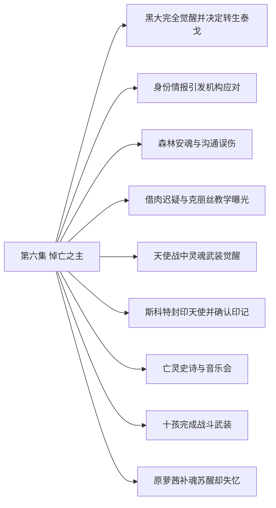

# 第六集 悼亡之主 · 剧情结构

[剧情目录](README.md) · [本集九维报告](../../vol06.md)

## 主线树

## 本集因果、伏笔与回收关系

| 起点 | 关系 | 终点 | 研究说明 |
|---|---|---|---|
| [黑大完全觉醒并决定转生泰戈](vol-06.md) | 铺垫 | [十孩完成战斗武装](vol-06.md) | 独立意识使黑大黑二自主塑造武装，而八个无意识孩子仍需代操。 |
| [森林安魂与沟通误伤](vol-06.md) | 因果 | [借肉迟疑与克丽丝教学曝光](vol-06.md) | 沟通误伤引战，冲火毁去外皮，随后需要活性肉引重建。 |
| [森林安魂与沟通误伤](vol-06.md) | 铺垫 | [亡灵史诗与音乐会](vol-06.md) | 首次安魂的有效性促成斯科特邀请罗得举办正式音乐会。 |
| [天使战中灵魂武装觉醒](vol-06.md) | 因果 | [斯科特封印天使并确认印记](vol-06.md) | 焚身本体威胁到亡者国度，亡灵及时干预并封印。 |
| [天使战中灵魂武装觉醒](vol-06.md) | 铺垫 | [十孩完成战斗武装](vol-06.md) | 战中灌甲经验成为后续受指导练习的起点。 |
| [斯科特封印天使并确认印记](vol-06.md) | 因果 | [原萝茜补魂苏醒却失忆](vol-06.md) | 天使被封印使残灵能够重聚，才有补魂苏醒条件。 |
| [亡灵史诗与音乐会](vol-06.md) | 铺垫 | [原萝茜补魂苏醒却失忆](vol-06.md) | 灵与魂的区分解释残灵补魂方案及其不等于完整记忆。 |
| [借肉迟疑与克丽丝教学曝光](vol-06.md) | 呼应 | [原萝茜补魂苏醒却失忆](vol-06.md) | 对娜娜的迟疑与对复活敌人的灭魂冲动相照，标出关爱的对象边界。 |

跨集联系见[全部语义关系](relations.md)与[跨集剧情线](README.md)。

## 事件、人物与认知依据

### 黑大完全觉醒并决定转生泰戈

判断类型：原文事实

病情与同行矛盾触发自主发言，身份确认后操控断开，黑大杀泰戈交黑龙转生。

人物：[黑龙](../cards/chr-9f2e5fcbba87455eb37e35869ea8854d.md)、[黑大](../cards/chr-632a4344b53f478a93f4d308f3890b92.md)、[泰戈](../cards/chr-d991a470980d4716bf4e09af3d17d913.md)

- 黑龙：知道；黑大的独立意识完全觉醒。

- 黑龙：怀疑；黑大可能早在泰戈反复诉说身份时逐渐觉醒。

| 章节 | 行号 | 判断类型 |
|---|---|---|
| ch-0057 第一章 黑大觉醒 | 6963–7008 | 原文事实 |

### 身份情报引发机构应对

判断类型：原文事实

疾风权衡关系，同盟封存秘密，教会另调暗之神骑雷奥。

人物：[疾风](../cards/chr-d403f485486b44e08a2fe1e3d87c7788.md)、[智狼](../cards/chr-0989216ff50241d5b42f4b36f221009b.md)、[安德鲁](../cards/chr-6c5caa9685ab4398b38fdff31ed8a6e5.md)、[雷奥](../cards/chr-8e211a51f4ef4c4b8e707cb02c88a5ed.md)、[谢菲里安](../cards/chr-18498ebcc9694896935e7cc590090228.md)

- 安德鲁：未知；神之骑士是否按所有元素组成。

| 章节 | 行号 | 判断类型 |
|---|---|---|
| ch-0059 第三章 神之骑士 | 7200–7226 | 原文事实 |
| ch-0058 第二章 人类更危险 | 7110–7145 | 原文事实 |

### 森林安魂与沟通误伤

判断类型：原文事实

罗得安魂止哀嚎，黑龙过量魂问伤使者，随后发生亡灵冲突。

人物：[黑龙](../cards/chr-9f2e5fcbba87455eb37e35869ea8854d.md)、[罗得宾士](../cards/chr-0d52140c20bf4dc5be05fbdc80d9ace1.md)、[斯文哥尔](../cards/chr-24438669720a4bb8a0a27cbd25eadb33.md)

- 黑龙：怀疑；往生者之地可能在哀嚎森林而非龙墓。

| 章节 | 行号 | 判断类型 |
|---|---|---|
| ch-0060 第四章 无尽哀嚎 | 7324–7397 | 原文事实 |

### 借肉迟疑与克丽丝教学曝光

判断类型：原文事实

火战毁皮后黑龙拟取娜娜肉却迟疑，改取水貂；娜娜治疗时说明克丽丝授术。

人物：[黑龙](../cards/chr-9f2e5fcbba87455eb37e35869ea8854d.md)、[娜娜](../cards/chr-1d629a39da3e41149707e5f9f636defd.md)、[艾琳](../cards/chr-29cb2b388f194a1c8b2e424c96dee814.md)、[星](../cards/chr-d2d3971153154607bb651d6a0c827216.md)、[小黑](../cards/chr-ce01e2c4f7a94666a6eae543890d7668.md)、[克丽丝](../cards/chr-d1af2401c91342228738940630a00180.md)

- 斯文哥尔：知道；娜娜项链中存在她称克丽丝姐姐的教学来源。

| 章节 | 行号 | 判断类型 |
|---|---|---|
| ch-0061 第五章 借点肉 | 7503–7578 | 原文事实 |

### 天使战中灵魂武装觉醒

判断类型：原文事实

龙焰躯体被毁，黑龙从黑大经验推导魂剑魂甲，天使试图焚身降本体。

人物：[黑龙](../cards/chr-9f2e5fcbba87455eb37e35869ea8854d.md)、[黑大](../cards/chr-632a4344b53f478a93f4d308f3890b92.md)、[星](../cards/chr-d2d3971153154607bb651d6a0c827216.md)、[月](../cards/chr-5c605c7ecd20495ca665d15c2bdf2562.md)、[降临战斗天使](../cards/chr-28754b20dc334559be252769e427bfad.md)

- 降临战斗天使：知道；黑龙是尚未成熟的悼亡级不死生物。

| 章节 | 行号 | 判断类型 |
|---|---|---|
| ch-0063 第七章 亡灵圣者 | 7721–7823 | 原文事实 |

### 斯科特封印天使并确认印记

判断类型：原文事实

数百亡灵束缚天使，斯科特禁咒封其本源，说明路标及悼亡层级。

人物：[斯科特](../cards/chr-60677b93fd18486dbb9f18d6de5f823f.md)、[黑龙](../cards/chr-9f2e5fcbba87455eb37e35869ea8854d.md)、[降临战斗天使](../cards/chr-28754b20dc334559be252769e427bfad.md)、[魅](../cards/chr-006089add9c541fe9bcda4dd5369d743.md)

- 黑龙：知道；亡灵印记由斯科特散播；紫色灵魂为悼亡之魂。

| 章节 | 行号 | 判断类型 |
|---|---|---|
| ch-0064 第八章 暗黑六芒星 | 7861–7897 | 原文事实 |

### 亡灵史诗与音乐会

判断类型：原文事实

史诗和斯科特解明国度历史及怨灵花，罗得琴歌使森林暂时安宁。

人物：[黑龙](../cards/chr-9f2e5fcbba87455eb37e35869ea8854d.md)、[斯科特](../cards/chr-60677b93fd18486dbb9f18d6de5f823f.md)、[罗得宾士](../cards/chr-0d52140c20bf4dc5be05fbdc80d9ace1.md)、[斯文哥尔](../cards/chr-24438669720a4bb8a0a27cbd25eadb33.md)

- 斯科特：未知；黑龙为何可从生命种族尸体快速吸能进化。

| 章节 | 行号 | 判断类型 |
|---|---|---|
| ch-0065 第九章 音乐的力量 | 7945–8081 | 原文事实 |

### 十孩完成战斗武装

判断类型：原文事实

黑龙练习塑甲，再引导八无意识孩子，黑大黑二自行完成不同武装。

人物：[黑龙](../cards/chr-9f2e5fcbba87455eb37e35869ea8854d.md)、[黑大](../cards/chr-632a4344b53f478a93f4d308f3890b92.md)、[黑二](../cards/chr-24b9d252fb624865a46d717832261c68.md)、[斯科特](../cards/chr-60677b93fd18486dbb9f18d6de5f823f.md)、[斯文哥尔](../cards/chr-24438669720a4bb8a0a27cbd25eadb33.md)

- 黑龙：知道；孩子们有灵魂之心可觉醒武装，但新套装尚未抗圣力实测。

| 章节 | 行号 | 判断类型 |
|---|---|---|
| ch-0066 第十章 战斗武装 | 8102–8162 | 原文事实 |

### 原萝茜补魂苏醒却失忆

判断类型：原文事实

为情报目的，黑龙补足原萝茜残灵所缺之魂；其复仇举动反噬，记忆残缺，魅看守。

人物：[拉西萝茜](../cards/chr-54e84c6e82214a26921887c503f519ee.md)、[黑龙](../cards/chr-9f2e5fcbba87455eb37e35869ea8854d.md)、[斯科特](../cards/chr-60677b93fd18486dbb9f18d6de5f823f.md)、[斯文哥尔](../cards/chr-24438669720a4bb8a0a27cbd25eadb33.md)、[魅](../cards/chr-006089add9c541fe9bcda4dd5369d743.md)

- 斯科特：知道；原萝茜的记忆随灵识破损，预定情报获取困难。

| 章节 | 行号 | 判断类型 |
|---|---|---|
| ch-0066 第十章 战斗武装 | 8177–8214 | 原文事实 |

## 本集当时的剧情线判断

这是分集历史判断，后续回收结果以跨集终点页为准。

### 第6集 · 孩子的独立意识

当时状态：部分回收

其他八个孩子如何获得灵识？

黑大完整觉醒明确，八孩仍无意识；斯科特给出灵魂框架但无法解释异常成长。

[查看全书终点判断](threads/book-c55cdb2efcb4.md)

### 第6集 · 自由与同伴边界

当时状态：部分回收

黑龙如何协调同伴意愿、保护与自由？

对黑大授权、对娜娜犹豫、音乐显示伙伴价值；强制转生伦理未结束。

[查看全书终点判断](threads/book-37dd82abc178.md)

### 第6集 · 克丽丝的身份与教学

当时状态：部分回收

沉渊木中的克丽丝究竟是谁，如何影响娜娜？

娜娜明确称其教冥月抚慰，队友开始知情；女神身份仍未验证。

[查看全书终点判断](threads/book-e90db68cb625.md)

### 第6集 · 娜娜的保护与主动性

当时状态：部分回收

娜娜能否在被保护之外表达自己的选择？

她愿献肉并保护宠物，法术学习展现主动性；仍是队伍唯一明确活人。

[查看全书终点判断](threads/book-cb9c67d1cdae.md)

### 第6集 · 萝茜与降临天使

当时状态：部分回收

原萝茜会恢复多少自我，封印天使会否重返？

天使和原人格明确分离；天使封存，原萝茜补魂成不死者却失忆。

[查看全书终点判断](threads/book-09f441653222.md)

### 第6集 · 红月落处的呼唤

当时状态：已回收

亡灵印记的发出者和目的地是谁、何处？

本集斯科特确认自己散播印记，往生者国度在哀嚎森林；只解决定位和发出者，不等于所有进化谜题完成。

[查看全书终点判断](threads/book-d9427f2553c6.md)

### 第6集 · 沙漠历史与悼亡力量

当时状态：部分回收

古战场与悼亡传承还隐藏哪些历史？

沙漠源于远古大战得到叙述解释；战因胜负和黑龙特殊成长仍未明，骨色尚未证变紫金。

[查看全书终点判断](threads/book-2c92e5ad3024.md)

### 第6集 · 吸魂与异族伦理

当时状态：未回收

公平看待异族风险能否兼容对实际杀戮的约束？

顾问反省偏见仍担心斯科特鼓励吸魂，伦理张力并未因反问消除。

[查看全书终点判断](threads/book-4e6bf7ea8c15.md)

### 第6集 · 神之骑士追索

当时状态：未回收

雷奥将如何处理黑龙，教皇为何同时使用本界武力？

暗之神骑出岛，尚未接触主队。

[查看全书终点判断](threads/book-8477942e0118.md)

### 第6集 · 罗得的音乐与未明往事

当时状态：部分回收

安魂创作会怎样发展，亡妻线将何时重返？

安魂用途与琴歌能力被验证，新曲灵感出现；亡妻现状没有新增答案。

[查看全书终点判断](threads/book-bd3759586c4a.md)
