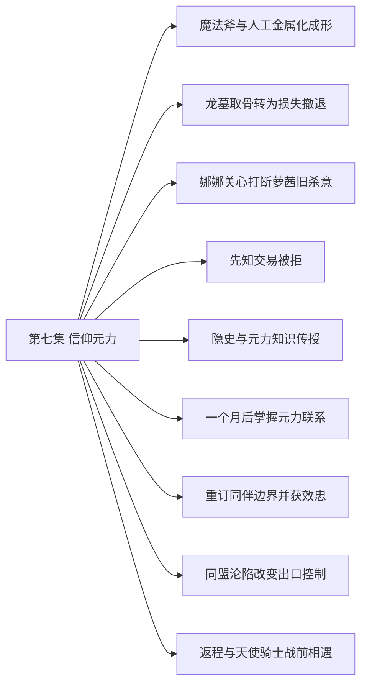

# 第七集 信仰元力 · 剧情结构

[剧情目录](README.md) · [本集九维报告](../../vol07.md)

## 主线树

## 本集因果、伏笔与回收关系

| 起点 | 关系 | 终点 | 研究说明 |
|---|---|---|---|
| [魔法斧与人工金属化成形](vol-07.md) | 铺垫 | [龙墓取骨转为损失撤退](vol-07.md) | 制造出的三十具金属骷髅进入龙墓实战，强度与关节弱点同时接受检验。 |
| [龙墓取骨转为损失撤退](vol-07.md) | 因果 | [先知交易被拒](vol-07.md) | 亲历墓地实力与同伴损失，使黑龙拒绝更高风险的取石方案。 |
| [先知交易被拒](vol-07.md) | 铺垫 | [隐史与元力知识传授](vol-07.md) | 斯科特追问并认可风险判断后，才交出天使和隐瞒的历史；考察关联由效忠说明补证。 |
| [隐史与元力知识传授](vol-07.md) | 因果 | [一个月后掌握元力联系](vol-07.md) | 封存天使意念提供运用方法，黑龙经过一个月消化取得元力感知。 |
| [一个月后掌握元力联系](vol-07.md) | 因果 | [重订同伴边界并获效忠](vol-07.md) | 成长与扩军计划加深斯文恐惧，持续劝阻引发关系摊牌。 |
| [龙墓取骨转为损失撤退](vol-07.md) | 铺垫 | [重订同伴边界并获效忠](vol-07.md) | 不让孩子挑战过强力量的决策成为斯科特判断君王资格的依据。 |
| [同盟沦陷改变出口控制](vol-07.md) | 因果 | [返程与天使骑士战前相遇](vol-07.md) | 出口被控制和雷奥持续定位让安德鲁绕行到返程方向完成拦截。 |

跨集联系见[全部语义关系](relations.md)与[跨集剧情线](README.md)。

## 事件、人物与认知依据

### 魔法斧与人工金属化成形

判断类型：原文事实

斯文协助造斧，黑龙与斯科特以无形置换制造金属骷髅，发现附肉和产能限制。

人物：[黑龙](../cards/chr-9f2e5fcbba87455eb37e35869ea8854d.md)、[斯文哥尔](../cards/chr-24438669720a4bb8a0a27cbd25eadb33.md)、[斯科特](../cards/chr-60677b93fd18486dbb9f18d6de5f823f.md)

- 斯文哥尔：怀疑；金属魔法排斥可能造成附肉失败。

| 章节 | 行号 | 判断类型 |
|---|---|---|
| ch-0068 第一章 暗黑元素体 | 8263–8298 | 原文事实 |
| ch-0069 第二章 伟大的实验 | 8478–8529 | 原文事实 |
| ch-0070 第三章 龙族墓地 | 8559–8569 | 原文事实 |

### 龙墓取骨转为损失撤退

判断类型：原文事实

小骨龙被制服，大骨龙试探遭误伤；怒杀触发群龙追击，七具金属骷髅损失，黑七重伤。

人物：[黑龙](../cards/chr-9f2e5fcbba87455eb37e35869ea8854d.md)、[黑大](../cards/chr-632a4344b53f478a93f4d308f3890b92.md)、[黑二](../cards/chr-24b9d252fb624865a46d717832261c68.md)、[黑七](../cards/chr-775349c3c9654daaae30acf69aadff21.md)、[斯科特](../cards/chr-60677b93fd18486dbb9f18d6de5f823f.md)

- 读者：知道；大骨龙最初伸爪是试探，黑龙等人误认为威胁。

| 章节 | 行号 | 判断类型 |
|---|---|---|
| ch-0070 第三章 龙族墓地 | 8718–8731 | 原文事实 |
| ch-0071 第四章 怒龙咆哮 | 8848–8859 | 原文事实 |
| ch-0071 第四章 怒龙咆哮 | 8892–8899 | 原文事实 |

### 娜娜关心打断萝茜旧杀意

判断类型：原文事实

失忆萝茜因娜娜本名生杀意又因关心消退，背后阴影匕首随之消散。

人物：[拉西萝茜](../cards/chr-54e84c6e82214a26921887c503f519ee.md)、[娜娜](../cards/chr-1d629a39da3e41149707e5f9f636defd.md)

- 拉西萝茜：未知；自己为何记得某些名字并对它们产生敌意。

- 读者：知道；异端名单留下姓名触发，且现场存在隐蔽保护。

| 章节 | 行号 | 判断类型 |
|---|---|---|
| ch-0071 第四章 怒龙咆哮 | 8735–8776 | 原文事实 |

### 先知交易被拒

判断类型：原文事实

先知以誓约和安息石情报求破约自由，黑龙因龙岛风险拒绝；先知独处显龙亡灵形态。

人物：[黑龙](../cards/chr-9f2e5fcbba87455eb37e35869ea8854d.md)、[斯科特](../cards/chr-60677b93fd18486dbb9f18d6de5f823f.md)、[米勒达布隆迪](../cards/chr-4aafb8822bf64bb099f0e9abe3ae67c9.md)

- 黑龙：怀疑；先知说了真话，但隐瞒部分事情。

- 读者：知道；先知能够显现龙亡灵形态。

| 章节 | 行号 | 判断类型 |
|---|---|---|
| ch-0072 第五章 龙魂誓约 | 9021–9046 | 原文事实 |
| ch-0073 第六章 生死之战 | 9050–9088 | 原文事实 |

### 隐史与元力知识传授

判断类型：原文事实

斯科特承认隐瞒，讲述古帝国兴亡和君王依赖链，并以封存天使提供元力运用知识。

人物：[斯科特](../cards/chr-60677b93fd18486dbb9f18d6de5f823f.md)、[黑龙](../cards/chr-9f2e5fcbba87455eb37e35869ea8854d.md)、[斯文哥尔](../cards/chr-24438669720a4bb8a0a27cbd25eadb33.md)、[罗得宾士](../cards/chr-0d52140c20bf4dc5be05fbdc80d9ace1.md)

- 斯科特：未知；不死帝国大陆为何消失。

| 章节 | 行号 | 判断类型 |
|---|---|---|
| ch-0073 第六章 生死之战 | 9089–9116 | 原文事实 |
| ch-0073 第六章 生死之战 | 9203–9216 | 原文事实 |
| ch-0074 第七章 信仰元力 | 9221–9240 | 原文事实 |

### 一个月后掌握元力联系

判断类型：原文事实

黑龙消化天使意念后醒来，短暂威压引跪拜，收束后能感到远端部属传来能量。

人物：[黑龙](../cards/chr-9f2e5fcbba87455eb37e35869ea8854d.md)、[斯科特](../cards/chr-60677b93fd18486dbb9f18d6de5f823f.md)、[斯文哥尔](../cards/chr-24438669720a4bb8a0a27cbd25eadb33.md)、[艾琳](../cards/chr-29cb2b388f194a1c8b2e424c96dee814.md)

- 黑龙：知道；更多灵魂联系能增加元力积累，但仍无力唤醒所有感知到的同类。

| 章节 | 行号 | 判断类型 |
|---|---|---|
| ch-0074 第七章 信仰元力 | 9241–9291 | 原文事实 |

### 重订同伴边界并获效忠

判断类型：原文事实

黑龙收回针对斯文的杀意，明确自由存在目标；斯科特献上没有死亡连带作用的忠诚誓言。

人物：[黑龙](../cards/chr-9f2e5fcbba87455eb37e35869ea8854d.md)、[斯文哥尔](../cards/chr-24438669720a4bb8a0a27cbd25eadb33.md)、[艾琳](../cards/chr-29cb2b388f194a1c8b2e424c96dee814.md)、[黑大](../cards/chr-632a4344b53f478a93f4d308f3890b92.md)、[黑二](../cards/chr-24b9d252fb624865a46d717832261c68.md)、[斯科特](../cards/chr-60677b93fd18486dbb9f18d6de5f823f.md)

- 斯文哥尔：知道；黑龙已看穿自己优先顾虑人类的立场。

| 章节 | 行号 | 判断类型 |
|---|---|---|
| ch-0075 第八章 同盟瓦解 | 9369–9445 | 原文事实 |

### 同盟沦陷改变出口控制

判断类型：原文事实

同盟军和自然神殿被击败，安德鲁知道神明层面败亡；教会控制两处沙漠出口并按雷奥定位改道。

人物：[安德鲁](../cards/chr-6c5caa9685ab4398b38fdff31ed8a6e5.md)、[雷奥](../cards/chr-8e211a51f4ef4c4b8e707cb02c88a5ed.md)

- 安德鲁：知道；雷奥可以持续提供目标方位；自然之神已殒落。

| 章节 | 行号 | 判断类型 |
|---|---|---|
| ch-0075 第八章 同盟瓦解 | 9446–9509 | 原文事实 |

### 返程与天使骑士战前相遇

判断类型：原文事实

黑七与法师等留后，黑龙带九孩返程；黑大银丝侦察引敌误读，黑龙凭既有灵魂运用和武装决定正面应战，列奥纳布双层盾墙等冲撞。

人物：[黑龙](../cards/chr-9f2e5fcbba87455eb37e35869ea8854d.md)、[黑大](../cards/chr-632a4344b53f478a93f4d308f3890b92.md)、[银丝](../cards/chr-6397f22d0a5f47f0901efd4f2cc15ed0.md)、[列奥纳](../cards/chr-0fad76b4afcc497bb7f56e8245aa0273.md)、[安德鲁](../cards/chr-6c5caa9685ab4398b38fdff31ed8a6e5.md)

- 列奥纳：误以为；银丝与黑大是具完整上位银龙威胁的龙骑组合，并有意耀武扬威。

| 章节 | 行号 | 判断类型 |
|---|---|---|
| ch-0075 第八章 同盟瓦解 | 9510–9521 | 原文事实 |
| ch-0076 第九章 光与暗的重逢 | 9543–9569 | 原文事实 |
| ch-0076 第九章 光与暗的重逢 | 9569–9576 | 原文事实 |
| ch-0076 第九章 光与暗的重逢 | 9585–9605 | 原文事实 |

## 本集当时的剧情线判断

这是分集历史判断，后续回收结果以跨集终点页为准。

### 第7集 · 求力远征与龙墓

当时状态：部分回收

龙墓与龙岛资源是否仍值得追求？

已进入龙墓并承担损失，安息石路线被当前判断拒绝；不等于相关地点或力量线索永久结束。

[查看全书终点判断](threads/book-77f072ce087d.md)

### 第7集 · 龙魂誓约与先知

当时状态：未回收

先知还隐瞒什么，龙岛衰败说是否可靠？

誓约解释及求自由动机由先知提供，读者见其龙形；尚未破约或前往龙岛。

[查看全书终点判断](threads/book-bf7a72bd8f37.md)

### 第7集 · 自由存在与同伴自主

当时状态：部分回收

黑龙的自由是否容得下同伴真正拒绝和退出？

他珍惜同伴并克制杀意，重订合作边界；深层支配关系仍未解除。

[查看全书终点判断](threads/book-37dd82abc178.md)

### 第7集 · 萝茜残存身份与天使分离

当时状态：部分回收

萝茜能否重建自我，旧杀意是否会再次支配行动？

萝茜作为失忆不死者与娜娜互动，独立封存天使被黑龙吸收；两者未混为一个人格。

[查看全书终点判断](threads/book-09f441653222.md)

### 第7集 · 不死帝国失踪与君王力量

当时状态：部分回收

大陆为何消失，悼亡之魂还能怎样成长？

古战争与元力联系获得口述解释和局部实证；大陆失踪原因仍未知，黑龙远未具古君王战力。

[查看全书终点判断](threads/book-2c92e5ad3024.md)

### 第7集 · 暗之神骑的身份与追踪

当时状态：未回收

雷奥何以在光明教会任职并持续定位？

追踪已造成拦截，机制、私人动机及异常表情尚未解释。

[查看全书终点判断](threads/book-8477942e0118.md)

### 第7集 · 同盟战局与神明力量

当时状态：部分回收

同盟败亡后黑龙的生存空间如何变化？

两处出口落入教会范围并形成追捕；宏观战局不能由这一次拦截就视为全书终局。

[查看全书终点判断](threads/book-db9eea600737.md)
