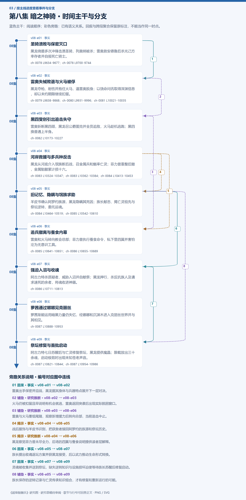

# 第八集 暗之神骑 · 剧情结构

[剧情目录](README.md) · [本集九维报告](../../vol08.md)

## 主线时间与分支图片

[PNG原尺寸](images/vol-08.png) · [SVG矢量图](images/vol-08.svg) · [全书图片目录](images.md)

## 本集因果、伏笔与回收关系

| 起点 | 关系 | 终点 | 研究说明 |
|---|---|---|---|
| [圣骑溃败与保密灭口](vol-08.md) | 因果 | [雷奥失械败退与火马被俘](vol-08.md) | 雷奥出手保密并迎战，黑龙据其身体与兵器特点展开下一层对决。 |
| [雷奥失械败退与火马被俘](vol-08.md) | 铺垫 | [黑四受创引出追击失守](vol-08.md) | 火马仍被扣留且早说明有机会就逃，雷奥返回突袭后出现实际脱困窗口。 |
| [黑四受创引出追击失守](vol-08.md) | 铺垫 | [追兵撤离与蚕食内幕](vol-08.md) | 雷奥与火马重组尾随，观察新增援力后转向总部，当前追击中止。 |
| [河岸救援与多兵种反击](vol-08.md) | 揭示 | [旧记忆、隐瞒与氓族求助](vol-08.md) | 战后服饰与羊皮书识别，把获救者接回阿罗约的族源和祭坛历史。 |
| [河岸救援与多兵种反击](vol-08.md) | 揭示 | [追兵撤离与蚕食内幕](vol-08.md) | 黑龙察觉菲力普未尽全力，后场的四翼与蚕食说明提供读者层解释。 |
| [旧记忆、隐瞒与氓族求助](vol-08.md) | 因果 | [强迫入沼与收魂](vol-08.md) | 族长提出收魂返坛方案并获黑龙接受，后以武力推动生命形式转换。 |
| [强迫入沼与收魂](vol-08.md) | 因果 | [祭坛修复与首批启动](vol-08.md) | 灵魂被收集并送到祭坛，缺失逆转知识与设施损坏迫使等待族长苏醒后修复启动。 |
| [旧记忆、隐瞒与氓族求助](vol-08.md) | 铺垫 | [祭坛修复与首批启动](vol-08.md) | 族长保存的逆转记录与亡灵传承知识组合，才有修复和重新运行的可能。 |

跨集联系见[全部语义关系](relations.md)与[跨集剧情线](README.md)。

## 事件、人物与认知依据

### 圣骑溃败与保密灭口

判断类型：原文事实

黑龙绕盾多次冲锋击溃圣骑，列奥纳被杀；雷奥救安德鲁后杀光己方幸存者并自报死亡骑士。

人物：[黑龙](../cards/chr-9f2e5fcbba87455eb37e35869ea8854d.md)、[黑大](../cards/chr-632a4344b53f478a93f4d308f3890b92.md)、[黑二](../cards/chr-24b9d252fb624865a46d717832261c68.md)、[列奥纳](../cards/chr-0fad76b4afcc497bb7f56e8245aa0273.md)、[安德鲁](../cards/chr-6c5caa9685ab4398b38fdff31ed8a6e5.md)、[雷奥](../cards/chr-8e211a51f4ef4c4b8e707cb02c88a5ed.md)

- 安德鲁：怀疑；教皇安排随行骑士时，可能已经预定他们牺牲。

- 黑龙：知道；雷奥是不死死亡骑士，却属于光明教会。

| 章节 | 行号 | 判断类型 |
|---|---|---|
| ch-0078 第一章 不堪一击 | 9634–9677 | 原文事实 |
| ch-0078 第一章 不堪一击 | 9700–9744 | 原文事实 |

### 雷奥失械败退与火马被俘

判断类型：原文事实

黑龙夺枪、耐伤并抱住火马，逼雷奥脱身；以饶命问讯取得深渊信息，却以未约期限继续扣留。

人物：[黑龙](../cards/chr-9f2e5fcbba87455eb37e35869ea8854d.md)、[黑二](../cards/chr-24b9d252fb624865a46d717832261c68.md)、[雷奥](../cards/chr-8e211a51f4ef4c4b8e707cb02c88a5ed.md)、[哥顿普](../cards/chr-968add4b94d440cbabc01e3b0558d55d.md)

- 雷奥：知道；黑龙有肉体但真实骨体是悼亡紫金骷髅，胸口不是灵魂要害。

- 黑龙：知道；哥顿普说神骑守安息深渊出口，亲见六位但不知道总数。

| 章节 | 行号 | 判断类型 |
|---|---|---|
| ch-0079 第二章 重伤不死战马 | 9838–9868 | 原文事实 |
| ch-0080 第三章 忠心护主 | 9931–9996 | 原文事实 |
| ch-0081 第四章 聒噪的火焰马 | 10021–10035 | 原文事实 |

### 黑四受创引出追击失守

判断类型：原文事实

雷奥斩断黑四颈，黑龙召公爵图克并全员追敌，火马趁机逃跑；黑四换普通上半身。

人物：[黑龙](../cards/chr-9f2e5fcbba87455eb37e35869ea8854d.md)、[黑四](../cards/chr-cfa1e622ca004631bfd0e1642a22e7a8.md)、[图克](../cards/chr-6ebb35c20edf4908b3b64159c8fd7a73.md)、[雷奥](../cards/chr-8e211a51f4ef4c4b8e707cb02c88a5ed.md)、[哥顿普](../cards/chr-968add4b94d440cbabc01e3b0558d55d.md)

- 黑龙：知道；黑四魂心无伤可换体，图克已晋公爵。

| 章节 | 行号 | 判断类型 |
|---|---|---|
| ch-0082 第五章 调虎离山 | 10173–10227 | 原文事实 |

### 河岸救援与多兵种反击

判断类型：原文事实

黑龙从河底介入氓族断后战，召金属兵和魅率亡灵；菲力普重整后撤，金属骷髅累计损十六。

人物：[黑龙](../cards/chr-9f2e5fcbba87455eb37e35869ea8854d.md)、[黑大](../cards/chr-632a4344b53f478a93f4d308f3890b92.md)、[阿古力特](../cards/chr-37825d4ef6be40189c50d630eb315f4c.md)、[菲力普](../cards/chr-f5b27f27591c4a9f9b29844c3ab97ee0.md)、[斯科特](../cards/chr-60677b93fd18486dbb9f18d6de5f823f.md)、[魅](../cards/chr-006089add9c541fe9bcda4dd5369d743.md)

- 黑龙：怀疑；菲力普有顾忌并未使尽全力，继续追击没有胜算保证。

| 章节 | 行号 | 判断类型 |
|---|---|---|
| ch-0083 第六章 屠戮 | 10324–10347 | 原文事实 |
| ch-0083 第六章 屠戮 | 10362–10384 | 原文事实 |
| ch-0084 第七章 阿罗约之源 | 10413–10453 | 原文事实 |

### 旧记忆、隐瞒与氓族求助

判断类型：原文事实

羊皮书确认阿罗约族源，黑龙隐瞒其死因；族长献忠、揭亡灵祖先与祭坛逆转，委托运魂。

人物：[黑龙](../cards/chr-9f2e5fcbba87455eb37e35869ea8854d.md)、[阿古力特](../cards/chr-37825d4ef6be40189c50d630eb315f4c.md)、[阿罗约](../cards/chr-c128fbc5576e4683b433463c7468e03d.md)、[图克](../cards/chr-6ebb35c20edf4908b3b64159c8fd7a73.md)

- 阿古力特：未知；阿罗约已被黑龙杀害，其记忆被吸收。

- 黑龙：知道；族长说氓族先祖由亡灵逆转为人，族人魂可藏于亡魂之界等待转生。

| 章节 | 行号 | 判断类型 |
|---|---|---|
| ch-0084 第七章 阿罗约之源 | 10464–10519 | 原文事实 |
| ch-0085 第八章 过往的交集 | 10542–10610 | 原文事实 |

### 追兵撤离与蚕食内幕

判断类型：原文事实

雷奥和火马转向教会总部；菲力普执行蚕食命令，私下显四翼并害怕沦为无意识工具。

人物：[雷奥](../cards/chr-8e211a51f4ef4c4b8e707cb02c88a5ed.md)、[哥顿普](../cards/chr-968add4b94d440cbabc01e3b0558d55d.md)、[菲力普](../cards/chr-f5b27f27591c4a9f9b29844c3ab97ee0.md)、[古瓦](../cards/chr-045b64955da642fab323c6657e39c410.md)

- 读者：知道；菲力普是力天使，继续保留敌手涉及组织存在价值。

- 黑龙：未知；菲力普未再追来及雷奥离开的具体后场原因。

| 章节 | 行号 | 判断类型 |
|---|---|---|
| ch-0085 第八章 过往的交集 | 10641–10651 | 原文事实 |
| ch-0086 第九章 氓族图存 | 10655–10689 | 原文事实 |

### 强迫入沼与收魂

判断类型：原文事实

阿古力特杀质疑者、威胁入沼并自献祭；黑龙押行，杀反抗族人及请求速死的余者，将魂收进神器。

人物：[阿古力特](../cards/chr-37825d4ef6be40189c50d630eb315f4c.md)、[黑龙](../cards/chr-9f2e5fcbba87455eb37e35869ea8854d.md)、[图克](../cards/chr-6ebb35c20edf4908b3b64159c8fd7a73.md)、[魅](../cards/chr-006089add9c541fe9bcda4dd5369d743.md)、[黑大](../cards/chr-632a4344b53f478a93f4d308f3890b92.md)

- 读者：知道；族人没有得到充分说明，部分服从源于武力威胁，实际转生尚未验证。

| 章节 | 行号 | 判断类型 |
|---|---|---|
| ch-0086 第九章 氓族图存 | 10711–10813 | 原文事实 |

### 萝茜通过娜娜见克丽丝

判断类型：原文事实

萝茜渐能运用暗黑力量仍失忆，经娜娜和沉渊木进入克丽丝世界并与其相见。

人物：[拉西萝茜](../cards/chr-54e84c6e82214a26921887c503f519ee.md)、[娜娜](../cards/chr-1d629a39da3e41149707e5f9f636defd.md)、[克丽丝](../cards/chr-d1af2401c91342228738940630a00180.md)

- 拉西萝茜：未知；自己暗黑力量的来源以及克丽丝认为身体特殊的原因。

| 章节 | 行号 | 判断类型 |
|---|---|---|
| ch-0087 第十章 之希望 | 10888–10953 | 原文事实 |

### 祭坛修复与首批启动

判断类型：原文事实

阿古力特七日苏醒后与亡灵修复祭坛，黑龙提供魔晶；限载放出三十余魂，启动极致时出现未知苍老声音。

人物：[阿古力特](../cards/chr-37825d4ef6be40189c50d630eb315f4c.md)、[黑龙](../cards/chr-9f2e5fcbba87455eb37e35869ea8854d.md)、[图克](../cards/chr-6ebb35c20edf4908b3b64159c8fd7a73.md)

- 读者：未知；苍老声音身份及首批灵魂最终转生结果。

| 章节 | 行号 | 判断类型 |
|---|---|---|
| ch-0087 第十章 之希望 | 10821–10844 | 原文事实 |
| ch-0087 第十章 之希望 | 10954–10986 | 原文事实 |

## 本集当时的剧情线判断

这是分集历史判断，后续回收结果以跨集终点页为准。

### 第8集 · 死亡骑士的教会身份

当时状态：部分回收

雷奥为何替教会服务，如何持续定位并遮蔽自身？

死亡骑士及深渊镇守岗位已揭，火马救回并转向总部；动机和定位机制未回收。

[查看全书终点判断](threads/book-8477942e0118.md)

### 第8集 · 自由目标与支配手段

当时状态：未回收

黑龙的保护、承诺和自由如何面对他人的拒绝？

他珍惜孩子、求取情报，但扣俘、隐瞒和强迫运魂继续扩大控制；未形成价值和解。

[查看全书终点判断](threads/book-37dd82abc178.md)

### 第8集 · 阿罗约记忆与被隐藏的旧杀戮

当时状态：未回收

氓族若得知阿罗约真实遭遇，联盟会如何改变？

族源得到确认，记忆亲近与撒谎同时成立；族长仍不知死因，未能评价这项隐瞒。

[查看全书终点判断](threads/book-49e8bb5d0f08.md)

### 第8集 · 祭坛逆转与氓族存续

当时状态：部分回收

被保存的灵魂能否顺利重生，其人格和意愿会怎样延续？

祖先逆转史由族长讲述，设施修复完成、首批三十余魂启动；全部转生结果尚未揭示。

[查看全书终点判断](threads/book-994cfa997ae2.md)

### 第8集 · 教会工具与蚕食计划

当时状态：未回收

教会为何保留敌手，菲力普如何保有自我意识？

骑士被灭口和力天使自言揭示组织利益与工具化恐惧；不能据此确定教皇所有意图。

[查看全书终点判断](threads/book-02ba45413b1e.md)

### 第8集 · 萝茜的新力量与自我重建

当时状态：部分回收

暗黑力量如何形成，克丽丝将怎样看待其特殊身体？

原萝茜仍失忆，通过娜娜获得新关系；见克丽丝不等于治疗或记忆恢复。

[查看全书终点判断](threads/book-09f441653222.md)

### 第8集 · 图克与祭坛来历

当时状态：未回收

图克如何诞生，结尾声音与其守护使命有何关系？

公爵与忠诚变化明确，图克不知道逆转前史；启动景象令他熟悉，声音身份未明。

[查看全书终点判断](threads/book-1a972091c7f4.md)
