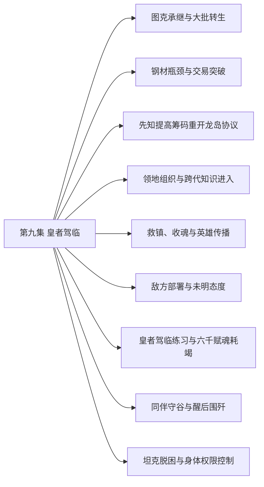

# 第九集 皇者驾临 · 剧情结构

[剧情目录](README.md) · [本集九维报告](../../vol09.md)

## 主线树

## 本集因果、伏笔与回收关系

| 起点 | 关系 | 终点 | 研究说明 |
|---|---|---|---|
| [图克承继与大批转生](vol-09.md) | 因果 | [领地组织与跨代知识进入](vol-09.md) | 大批转生和先人记忆为领地建设提供人口与知识。 |
| [钢材瓶颈与交易突破](vol-09.md) | 因果 | [领地组织与跨代知识进入](vol-09.md) | 首批钢材使骷髅强化可以启动，而建设与制造争用劳力。 |
| [救镇、收魂与英雄传播](vol-09.md) | 因果 | [敌方部署与未明态度](vol-09.md) | e05中沿途消灭小队这一部分促成e06中菲力普派队调查；不表示后段英雄传播造成前段敌方部署。 |
| [皇者驾临练习与六千赋魂耗竭](vol-09.md) | 因果 | [同伴守谷与醒后围歼](vol-09.md) | 主角耗竭未下令使队伍无法撤离，同伴守谷遭循痕搜查。 |
| [敌方部署与未明态度](vol-09.md) | 铺垫 | [同伴守谷与醒后围歼](vol-09.md) | e06中菲力普派出调查的小队成为谷地对手；不把该聚合事件中的其他敌方行动视为此次围谷原因。 |
| [皇者驾临练习与六千赋魂耗竭](vol-09.md) | 因果 | [坦克脱困与身体权限控制](vol-09.md) | 耗竭先抽空战魂，后补魂时双方恢复差使其脱困。 |
| [皇者驾临练习与六千赋魂耗竭](vol-09.md) | 回收 | [坦克脱困与身体权限控制](vol-09.md) | 控尸时细分动作的经验用于检验战魂躯体控制。 |

跨集联系见[全部语义关系](relations.md)与[跨集剧情线](README.md)。

## 事件、人物与认知依据

### 图克承继与大批转生

判断类型：原文事实

旧领主烙印进入图克，守护和诅咒源头揭开；三千余混合灵魂转生，力王等在威胁下奉誓。

人物：[黑龙](../cards/chr-9f2e5fcbba87455eb37e35869ea8854d.md)、[图克](../cards/chr-6ebb35c20edf4908b3b64159c8fd7a73.md)、[阿古力特](../cards/chr-37825d4ef6be40189c50d630eb315f4c.md)、[力王](../cards/chr-56668b9d826140aa9811b4868084db8f.md)

- 图克：知道；记忆得到传承，但现有主体仍是自己，力量未直接继承。

| 章节 | 行号 | 判断类型 |
|---|---|---|
| ch-0089 第一章 瓜瓞绵绵 | 11014–11046 | 原文事实 |
| ch-0089 第一章 瓜瓞绵绵 | 11084–11126 | 原文事实 |

### 钢材瓶颈与交易突破

判断类型：原文事实

斯文产能不足促黑龙入城；海图招揽失败，疾风订每月五十吨口头供货并备首批。

人物：[黑龙](../cards/chr-9f2e5fcbba87455eb37e35869ea8854d.md)、[斯文哥尔](../cards/chr-24438669720a4bb8a0a27cbd25eadb33.md)、[梅丽雅](../cards/chr-36d3c517958f4eff803a6713817b254f.md)、[疾风](../cards/chr-d403f485486b44e08a2fe1e3d87c7788.md)

- 梅丽雅：怀疑；黑龙大量索物可能代表隐藏实力。

| 章节 | 行号 | 判断类型 |
|---|---|---|
| ch-0090 第二章 使命 | 11180–11193 | 原文事实 |
| ch-0090 第二章 使命 | 11319–11357 | 原文事实 |
| ch-0091 第三章 接二连三的请托 | 11515–11532 | 原文事实 |
| ch-0091 第三章 接二连三的请托 | 11418–11422 | 原文事实 |

### 先知提高筹码重开龙岛协议

判断类型：原文事实

先知承认龙灵分身及关键隐瞒，以全墓忠诚求取安息石，黑龙答应但暂不赴险。

人物：[黑龙](../cards/chr-9f2e5fcbba87455eb37e35869ea8854d.md)、[斯科特](../cards/chr-60677b93fd18486dbb9f18d6de5f823f.md)、[米勒达布隆迪](../cards/chr-4aafb8822bf64bb099f0e9abe3ae67c9.md)

- 黑龙：知道；安息石用于解封，先知此前隐去了关键功能。

| 章节 | 行号 | 判断类型 |
|---|---|---|
| ch-0091 第三章 接二连三的请托 | 11374–11394 | 原文事实 |
| ch-0091 第三章 接二连三的请托 | 11423–11458 | 原文事实 |

### 领地组织与跨代知识进入

判断类型：原文事实

跨段聚合：先祖拜见、斯科特限借，斯文与族人共建领地；后段规划辩论扩展到文化商业，另记泰戈醒来待检，并非同一时点的一场会议。

人物：[黑龙](../cards/chr-9f2e5fcbba87455eb37e35869ea8854d.md)、[斯文哥尔](../cards/chr-24438669720a4bb8a0a27cbd25eadb33.md)、[阿古力特](../cards/chr-37825d4ef6be40189c50d630eb315f4c.md)、[毕瑟格林](../cards/chr-b72287e437f54ec19819a94091f46ce3.md)、[图克](../cards/chr-6ebb35c20edf4908b3b64159c8fd7a73.md)、[斯科特](../cards/chr-60677b93fd18486dbb9f18d6de5f823f.md)、[泰戈](../cards/chr-d991a470980d4716bf4e09af3d17d913.md)

- 斯文哥尔：怀疑；泰戈弹跳提升可能意味着身体已显著强化。

| 章节 | 行号 | 判断类型 |
|---|---|---|
| ch-0092 第四章 一展长才 | 11564–11614 | 原文事实 |
| ch-0095 第七章 暗之改变 | 12308–12380 | 原文事实 |

### 救镇、收魂与英雄传播

判断类型：原文事实

跨段追踪：黑龙为魂骨消灭屠镇敌军，同伴救助平民，老罗格残魂异常；后段回叙救民事迹被群众和反抗组织传播。

人物：[黑龙](../cards/chr-9f2e5fcbba87455eb37e35869ea8854d.md)、[老罗格](../cards/chr-d453bb3977604493ac8c1941df6c8389.md)、[艾琳](../cards/chr-29cb2b388f194a1c8b2e424c96dee814.md)、[罗得宾士](../cards/chr-0d52140c20bf4dc5be05fbdc80d9ace1.md)、[星](../cards/chr-d2d3971153154607bb651d6a0c827216.md)、[月](../cards/chr-5c605c7ecd20495ca665d15c2bdf2562.md)

- 老罗格：误以为；临死看到黑龙来军，认作神明显灵回应祈祷。

- 读者：知道；黑龙的直接目的为魂骨，英雄传说由受救者与组织再加工。

| 章节 | 行号 | 判断类型 |
|---|---|---|
| ch-0092 第四章 一展长才 | 11656–11683 | 原文事实 |
| ch-0092 第四章 一展长才 | 11707–11745 | 原文事实 |
| ch-0095 第七章 暗之改变 | 12279–12307 | 原文事实 |

### 敌方部署与未明态度

判断类型：原文事实

穿插于多章的敌方行动：安德鲁动摇回圣山，雷奥获噬魂，菲力普派队查失踪；到黑龙赋魂释能时，教皇和菲力普感到强波动却未出手。

人物：[安德鲁](../cards/chr-6c5caa9685ab4398b38fdff31ed8a6e5.md)、[雷奥](../cards/chr-8e211a51f4ef4c4b8e707cb02c88a5ed.md)、[哥顿普](../cards/chr-968add4b94d440cbabc01e3b0558d55d.md)、[教皇](../cards/chr-fa5f928c72f34e6292fef0b12b0579e9.md)、[菲力普](../cards/chr-f5b27f27591c4a9f9b29844c3ab97ee0.md)

- 安德鲁：怀疑；自己也可能因教皇需要掩饰秘密而被牺牲。

- 读者：知道；菲力普私下嘲弄骑士誓言，但尚不知其真实目的。

| 章节 | 行号 | 判断类型 |
|---|---|---|
| ch-0090 第二章 使命 | 11282–11303 | 原文事实 |
| ch-0093 第五章 死亡的收获 | 11757–11794 | 原文事实 |
| ch-0093 第五章 死亡的收获 | 11801–11823 | 原文事实 |
| ch-0094 第六章 第七次沉睡 | 11936–11942 | 原文事实 |

### 皇者驾临练习与六千赋魂耗竭

判断类型：原文事实

意控尸体由千具练至约两千，选出六千后一次赋魂耗尽，骨军失去指令停摆。

人物：[黑龙](../cards/chr-9f2e5fcbba87455eb37e35869ea8854d.md)、[罗得宾士](../cards/chr-0d52140c20bf4dc5be05fbdc80d9ace1.md)、[星](../cards/chr-d2d3971153154607bb651d6a0c827216.md)、[月](../cards/chr-5c605c7ecd20495ca665d15c2bdf2562.md)、[艾琳](../cards/chr-29cb2b388f194a1c8b2e424c96dee814.md)

- 罗得宾士：怀疑；黑龙意控无魂尸体是皇者驾临。

- 黑龙：知道；全量释放并分配六千魂火超出安全储备。

| 章节 | 行号 | 判断类型 |
|---|---|---|
| ch-0093 第五章 死亡的收获 | 11848–11920 | 原文事实 |
| ch-0094 第六章 第七次沉睡 | 11950–11977 | 原文事实 |

### 同伴守谷与醒后围歼

判断类型：原文事实

墨菲斯循痕搜谷，罗得等守护，萝茜杀旧友护主；黑龙醒后协调六千骨军与空骑围歼，但仍极弱。

人物：[黑龙](../cards/chr-9f2e5fcbba87455eb37e35869ea8854d.md)、[黑二](../cards/chr-24b9d252fb624865a46d717832261c68.md)、[黑四](../cards/chr-cfa1e622ca004631bfd0e1642a22e7a8.md)、[黑大](../cards/chr-632a4344b53f478a93f4d308f3890b92.md)、[银丝](../cards/chr-6397f22d0a5f47f0901efd4f2cc15ed0.md)、[罗得宾士](../cards/chr-0d52140c20bf4dc5be05fbdc80d9ace1.md)、[艾琳](../cards/chr-29cb2b388f194a1c8b2e424c96dee814.md)、[星](../cards/chr-d2d3971153154607bb651d6a0c827216.md)、[月](../cards/chr-5c605c7ecd20495ca665d15c2bdf2562.md)、[拉西萝茜](../cards/chr-54e84c6e82214a26921887c503f519ee.md)、[墨菲斯](../cards/chr-6b950c0a30284488945c85ee31532e49.md)

- 墨菲斯：未知；萝茜为何复活、失忆并保护对手。

- 拉西萝茜：知道；克丽丝要求自己保护黑龙。

| 章节 | 行号 | 判断类型 |
|---|---|---|
| ch-0094 第六章 第七次沉睡 | 12019–12067 | 原文事实 |
| ch-0094 第六章 第七次沉睡 | 12121–12143 | 原文事实 |
| ch-0095 第七章 暗之改变 | 12181–12213 | 原文事实 |

### 坦克脱困与身体权限控制

判断类型：原文事实

补魂使战魂先恢复而脱体，黑龙以具体动作停其躯体，试斗后收回；战魂意念仍不受控，黑龙回程仅复三成。

人物：[黑龙](../cards/chr-9f2e5fcbba87455eb37e35869ea8854d.md)、[坦克](../cards/chr-201a3f9df7a64c6b807871acb89f436a.md)、[黑二](../cards/chr-24b9d252fb624865a46d717832261c68.md)、[罗得宾士](../cards/chr-0d52140c20bf4dc5be05fbdc80d9ace1.md)

- 黑龙：知道；能按动作控制战魂身体，不能控制其战意。

- 读者：知道；悼亡之魂同属性淬炼赋予更高躯体权限。

| 章节 | 行号 | 判断类型 |
|---|---|---|
| ch-0095 第七章 暗之改变 | 12214–12245 | 原文事实 |
| ch-0095 第七章 暗之改变 | 12261–12277 | 原文事实 |

## 本集当时的剧情线判断

这是分集历史判断，后续回收结果以跨集终点页为准。

### 第9集 · 沼泽古国与转生遗产

当时状态：部分回收

祭坛遗产如何延续，帝国消失为何？

千年诅咒、图克守护和旧领主记忆得到明确补充；古帝国消失连旧领主也不知。

[查看全书终点判断](threads/book-c0fbac950b52.md)

### 第9集 · 图克诞生、守护与祭坛声音来源

当时状态：已回收

图克如何诞生，守护本能和祭坛苍老声音来自何处？

声音是旧沼泽领主留下的记忆烙印；其灵魂重新汇聚成为图克，最后执念形成守护本能。现主体仍是图克，只继承记忆知识；本条回收这组来源问题，不关闭古帝国消失或后续祭坛发展。

[查看全书终点判断](threads/book-1a972091c7f4.md)

### 第9集 · 自主、服从与共同存在

当时状态：部分回收

追求自由的黑龙如何容纳他人的意志？

逼誓及偏好无意识部属加强控制，同伴护主却证明关系不只有指令；根本张力未解。

[查看全书终点判断](threads/book-37dd82abc178.md)

### 第9集 · 孩子意识与皇者能力

当时状态：部分回收

黄金骷髅的意识与皇者技能如何发展？

黑龙出现皇者驾临式意控并持续练习；其他孩子未同样展示技能，黑四仍明说无意识。

[查看全书终点判断](threads/book-c55cdb2efcb4.md)

### 第9集 · 龙魂誓约与先知交易

当时状态：部分回收

安息石能否解除封印，先知承诺是否兑现？

身份、分身和隐瞒明示，条件升级并获承诺；黑龙保留时机，未赴龙岛。

[查看全书终点判断](threads/book-bf7a72bd8f37.md)

### 第9集 · 坦克战魂的控制边界

当时状态：部分回收

战魂能否真正炼化或可靠驾驭？

从不可控制转为身体受具体命令限制；战意仍不服，不能视为全部内患解除。

[查看全书终点判断](threads/book-9baae09a0d12.md)

### 第9集 · 萝茜失忆与新使命

当时状态：部分回收

新使命与旧身份将如何共存？

克丽丝使者使命被行动落实；仍不认旧友、仍敌视黑龙。天使人格不回归。

[查看全书终点判断](threads/book-09f441653222.md)

### 第9集 · 克丽丝身份与代理行动

当时状态：部分回收

克丽丝为何安排萝茜保护黑龙？

使者安排与护主行为明确，女神身份及目的仍未验证。

[查看全书终点判断](threads/book-e90db68cb625.md)

### 第9集 · 雷奥追踪与君王兵器

当时状态：未回收

教皇为何赐噬魂，雷奥会如何对付黑龙？

获得强武器并循波动赶路，尚未交锋；教皇掌握武器的来源和意图未揭。

[查看全书终点判断](threads/book-8477942e0118.md)

### 第9集 · 占领与英雄声望

当时状态：部分回收

战败社会怎样利用黑龙的实际行动？

迁徙、恐惧、幸存者见证及反抗组织推波使英雄声望扩大；流言不能代替统治者真实政策。

[查看全书终点判断](threads/book-db9eea600737.md)

### 第9集 · 领地生产与文明建设

当时状态：部分回收

领地能否把外贸、人手和创新制度变成稳定力量？

首批钢材到位、人口转生、建设启动，借人额度有限，商业货币和详细规划未定。

[查看全书终点判断](threads/book-5c6c99356f4d.md)

### 第9集 · 老罗格凝魂与临终祈愿

当时状态：未回收

祈愿与死后凝聚魂火有何关系？

读者见祈愿，黑龙只见异常魂火并保留观察，机制尚未解释。

[查看全书终点判断](threads/book-c8d5d9e2b50a.md)

### 第9集 · 泰戈苏醒与灵魂修复

当时状态：部分回收

泰戈的智力和身体改变到何种程度？

斯科特提出修魂解释，醒后先问自身变化且跳跃增强；具体检验尚未完成。

[查看全书终点判断](threads/book-15cb5511c407.md)
