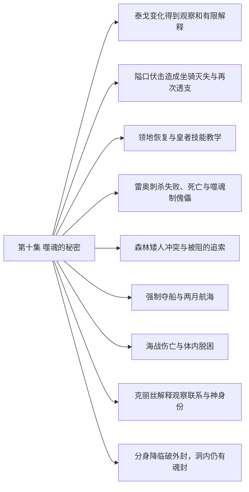

# 第十集 噬魂的秘密 · 剧情结构

[剧情目录](README.md) · [本集九维报告](../../vol10.md)

## 主线树

## 本集因果、伏笔与回收关系

| 起点 | 关系 | 终点 | 研究说明 |
|---|---|---|---|
| [隘口伏击造成坐骑灭失与再次透支](vol-10.md) | 因果 | [领地恢复与皇者技能教学](vol-10.md) | 连续透支与伏击损失促成反思、恢复和教学。 |
| [领地恢复与皇者技能教学](vol-10.md) | 铺垫 | [雷奥刺杀失败、死亡与噬魂制傀儡](vol-10.md) | 雷奥在领地观察后暴露于魅，借被俘进入近身范围。 |
| [雷奥刺杀失败、死亡与噬魂制傀儡](vol-10.md) | 因果 | [森林矮人冲突与被阻的追索](vol-10.md) | 取得噬魂的实力与亲和使黑龙决意启程，并在森林战中实际运用。 |
| [雷奥刺杀失败、死亡与噬魂制傀儡](vol-10.md) | 回收 | [森林矮人冲突与被阻的追索](vol-10.md) | 首次制雷奥形傀儡的能力在十五矮人灵魂上再次验证。 |
| [强制夺船与两月航海](vol-10.md) | 铺垫 | [海战伤亡与体内脱困](vol-10.md) | 船只与未知航线把不会游泳的主角置于海洋威胁中。 |
| [海战伤亡与体内脱困](vol-10.md) | 因果 | [克丽丝解释观察联系与神身份](vol-10.md) | 巨兽带黑龙到海谷，双峰视野使克丽丝识出封印并主动呼唤。 |
| [克丽丝解释观察联系与神身份](vol-10.md) | 因果 | [分身降临破外封，洞内仍有魂封](vol-10.md) | 解释后合作使黑龙召来萝茜，分身得以降临并拆外封。 |
| [隘口伏击造成坐骑灭失与再次透支](vol-10.md) | 呼应 | [分身降临破外封，洞内仍有魂封](vol-10.md) | 末尾舍弃复活巨兽回应此前不能再耗尽力量的教训。 |

跨集联系见[全部语义关系](relations.md)与[跨集剧情线](README.md)。

## 事件、人物与认知依据

### 泰戈变化得到观察和有限解释

判断类型：原文事实

刀火测试与问答显示身体、智力变化，几名专家提出残魂与悼亡能量变异假说。

人物：[泰戈](../cards/chr-d991a470980d4716bf4e09af3d17d913.md)、[斯文哥尔](../cards/chr-24438669720a4bb8a0a27cbd25eadb33.md)、[图克](../cards/chr-6ebb35c20edf4908b3b64159c8fd7a73.md)、[阿古力特](../cards/chr-37825d4ef6be40189c50d630eb315f4c.md)、[毕瑟格林](../cards/chr-b72287e437f54ec19819a94091f46ce3.md)

- 斯文哥尔：知道；泰戈能类推并接受等待，理解力已有变化。

- 图克：怀疑；先天魂缺陷与悼亡能量引发特殊变异。

| 章节 | 行号 | 判断类型 |
|---|---|---|
| ch-0097 第一章 只怕有心人 | 12406–12448 | 原文事实 |

### 隘口伏击造成坐骑灭失与再次透支

判断类型：原文事实

费尔巴尼私查布伏，普通军队最终覆灭仍杀尽随行战马、伤骨骼，黑龙透支再睡。

人物：[黑龙](../cards/chr-9f2e5fcbba87455eb37e35869ea8854d.md)、[费尔巴尼](../cards/chr-c1707913f1264b49b876a14ab96e9d21.md)、[坦克](../cards/chr-201a3f9df7a64c6b807871acb89f436a.md)、[黑二](../cards/chr-24b9d252fb624865a46d717832261c68.md)、[黑七](../cards/chr-775349c3c9654daaae30acf69aadff21.md)、[黑四](../cards/chr-cfa1e622ca004631bfd0e1642a22e7a8.md)、[黑大](../cards/chr-632a4344b53f478a93f4d308f3890b92.md)、[龙焰](../cards/chr-bd5dc9b525ec42fe9acf4e885a0aa81a.md)、[二黑](../cards/chr-345328fb11e244318118f9019606d3e4.md)

- 费尔巴尼：怀疑；有人在帝国高层掩盖黑龙行踪。

- 黑龙：知道；地形和工具使普通人也能威胁强大躯体。

| 章节 | 行号 | 判断类型 |
|---|---|---|
| ch-0097 第一章 只怕有心人 | 12468–12496 | 原文事实 |
| ch-0098 第二章 伏击 | 12544–12565 | 原文事实 |
| ch-0098 第二章 伏击 | 12616–12696 | 原文事实 |
| ch-0099 第三章 不死领地 | 12716–12734 | 原文事实 |

### 领地恢复与皇者技能教学

判断类型：原文事实

黑龙醒来反思，召回骨军，黑大先领会、黑二随后参与尸体操控练习；雷奥在外围观察等待。

人物：[黑龙](../cards/chr-9f2e5fcbba87455eb37e35869ea8854d.md)、[黑大](../cards/chr-632a4344b53f478a93f4d308f3890b92.md)、[黑二](../cards/chr-24b9d252fb624865a46d717832261c68.md)、[斯文哥尔](../cards/chr-24438669720a4bb8a0a27cbd25eadb33.md)、[雷奥](../cards/chr-8e211a51f4ef4c4b8e707cb02c88a5ed.md)

- 黑龙：知道；能力此前已有，掌握其运用需要练习并可以教学。

| 章节 | 行号 | 判断类型 |
|---|---|---|
| ch-0099 第三章 不死领地 | 12707–12739 | 原文事实 |
| ch-0099 第三章 不死领地 | 12740–12793 | 原文事实 |
| ch-0099 第三章 不死领地 | 12794–12818 | 原文事实 |

### 雷奥刺杀失败、死亡与噬魂制傀儡

判断类型：原文事实

魅带俘近前被雷奥利用，分魂刺杀遭枪的亲和规则阻止；雷奥魂灭，噬魂吞魂制出同形傀儡。

人物：[黑龙](../cards/chr-9f2e5fcbba87455eb37e35869ea8854d.md)、[雷奥](../cards/chr-8e211a51f4ef4c4b8e707cb02c88a5ed.md)、[哥顿普](../cards/chr-968add4b94d440cbabc01e3b0558d55d.md)、[魅](../cards/chr-006089add9c541fe9bcda4dd5369d743.md)、[图克](../cards/chr-6ebb35c20edf4908b3b64159c8fd7a73.md)、[阿古力特](../cards/chr-37825d4ef6be40189c50d630eb315f4c.md)、[毕瑟格林](../cards/chr-b72287e437f54ec19819a94091f46ce3.md)、[雷奥形死息傀儡](../cards/chr-28e17940311e4d20bb1a4b8e5753e1fc.md)

- 雷奥：怀疑；教皇知道枪不能杀悼亡者而让自己送死。

- 黑龙：知道；噬魂有同源亲和，但尚未认自己为主。

| 章节 | 行号 | 判断类型 |
|---|---|---|
| ch-0099 第三章 不死领地 | 12843–12861 | 原文事实 |
| ch-0100 第四章 噬魂的秘密 | 12885–12944 | 原文事实 |
| ch-0100 第四章 噬魂的秘密 | 12965–13014 | 原文事实 |
| ch-0101 第五章 量产型狂暴战士 | 13048–13052 | 原文事实 |

### 森林矮人冲突与被阻的追索

判断类型：原文事实

十七狂暴矮人遇战，十五死并制成傀儡；两兄弟逃回巨树。黑龙追林被阻后为龙岛任务暂退。

人物：[黑龙](../cards/chr-9f2e5fcbba87455eb37e35869ea8854d.md)、[黑二](../cards/chr-24b9d252fb624865a46d717832261c68.md)、[黑大](../cards/chr-632a4344b53f478a93f4d308f3890b92.md)、[黑七](../cards/chr-775349c3c9654daaae30acf69aadff21.md)、[斯文哥尔](../cards/chr-24438669720a4bb8a0a27cbd25eadb33.md)、[托雷](../cards/chr-7d10e8845f90455d8c876a7c5d7a7c6c.md)、[巴得勒](../cards/chr-9adbbc5d4a304b6eafaf675a693aee25.md)、[里维里斯特](../cards/chr-d08ae3acd751409d846ab3e89561060d.md)

- 读者：知道；巨树曾灭长者、压缩成长繁殖周期并要求信仰。

- 斯文哥尔：怀疑；密林存在幻境及超常控制者，反击有意保留退路。

| 章节 | 行号 | 判断类型 |
|---|---|---|
| ch-0101 第五章 量产型狂暴战士 | 13108–13126 | 原文事实 |
| ch-0101 第五章 量产型狂暴战士 | 13174–13215 | 原文事实 |
| ch-0102 第六章 森林矮人 | 13219–13309 | 原文事实 |
| ch-0102 第六章 森林矮人 | 13310–13375 | 原文事实 |

### 强制夺船与两月航海

判断类型：原文事实

黑龙杀转水手，斯文以拘魂威胁逼从，夺两船赴龙岛；无补给需求仍需导航和心理休整。

人物：[黑龙](../cards/chr-9f2e5fcbba87455eb37e35869ea8854d.md)、[斯文哥尔](../cards/chr-24438669720a4bb8a0a27cbd25eadb33.md)、[米勒达布隆迪](../cards/chr-4aafb8822bf64bb099f0e9abe3ae67c9.md)

- 黑龙：知道；先知说巨海蛇低智无魔法、海中力量极强。

| 章节 | 行号 | 判断类型 |
|---|---|---|
| ch-0103 第七章 黑龙的海上世界 | 13403–13442 | 原文事实 |
| ch-0103 第七章 黑龙的海上世界 | 13460–13480 | 原文事实 |

### 海战伤亡与体内脱困

判断类型：原文事实

巨海蛇好奇探船引来主角先攻，几亡灵法师死、魅受损；黑龙被吞后杀兽脱困，海底见双峰。

人物：[黑龙](../cards/chr-9f2e5fcbba87455eb37e35869ea8854d.md)、[基多尔克](../cards/chr-c9785b22317349acae9ecbaf73a03ee7.md)、[毕瑟格林](../cards/chr-b72287e437f54ec19819a94091f46ce3.md)、[魅](../cards/chr-006089add9c541fe9bcda4dd5369d743.md)、[黑大](../cards/chr-632a4344b53f478a93f4d308f3890b92.md)

- 读者：知道；巨海蛇最初只是好奇，对小体型黑龙无视。

- 黑龙：知道；海中移动和魂量不能依陆地体型常识直接判断。

| 章节 | 行号 | 判断类型 |
|---|---|---|
| ch-0103 第七章 黑龙的海上世界 | 13489–13499 | 原文事实 |
| ch-0104 第八章 大战海怪 | 13509–13548 | 原文事实 |
| ch-0104 第八章 大战海怪 | 13576–13608 | 原文事实 |
| ch-0104 第八章 大战海怪 | 13653–13689 | 原文事实 |
| ch-0104 第八章 大战海怪 | 13640–13644 | 原文事实 |

### 克丽丝解释观察联系与神身份

判断类型：原文事实

克丽丝认出好友封印，受黑龙拒绝后说明借萝茜单向联系重叠视野，并讲述自己由守族者成神。

人物：[黑龙](../cards/chr-9f2e5fcbba87455eb37e35869ea8854d.md)、[克丽丝](../cards/chr-d1af2401c91342228738940630a00180.md)、[拉西萝茜](../cards/chr-54e84c6e82214a26921887c503f519ee.md)、[蒲赛顿西斯](../cards/chr-b51305fe7679475f9cae757281a146b3.md)

- 黑龙：知道；克丽丝此前能经萝茜观察自己的视野。

- 读者：知道；克丽丝的孤独与借萝茜观察黑龙的动机在私人视角中被展示；其守族成神历史仍来自自述。

| 章节 | 行号 | 判断类型 |
|---|---|---|
| ch-0105 第九章 双星封印 | 13695–13769 | 原文事实 |

### 分身降临破外封，洞内仍有魂封

判断类型：原文事实

萝茜受改体与注能耗竭，双星失衡崩塌；四人进入内洞见六芒星封魂与未知声音，未完成救援。

人物：[黑龙](../cards/chr-9f2e5fcbba87455eb37e35869ea8854d.md)、[拉西萝茜](../cards/chr-54e84c6e82214a26921887c503f519ee.md)、[克丽丝](../cards/chr-d1af2401c91342228738940630a00180.md)、[毕瑟格林](../cards/chr-b72287e437f54ec19819a94091f46ce3.md)、[魅](../cards/chr-006089add9c541fe9bcda4dd5369d743.md)、[蒲赛顿西斯](../cards/chr-b51305fe7679475f9cae757281a146b3.md)、[菲力普](../cards/chr-f5b27f27591c4a9f9b29844c3ab97ee0.md)

- 菲力普：知道；感应到冥月女神通过代言者分身降临。

- 黑龙：未知；洞内封印和末尾发声者的完整状况。

| 章节 | 行号 | 判断类型 |
|---|---|---|
| ch-0105 第九章 双星封印 | 13770–13802 | 原文事实 |
| ch-0105 第九章 双星封印 | 13815–13836 | 原文事实 |
| ch-0105 第九章 双星封印 | 13843–13871 | 原文事实 |

## 本集当时的剧情线判断

这是分集历史判断，后续回收结果以跨集终点页为准。

### 第10集 · 泰戈变异与认知成长

当时状态：部分回收

泰戈的身体与智力将怎样发展？

本集试验和问答确认局部提升；机制为几人推论，未达普通成人全部能力。

[查看全书终点判断](threads/book-15cb5511c407.md)

### 第10集 · 皇者能力教学与孩子自主

当时状态：部分回收

哪些孩子能够学会皇者技能并发展意识？

黑大先理解，黑龙黑大黑二随后共同练习；八个无意识孩子尚未展示成功。

[查看全书终点判断](threads/book-c55cdb2efcb4.md)

### 第10集 · 雷奥追杀与教皇安排

当时状态：部分回收

追杀结局与教皇安排的目的分别是什么？

雷奥本人死亡，个人追杀结束；他为教会所用的来历、教皇赐枪与原追踪方法仍未完全解明。

[查看全书终点判断](threads/book-8477942e0118.md)

### 第10集 · 噬魂权限与死息傀儡

当时状态：部分回收

如何认主、吞魂制造傀儡，古主遗产何来？

同源亲和和傀儡功能有实证，黑龙尚未认主、约用七成；矮人傀儡约半生前实力。

[查看全书终点判断](threads/book-be62d277e700.md)

### 第10集 · 龙墓解封与龙岛远征

当时状态：部分回收

能否取得安息石并兑现全墓效忠？

翻山、夺船出航且到中继岛，海战与封印支线介入；未抵达龙岛或取得石。

[查看全书终点判断](threads/book-77f072ce087d.md)

### 第10集 · 森林巨树与矮人信仰

当时状态：未回收

巨树是谁，加速生命与要求信仰有何目的？

读者见威逼与恩赐，主队仅接触守卫和防御；身份、长期代价未揭，暂退不算解决。

[查看全书终点判断](threads/book-4f19b0c4054c.md)

### 第10集 · 自主与强迫合作

当时状态：部分回收

扩张的需求如何改变同伴与被支配者的边界？

护同伴、痛惜坐骑与杀转水手并存；他要求解释才协助克丽丝，却未给予水手相同选择。

[查看全书终点判断](threads/book-37dd82abc178.md)

### 第10集 · 冥月女神身份与行动

当时状态：部分回收

身份、观察手段与封印历史分别有何证据？

私人视角与菲力普识认使冥月身份得到强支持；沉渊木和借萝茜观察方法明确，古神冲突细节仍主要为自述。

[查看全书终点判断](threads/book-e90db68cb625.md)

### 第10集 · 萝茜承载与自我状态

当时状态：部分回收

分身降临后萝茜的主体与记忆如何变化？

改体、耗竭、自称萝茜及对黑龙的复杂反应已见；未证旧记忆恢复、旧天使重返或人格融合完成。

[查看全书终点判断](threads/book-09f441653222.md)

### 第10集 · 海皇与双层封印

当时状态：未回收

双星外封后的灵魂封印中究竟是什么状态？

双星山峰已塌、内层六芒魂封仍在，末声音未自报身份；不能写海皇营救完成。

[查看全书终点判断](threads/book-67592e865ba5.md)

### 第10集 · 战争掩护与神权网络

当时状态：未回收

谁掩护黑龙行踪，各神权中心有何真实安排？

叙述确认有心人掩护而未指名；费尔巴尼与雷奥各有怀疑，教皇、菲力普与巨树对降临的反应不同。

[查看全书终点判断](threads/book-db9eea600737.md)
