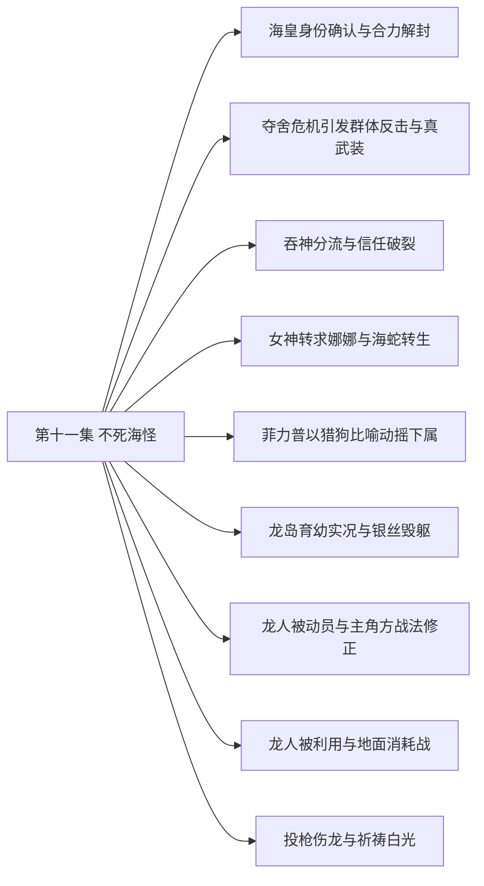

# 第十一集 不死海怪 · 剧情结构

[剧情目录](README.md) · [本集九维报告](../../vol11.md)

## 主线树

## 本集因果、伏笔与回收关系

| 起点 | 关系 | 终点 | 研究说明 |
|---|---|---|---|
| [海皇身份确认与合力解封](vol-11.md) | 转折 | [夺舍危机引发群体反击与真武装](vol-11.md) | 解救者转为夺舍目标 |
| [夺舍危机引发群体反击与真武装](vol-11.md) | 因果 | [吞神分流与信任破裂](vol-11.md) | 本源近身逼出吞噬与容量危机 |
| [吞神分流与信任破裂](vol-11.md) | 因果 | [女神转求娜娜与海蛇转生](vol-11.md) | 拒绝再援使克丽丝转求娜娜 |
| [吞神分流与信任破裂](vol-11.md) | 铺垫 | [女神转求娜娜与海蛇转生](vol-11.md) | 新增力量支持昂贵的海蛇转生 |
| [女神转求娜娜与海蛇转生](vol-11.md) | 回收 | [龙岛育幼实况与银丝毁躯](vol-11.md) | 海蛇使龙皇重估追击代价 |
| [龙岛育幼实况与银丝毁躯](vol-11.md) | 因果 | [龙人被动员与主角方战法修正](vol-11.md) | 空骑损失与飞行威胁推动战术补强 |
| [龙人被动员与主角方战法修正](vol-11.md) | 因果 | [龙人被利用与地面消耗战](vol-11.md) | 动员与越崖被导向预定消耗战 |
| [龙人被动员与主角方战法修正](vol-11.md) | 回收 | [投枪伤龙与祈祷白光](vol-11.md) | 黑大投枪示范由黑龙实战伤龙兑现 |
| [龙人被利用与地面消耗战](vol-11.md) | 因果 | [投枪伤龙与祈祷白光](vol-11.md) | 增援改变战局促龙皇介入，损失促帝勒祈祷 |

跨集联系见[全部语义关系](relations.md)与[跨集剧情线](README.md)。

## 事件、人物与认知依据

### 海皇身份确认与合力解封

判断类型：原文事实

海皇本源与克丽丝分身削弱封印，黑龙毁柱，海皇真正脱困。

人物：[黑龙](../cards/chr-9f2e5fcbba87455eb37e35869ea8854d.md)、[克丽丝](../cards/chr-d1af2401c91342228738940630a00180.md)、[蒲赛顿西斯](../cards/chr-b51305fe7679475f9cae757281a146b3.md)

- 黑龙：知道；声音来自海皇，解封依赖双方先削弱封印

| 章节 | 行号 | 判断类型 |
|---|---|---|
| ch-0107 第一章 破封 | 13880–13913 | 原文事实 |
| ch-0107 第一章 破封 | 13964–13977 | 原文事实 |
| ch-0108 第二章 忘恩 | 13981–13992 | 原文事实 |

### 夺舍危机引发群体反击与真武装

判断类型：原文事实

海皇谋夺躯体，黑龙先攻召援；斯科特领域护军，十孩供力使黑龙凝成真正魂兵。

人物：[黑龙](../cards/chr-9f2e5fcbba87455eb37e35869ea8854d.md)、[克丽丝](../cards/chr-d1af2401c91342228738940630a00180.md)、[蒲赛顿西斯](../cards/chr-b51305fe7679475f9cae757281a146b3.md)、[斯科特](../cards/chr-60677b93fd18486dbb9f18d6de5f823f.md)、[黑大](../cards/chr-632a4344b53f478a93f4d308f3890b92.md)、[黑二](../cards/chr-24b9d252fb624865a46d717832261c68.md)、[图克](../cards/chr-6ebb35c20edf4908b3b64159c8fd7a73.md)、[毕瑟格林](../cards/chr-b72287e437f54ec19819a94091f46ce3.md)、[阿古力特](../cards/chr-37825d4ef6be40189c50d630eb315f4c.md)

- 蒲赛顿西斯：误以为；起初认为弱小悼亡者可被轻易夺躯

- 克丽丝：知道；黑龙的部众力量超出自己预期

| 章节 | 行号 | 判断类型 |
|---|---|---|
| ch-0108 第二章 忘恩 | 13998–14051 | 原文事实 |
| ch-0108 第二章 忘恩 | 14062–14086 | 原文事实 |
| ch-0109 第三章 彻底武装 | 14097–14143 | 原文事实 |

### 吞神分流与信任破裂

判断类型：原文事实

黑龙吞掉海皇神识，以分流免爆体并恢复躯体；责怪却理解斯科特，明确拒再帮克丽丝。

人物：[黑龙](../cards/chr-9f2e5fcbba87455eb37e35869ea8854d.md)、[蒲赛顿西斯](../cards/chr-b51305fe7679475f9cae757281a146b3.md)、[斯科特](../cards/chr-60677b93fd18486dbb9f18d6de5f823f.md)、[克丽丝](../cards/chr-d1af2401c91342228738940630a00180.md)、[黑大](../cards/chr-632a4344b53f478a93f4d308f3890b92.md)、[黑二](../cards/chr-24b9d252fb624865a46d717832261c68.md)

- 斯科特：知道；分流成功超出原预判

- 黑龙：知道；克丽丝引荐带来夺舍危险

- 读者：知道；克丽丝造沉渊木和教徒为求自身脱困

| 章节 | 行号 | 判断类型 |
|---|---|---|
| ch-0109 第三章 彻底武装 | 14180–14208 | 原文事实 |
| ch-0110 第四章 全面提升 | 14214–14294 | 原文事实 |
| ch-0110 第四章 全面提升 | 14295–14316 | 原文事实 |

### 女神转求娜娜与海蛇转生

判断类型：原文事实

娜娜接到新求助；十孩获真武装后，黑龙耗半魂转生海蛇并找到旧帝国遗物，回船续航。

人物：[娜娜](../cards/chr-1d629a39da3e41149707e5f9f636defd.md)、[克丽丝](../cards/chr-d1af2401c91342228738940630a00180.md)、[黑龙](../cards/chr-9f2e5fcbba87455eb37e35869ea8854d.md)、[黑大](../cards/chr-632a4344b53f478a93f4d308f3890b92.md)、[黑二](../cards/chr-24b9d252fb624865a46d717832261c68.md)、[基多尔克](../cards/chr-c9785b22317349acae9ecbaf73a03ee7.md)、[斯科特](../cards/chr-60677b93fd18486dbb9f18d6de5f823f.md)、[拉西萝茜](../cards/chr-54e84c6e82214a26921887c503f519ee.md)、[斯文哥尔](../cards/chr-24438669720a4bb8a0a27cbd25eadb33.md)

- 娜娜：未知；尚不知道克丽丝需要自己具体做什么

- 黑龙：未知；遗物来历、用途及古帝国消失原因

| 章节 | 行号 | 判断类型 |
|---|---|---|
| ch-0111 第五章 不死海怪 | 14321–14331 | 原文事实 |
| ch-0111 第五章 不死海怪 | 14344–14354 | 原文事实 |
| ch-0111 第五章 不死海怪 | 14360–14397 | 原文事实 |
| ch-0111 第五章 不死海怪 | 14428–14435 | 原文事实 |

### 菲力普以猎狗比喻动摇下属

判断类型：原文事实

占领军停滞与异端集结背景下，菲力普隔离克罗斯并揭露工具处境，迫其面对信仰疑虑。

人物：[菲力普](../cards/chr-f5b27f27591c4a9f9b29844c3ab97ee0.md)、[克罗斯](../cards/chr-ae13d8cb673b4af3a30842afd9efa78b.md)

- 克罗斯：怀疑；菲力普及部分高层存在隐秘合作

- 克罗斯：知道；自己的信念已因受害者遭遇动摇

| 章节 | 行号 | 判断类型 |
|---|---|---|
| ch-0112 第六章 猎犬的直觉 | 14439–14480 | 原文事实 |
| ch-0112 第六章 猎犬的直觉 | 14481–14520 | 原文事实 |

### 龙岛育幼实况与银丝毁躯

判断类型：原文事实

读者获知九龙分布、繁殖危机及龙人来历；登陆队伍的银丝引发龙皇愤怒，海蛇和法师力量迫其转入警告。

人物：[黑龙](../cards/chr-9f2e5fcbba87455eb37e35869ea8854d.md)、[黑大](../cards/chr-632a4344b53f478a93f4d308f3890b92.md)、[斯文哥尔](../cards/chr-24438669720a4bb8a0a27cbd25eadb33.md)、[泰特尼斯](../cards/chr-4355fd0bfe034913a4c320006ef7678b.md)、[拿不列斯](../cards/chr-74d6bd18c10d470aa41d265f935c1229.md)、[基多尔克](../cards/chr-c9785b22317349acae9ecbaf73a03ee7.md)、[银丝](../cards/chr-6397f22d0a5f47f0901efd4f2cc15ed0.md)

- 读者：知道；另外八龙在蛮荒大陆育幼，本岛仅龙皇守护

- 斯文哥尔：怀疑；龙皇反复警告显示顾忌己方实力

| 章节 | 行号 | 判断类型 |
|---|---|---|
| ch-0112 第六章 猎犬的直觉 | 14551–14556 | 原文事实 |
| ch-0113 第七章 龙族受孕交配指南 | 14560–14639 | 原文事实 |
| ch-0113 第七章 龙族受孕交配指南 | 14642–14695 | 原文事实 |
| ch-0113 第七章 龙族受孕交配指南 | 14696–14696 | 原文事实 |
| ch-0114 第八章 龙人 | 14700–14708 | 原文事实 |

### 龙人被动员与主角方战法修正

判断类型：原文事实

龙皇以威压动员龙人，斯文纠正对空布阵并配装备，黑大以投枪展示独立解决方案。

人物：[泰特尼斯](../cards/chr-4355fd0bfe034913a4c320006ef7678b.md)、[斯图帝勒](../cards/chr-5aeff1d849534cdf80251105e5c44e7a.md)、[斯图赫亚](../cards/chr-739ae97de5ba4afb9f34431377d9ad82.md)、[黑龙](../cards/chr-9f2e5fcbba87455eb37e35869ea8854d.md)、[斯文哥尔](../cards/chr-24438669720a4bb8a0a27cbd25eadb33.md)、[黑大](../cards/chr-632a4344b53f478a93f4d308f3890b92.md)、[黑二](../cards/chr-24b9d252fb624865a46d717832261c68.md)、[星](../cards/chr-d2d3971153154607bb651d6a0c827216.md)、[月](../cards/chr-5c605c7ecd20495ca665d15c2bdf2562.md)、[图克](../cards/chr-6ebb35c20edf4908b3b64159c8fd7a73.md)、[哥顿普](../cards/chr-968add4b94d440cbabc01e3b0558d55d.md)

- 斯图帝勒：知道；禁崖之外存在更大天地

- 黑龙：知道；黑大木讷并不等于没有独立战术思考

| 章节 | 行号 | 判断类型 |
|---|---|---|
| ch-0114 第八章 龙人 | 14762–14775 | 原文事实 |
| ch-0114 第八章 龙人 | 14776–14803 | 原文事实 |
| ch-0114 第八章 龙人 | 14809–14856 | 原文事实 |
| ch-0115 第九章 肉搏 | 14860–14890 | 原文事实 |

### 龙人被利用与地面消耗战

判断类型：原文事实

龙皇期待两方互耗；黑龙留预备队、派魅与图克试探，近战造成双方大量死亡，帝勒逐渐意识到受骗。

人物：[泰特尼斯](../cards/chr-4355fd0bfe034913a4c320006ef7678b.md)、[斯图帝勒](../cards/chr-5aeff1d849534cdf80251105e5c44e7a.md)、[斯图赫亚](../cards/chr-739ae97de5ba4afb9f34431377d9ad82.md)、[黑龙](../cards/chr-9f2e5fcbba87455eb37e35869ea8854d.md)、[斯文哥尔](../cards/chr-24438669720a4bb8a0a27cbd25eadb33.md)、[魅](../cards/chr-006089add9c541fe9bcda4dd5369d743.md)、[图克](../cards/chr-6ebb35c20edf4908b3b64159c8fd7a73.md)、[黑大](../cards/chr-632a4344b53f478a93f4d308f3890b92.md)、[黑二](../cards/chr-24b9d252fb624865a46d717832261c68.md)

- 读者：知道；龙皇有意削弱龙人并保留最低繁衍人数

- 斯图帝勒：怀疑；母神之王未提醒敌情，自己与同族可能受骗

| 章节 | 行号 | 判断类型 |
|---|---|---|
| ch-0115 第九章 肉搏 | 14901–14910 | 原文事实 |
| ch-0115 第九章 肉搏 | 14931–15024 | 原文事实 |
| ch-0116 第十章 对轰 | 15028–15073 | 原文事实 |

### 投枪伤龙与祈祷白光

判断类型：原文事实

龙皇空袭和傀儡造成额外伤亡，黑龙投噬魂伤其腿，阿古力特配合法术遭冰盾抵消；龙人败势中帝勒祈祷引来白光。

人物：[黑龙](../cards/chr-9f2e5fcbba87455eb37e35869ea8854d.md)、[阿古力特](../cards/chr-37825d4ef6be40189c50d630eb315f4c.md)、[泰特尼斯](../cards/chr-4355fd0bfe034913a4c320006ef7678b.md)、[斯图帝勒](../cards/chr-5aeff1d849534cdf80251105e5c44e7a.md)、[斯文哥尔](../cards/chr-24438669720a4bb8a0a27cbd25eadb33.md)

- 黑龙：知道；投掷魂兵能伤空中龙皇，但高空仍超出有效射程

- 读者：未知；笼罩帝勒的力量来源、身份与最终作用

| 章节 | 行号 | 判断类型 |
|---|---|---|
| ch-0116 第十章 对轰 | 15075–15109 | 原文事实 |
| ch-0116 第十章 对轰 | 15117–15146 | 原文事实 |
| ch-0116 第十章 对轰 | 15155–15167 | 原文事实 |

## 本集当时的剧情线判断

这是分集历史判断，后续回收结果以跨集终点页为准。

### 第11集 · 海皇解封与夺躯危机

当时状态：已回收

海皇是否获释，夺躯危机结果如何？

海皇解封后谋夺躯，终神识被吞灭；仅回收这次封印与危机，不关闭古帝国或全部神史。

[查看全书终点判断](threads/book-67592e865ba5.md)

### 第11集 · 克丽丝身份与脱困动机

当时状态：部分回收

求脱困的真实安排将怎样影响娜娜与黑龙？

独处视角明确沉渊木及教学动机，黑龙撤回帮助，她转求娜娜；具体计划仍未揭。

[查看全书终点判断](threads/book-e90db68cb625.md)

### 第11集 · 自由与保护关系的边界

当时状态：部分回收

各方的自由需求如何与他人拒绝、风险和生命相容？

海皇夺躯、斯科特保族、主角拒援与龙皇利用分别显出边界；没有形成平等关系的最终解答。

[查看全书终点判断](threads/book-37dd82abc178.md)

### 第11集 · 孩子意识、武装与独立战法

当时状态：部分回收

力量共同提升后，个体意识如何继续发展？

十孩都获真武装，黑大和黑二各有独立行为，其他八孩仍无意识；力量升级不关闭觉醒机制。

[查看全书终点判断](threads/book-c55cdb2efcb4.md)

### 第11集 · 龙墓约定与龙岛安息石

当时状态：部分回收

能否取得安息之石，先知隐瞒的形态是什么？

已登岛并伤龙皇，安息石只知在中央峰巢穴且不止石头，尚未取到。

[查看全书终点判断](threads/book-77f072ce087d.md)

### 第11集 · 龙族繁衍、龙人庇护与禁锢

当时状态：未回收

龙人能否摆脱工具地位，龙族延续是否实现？

龙蛋和受孕已有进展但新幼龙未出生；龙人被推入消耗战，祈祷白光结果待揭。

[查看全书终点判断](threads/book-7ba6c4bc6db7.md)

### 第11集 · 教会猎犬价值与天使自主

当时状态：部分回收

菲力普如何以留存猎物维护自身意识与价值？

对克罗斯公开工具史和猎犬逻辑，听者动摇但未明确投效；教会最终战略仍未完整揭示。

[查看全书终点判断](threads/book-02ba45413b1e.md)

### 第11集 · 古帝国遗迹与悼亡成长

当时状态：部分回收

海蛇腹中帝国遗物如何关联古国消失？

吞神改变力量与武装，遗物被收存待问；没有从遗物得到帝国消失成因。

[查看全书终点判断](threads/book-2c92e5ad3024.md)
