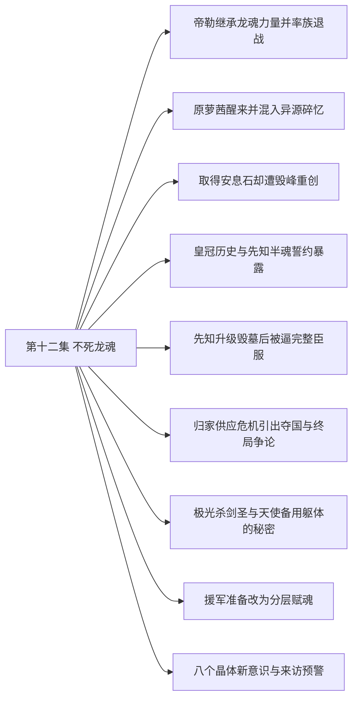

# 第十二集 不死龙魂 · 剧情结构

[剧情目录](README.md) · [本集九维报告](../../vol12.md)

## 主线树

## 本集因果、伏笔与回收关系

| 起点 | 关系 | 终点 | 研究说明 |
|---|---|---|---|
| [帝勒继承龙魂力量并率族退战](vol-12.md) | 因果 | [取得安息石却遭毁峰重创](vol-12.md) | 龙人退出使龙皇失去掩护，取石行动继续并遭其地形反击 |
| [取得安息石却遭毁峰重创](vol-12.md) | 因果 | [皇冠历史与先知半魂誓约暴露](vol-12.md) | 带回安息石才使皇冠辨认和先知交约谈判成为现实 |
| [皇冠历史与先知半魂誓约暴露](vol-12.md) | 因果 | [先知升级毁墓后被逼完整臣服](vol-12.md) | 皇冠交付给升级与破封提供条件，半魂约又成为反制先知的控制点 |
| [取得安息石却遭毁峰重创](vol-12.md) | 呼应 | [先知升级毁墓后被逼完整臣服](vol-12.md) | 龙岛坍塌的经验使黑龙对龙墓地震迅速撤离 |
| [先知升级毁墓后被逼完整臣服](vol-12.md) | 铺垫 | [归家供应危机引出夺国与终局争论](vol-12.md) | 受完整约束的先知随队归家，看见组织潜力后转为提出扩张方案 |
| [归家供应危机引出夺国与终局争论](vol-12.md) | 因果 | [援军准备改为分层赋魂](vol-12.md) | 拒绝灭世终局但接受保供应的有限请求，因此需要隐蔽援军与赋魂分工 |
| [先知升级毁墓后被逼完整臣服](vol-12.md) | 回收 | [援军准备改为分层赋魂](vol-12.md) | 战斗中有效的十孩供能被黑龙迁移到规模赋魂 |
| [归家供应危机引出夺国与终局争论](vol-12.md) | 呼应 | [八个晶体新意识与来访预警](vol-12.md) | 不愿所有人沉睡的生活判断与寻找真正同类的喜悦互相照应 |

跨集联系见[全部语义关系](relations.md)与[跨集剧情线](README.md)。

## 事件、人物与认知依据

### 帝勒继承龙魂力量并率族退战

判断类型：原文事实

拿不列斯转出元力与记忆后本源沉睡；帝勒用克制干预和退战谈判争取空间，黑龙最终放行并监视。

人物：[斯图帝勒](../cards/chr-5aeff1d849534cdf80251105e5c44e7a.md)、[拿不列斯](../cards/chr-74d6bd18c10d470aa41d265f935c1229.md)、[黑龙](../cards/chr-9f2e5fcbba87455eb37e35869ea8854d.md)、[斯文哥尔](../cards/chr-24438669720a4bb8a0a27cbd25eadb33.md)、[泰特尼斯](../cards/chr-4355fd0bfe034913a4c320006ef7678b.md)、[阿古力特](../cards/chr-37825d4ef6be40189c50d630eb315f4c.md)

- 读者：知道；力量与记忆来自拿不列斯，后者本源仍沉睡

- 克丽丝：未知；帝勒为何具备此信仰来源

- 斯文哥尔：怀疑；开始怀疑退兵是计谋，后据行动改变判断

| 章节 | 行号 | 判断类型 |
|---|---|---|
| ch-0118 第一章 龙魂附体 | 15193–15229 | 原文事实 |
| ch-0118 第一章 龙魂附体 | 15232–15270 | 原文事实 |
| ch-0119 第二章 大梦初醒 | 15275–15312 | 原文事实 |
| ch-0119 第二章 大梦初醒 | 15340–15364 | 原文事实 |

### 原萝茜醒来并混入异源碎忆

判断类型：原文事实

萝茜以失忆后共同生活的经验为主，夹入克丽丝魔法师记忆与旧天使碎忆；恢复清醒不等全部人格或旧记忆复原。

人物：[拉西萝茜](../cards/chr-54e84c6e82214a26921887c503f519ee.md)、[娜娜](../cards/chr-1d629a39da3e41149707e5f9f636defd.md)、[克丽丝](../cards/chr-d1af2401c91342228738940630a00180.md)

- 读者：知道；三种经验来源不同，当前仍是原萝茜主体

- 拉西萝茜：怀疑；自己已好起来却仍对脑中变化迷茫

| 章节 | 行号 | 判断类型 |
|---|---|---|
| ch-0120 第三章 降临 | 15368–15383 | 原文事实 |

### 取得安息石却遭毁峰重创

判断类型：原文事实

黑龙取到毕瑟辨认的黑晶之魄；龙皇预设地形弱点发动禁咒，金属骨重损，挖救亡灵后借斯科特撤回；龙人全族消失且留长老尸体。

人物：[黑龙](../cards/chr-9f2e5fcbba87455eb37e35869ea8854d.md)、[泰特尼斯](../cards/chr-4355fd0bfe034913a4c320006ef7678b.md)、[毕瑟格林](../cards/chr-b72287e437f54ec19819a94091f46ce3.md)、[斯文哥尔](../cards/chr-24438669720a4bb8a0a27cbd25eadb33.md)、[斯科特](../cards/chr-60677b93fd18486dbb9f18d6de5f823f.md)

- 泰特尼斯：误以为；认为守岛迫退来敌，尚不知道宝物已被拿走

- 黑龙：知道；金属部属损失惨重，毁岛复仇没有可用方法

- 读者：未知；龙人为何失踪、长老因何死亡

| 章节 | 行号 | 判断类型 |
|---|---|---|
| ch-0120 第三章 降临 | 15420–15458 | 原文事实 |
| ch-0121 第四章 地龙咆哮 | 15460–15534 | 原文事实 |

### 皇冠历史与先知半魂誓约暴露

判断类型：原文事实

皇冠传说引出万王之王，先知自报欧罗普菲力克；黑龙坚持灵魂约，先知仅献分身部分便取得皇冠，并击服墓中强龙。

人物：[黑龙](../cards/chr-9f2e5fcbba87455eb37e35869ea8854d.md)、[米勒达布隆迪](../cards/chr-4aafb8822bf64bb099f0e9abe3ae67c9.md)、[斯科特](../cards/chr-60677b93fd18486dbb9f18d6de5f823f.md)、[毕瑟格林](../cards/chr-b72287e437f54ec19819a94091f46ce3.md)、[图克](../cards/chr-6ebb35c20edf4908b3b64159c8fd7a73.md)、[阿古力特](../cards/chr-37825d4ef6be40189c50d630eb315f4c.md)

- 黑龙：误以为；最初以为取得对先知全部灵魂的制约

- 米勒达布隆迪：知道；分身誓约使主本源不随黑龙死亡

- 读者：知道；当前先知与旧米勒达布隆迪叙述衔接，但阶位与分身知情存在矛盾

| 章节 | 行号 | 判断类型 |
|---|---|---|
| ch-0121 第四章 地龙咆哮 | 15541–15589 | 原文事实 |
| ch-0122 第五章 龙神 | 15593–15683 | 原文事实 |
| ch-0122 第五章 龙神 | 15685–15725 | 原文事实 |

### 先知升级毁墓后被逼完整臣服

判断类型：原文事实

皇冠转化死气助先知凝不死龙魂并破封；他故意埋骨制造依赖，黑龙以半魂制约、十孩供力和联合护盾压制，最终收完整誓约与皇冠。

人物：[黑龙](../cards/chr-9f2e5fcbba87455eb37e35869ea8854d.md)、[米勒达布隆迪](../cards/chr-4aafb8822bf64bb099f0e9abe3ae67c9.md)、[斯科特](../cards/chr-60677b93fd18486dbb9f18d6de5f823f.md)、[黑大](../cards/chr-632a4344b53f478a93f4d308f3890b92.md)、[黑二](../cards/chr-24b9d252fb624865a46d717832261c68.md)、[毕瑟格林](../cards/chr-b72287e437f54ec19819a94091f46ce3.md)

- 米勒达布隆迪：误以为；起初认为黑龙没有吞噬自己的实力，且需要保留龙群

- 黑龙：知道；先知故意破坏收集骨骸计划

- 读者：知道；先知等级仍在但魂能大幅下降，非被吞灭

| 章节 | 行号 | 判断类型 |
|---|---|---|
| ch-0123 第六章 不死龙魂 | 15732–15791 | 原文事实 |
| ch-0124 第七章 臣服 | 15837–15939 | 原文事实 |

### 归家供应危机引出夺国与终局争论

判断类型：原文事实

回家重逢与分工使先知看到组织潜力；星报钢铁减半，疾风求助夺沙里克，先知提灭世转生计划，黑龙认为那会无聊并未接受。

人物：[黑龙](../cards/chr-9f2e5fcbba87455eb37e35869ea8854d.md)、[米勒达布隆迪](../cards/chr-4aafb8822bf64bb099f0e9abe3ae67c9.md)、[斯文哥尔](../cards/chr-24438669720a4bb8a0a27cbd25eadb33.md)、[星](../cards/chr-d2d3971153154607bb651d6a0c827216.md)、[疾风](../cards/chr-d403f485486b44e08a2fe1e3d87c7788.md)、[智狼](../cards/chr-0989216ff50241d5b42f4b36f221009b.md)

- 星：怀疑；交货减少意味着疾风有难处

- 斯文哥尔：怀疑；智狼淡化了占领公国的实际难度

- 黑龙：知道；所有人沉睡的终局不符合自己想过的生活

| 章节 | 行号 | 判断类型 |
|---|---|---|
| ch-0125 第八章 回家 | 15978–15987 | 原文事实 |
| ch-0125 第八章 回家 | 16025–16052 | 原文事实 |
| ch-0126 第九章 发展野心 | 16072–16131 | 原文事实 |

### 极光杀剑圣与天使备用躯体的秘密

判断类型：原文事实

格杀档案在极光屠村杀奥马利多的现场得到具象验证；菲力普得知神迹非针对自己，却仍不懂骑士召回目的，反映教会力量不由他尽知。

人物：[奥马利多](../cards/chr-4c1d7cf3d05b4abfb925eba7237d6624.md)、[菲力普](../cards/chr-f5b27f27591c4a9f9b29844c3ab97ee0.md)、[教皇](../cards/chr-fa5f928c72f34e6292fef0b12b0579e9.md)

- 奥马利多：未知；死前不知白衣杀手本质

- 菲力普：知道；骑士团是天使降临的备用躯体来源，神迹并非针对自己

- 菲力普：未知；极光机制及骑士召回真实目的

| 章节 | 行号 | 判断类型 |
|---|---|---|
| ch-0123 第六章 不死龙魂 | 15800–15833 | 原文事实 |
| ch-0127 第十章 赶尽杀绝 | 16135–16215 | 原文事实 |

### 援军准备改为分层赋魂

判断类型：原文事实

黑龙仍为保障供应接受援助，先知指出单点指挥限制；黑大黑二学习赐魂并汇聚十孩能量，疾风半月送来万甲万马，战马转生再次消耗孩子们十余天沉睡后稍复的元气。

人物：[黑龙](../cards/chr-9f2e5fcbba87455eb37e35869ea8854d.md)、[米勒达布隆迪](../cards/chr-4aafb8822bf64bb099f0e9abe3ae67c9.md)、[黑大](../cards/chr-632a4344b53f478a93f4d308f3890b92.md)、[黑二](../cards/chr-24b9d252fb624865a46d717832261c68.md)、[疾风](../cards/chr-d403f485486b44e08a2fe1e3d87c7788.md)

- 黑龙：知道；能力可以委托有意识的孩子，但其余八孩不能独立指挥

- 米勒达布隆迪：知道；自己受完整魂约绑定，只能积极促进黑龙成长

| 章节 | 行号 | 判断类型 |
|---|---|---|
| ch-0127 第十章 赶尽杀绝 | 16216–16262 | 原文事实 |

### 八个晶体新意识与来访预警

判断类型：原文事实

海皇分流后获新魂的晶体骨苏醒，测试造成阿古伤势与一骨架断裂；仅八具初觉醒，黑龙命名十一至十八，魅随后报告大量生物靠近。

人物：[黑龙](../cards/chr-9f2e5fcbba87455eb37e35869ea8854d.md)、[阿古力特](../cards/chr-37825d4ef6be40189c50d630eb315f4c.md)、[斯文哥尔](../cards/chr-24438669720a4bb8a0a27cbd25eadb33.md)、[毕瑟格林](../cards/chr-b72287e437f54ec19819a94091f46ce3.md)、[米勒达布隆迪](../cards/chr-4aafb8822bf64bb099f0e9abe3ae67c9.md)、[罗得宾士](../cards/chr-0d52140c20bf4dc5be05fbdc80d9ace1.md)、[十一](../cards/chr-d7a6e7fd87da4749afae2de8a843d24b.md)、[十二](../cards/chr-fb9ec888c05746ce87489ade2cba50b0.md)、[十三](../cards/chr-f5e7932dbd0142cfb24f0fde4873a721.md)、[十四](../cards/chr-6b6717e1b38440a68456d0a7321752f0.md)、[十五](../cards/chr-832a86a6060d4964b0a8d51a71208ab1.md)、[十六](../cards/chr-fb4f84f38467406ab192ae39bbf114ee.md)、[十七](../cards/chr-40a24388435142d49b744c61dc760208.md)、[十八](../cards/chr-3d9a84b43005445fbf04f8dd0b2fc9fd.md)、[魅](../cards/chr-006089add9c541fe9bcda4dd5369d743.md)

- 黑龙：知道；只有八具初觉醒，魂链暂感不到意识波动

- 毕瑟格林：怀疑；海皇本源可能促成觉醒

- 读者：未知；接近沼泽的生物身份与意图

| 章节 | 行号 | 判断类型 |
|---|---|---|
| ch-0128 第十一章 新兄弟 | 16266–16344 | 原文事实 |
| ch-0128 第十一章 新兄弟 | 16345–16393 | 原文事实 |

## 本集当时的剧情线判断

这是分集历史判断，后续回收结果以跨集终点页为准。

### 第12集 · 取石远征与龙墓解封

当时状态：已回收

能否取得安息石并让龙墓力量离开封印？

本集取石、破封与获取受制龙群均完成，但付出金属兵及大批可用骨骸损失；这仅关闭本次远征目标，不代表龙皇冲突、皇冠历史或组织稳定结束。

[查看全书终点判断](threads/book-77f072ce087d.md)

### 第12集 · 先知承诺与真正臣服

当时状态：部分回收

先知能否兑现全墓力量的效忠，自主与约束如何分配？

从分身半魂漏洞升级为完整魂约，先知已无法随意背离；其思想仍含支配与灭世野心，身份阶位及分身知情矛盾未解。

[查看全书终点判断](threads/book-bf7a72bd8f37.md)

### 第12集 · 龙人血脉、自主与失踪

当时状态：部分回收

帝勒能否带族人脱离龙皇控制，拿不列斯延续方式为何？

元力与记忆传承、拒绝被利用和退战得到确认；全族去向、长老死因、帝勒神格完成度与拿本源苏醒仍未回收。

[查看全书终点判断](threads/book-7ba6c4bc6db7.md)

### 第12集 · 原萝茜的清醒与记忆混合

当时状态：部分回收

原萝茜如何在借体后的多重经验中维持自我？

原主体醒来，新生活记忆主导并夹异源碎片；旧天使与克丽丝并未因此合并为她，未来记忆整合仍未知。

[查看全书终点判断](threads/book-09f441653222.md)

### 第12集 · 不死帝国遗产与皇冠疑云

当时状态：部分回收

皇冠与众王之王、旧帝国力量存在何种联系？

古物被认出并展示转化死气与破封能力；六王交接有毕瑟记忆支持，禁地传说、制作者与目光来源仍不明。

[查看全书终点判断](threads/book-2c92e5ad3024.md)

### 第12集 · 自由目标、强制关系与生活愿望

当时状态：部分回收

黑龙怎样在控制他人和寻找同类之间形成自己的生活目标？

允许龙人退场、迫先知献完整魂约、拒绝无聊的灭世终局和欢迎新同类并存，显示其价值边界尚不等同普遍自由伦理。

[查看全书终点判断](threads/book-37dd82abc178.md)

### 第12集 · 分层赐魂与八个新意识

当时状态：部分回收

意识如何产生，独立主体能否成为共同体的行动节点？

黑大黑二成为赋魂执行者；晶体批次八具初觉醒并得十一至十八之名，原黑三至黑十仍未觉醒，海皇本源仅为原因猜测。

[查看全书终点判断](threads/book-c55cdb2efcb4.md)

### 第12集 · 领地生产、钢铁供应与夺国援助

当时状态：部分回收

如何维持沼泽发展所需资源而不被外部政治吞没？

保密运输与建设已运转，钢材减半引出疾风夺沙里克计划；援军整备获得物资与新兵，出征结果尚未出现。

[查看全书终点判断](threads/book-5c6c99356f4d.md)

### 第12集 · 停滞战局与皇权神权交易

当时状态：部分回收

占领停止、教区让步与新神出现如何改变大陆局势？

皇子代政与贵族利益冲突给同盟喘息；新神异动、神迹和骑士召回有时序关联但具体因果尚未证明。

[查看全书终点判断](threads/book-db9eea600737.md)

### 第12集 · 极光与天使体系的信息隔离

当时状态：部分回收

菲力普及其盟友能否在教会与众神之间保持自主？

极光杀戮与备用躯体制度明确；盟友排除神迹针对菲力普，仍无法解释极光本质和大规模召回。其私心与机构盲区继续存在。

[查看全书终点判断](threads/book-02ba45413b1e.md)

### 第12集 · 沼泽新来者

当时状态：未回收

魅发现的大量靠近生物是谁，来意为何？

本集只有感应与报告，没有身份、人数或敌友确认；不得直接接成攻击已发生。

[查看全书终点判断](threads/book-a47d35bd1533.md)
