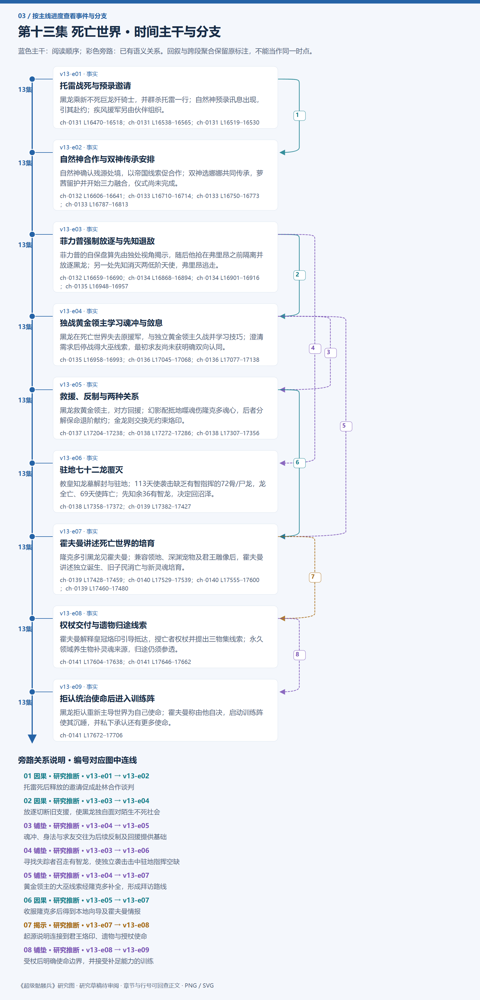

# 第十三集 死亡世界 · 剧情结构

[剧情目录](README.md) · [本集九维报告](../../vol13.md)

## 主线时间与分支图片

[PNG原尺寸](images/vol-13.png) · [SVG矢量图](images/vol-13.svg) · [全书图片目录](images.md)

## 本集因果、伏笔与回收关系

| 起点 | 关系 | 终点 | 研究说明 |
|---|---|---|---|
| [托雷战死与预录邀请](vol-13.md) | 因果 | [自然神合作与双神传承安排](vol-13.md) | 托雷死后释放的邀请促成赴林合作谈判 |
| [菲力普强制放逐与先知退敌](vol-13.md) | 因果 | [独战黄金领主学习魂冲与敛息](vol-13.md) | 放逐切断旧支援，使黑龙独自面对陌生不死社会 |
| [独战黄金领主学习魂冲与敛息](vol-13.md) | 铺垫 | [救援、反制与两种关系](vol-13.md) | 魂冲、身法与求友交往为后续反制及回援提供基础 |
| [菲力普强制放逐与先知退敌](vol-13.md) | 铺垫 | [驻地七十二龙覆灭](vol-13.md) | 寻找失踪者召走有智龙，使独立袭击击中驻地指挥空缺 |
| [独战黄金领主学习魂冲与敛息](vol-13.md) | 铺垫 | [霍夫曼讲述死亡世界的培育](vol-13.md) | 黄金领主的大巫线索经隆克多补全，形成拜访路线 |
| [救援、反制与两种关系](vol-13.md) | 因果 | [霍夫曼讲述死亡世界的培育](vol-13.md) | 收服隆克多后得到本地向导及霍夫曼情报 |
| [霍夫曼讲述死亡世界的培育](vol-13.md) | 揭示 | [权杖交付与遗物归途线索](vol-13.md) | 起源说明连接到君王烙印、遗物与授杖使命 |
| [权杖交付与遗物归途线索](vol-13.md) | 铺垫 | [拒认统治使命后进入训练阵](vol-13.md) | 受杖后明确使命边界，并接受补足能力的训练 |

跨集联系见[全部语义关系](relations.md)与[跨集剧情线](README.md)。

## 事件、人物与认知依据

### 托雷战死与预录邀请

判断类型：原文事实

黑龙乘新不死巨龙歼骑士，并群杀托雷一行；自然神预录讯息出现，引其赴约；疾风援军另由伙伴组织。

人物：[黑龙](../cards/chr-9f2e5fcbba87455eb37e35869ea8854d.md)、[托雷](../cards/chr-7d10e8845f90455d8c876a7c5d7a7c6c.md)、[黑二](../cards/chr-24b9d252fb624865a46d717832261c68.md)、[米勒达布隆迪](../cards/chr-4aafb8822bf64bb099f0e9abe3ae67c9.md)、[里维里斯特](../cards/chr-d08ae3acd751409d846ab3e89561060d.md)、[阿古力特](../cards/chr-37825d4ef6be40189c50d630eb315f4c.md)、[斯文哥尔](../cards/chr-24438669720a4bb8a0a27cbd25eadb33.md)、[龙焰（不死巨龙）](../cards/chr-f2a9a17c2694466781c17d1baf8f5663.md)

- 米勒达布隆迪：怀疑；自然神用预录通信可能因陨落而极弱。

| 章节 | 行号 | 判断类型 |
|---|---|---|
| ch-0131 第二章 来自过去的邀请 | 16470–16518 | 原文事实 |
| ch-0131 第二章 来自过去的邀请 | 16538–16565 | 原文事实 |
| ch-0131 第二章 来自过去的邀请 | 16519–16530 | 原文事实 |

### 自然神合作与双神传承安排

判断类型：原文事实

自然神确认残源处境，以帝国线索促合作；双神选娜娜共同传承，萝茜留护并开始三力融合，仪式尚未完成。

人物：[黑龙](../cards/chr-9f2e5fcbba87455eb37e35869ea8854d.md)、[里维里斯特](../cards/chr-d08ae3acd751409d846ab3e89561060d.md)、[克丽丝](../cards/chr-d1af2401c91342228738940630a00180.md)、[娜娜](../cards/chr-1d629a39da3e41149707e5f9f636defd.md)、[拉西萝茜](../cards/chr-54e84c6e82214a26921887c503f519ee.md)、[洛特](../cards/chr-345d1d88371947b7815469b3740c9e78.md)、[米勒达布隆迪](../cards/chr-4aafb8822bf64bb099f0e9abe3ae67c9.md)

- 读者：知道；双神希望借娜娜绑定黑龙；预录通信还用于防范黑龙窥源。

- 黑龙：未知；双神完整私下交易和绑定目的。

| 章节 | 行号 | 判断类型 |
|---|---|---|
| ch-0132 第三章 自然之神 | 16606–16641 | 原文事实 |
| ch-0133 第四章 神o传承者 | 16710–16714 | 原文事实 |
| ch-0133 第四章 神o传承者 | 16750–16773 | 原文事实 |
| ch-0133 第四章 神o传承者 | 16787–16813 | 原文事实 |

### 菲力普强制放逐与先知退敌

判断类型：原文事实

菲力普的自保盘算先由独处视角揭示，随后他抢在弗里昂之前隔离并放逐黑龙；另一处先知消灭两低阶天使，弗里昂逃走。

人物：[菲力普](../cards/chr-f5b27f27591c4a9f9b29844c3ab97ee0.md)、[黑龙](../cards/chr-9f2e5fcbba87455eb37e35869ea8854d.md)、[米勒达布隆迪](../cards/chr-4aafb8822bf64bb099f0e9abe3ae67c9.md)、[弗里昂](../cards/chr-d1d8100576de44c78523a33978ff5838.md)

- 读者：知道；菲力普为保存独立人格，希望黑龙壮大作为抵抗势力。

- 黑龙：误以为；失去魂链可能意味着所有孩子消亡，尚未理解领域遮断。

| 章节 | 行号 | 判断类型 |
|---|---|---|
| ch-0132 第三章 自然之神 | 16659–16690 | 原文事实 |
| ch-0134 第五章 放逐 | 16868–16894 | 原文事实 |
| ch-0134 第五章 放逐 | 16901–16916 | 原文事实 |
| ch-0135 第六章 死亡世界？ | 16948–16957 | 原文事实 |

### 独战黄金领主学习魂冲与敛息

判断类型：原文事实

黑龙在死亡世界失去原援军，与独立黄金领主久战并学习技巧；澄清需求后停战得大巫线索，最初求友尚未获明确双向认同。

人物：[黑龙](../cards/chr-9f2e5fcbba87455eb37e35869ea8854d.md)、[金龙](../cards/chr-298c7fc48c534d1ba9027fc898a29cbb.md)、[雷奥形死息傀儡](../cards/chr-28e17940311e4d20bb1a4b8e5753e1fc.md)

- 金龙：误以为；不抢领地的外来上位者必为猎取灵魂而来。

| 章节 | 行号 | 判断类型 |
|---|---|---|
| ch-0135 第六章 死亡世界？ | 16958–16993 | 原文事实 |
| ch-0136 第七章 灵魂冲击 | 17045–17068 | 原文事实 |
| ch-0136 第七章 灵魂冲击 | 17077–17138 | 原文事实 |

### 救援、反制与两种关系

判断类型：原文事实

黑龙救黄金领主，对方回援；幻影配抵地噬魂伤隆克多魂心，后者分解保命退阶献约；金龙则交换无约束烙印。

人物：[黑龙](../cards/chr-9f2e5fcbba87455eb37e35869ea8854d.md)、[金龙](../cards/chr-298c7fc48c534d1ba9027fc898a29cbb.md)、[隆克多](../cards/chr-b849a4aef8ed4c03a9baf8ffd28a1d06.md)

- 隆克多：知道；黑龙确为悼亡之主，但自己尚未得到晋升方法。

| 章节 | 行号 | 判断类型 |
|---|---|---|
| ch-0137 第八章 枪不是这样使的 | 17204–17238 | 原文事实 |
| ch-0138 第九章 金龙 | 17272–17286 | 原文事实 |
| ch-0138 第九章 金龙 | 17307–17356 | 原文事实 |

### 驻地七十二龙覆灭

判断类型：原文事实

教皇知龙墓解封与驻地；113天使袭击缺乏有智指挥的72骨/尸龙，龙全亡、69天使阵亡；先知余36有智龙，决定回沼泽。

人物：[教皇](../cards/chr-fa5f928c72f34e6292fef0b12b0579e9.md)、[弗里昂](../cards/chr-d1d8100576de44c78523a33978ff5838.md)、[米勒达布隆迪](../cards/chr-4aafb8822bf64bb099f0e9abe3ae67c9.md)

- 米勒达布隆迪：怀疑；众神提供的龙墓封印可能藏有监控，使其知道解封。

| 章节 | 行号 | 判断类型 |
|---|---|---|
| ch-0138 第九章 金龙 | 17358–17372 | 原文事实 |
| ch-0139 第十章 偷袭 | 17382–17427 | 原文事实 |

### 霍夫曼讲述死亡世界的培育

判断类型：原文事实

隆克多引黑龙见霍夫曼；兼容领地、深渊宠物及君王雕像后，霍夫曼讲述独立诞生、旧子民消亡与新灵魂培育。

人物：[黑龙](../cards/chr-9f2e5fcbba87455eb37e35869ea8854d.md)、[隆克多](../cards/chr-b849a4aef8ed4c03a9baf8ffd28a1d06.md)、[霍夫曼](../cards/chr-6383b070d61640f5942f76b07be1189b.md)

- 隆克多：怀疑；起初怀疑霍夫曼的造世说，听完仍需区分口述和亲见。

| 章节 | 行号 | 判断类型 |
|---|---|---|
| ch-0139 第十章 偷袭 | 17428–17459 | 原文事实 |
| ch-0140 第十一章 巫妖共主 | 17529–17539 | 原文事实 |
| ch-0140 第十一章 巫妖共主 | 17555–17600 | 原文事实 |
| ch-0139 第十章 偷袭 | 17460–17480 | 原文事实 |

### 权杖交付与遗物归途线索

判断类型：原文事实

霍夫曼解释皇冠烙印引导抵达，授亡者权杖并提出三物集线索；永久领域养生物补灵魂来源，归途仍须参透。

人物：[黑龙](../cards/chr-9f2e5fcbba87455eb37e35869ea8854d.md)、[霍夫曼](../cards/chr-6383b070d61640f5942f76b07be1189b.md)、[隆克多](../cards/chr-b849a4aef8ed4c03a9baf8ffd28a1d06.md)

- 霍夫曼：未知；不死帝国消失的实际原因。

- 黑龙：未知；永恒之眼下落与如何用遗物回原位面。

| 章节 | 行号 | 判断类型 |
|---|---|---|
| ch-0141 第十二章 使命 | 17604–17638 | 原文事实 |
| ch-0141 第十二章 使命 | 17646–17662 | 原文事实 |

### 拒认统治使命后进入训练阵

判断类型：原文事实

黑龙拒认重新主导世界为自己使命；霍夫曼称由他自决，启动训练阵使其沉睡，并私下承认还有更多使命。

人物：[黑龙](../cards/chr-9f2e5fcbba87455eb37e35869ea8854d.md)、[霍夫曼](../cards/chr-6383b070d61640f5942f76b07be1189b.md)、[隆克多](../cards/chr-b849a4aef8ed4c03a9baf8ffd28a1d06.md)

- 读者：未知；法阵具体机制、醒后变化和霍夫曼余下使命。

| 章节 | 行号 | 判断类型 |
|---|---|---|
| ch-0141 第十二章 使命 | 17672–17706 | 原文事实 |

## 本集当时的剧情线判断

这是分集历史判断，后续回收结果以跨集终点页为准。

### 第13集 · 森林巨树与自然之神

当时状态：部分回收

自然神合作、矮人改造和生者信仰安排将如何落实？

巨树身份与残源处境揭示，通信限制也得到自保动机解释；帝国情报仍未交付。

[查看全书终点判断](threads/book-4f19b0c4054c.md)

### 第13集 · 娜娜保护与双神传承

当时状态：部分回收

共同传承能否完成，娜娜是否拥有足够选择空间？

已选定并留自然森林，萝茜承诺守护，仪式需月年，不能当成已成神。

[查看全书终点判断](threads/book-cb9c67d1cdae.md)

### 第13集 · 克丽丝脱困与载体合作

当时状态：部分回收

她能否借传承解除封印，与自然神的合作有何代价？

用萝茜接管会谈并参与传承安排；仍受封印，跨界后失去黑龙定位。

[查看全书终点判断](threads/book-e90db68cb625.md)

### 第13集 · 天使人格与教会追捕

当时状态：部分回收

菲力普能否保住人格，强制放逐能否实现其扶植意图？

怕净化及希望黑龙壮大的动机确认，强放逐完成；长期结果及教会内部审查未结。

[查看全书终点判断](threads/book-02ba45413b1e.md)

### 第13集 · 平等朋友与受安排的成长

当时状态：部分回收

自由如何跨越对伙伴的控制与他人赋予的使命？

金龙成为无约束朋友，隆克多成为魂约臣属；黑龙拒认统治使命但接受法阵。

[查看全书终点判断](threads/book-37dd82abc178.md)

### 第13集 · 龙墓资源释放后的代价

当时状态：部分回收

余下龙群如何面对教会与失去君王联络？

这是第12集取石/破封目标完成后的龙群生存新问题，不重开已完成远征。72无智龙毁灭，36有智龙随先知保留；复仇及主从重联未完成。

[查看全书终点判断](threads/book-0ee308c4a60f.md)

### 第13集 · 死亡世界、遗物与悼亡成长

当时状态：部分回收

帝国为何消失，三件遗物如何揭线索与实现回归？

霍夫曼讲述新世界培育，权杖已得、皇冠引导说明，永恒之眼未知；训练阵仅启动。

[查看全书终点判断](threads/book-2c92e5ad3024.md)

### 第13集 · 放逐后的定位与归途

当时状态：未回收

黑龙如何回到原位面并恢复与同伴联络？

黑龙已在死亡世界，原同伴确认其未死但无坐标；霍夫曼给遗物方向，未实现回归。

[查看全书终点判断](threads/book-688f780712b6.md)
