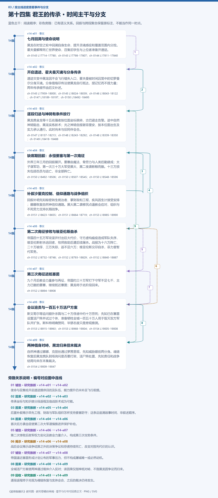

# 第十四集 君王的传承 · 剧情结构

[剧情目录](README.md) · [本集九维报告](../../vol14.md)

## 主线时间与分支图片

[PNG原尺寸](images/vol-14.png) · [SVG矢量图](images/vol-14.svg) · [全书图片目录](images.md)

## 本集因果、伏笔与回收关系

| 起点 | 关系 | 终点 | 研究说明 |
|---|---|---|---|
| [七月回溯与使命说明](vol-14.md) | 铺垫 | [开启遗迹、霍夫曼灭魂与分身传承](vol-14.md) | 使命与召集给开启遗迹提供目的及队伍，能力提升仍未补足飞行前提。 |
| [开启遗迹、霍夫曼灭魂与分身传承](vol-14.md) | 因果 | [逐段归途与神骑有条件放行](vol-14.md) | 传承坐标与知识使分段返程及临战新术成为可能。 |
| [补叙沙里克控制、信仰通路与战争组织](vol-14.md) | 因果 | [缺席期回叙：永恒要塞与第一次南征](vol-14.md) | 后置补叙揭示早先工程、财政与军队组织怎样支持要塞防守；这条边追溯故事时间，非叙述顺序。 |
| [缺席期回叙：永恒要塞与第一次南征](vol-14.md) | 因果 | [第二次南征惨败与维亚伦斯自杀](vol-14.md) | 首次后方袭击促使第二次大军谨慎推进并保护补给。 |
| [第二次南征惨败与维亚伦斯自杀](vol-14.md) | 铺垫 | [第三次南征进抵塞茵](vol-14.md) | 第二次惨败后政军权力变化及教会力量介入，构成第三次攻势条件。 |
| [第二次南征惨败与维亚伦斯自杀](vol-14.md) | 揭示 | [会议追责与一百五十万活尸方案](vol-14.md) | 战后会议揭示战争结算之外的决策争议和俘虏持续死亡，改变对胜利代价的认识。 |
| [第三次南征进抵塞茵](vol-14.md) | 铺垫 | [会议追责与一百五十万活尸方案](vol-14.md) | 帝国逼近塞茵形成计划公布的军事压力，但不构成屠城唯一或必然动机。 |
| [会议追责与一百五十万活尸方案](vol-14.md) | 因果 | [两神借身对峙，黑龙归来但未裁决](vol-14.md) | 全城活尸方案使两神通过载体介入反对；该因果仅指神祇对峙，不指黑龙因争论而归来。 |
| [逐段归途与神骑有条件放行](vol-14.md) | 回收 | [两神借身对峙，黑龙归来但未裁决](vol-14.md) | 逐段返程终于兑现为魂链恢复与实体会合，之后的裁决仍待发生。 |

跨集联系见[全部语义关系](relations.md)与[跨集剧情线](README.md)。

## 事件、人物与认知依据

### 七月回溯与使命说明

判断类型：原文事实

黑龙在时空之轮中回溯自身生命，提升灵魂感应和覆盖范围内分控。霍夫曼解释死亡世界使命，召集旧学生与上位者准备开遗迹。

人物：[黑龙](../cards/chr-9f2e5fcbba87455eb37e35869ea8854d.md)、[霍夫曼](../cards/chr-6383b070d61640f5942f76b07be1189b.md)、[隆克多](../cards/chr-b849a4aef8ed4c03a9baf8ffd28a1d06.md)

- 黑龙：知道；已获自己的记忆回溯与新感应能力，但尚未取得后来的君王记忆。

| 章节 | 行号 | 判断类型 |
|---|---|---|
| ch-0143 第一章 使命传承 | 17714–17780 | 原文事实 |
| ch-0143 第一章 使命传承 | 17798–17807 | 原文事实 |
| ch-0144 第二章 遗迹之秘 | 17811–17840 | 原文事实 |

### 开启遗迹、霍夫曼灭魂与分身传承

判断类型：原文事实

遗迹灾变中黑龙因不会飞行错失入口，霍夫曼被时间囚笼中的切罗曼尔分身灭魂。分身借烙印传法使黑龙自行抵达，授记忆而不授力量；两年传承细节由后文补述。

人物：[黑龙](../cards/chr-9f2e5fcbba87455eb37e35869ea8854d.md)、[霍夫曼](../cards/chr-6383b070d61640f5942f76b07be1189b.md)、[切罗曼尔（时间囚笼分身）](../cards/chr-69052759b0c94e52be70bb2b90d7514d.md)、[隆克多](../cards/chr-b849a4aef8ed4c03a9baf8ffd28a1d06.md)

- 读者：知道；本体早已死亡，眼前为临终分身；霍夫曼已死，分身最终结局尚未展示。

| 章节 | 行号 | 判断类型 |
|---|---|---|
| ch-0145 第三章 开启遗迹 | 17959–18000 | 原文事实 |
| ch-0145 第三章 开启遗迹 | 18024–18039 | 原文事实 |
| ch-0146 第四章 时间囚笼 | 18043–18122 | 原文事实 |
| ch-0147 第五章 无尽深渊 | 18189–18197 | 原文事实 |
| ch-0150 第八章 同盟之危 | 18492–18495 | 原文事实 |

### 逐段归途与神骑有条件放行

判断类型：原文事实

黑龙携金龙等十五名强者按位面坐标跳转，古巴避走告警。途中自然神骑阻击，黑龙实练新术；光之神骑自报谢菲里安，按本位面出生及实力承认通行。此时尚未与旧同伴会合。

人物：[黑龙](../cards/chr-9f2e5fcbba87455eb37e35869ea8854d.md)、[金龙](../cards/chr-298c7fc48c534d1ba9027fc898a29cbb.md)、[隆克多](../cards/chr-b849a4aef8ed4c03a9baf8ffd28a1d06.md)、[列维斯](../cards/chr-a9fc536994c7467c9fcc8dc374ec14d1.md)、[阿昔洛韦](../cards/chr-ba471d7e9b574913bbb2568346ebb7a3.md)、[古巴](../cards/chr-5ea71121d70a4f5da6f23a654c5c16a0.md)、[大地神骑](../cards/chr-aaa42f1c30f241be8c9d7088829a7ac3.md)、[谢菲里安](../cards/chr-18498ebcc9694896935e7cc590090228.md)

- 谢菲里安：知道；黑龙出生物质位面，依当前职责和力量判断不作为必须消灭的外来者。

- 黑龙：知道；已感到孩子存在，但途中尚不能通信或召回。

| 章节 | 行号 | 判断类型 |
|---|---|---|
| ch-0147 第五章 无尽深渊 | 18157–18213 | 原文事实 |
| ch-0148 第六章 神之骑士 | 18243–18292 | 原文事实 |
| ch-0148 第六章 神之骑士 | 18339–18350 | 原文事实 |
| ch-0149 第七章 光之神骑 | 18418–18488 | 原文事实 |

### 缺席期回叙：永恒要塞与第一次南征

判断类型：原文事实

外界三年三月的回叙展开。要塞由魔法、骨劳力与人类后勤建成；太子谋军功，第一次三十万大军受黑大、黑二夜袭断粮而撤。十三万损失包括伤员与逃亡，非全部阵亡。

人物：[黑大](../cards/chr-632a4344b53f478a93f4d308f3890b92.md)、[黑二](../cards/chr-24b9d252fb624865a46d717832261c68.md)、[阿里斯托·菲力克](../cards/chr-734a2c52592d40da8a9e0519c774b75a.md)、[维亚伦斯](../cards/chr-6ad595248196496a923620084f5c5149.md)、[米勒达布隆迪](../cards/chr-4aafb8822bf64bb099f0e9abe3ae67c9.md)、[斯文哥尔](../cards/chr-24438669720a4bb8a0a27cbd25eadb33.md)

- 读者：知道；此段是黑龙缺席期间的战争回叙，旁白同盟灭亡预告不等于当前塞茵陷落场面。

| 章节 | 行号 | 判断类型 |
|---|---|---|
| ch-0150 第八章 同盟之危 | 18492–18506 | 原文事实 |
| ch-0150 第八章 同盟之危 | 18507–18545 | 原文事实 |
| ch-0150 第八章 同盟之危 | 18548–18596 | 原文事实 |

### 补叙沙里克控制、信仰通路与战争组织

判断类型：原文事实

回叙补明先知秘密转生统治者、掌财政和工程，疾风因生计接受安排；娜娜恢复自然神信仰通路。黑大黑二袭移民点逼教会应对，组织与不死劳力支持长期战争。

人物：[米勒达布隆迪](../cards/chr-4aafb8822bf64bb099f0e9abe3ae67c9.md)、[疾风](../cards/chr-d403f485486b44e08a2fe1e3d87c7788.md)、[娜娜](../cards/chr-1d629a39da3e41149707e5f9f636defd.md)、[里维里斯特](../cards/chr-d08ae3acd751409d846ab3e89561060d.md)、[阿古力特](../cards/chr-37825d4ef6be40189c50d630eb315f4c.md)、[黑大](../cards/chr-632a4344b53f478a93f4d308f3890b92.md)、[黑二](../cards/chr-24b9d252fb624865a46d717832261c68.md)

- 疾风：怀疑；后期怀疑先知对统治者的异常安排，但无证据，故逐渐保持距离。

| 章节 | 行号 | 判断类型 |
|---|---|---|
| ch-0151 第九章 不死骑兵 | 18623–18655 | 原文事实 |
| ch-0151 第九章 不死骑兵 | 18664–18719 | 原文事实 |
| ch-0153 第十一章 先知之计 | 18985–18990 | 原文事实 |

### 第二次南征惨败与维亚伦斯自杀

判断类型：原文事实

帝国四十五万军攻坚并付出巨大代价，守方虚构瘟疫造成军队失序，维亚伦斯射杀逃回者，牧师救助后遭后续屠杀。战报为十六万阵亡、二十万被俘、三万失踪，返不足六万；维亚伦斯交印自杀，菲力普暂代军务。

人物：[维亚伦斯](../cards/chr-6ad595248196496a923620084f5c5149.md)、[阿里斯托·菲力克](../cards/chr-734a2c52592d40da8a9e0519c774b75a.md)、[菲力普](../cards/chr-f5b27f27591c4a9f9b29844c3ab97ee0.md)、[米勒达布隆迪](../cards/chr-4aafb8822bf64bb099f0e9abe3ae67c9.md)、[阿古力特](../cards/chr-37825d4ef6be40189c50d630eb315f4c.md)、[斯科特](../cards/chr-60677b93fd18486dbb9f18d6de5f823f.md)、[黑大](../cards/chr-632a4344b53f478a93f4d308f3890b92.md)

- 读者：知道；维亚伦斯已死亡；太子终身软禁为旁白交代的未来命运，勿与当前执行混同。

| 章节 | 行号 | 判断类型 |
|---|---|---|
| ch-0152 第十章 再度南征 | 18732–18748 | 原文事实 |
| ch-0152 第十章 再度南征 | 18793–18829 | 原文事实 |
| ch-0152 第十章 再度南征 | 18840–18887 | 原文事实 |

### 第三次南征进抵塞茵

判断类型：原文事实

九个月后教会力量参与再征，帝国约三十万军打下守军不足七千、主力已撤的要塞，继续抵近塞茵；黑龙将于此阶段回来。

人物：[米勒达布隆迪](../cards/chr-4aafb8822bf64bb099f0e9abe3ae67c9.md)

- 读者：未知；旁白预告之后，同盟和塞茵的最终结局仍未在本集当前场面中完成。

| 章节 | 行号 | 判断类型 |
|---|---|---|
| ch-0152 第十章 再度南征 | 18894–18908 | 原文事实 |

### 会议追责与一百五十万活尸方案

判断类型：原文事实

斯文哥尔等追问额外杀戮与二十万俘虏中约十万劳死；先知已在塞茵设置活尸阵并试过个体，准备牺牲全城一百五十万人用于毁灭双方军队并扩张。斯科特明确赞同，毕瑟态度只是旁观推测。

人物：[米勒达布隆迪](../cards/chr-4aafb8822bf64bb099f0e9abe3ae67c9.md)、[斯文哥尔](../cards/chr-24438669720a4bb8a0a27cbd25eadb33.md)、[艾琳](../cards/chr-29cb2b388f194a1c8b2e424c96dee814.md)、[阿古力特](../cards/chr-37825d4ef6be40189c50d630eb315f4c.md)、[斯科特](../cards/chr-60677b93fd18486dbb9f18d6de5f823f.md)、[毕瑟格林](../cards/chr-b72287e437f54ec19819a94091f46ce3.md)、[黑大](../cards/chr-632a4344b53f478a93f4d308f3890b92.md)、[娜娜](../cards/chr-1d629a39da3e41149707e5f9f636defd.md)、[拉西萝茜](../cards/chr-54e84c6e82214a26921887c503f519ee.md)

- 斯科特：知道；听到后续扩张构想并明确表示喜欢。

- 读者：知道；布阵与个体试验已发生，全城发动、消灭双方五十万军、征服精灵都仍是计划。

| 章节 | 行号 | 判断类型 |
|---|---|---|
| ch-0153 第十一章 先知之计 | 18915–18963 | 原文事实 |
| ch-0153 第十一章 先知之计 | 18968–19004 | 原文事实 |
| ch-0154 第十二章 再见黑龙 | 19005–19008 | 原文事实 |

### 两神借身对峙，黑龙归来但未裁决

判断类型：原文事实

自然神通过娜娜、克丽丝通过萝茜显现，先知威胁眼前两分身。魂链恢复后黑龙携队到场询问是否要打架，活尸阵处置、先知责任和战争结局均未在本集裁决。

人物：[黑龙](../cards/chr-9f2e5fcbba87455eb37e35869ea8854d.md)、[米勒达布隆迪](../cards/chr-4aafb8822bf64bb099f0e9abe3ae67c9.md)、[娜娜](../cards/chr-1d629a39da3e41149707e5f9f636defd.md)、[里维里斯特](../cards/chr-d08ae3acd751409d846ab3e89561060d.md)、[拉西萝茜](../cards/chr-54e84c6e82214a26921887c503f519ee.md)、[克丽丝](../cards/chr-d1af2401c91342228738940630a00180.md)、[斯文哥尔](../cards/chr-24438669720a4bb8a0a27cbd25eadb33.md)

- 读者：知道；两神只是借载体出现分身，未证本源复原或少女原人格完全恢复。

- 黑龙：未知；刚回到会议，文本尚未证明已获知全部活尸方案及战争代价。

| 章节 | 行号 | 判断类型 |
|---|---|---|
| ch-0154 第十二章 再见黑龙 | 19009–19047 | 原文事实 |

## 本集当时的剧情线判断

这是分集历史判断，后续回收结果以跨集终点页为准。

### 第14集 · 死亡世界归途

当时状态：已回收

黑龙能否重新连通旧同伴并实体返回？

本次失联后的跨位面归途于卷末实体会合回收；不代表死亡世界全部居民问题、领地危机或君王使命解决。

[查看全书终点判断](threads/book-688f780712b6.md)

### 第14集 · 古国、悼亡与帝国遗产

当时状态：部分回收

黑龙的悼亡身份与旧帝国、永恒之眼及使命有何关系？

君王分身、记忆传承和帝国重临目的获得说明；古国历史和使命终极机制仍有未明，不能因拿到记忆便关闭宽问题。

[查看全书终点判断](threads/book-2c92e5ad3024.md)

### 第14集 · 君王分身的有限传承与强制使命

当时状态：部分回收

分身能传下什么、余命如何结束、继承是否约束黑龙选择？

确认记忆不等于力量，黑龙人格未被替代；分身灭霍夫曼表现强制使命，但终局存亡与黑龙的最终选择未明。

[查看全书终点判断](threads/book-f6314cbd93ce.md)

### 第14集 · 黑龙自主性与同伴边界

当时状态：部分回收

强大与领袖身份将怎样影响黑龙同同伴的关系和自主判断？

无约束烙印召来金龙，黑龙返程考虑全队安全；归来面对内部伦理分裂，尚未决定如何对待先知与反对者。

[查看全书终点判断](threads/book-37dd82abc178.md)

### 第14集 · 自然神的信仰通路与森林共同体

当时状态：部分回收

森林神祇如何恢复信仰、力量与行动能力？

娜娜已成为信仰媒介，自然神可借她显现分身；不是完全恢复本体或突破位面限制。此前信力仍涌入的口径疑点保留。

[查看全书终点判断](threads/book-4f19b0c4054c.md)

### 第14集 · 娜娜的身份、保护与神性承载

当时状态：部分回收

娜娜的力量与意志如何在多方利用和保护中得到界定？

信仰媒介功能已运作，末尾自然神借身；娜娜起初未全懂会议，本人认知与神祇发言仍不可合并，双神传承未证完成。

[查看全书终点判断](threads/book-cb9c67d1cdae.md)

### 第14集 · 克丽丝的封印、载体与信仰恢复

当时状态：部分回收

克丽丝怎样从封印中恢复，借萝茜显现意味着什么？

冥月神殿重建初有进展，分身通过萝茜出场；本源仍被封印，不能以此宣布完全复原或萝茜人格恢复。

[查看全书终点判断](threads/book-e90db68cb625.md)

### 第14集 · 黑龙领地的财政、工程与代理治理

当时状态：部分回收

不死劳动与政治组织将把领地带向怎样的统治方式？

建设、矿业、财政与军事有效整合，但统治者秘密转生及俘虏劳死揭开代价；黑龙回来后如何约束代理权尚待后文。

[查看全书终点判断](threads/book-5c6c99356f4d.md)

### 第14集 · 同盟战争与超常力量的政治后果

当时状态：未回收

三次南征后，塞茵和同盟能否存续，战争将怎样结束？

前两次南征受挫，第三次推进到塞茵；旁白有灭亡预告，但当前战局、全城处置和最终结算尚未展示。

[查看全书终点判断](threads/book-db9eea600737.md)

### 第14集 · 教会、神骑与神性主体的不同职责

当时状态：部分回收

宗教名义下的军队、骑士和神祇是否按同一利益行动？

神骑按位面职责放行，牧师在败军中救助，教会军团第三次介入；两神通过载体反对先知，不能合并成单一阵营意志。

[查看全书终点判断](threads/book-02ba45413b1e.md)

### 第14集 · 塞茵全城活尸计划与授权危机

当时状态：未回收

先知的全城法阵是否发动，黑龙将如何处理其计划与责任？

法阵已设并做过个体试验；一百五十万城民未在本集全部变活尸。斯科特赞成，两神反对，黑龙仅到场，未裁决或拆阵。

[查看全书终点判断](threads/book-f7d8b02957f0.md)
