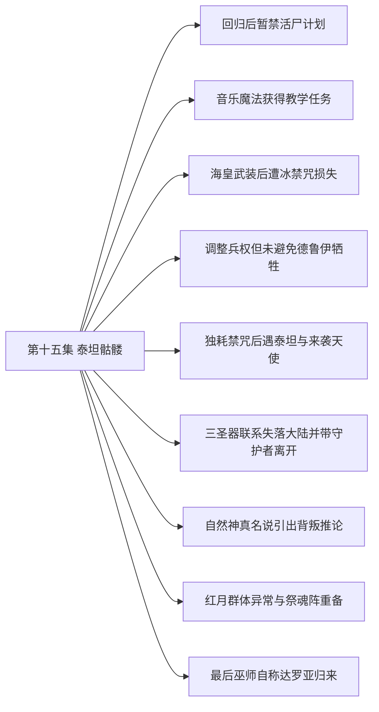

# 第十五集 泰坦骷髅 · 剧情结构

[剧情目录](README.md) · [本集九维报告](../../vol15.md)

## 主线树

## 本集因果、伏笔与回收关系

| 起点 | 关系 | 终点 | 研究说明 |
|---|---|---|---|
| [回归后暂禁活尸计划](vol-15.md) | 铺垫 | [调整兵权但未避免德鲁伊牺牲](vol-15.md) | 回归后的集中决策为收回私人兵权建立权威，具体触发是德鲁伊争执。 |
| [海皇武装后遭冰禁咒损失](vol-15.md) | 因果 | [独耗禁咒后遇泰坦与来袭天使](vol-15.md) | 孩子损失促使黑龙独返，用个人魂力换取突破。 |
| [独耗禁咒后遇泰坦与来袭天使](vol-15.md) | 铺垫 | [三圣器联系失落大陆并带守护者离开](vol-15.md) | 误会缓解和共同退敌使守护者进入交流与交眼。 |
| [三圣器联系失落大陆并带守护者离开](vol-15.md) | 因果 | [自然神真名说引出背叛推论](vol-15.md) | 回归要求中的平衡与残警告推动黑龙向自然神索真名。 |
| [回归后暂禁活尸计划](vol-15.md) | 转折 | [红月群体异常与祭魂阵重备](vol-15.md) | 原先暂禁的大阵回到备选清单，表明初禁基于时机和收益。 |
| [红月群体异常与祭魂阵重备](vol-15.md) | 因果 | [最后巫师自称达罗亚归来](vol-15.md) | 死亡后聚能的规律经主动献身推向单一主体。 |
| [三圣器联系失落大陆并带守护者离开](vol-15.md) | 呼应 | [最后巫师自称达罗亚归来](vol-15.md) | 远方旧君王联系与现场自称旧君王形成历史进入现时的呼应。 |

跨集联系见[全部语义关系](relations.md)与[跨集剧情线](README.md)。

## 事件、人物与认知依据

### 回归后暂禁活尸计划

判断类型：原文事实

黑龙重返同伴，以位面规则和当前利益暂禁百万活尸阵，保留正常交战与撤退选择。

人物：[黑龙](../cards/chr-9f2e5fcbba87455eb37e35869ea8854d.md)、[米勒达布隆迪](../cards/chr-4aafb8822bf64bb099f0e9abe3ae67c9.md)、[斯文哥尔](../cards/chr-24438669720a4bb8a0a27cbd25eadb33.md)、[娜娜](../cards/chr-1d629a39da3e41149707e5f9f636defd.md)、[菲力普](../cards/chr-f5b27f27591c4a9f9b29844c3ab97ee0.md)

- 黑龙：知道；菲力普以自身价值希望自己存续；神降临有限制。

| 章节 | 行号 | 判断类型 |
|---|---|---|
| ch-0156 第一章 黑龙回归 | 19055–19118 | 原文事实 |
| ch-0157 第二章 大战将起 | 19212–19267 | 原文事实 |

### 音乐魔法获得教学任务

判断类型：原文事实

罗得的异常力场经误认和排除后被解释为音乐魔法，黑龙安排招人并令其教学。

人物：[黑龙](../cards/chr-9f2e5fcbba87455eb37e35869ea8854d.md)、[罗得宾士](../cards/chr-0d52140c20bf4dc5be05fbdc80d9ace1.md)、[哥顿普](../cards/chr-968add4b94d440cbabc01e3b0558d55d.md)、[斯文哥尔](../cards/chr-24438669720a4bb8a0a27cbd25eadb33.md)、[米勒达布隆迪](../cards/chr-4aafb8822bf64bb099f0e9abe3ae67c9.md)

- 斯文哥尔：误以为；最初疑罗得是魔力指挥使，随后被先知纠正。

| 章节 | 行号 | 判断类型 |
|---|---|---|
| ch-0157 第二章 大战将起 | 19289–19295 | 原文事实 |
| ch-0158 第三章 魔力神o | 19296–19397 | 原文事实 |

### 海皇武装后遭冰禁咒损失

判断类型：原文事实

八晶体补魂获得海皇武装；黑龙经海蛇到海底遗迹，逃禁咒时十七十八被冰封冻碎，未见恢复。

人物：[黑龙](../cards/chr-9f2e5fcbba87455eb37e35869ea8854d.md)、[十一](../cards/chr-d7a6e7fd87da4749afae2de8a843d24b.md)、[十二](../cards/chr-fb9ec888c05746ce87489ade2cba50b0.md)、[十三](../cards/chr-f5e7932dbd0142cfb24f0fde4873a721.md)、[十四](../cards/chr-6b6717e1b38440a68456d0a7321752f0.md)、[十五](../cards/chr-832a86a6060d4964b0a8d51a71208ab1.md)、[十六](../cards/chr-fb4f84f38467406ab192ae39bbf114ee.md)、[十七](../cards/chr-40a24388435142d49b744c61dc760208.md)、[十八](../cards/chr-3d9a84b43005445fbf04f8dd0b2fc9fd.md)

- 黑龙：知道；无魂傀儡不受魂威慑，禁咒威胁可伤及有意识孩子。

| 章节 | 行号 | 判断类型 |
|---|---|---|
| ch-0159 第四章 海皇武装 | 19462–19529 | 原文事实 |
| ch-0160 第五章 安息之海 | 19533–19600 | 原文事实 |
| ch-0161 第六章 无心傀儡 | 19604–19649 | 原文事实 |

### 调整兵权但未避免德鲁伊牺牲

判断类型：原文事实

黑龙把德鲁伊出战数减半，强收先知三十六龙魂约仍留指挥职；已投入的五十余德鲁伊全部战死后尸兵扭转局面。

人物：[黑龙](../cards/chr-9f2e5fcbba87455eb37e35869ea8854d.md)、[米勒达布隆迪](../cards/chr-4aafb8822bf64bb099f0e9abe3ae67c9.md)、[里维里斯特](../cards/chr-d08ae3acd751409d846ab3e89561060d.md)、[斯文哥尔](../cards/chr-24438669720a4bb8a0a27cbd25eadb33.md)

| 章节 | 行号 | 判断类型 |
|---|---|---|
| ch-0161 第六章 无心傀儡 | 19693–19730 | 原文事实 |
| ch-0162 第七章 禁地之墓 | 19731–19779 | 原文事实 |

### 独耗禁咒后遇泰坦与来袭天使

判断类型：原文事实

黑龙付魂力代价独闯，毁傀儡后封印自行开；泰坦先攻，四翼女子来袭使双方暂联手毁其躯体、迫圣气退走。

人物：[黑龙](../cards/chr-9f2e5fcbba87455eb37e35869ea8854d.md)、[阿鲁霍夫克斯](../cards/chr-4d337e033ff24db381f736c1da206aec.md)、[禁地之墓四翼天使](../cards/chr-67d04695287f422f89719916c99d9a06.md)

- 黑龙：知道；死亡之眼仍由守护者保有；天使是双方共同敌人。

| 章节 | 行号 | 判断类型 |
|---|---|---|
| ch-0162 第七章 禁地之墓 | 19782–19858 | 原文事实 |
| ch-0163 第八章 黄金泰坦 | 19862–19985 | 原文事实 |

### 三圣器联系失落大陆并带守护者离开

判断类型：原文事实

大贤者讲亲历，三器触发意念见证红月通道、浮陆和哈力维亚。黑龙获死亡之眼与最后未用禁咒，毁墓带二守护者返回。

人物：[黑龙](../cards/chr-9f2e5fcbba87455eb37e35869ea8854d.md)、[大贤者](../cards/chr-45313c8f3c754bd9b2fbb3575e8bf435.md)、[阿鲁霍夫克斯](../cards/chr-4d337e033ff24db381f736c1da206aec.md)、[哈力维亚](../cards/chr-8aa753f481f04f0181e7bee412fb68f8.md)

- 黑龙：知道；哈力维亚存活且帝国大陆在红月通道另一侧。

- 黑龙：未知；断续警告完整含义和幕后责任未明。

| 章节 | 行号 | 判断类型 |
|---|---|---|
| ch-0164 第九章 大贤者 | 19997–20090 | 原文事实 |
| ch-0165 第十章 骷髅君王 | 20091–20207 | 原文事实 |

### 自然神真名说引出背叛推论

判断类型：原文事实

自然神称平衡神是切里莫；黑龙把三缺席君王、三主神和帝国远征相连，但正文标明只是一面之词支撑的合理推测。

人物：[黑龙](../cards/chr-9f2e5fcbba87455eb37e35869ea8854d.md)、[里维里斯特](../cards/chr-d08ae3acd751409d846ab3e89561060d.md)、[拉西萝茜](../cards/chr-54e84c6e82214a26921887c503f519ee.md)、[切里莫·亚力莫菲](../cards/chr-6e4a70b72af34722b670d0c84b4f9bb9.md)

- 黑龙：怀疑；切里莫及其他缺席君王可能以神明身份背叛帝国。

| 章节 | 行号 | 判断类型 |
|---|---|---|
| ch-0166 第十一章 平衡之神 | 20239–20335 | 原文事实 |

### 红月群体异常与祭魂阵重备

判断类型：原文事实

红月巫师无人指挥突袭，力量向生还者集中；天使现身后黑龙同意趁机出击并重备祭魂阵，称不到最后不发动。

人物：[黑龙](../cards/chr-9f2e5fcbba87455eb37e35869ea8854d.md)、[米勒达布隆迪](../cards/chr-4aafb8822bf64bb099f0e9abe3ae67c9.md)、[斯文哥尔](../cards/chr-24438669720a4bb8a0a27cbd25eadb33.md)、[菲力普](../cards/chr-f5b27f27591c4a9f9b29844c3ab97ee0.md)

- 黑龙：怀疑；红月异常可能由其后强大存在或通道传力引起。

| 章节 | 行号 | 判断类型 |
|---|---|---|
| ch-0167 第十二章 疯狂红月 | 20344–20465 | 原文事实 |

### 最后巫师自称达罗亚归来

判断类型：原文事实

战死、自爆与主动合一只余一人，侵蚀一名降临天使躯体后自报达罗亚力绯克；黑龙会意挥手出城。

人物：[黑龙](../cards/chr-9f2e5fcbba87455eb37e35869ea8854d.md)、[米勒达布隆迪](../cards/chr-4aafb8822bf64bb099f0e9abe3ae67c9.md)、[菲力普](../cards/chr-f5b27f27591c4a9f9b29844c3ab97ee0.md)、[达罗亚力绯克](../cards/chr-2c0f811c29f04c4c9ed7718fd91d3a76.md)

- 读者：知道；现场主体以达罗亚之名宣布归来。

- 读者：未知；其本体与载体关系、受话者与切里莫关系尚未说明。

| 章节 | 行号 | 判断类型 |
|---|---|---|
| ch-0167 第十二章 疯狂红月 | 20470–20499 | 原文事实 |

## 本集当时的剧情线判断

这是分集历史判断，后续回收结果以跨集终点页为准。

### 第15集 · 放逐后的定位与归途

当时状态：已回收

黑龙能否回到物质位面并恢复同伴联系？

本集开场确已带十五同伴归来并重获决策；只关闭本次归途，不关闭未来跨位面风险。

[查看全书终点判断](threads/book-688f780712b6.md)

### 第15集 · 关怀、控制与群体牺牲

当时状态：部分回收

黑龙如何在亲近个体与扩大统治权之间选择？

安抚、拒毁魂与独探保护并存于收约、压制异议和重备祭魂；没有线性善化。

[查看全书终点判断](threads/book-37dd82abc178.md)

### 第15集 · 先知私兵与主君制衡

当时状态：部分回收

先知的私人利益是否得到有效约束？

三十六龙转约黑龙，先知保留指挥，私兵根基受削但末仍获祭魂准备授权。

[查看全书终点判断](threads/book-bf7a72bd8f37.md)

### 第15集 · 剩余不死龙的作战与归属

当时状态：部分回收

余下智慧龙如何存续并参与教会战争？

三十六龙仍存并从先知转约黑龙，战争继续，不能宣称全群脱险。

[查看全书终点判断](threads/book-0ee308c4a60f.md)

### 第15集 · 晶体孩子的烙印、武装与损失

当时状态：部分回收

孩子的意识来源、能力和损伤会如何变化？

八晶体武装成形和亲海形态得到表现，觉醒机制仍不明；十七十八冻碎未恢复，不能用武装升级替代存亡判断。

[查看全书终点判断](threads/book-c55cdb2efcb4.md)

### 第15集 · 音乐教学与势力资源

当时状态：部分回收

个人能力能否变成组织可重复资源？

罗得被任教并征召学员，只到准备阶段；是否有效、是否等于魔力指挥使皆不能先判。

[查看全书终点判断](threads/book-5c6c99356f4d.md)

### 第15集 · 围城、活尸备选与红月介入

当时状态：部分回收

黑龙势力如何应对教会战争和大规模牺牲选项？

围城常规战造成巨大伤亡，红月改局；祭魂阵从暂禁到准备，尚未发动或验证效果。

[查看全书终点判断](threads/book-db9eea600737.md)

### 第15集 · 天使人格与教会目标

当时状态：部分回收

天使的个体化如何改变制度服从与战局？

菲力普自陈价值动机；其他降临天使出现兴趣与不服，弗里昂担忧；四翼来袭者本源结局不明。

[查看全书终点判断](threads/book-02ba45413b1e.md)

### 第15集 · 三圣器、红月与帝国回归

当时状态：部分回收

失落帝国如何返回，谁造成旧日断裂？

第三器死亡之眼取得；亲见红月通道、浮陆和哈力维亚，得到三器破平衡指令；切里莫背叛仍是推断，末自称回归另须验证。

[查看全书终点判断](threads/book-2c92e5ad3024.md)

### 第15集 · 自然神的本源与情报交换

当时状态：部分回收

自然神会透露多少帝国秘密，其媒介安排如何持续？

明确本源常借娜娜、分身留树；受威胁吐露平衡神真名，可信范围仍限单方说明。

[查看全书终点判断](threads/book-4f19b0c4054c.md)

### 第15集 · 娜娜主体与神明承载

当时状态：部分回收

娜娜如何保持选择权，传承是否完成？

她能主动逐出神、亲近黑龙；无传承完成证据，旧魔法与本身无力说法待核。

[查看全书终点判断](threads/book-cb9c67d1cdae.md)

### 第15集 · 原萝茜的记忆与借力主体

当时状态：部分回收

原萝茜能否整合残忆并自主运用借来力量？

旧恨、亲近与嫉妒并存，自主护墙说明可运用克丽丝之力；不是旧天使人格或神明主体合并。

[查看全书终点判断](threads/book-09f441653222.md)

### 第15集 · 塞茵活尸阵的延期与重新准备

当时状态：部分回收

黑龙是否允许祭魂魔阵发动，百万平民将如何存续？

开场因时机收益否决，末遇红月转机改为准备并承诺不到最后不启；截至本集未发动，不以暂禁冒充永久放弃。

[查看全书终点判断](threads/book-f7d8b02957f0.md)

### 第15集 · 分身遗产与外加使命

当时状态：部分回收

黑龙如何承担遗产与使命，分身的结束如何进入其选择？

回述分身在三年内追上本体死亡而消失，力量与人格未因此自动等同本体；黑龙利用继承记忆认遗迹、接君王回归要求，但未完成回归使命。三年内是期限，不能改读为恰满三年。

[查看全书终点判断](threads/book-f6314cbd93ce.md)
