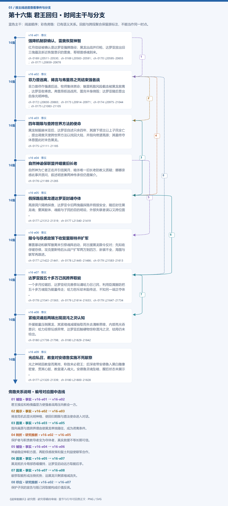

# 第十六集 君王回归 · 剧情结构

[剧情目录](README.md) · [本集九维报告](../../vol16.md)

## 主线时间与分支图片

[PNG原尺寸](images/vol-16.png) · [SVG矢量图](images/vol-16.svg) · [全书图片目录](images.md)

## 本集因果、伏笔与回收关系

| 起点 | 关系 | 终点 | 研究说明 |
|---|---|---|---|
| [强降机制获确认，雷奥恢复神智](vol-16.md) | 铺垫 | [菲力普逃离，祷言与弗里昂之死结束强者战](vol-16.md) | 君王接应和枪傀儡显力使强者战局压向教会一方。 |
| [菲力普逃离，祷言与弗里昂之死结束强者战](vol-16.md) | 揭示 | [四年期限与查跨世界方法的使命](vol-16.md) | 祷言危机后显光明神格，使回归期限与查法使命进入对话。 |
| [四年期限与查跨世界方法的使命](vol-16.md) | 因果 | [假探路后黑龙遭达罗亚封魂夺体](vol-16.md) | 指向高原与查跨界理由使黑龙单独随往，成为诱离条件。 |
| [菲力普逃离，祷言与弗里昂之死结束强者战](vol-16.md) | 转折 | [假探路后黑龙遭达罗亚封魂夺体](vol-16.md) | 保护者与职责教导者变为夺体者，真实救援不等长期可信。 |
| [自然神谕保联盟并暗害旧长老](vol-16.md) | 铺垫 | [限令与俘虏政策下收复里斯特并扩军](vol-16.md) | 神谕稳定神职方面，再配俘虏政策和复土利益使联军合作。 |
| [假探路后黑龙遭达罗亚封魂夺体](vol-16.md) | 因果 | [达罗亚毁五十多万己民跨界取能](vol-16.md) | 黑龙抵抗令局部吞噬僵持，达罗亚启动远方取能后手。 |
| [达罗亚毁五十多万己民跨界取能](vol-16.md) | 因果 | [紧缩灵魂后两端出现混沌之灵认知](vol-16.md) | 献祭取能形成压倒优势，迫黑龙只剩紧缩减流失。 |
| [菲力普逃离，祷言与弗里昂之死结束强者战](vol-16.md) | 呼应 | [达罗亚毁五十多万己民跨界取能](vol-16.md) | 保护子民的宣告与毁己民取能构成价值反讽。 |

跨集联系见[全部语义关系](relations.md)与[跨集剧情线](README.md)。

## 事件、人物与认知依据

### 强降机制获确认，雷奥恢复神智

判断类型：原文事实

红月信徒被确认是达罗亚强降路径；黑龙出战并归枪，达罗亚放出旧三傀儡及新近恢复意识的雷奥，哥顿普感魂到来。

人物：[黑龙](../cards/chr-9f2e5fcbba87455eb37e35869ea8854d.md)、[达罗亚力绯克](../cards/chr-2c0f811c29f04c4c9ed7718fd91d3a76.md)、[雷奥](../cards/chr-8e211a51f4ef4c4b8e707cb02c88a5ed.md)、[哥顿普](../cards/chr-968add4b94d440cbabc01e3b0558d55d.md)、[菲力普](../cards/chr-f5b27f27591c4a9f9b29844c3ab97ee0.md)

- 读者：知道；对菲力普的切里莫宣告面向各位面，不等身份合一。

- 黑龙：知道；雷奥从无意识死息阶段进化恢复神智。

| 章节 | 行号 | 判断类型 |
|---|---|---|
| ch-0169 第一章 君王回归 | 20511–20530 | 原文事实 |
| ch-0169 第一章 君王回归 | 20583–20591 | 原文事实 |
| ch-0170 第二章 噬魂傀儡 | 20595–20655 | 原文事实 |
| ch-0171 第三章 双方对峙 | 20659–20676 | 原文事实 |

### 菲力普逃离，祷言与弗里昂之死结束强者战

判断类型：原文事实

菲力普佯作强袭后逃，牧师集体燃命；魅冒耗散风险截击被黑龙救离，达罗亚收祷言。弗里昂拒逃战死，图克半身烧毁；达罗亚随后显出自身光明神格。

人物：[黑龙](../cards/chr-9f2e5fcbba87455eb37e35869ea8854d.md)、[菲力普](../cards/chr-f5b27f27591c4a9f9b29844c3ab97ee0.md)、[弗里昂](../cards/chr-d1d8100576de44c78523a33978ff5838.md)、[魅](../cards/chr-006089add9c541fe9bcda4dd5369d743.md)、[图克](../cards/chr-6ebb35c20edf4908b3b64159c8fd7a73.md)、[达罗亚力绯克](../cards/chr-2c0f811c29f04c4c9ed7718fd91d3a76.md)、[赫米亚](../cards/chr-88d5c65230c74b4181930d95ce4080ee.md)

- 黑龙：未知；祷言引来的远方注视者未回应切里莫试探，身份未确认。

- 读者：知道；切罗曼尔遭仲裁、公正植入光明神格，信仰供能持续消融其魂。

| 章节 | 行号 | 判断类型 |
|---|---|---|
| ch-0172 第四章 落跑天使 | 20830–20883 | 原文事实 |
| ch-0173 第五章 绝望祷言 | 20914–20971 | 原文事实 |
| ch-0174 第六章 切里莫 | 20975–21044 | 原文事实 |
| ch-0175 第七章 光明神格 | 21083–21105 | 原文事实 |

### 四年期限与查跨世界方法的使命

判断类型：原文事实

黑龙制服赫米亚后，达罗亚自述只余四年、其旗下领主以上子民全亡，提出调查天使跨世界方法以找回大陆，并指向绝望高原；其最终夺体意图此时未告黑龙。

人物：[黑龙](../cards/chr-9f2e5fcbba87455eb37e35869ea8854d.md)、[达罗亚力绯克](../cards/chr-2c0f811c29f04c4c9ed7718fd91d3a76.md)、[赫米亚](../cards/chr-88d5c65230c74b4181930d95ce4080ee.md)

- 黑龙：知道；达罗亚自述魂受光明神格消融，只余四年。

- 黑龙：怀疑；切里莫谋划生命种族兴起，最终目的仍不明。

| 章节 | 行号 | 判断类型 |
|---|---|---|
| ch-0175 第七章 光明神格 | 21111–21185 | 原文事实 |

### 自然神谕保联盟并暗害旧长老

判断类型：原文事实

自然神为亡者正名并引信冥月，暗杀唯一旧长老防教义质疑；娜娜亲感此事并质问，叙述明言兼两神传承但仍是媒介。

人物：[里维里斯特](../cards/chr-d08ae3acd751409d846ab3e89561060d.md)、[娜娜](../cards/chr-1d629a39da3e41149707e5f9f636defd.md)、[自然神殿大长老](../cards/chr-ce25acdf9048438db7830d0a65326f5e.md)、[克丽丝](../cards/chr-d1af2401c91342228738940630a00180.md)

- 娜娜：知道；大长老死于自然神微扰而非单纯自然衰老。

- 读者：未知；神谕所称教会与深渊联合尚无独立证据。

| 章节 | 行号 | 判断类型 |
|---|---|---|
| ch-0176 第八章 自然神谕 | 21189–21265 | 原文事实 |

### 假探路后黑龙遭达罗亚封魂夺体

判断类型：原文事实

高原洞穴隔绝探查，达罗亚令旧两傀儡探路并假报安全，随后封住黑龙魂；要其躯体、魂能与子民的目的明说，外部失联者误以又跨位面。

人物：[黑龙](../cards/chr-9f2e5fcbba87455eb37e35869ea8854d.md)、[达罗亚力绯克](../cards/chr-2c0f811c29f04c4c9ed7718fd91d3a76.md)、[半人马灵魂傀儡](../cards/chr-eed55a1a8e3740499b83322182b4132e.md)、[人形灵魂傀儡](../cards/chr-370e5f58f1134b4da07ba8c2fe2566e2.md)、[米勒达布隆迪](../cards/chr-4aafb8822bf64bb099f0e9abe3ae67c9.md)、[列维斯](../cards/chr-a9fc536994c7467c9fcc8dc374ec14d1.md)

- 黑龙：知道；同族与共同敌人不能保证达罗亚是可信同伴。

- 米勒达布隆迪：误以为；黑龙再次失联可能是去了死亡世界。

| 章节 | 行号 | 判断类型 |
|---|---|---|
| ch-0177 第九章 绝望高原 | 21312–21319 | 原文事实 |
| ch-0177 第九章 绝望高原 | 21340–21419 | 原文事实 |

### 限令与俘虏政策下收复里斯特并扩军

判断类型：原文事实

塞茵暴动和联军撤离未引祭魂阵启动，阿古援黑龙限令反对；先知收俘缓恐惧，攻克里斯特后从战尸扩军两万到四万，新装不全，海图与联军再跟进。

人物：[米勒达布隆迪](../cards/chr-4aafb8822bf64bb099f0e9abe3ae67c9.md)、[阿古力特](../cards/chr-37825d4ef6be40189c50d630eb315f4c.md)、[阿昔洛韦](../cards/chr-ba471d7e9b574913bbb2568346ebb7a3.md)、[列维斯](../cards/chr-a9fc536994c7467c9fcc8dc374ec14d1.md)、[黑大](../cards/chr-632a4344b53f478a93f4d308f3890b92.md)、[黑二](../cards/chr-24b9d252fb624865a46d717832261c68.md)

- 读者：知道；阶段胜利为里斯特收复与推进复土，不等全部同盟已收复。

| 章节 | 行号 | 判断类型 |
|---|---|---|
| ch-0177 第九章 绝望高原 | 21422–21441 | 原文事实 |
| ch-0178 第十章 祭天之坛 | 21445–21466 | 原文事实 |
| ch-0179 第十一章 君王之怒 | 21583–21613 | 原文事实 |

### 达罗亚毁五十多万己民跨界取能

判断类型：原文事实

一个多月拉锯后，达罗亚经完善祭坛请哈力召己民，利用臣属撤防把五十多万魂毁为能量传走；哈力怒斥却未阻传送，不知另一端正夺体。

人物：[达罗亚力绯克](../cards/chr-2c0f811c29f04c4c9ed7718fd91d3a76.md)、[哈力维亚](../cards/chr-8aa753f481f04f0181e7bee412fb68f8.md)、[塔克林](../cards/chr-a9fd3dc7a3a84a8386ced2209e1920a2.md)、[罗斯](../cards/chr-f914def0f0aa406faf41c8c89a604985.md)、[赫米亚](../cards/chr-88d5c65230c74b4181930d95ce4080ee.md)

- 哈力维亚：知道；达罗亚毁自己的忠魂取能。

- 哈力维亚：未知；这些能量被用于吞噬黑龙，他此时不知道。

| 章节 | 行号 | 判断类型 |
|---|---|---|
| ch-0178 第十章 祭天之坛 | 21541–21563 | 原文事实 |
| ch-0179 第十一章 君王之怒 | 21614–21633 | 原文事实 |
| ch-0179 第十一章 君王之怒 | 21647–21734 | 原文事实 |

### 紧缩灵魂后两端出现混沌之灵认知

判断类型：原文事实

外援能量压倒黑龙，其紧缩魂减缓抽取而失去清晰思维，内部亮光吞意识；哈力经祭坛感异常，达罗亚后触硬物惊称混沌之灵，结局仍未给出。

人物：[黑龙](../cards/chr-9f2e5fcbba87455eb37e35869ea8854d.md)、[达罗亚力绯克](../cards/chr-2c0f811c29f04c4c9ed7718fd91d3a76.md)、[哈力维亚](../cards/chr-8aa753f481f04f0181e7bee412fb68f8.md)、[塔克林](../cards/chr-a9fd3dc7a3a84a8386ced2209e1920a2.md)、[罗斯](../cards/chr-f914def0f0aa406faf41c8c89a604985.md)

- 黑龙：未知；不知道达罗亚突增能量来自五十万忠魂。

- 读者：未知；混沌之灵与黑龙具体关系、是否脱困或晋阶尚未说明。

| 章节 | 行号 | 判断类型 |
|---|---|---|
| ch-0180 第十二章 灵魂紧缩 | 21738–21798 | 原文事实 |
| ch-0180 第十二章 灵魂紧缩 | 21829–21842 | 原文事实 |

### 光应私召，教皇对安德鲁实施不死献祭

判断类型：原文事实

光之神骑因教皇而离岗，称敌未必君王；后深夜带安德鲁入黑白雕像密室，贯其心脏，教皇灌入魂火。安德鲁灵魂坠暗，醒后状态未展示。

人物：[谢菲里安](../cards/chr-18498ebcc9694896935e7cc590090228.md)、[教皇](../cards/chr-fa5f928c72f34e6292fef0b12b0579e9.md)、[安德鲁](../cards/chr-6c5caa9685ab4398b38fdff31ed8a6e5.md)

- 安德鲁：未知；教皇所说神的旨意指哪位神，未获答。

| 章节 | 行号 | 判断类型 |
|---|---|---|
| ch-0177 第九章 绝望高原 | 21320–21339 | 原文事实 |
| ch-0180 第十二章 灵魂紧缩 | 21800–21828 | 原文事实 |

## 本集当时的剧情线判断

这是分集历史判断，后续回收结果以跨集终点页为准。

### 第16集 · 帝国放逐、祭坛与魂之上阶

当时状态：部分回收

帝国如何回归，混沌之灵与已知阶序是什么关系？

强降及跨世界区别、祭坛建造和传能得到揭示；回归被夺体阴谋挪用，末混沌名出现未完成解释。

[查看全书终点判断](threads/book-2c92e5ad3024.md)

### 第16集 · 切罗曼尔记忆、死因与继承边界

当时状态：部分回收

继承记忆如何转成能力，旧死亡机制能否解除？

明确神格由两神植入、信仰持续消融；黑龙按需学习，不是原君王意识回生。公正/仲裁为切里莫分身仍假说。

[查看全书终点判断](threads/book-f6314cbd93ce.md)

### 第16集 · 达罗亚夺体与黑龙求存

当时状态：未回收

黑龙能否保住魂、身体和子民联系，达罗亚计划将如何终结？

动机、暗算和取能后手已证；黑龙末仍被吞噬，混沌异常不等胜利。

[查看全书终点判断](threads/book-488aad623ce0.md)

### 第16集 · 亲密保护、同族误信与自治

当时状态：部分回收

黑龙如何区别同伴与利用者并承担保护？

救魅兑现保护，信达暴露识人盲区；被封后不屈服，外部共同体仍依其命运。

[查看全书终点判断](threads/book-37dd82abc178.md)

### 第16集 · 天使自我与教会秘密转生

当时状态：部分回收

天使人格、教皇私令和公开教义如何冲突？

菲力普为自我逃离，弗里昂死；教皇反在密室实施不死献祭，雕像与所称神旨未知。

[查看全书终点判断](threads/book-02ba45413b1e.md)

### 第16集 · 神骑职责与私人召令

当时状态：部分回收

神骑与教皇、教会的关系将怎样显露？

雷奥恢复意识拒攻旧友；光可拒教会却应教皇，后参与刺安德鲁，旧追索转入更广的私令问题。

[查看全书终点判断](threads/book-8477942e0118.md)

### 第16集 · 塞茵祭魂阵的禁令约束

当时状态：部分回收

百万平民是否免于被阵法牺牲，谁有决定权？

外来强者主张启阵，阿古援引最后关头限制反对；先知未擅启，本集未发动。与另界五十万献魂是不同事件。

[查看全书终点判断](threads/book-f7d8b02957f0.md)

### 第16集 · 胜战后的复土与联军重组

当时状态：部分回收

军事优势能否转化为稳定合作和治理？

里斯特已收复，俘虏政策和利益带来合作；四万骑装备不齐、智慧人手少，全同盟复土尚非结果。

[查看全书终点判断](threads/book-db9eea600737.md)

### 第16集 · 失联时先知的权限边界

当时状态：部分回收

没有君王现场裁决，先知如何处理冲突？

仍受此前转约和限令约束；只能在军事与俘虏政策上调适，无法代定大规模祭魂。

[查看全书终点判断](threads/book-bf7a72bd8f37.md)

### 第16集 · 自然神保教与政治杀人

当时状态：部分回收

自然神的生存策略会付出什么道德和制度代价？

神谕保合作而暗杀旧权威，媒介娜娜反感；神职保持平静但部分信徒仍抗议。

[查看全书终点判断](threads/book-4f19b0c4054c.md)

### 第16集 · 双神传承下的娜娜主体

当时状态：部分回收

已接受传承后娜娜能否拒绝神的行为？

双传承由叙述明言，主动取回身体与质问均明确，但没有救下长老，也未成神。

[查看全书终点判断](threads/book-cb9c67d1cdae.md)

### 第16集 · 克丽丝的传承与脱封机会

当时状态：部分回收

克丽丝是否能借黑龙和媒介摆脱封印？

她有娜娜传承与萝茜代言选择，仍被说为只有黑龙能给脱封最后机会；本体未释放。

[查看全书终点判断](threads/book-e90db68cb625.md)

### 第16集 · 孩子意识与战时选择

当时状态：部分回收

孩子的意识如何产生并改变行为，各自状态有何变化？

黑大坚定与黑二怜悯有区分；两万骑中仍只有大二有智，不能推其余孩子全醒。十七十八未见恢复。雷奥恢复另在神骑与噬魂机制记录，非孩子觉醒线回收。

[查看全书终点判断](threads/book-c55cdb2efcb4.md)

### 第16集 · 军力扩张与智慧治理缺口

当时状态：部分回收

无智兵力扩张如何得到资源与治理配套？

战尸使骑兵两万增四万但装备降级；智慧者少限制广域控制，尚非完整国家治理方案。

[查看全书终点判断](threads/book-5c6c99356f4d.md)
