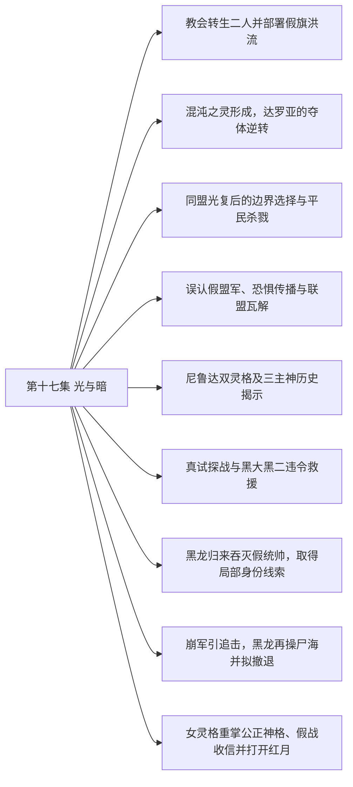

# 第十七集 光与暗 · 剧情结构

[剧情目录](README.md) · [本集九维报告](../../vol17.md)

## 主线树

## 本集因果、伏笔与回收关系

| 起点 | 关系 | 终点 | 研究说明 |
|---|---|---|---|
| [教会转生二人并部署假旗洪流](vol-17.md) | 因果 | [误认假盟军、恐惧传播与联盟瓦解](vol-17.md) | 借名与分权控制使假军进入先知的盟友模型。 |
| [混沌之灵形成，达罗亚的夺体逆转](vol-17.md) | 因果 | [黑龙归来吞灭假统帅，取得局部身份线索](vol-17.md) | 破局及搜回魂链使黑龙能定位同伴，实体回来识破借名。 |
| [同盟光复后的边界选择与平民杀戮](vol-17.md) | 铺垫 | [误认假盟军、恐惧传播与联盟瓦解](vol-17.md) | 边境推进使先知与从帝国后方来的洪流接触，其保留力量意图促使跟进。 |
| [尼鲁达双灵格及三主神历史揭示](vol-17.md) | 揭示 | [教会转生二人并部署假旗洪流](vol-17.md) | 后置历史揭示假旗和指挥印记的真实来源；为解释关系而非叙述先后。 |
| [误认假盟军、恐惧传播与联盟瓦解](vol-17.md) | 因果 | [真试探战与黑大黑二违令救援](vol-17.md) | 跟随假军进入预置战场，令先知为名义盟友投入真实试探兵力。 |
| [误认假盟军、恐惧传播与联盟瓦解](vol-17.md) | 因果 | [女灵格重掌公正神格、假战收信并打开红月](vol-17.md) | 洪流制造的恐惧和信仰积累为女灵格重掌神格提供条件。 |
| [尼鲁达双灵格及三主神历史揭示](vol-17.md) | 回收 | [女灵格重掌公正神格、假战收信并打开红月](vol-17.md) | 封存神格和双灵格合作在公开仪式中兑现，旧身份源得到当前行动验证。 |
| [真试探战与黑大黑二违令救援](vol-17.md) | 呼应 | [崩军引追击，黑龙再操尸海并拟撤退](vol-17.md) | 大二先救同类、黑龙后召回己军，保护范围和命令优先级形成对照。 |
| [黑龙归来吞灭假统帅，取得局部身份线索](vol-17.md) | 因果 | [崩军引追击，黑龙再操尸海并拟撤退](vol-17.md) | 统帅魂散导致军团崩溃并诱发人军追击，黑龙以新控制接管残局。 |
| [黑龙归来吞灭假统帅，取得局部身份线索](vol-17.md) | 铺垫 | [女灵格重掌公正神格、假战收信并打开红月](vol-17.md) | 吞忆得知女天使为老师却仍不明全局，使黑龙交手时保留力量等待解释。 |

跨集联系见[全部语义关系](relations.md)与[跨集剧情线](README.md)。

## 事件、人物与认知依据

### 教会转生二人并部署假旗洪流

判断类型：原文事实

安德鲁醒为不死者，光之神骑也已转生；二人改名安德鲁西斯、暗拉玛，奉教皇命冒用黑龙名义。凝魄与雕像印记分给指挥、感知和否决权，最终控制尚在更高意志。

人物：[安德鲁](../cards/chr-6c5caa9685ab4398b38fdff31ed8a6e5.md)、[谢菲里安](../cards/chr-18498ebcc9694896935e7cc590090228.md)、[教皇](../cards/chr-fa5f928c72f34e6292fef0b12b0579e9.md)

- 读者：知道；所谓黑龙命令是栽赃借名，两人没有因此成为黑龙真实下属。

- 安德鲁：未知；不知净世全盘目的和教皇怎样得知黑龙失联。

| 章节 | 行号 | 判断类型 |
|---|---|---|
| ch-0182 第一章 黑白人脸 | 21850–21939 | 原文事实 |

### 混沌之灵形成，达罗亚的夺体逆转

判断类型：原文事实

达的攻击唤醒黑龙紧缩形成的晶体，三力拉锯中哈力维亚传技；黑龙反吞人工光明神格，毁祭坛中心。达失回归体再夺赫米亚躯，仍被复制噬魂毁躯；黑龙重生身体、收两傀儡并恢复魂链。

人物：[黑龙](../cards/chr-9f2e5fcbba87455eb37e35869ea8854d.md)、[达罗亚力绯克](../cards/chr-2c0f811c29f04c4c9ed7718fd91d3a76.md)、[哈力维亚](../cards/chr-8aa753f481f04f0181e7bee412fb68f8.md)、[赫米亚](../cards/chr-88d5c65230c74b4181930d95ce4080ee.md)、[半人马灵魂傀儡](../cards/chr-eed55a1a8e3740499b83322182b4132e.md)、[人形灵魂傀儡](../cards/chr-370e5f58f1134b4da07ba8c2fe2566e2.md)

- 读者：知道；本次回归躯体和所夺恶魔躯已毁，另世界本源不由此自动判定终灭；黑龙可复制枪仍不能控制其内傀儡。

| 章节 | 行号 | 判断类型 |
|---|---|---|
| ch-0183 第二章 混沌之灵 | 21943–22025 | 原文事实 |
| ch-0184 第三章 诡异平衡 | 22064–22089 | 原文事实 |
| ch-0185 第四章 知识精华 | 22093–22168 | 原文事实 |
| ch-0185 第四章 知识精华 | 22179–22200 | 原文事实 |
| ch-0186 第五章 光明化身 | 22201–22224 | 原文事实 |
| ch-0186 第五章 光明化身 | 22264–22311 | 原文事实 |

### 同盟光复后的边界选择与平民杀戮

判断类型：原文事实

并行战争线三月扩军至八万骑，大二魂强增而未晋悼亡。先知受组织制衡拟停在边境，但空取石头城后追杀一万五千平民至圣罗兰，随后发现帝国后方陌生洪流。

人物：[米勒达布隆迪](../cards/chr-4aafb8822bf64bb099f0e9abe3ae67c9.md)、[黑大](../cards/chr-632a4344b53f478a93f4d308f3890b92.md)、[黑二](../cards/chr-24b9d252fb624865a46d717832261c68.md)、[阿古力特](../cards/chr-37825d4ef6be40189c50d630eb315f4c.md)、[斯文哥尔](../cards/chr-24438669720a4bb8a0a27cbd25eadb33.md)

- 米勒达布隆迪：怀疑；更深入帝国会引光明众神干预，关于位面平衡的解释仍有未能确认处。

| 章节 | 行号 | 判断类型 |
|---|---|---|
| ch-0184 第三章 诡异平衡 | 22030–22063 | 原文事实 |
| ch-0187 第六章 怪异盟军 | 22315–22362 | 原文事实 |
| ch-0187 第六章 怪异盟军 | 22375–22418 | 原文事实 |

### 误认假盟军、恐惧传播与联盟瓦解

判断类型：原文事实

先知等把两统帅装低智与称黑龙当归属证明，跟随千万洪流深入帝国。慢进与虐杀制造逃亡潮，教会声望上升，同盟断绝合作，自然神信徒减少。

人物：[米勒达布隆迪](../cards/chr-4aafb8822bf64bb099f0e9abe3ae67c9.md)、[斯科特](../cards/chr-60677b93fd18486dbb9f18d6de5f823f.md)、[阿古力特](../cards/chr-37825d4ef6be40189c50d630eb315f4c.md)、[安德鲁](../cards/chr-6c5caa9685ab4398b38fdff31ed8a6e5.md)、[谢菲里安](../cards/chr-18498ebcc9694896935e7cc590090228.md)、[斯文哥尔](../cards/chr-24438669720a4bb8a0a27cbd25eadb33.md)

- 米勒达布隆迪：误以为；陌生军团来自黑龙，两统帅因低智而不能沟通。

- 读者：知道；两人故意装傻、实际奉教皇部署；恐惧行为与危机信力积累相关。

| 章节 | 行号 | 判断类型 |
|---|---|---|
| ch-0188 第七章 疑问丛生 | 22422–22531 | 原文事实 |
| ch-0189 第八章 圣灵君王 | 22539–22567 | 原文事实 |

### 尼鲁达双灵格及三主神历史揭示

判断类型：原文事实

圣柜密谈揭教皇与女天使同源分裂后各有独立灵格。历史回叙说明切里莫、尼鲁达、安克瓦斯曾造光明分身，联手放逐大陆，后来互相清除；尼假死分魂潜伏，安已被切消灭，净世军本为切留下的子民。

人物：[教皇](../cards/chr-fa5f928c72f34e6292fef0b12b0579e9.md)、[迦莲娜（尼鲁达分裂灵格）](../cards/chr-57d5ea137fa1427d885b62bd8378143c.md)、[基尔霍夫·尼鲁达（分裂前）](../cards/chr-9380840bd9754b12b693dfd5819833cd.md)、[切里莫·亚力莫菲](../cards/chr-6e4a70b72af34722b670d0c84b4f9bb9.md)、[安克瓦斯](../cards/chr-278e429654704c8a983ef026c5a2b366.md)

- 读者：知道；教皇与女灵格是两个当前存在；黑白像根源为切里莫烙印，尼鲁达借其部署。

- 黑龙：未知；尚不知道三主神完整历史和尼鲁达双灵格安排。

| 章节 | 行号 | 判断类型 |
|---|---|---|
| ch-0189 第八章 圣灵君王 | 22606–22642 | 原文事实 |
| ch-0190 第九章 阴谋之战 | 22657–22689 | 原文事实 |

### 真试探战与黑大黑二违令救援

判断类型：原文事实

教皇部署正规骑阻拦受己方安排的洪流，先知误以领域使骨军止步，派五千骑真试探。光明老兵一万五千全亡，大二不忍同类消耗，带余骑和原八孩违先知令救回同伴。

人物：[教皇](../cards/chr-fa5f928c72f34e6292fef0b12b0579e9.md)、[米勒达布隆迪](../cards/chr-4aafb8822bf64bb099f0e9abe3ae67c9.md)、[阿古力特](../cards/chr-37825d4ef6be40189c50d630eb315f4c.md)、[黑大](../cards/chr-632a4344b53f478a93f4d308f3890b92.md)、[黑二](../cards/chr-24b9d252fb624865a46d717832261c68.md)

- 黑大：知道；当前命令把自己统领的同类当试探消耗，选择优先救援。

| 章节 | 行号 | 判断类型 |
|---|---|---|
| ch-0190 第九章 阴谋之战 | 22690–22710 | 原文事实 |
| ch-0190 第九章 阴谋之战 | 22735–22755 | 原文事实 |
| ch-0191 第十章 露馅危机 | 22774–22787 | 原文事实 |

### 黑龙归来吞灭假统帅，取得局部身份线索

判断类型：原文事实

魂链恢复，黑龙到场否认假军归属；光与安德鲁亮出旧身份及尼鲁达名号后，被黑龙吞魂取忆。记忆确认女天使为神骑老师、教皇与尼传承有关，两人随后明确魂散。

人物：[黑龙](../cards/chr-9f2e5fcbba87455eb37e35869ea8854d.md)、[安德鲁](../cards/chr-6c5caa9685ab4398b38fdff31ed8a6e5.md)、[谢菲里安](../cards/chr-18498ebcc9694896935e7cc590090228.md)、[米勒达布隆迪](../cards/chr-4aafb8822bf64bb099f0e9abe3ae67c9.md)

- 黑龙：知道；两人旧身份、神骑老师与尼鲁达传承线索已知，但完整双灵格历史仍不清楚。

| 章节 | 行号 | 判断类型 |
|---|---|---|
| ch-0191 第十章 露馅危机 | 22788–22820 | 原文事实 |
| ch-0191 第十章 露馅危机 | 22821–22862 | 原文事实 |
| ch-0192 第十一章 连锁反应 | 22872–22874 | 原文事实 |

### 崩军引追击，黑龙再操尸海并拟撤退

判断类型：原文事实

统帅魂散使千万旧军崩溃，人类振奋冲锋；黑龙召回己军，以无魂操骨反击，再吞亡魂操人马尸，微操耗神且不能跨空间携走这些工具。因情报不足，他决定向横断山撤，逐一赋魂仍为计划。

人物：[黑龙](../cards/chr-9f2e5fcbba87455eb37e35869ea8854d.md)、[黑大](../cards/chr-632a4344b53f478a93f4d308f3890b92.md)、[黑二](../cards/chr-24b9d252fb624865a46d717832261c68.md)、[米勒达布隆迪](../cards/chr-4aafb8822bf64bb099f0e9abe3ae67c9.md)、[斯科特](../cards/chr-60677b93fd18486dbb9f18d6de5f823f.md)

- 读者：知道；站起的千万尸骸没有独立魂火，不是旧主体复活。

| 章节 | 行号 | 判断类型 |
|---|---|---|
| ch-0192 第十一章 连锁反应 | 22872–22924 | 原文事实 |
| ch-0192 第十一章 连锁反应 | 22949–22968 | 原文事实 |

### 女灵格重掌公正神格、假战收信并打开红月

判断类型：原文事实

女灵格融合封存公正神格，以迦莲娜形态公开显现。她制造表演战斗，黑龙未明全盘目的而克制应战；教皇改祷对象汇聚信力，使她短现十翼再放能量开红月，退回四翼且受伤；黑龙只获其自报尼鲁达，尚未见大陆回归。

人物：[迦莲娜（尼鲁达分裂灵格）](../cards/chr-57d5ea137fa1427d885b62bd8378143c.md)、[教皇](../cards/chr-fa5f928c72f34e6292fef0b12b0579e9.md)、[黑龙](../cards/chr-9f2e5fcbba87455eb37e35869ea8854d.md)、[大贤者](../cards/chr-45313c8f3c754bd9b2fbb3575e8bf435.md)、[阿鲁霍夫克斯](../cards/chr-4d337e033ff24db381f736c1da206aec.md)

- 读者：知道；女灵格已重掌公正神格，十翼为能量集中阶段，末形态四翼且气息弱。

- 黑龙：知道；感到她接收信仰并得知其尼鲁达自称，但演戏全盘目的尚未全部说明。

| 章节 | 行号 | 判断类型 |
|---|---|---|
| ch-0192 第十一章 连锁反应 | 22927–22945 | 原文事实 |
| ch-0192 第十一章 连锁反应 | 22969–22975 | 原文事实 |
| ch-0193 第十二章 天使发威 | 22990–23016 | 原文事实 |
| ch-0193 第十二章 天使发威 | 23024–23108 | 原文事实 |

## 本集当时的剧情线判断

这是分集历史判断，后续回收结果以跨集终点页为准。

### 第17集 · 达罗亚夺体危机的现场解除

当时状态：已回收

黑龙能否摆脱此次夺体并重建与子民联系？

本次囚禁和夺体已解除，黑龙恢复联系并回到队伍；只关闭现场求存目标，不断言达罗亚另世界本源完全消亡。

[查看全书终点判断](threads/book-488aad623ce0.md)

### 第17集 · 不死帝国来源、黑晶上阶与红月

当时状态：部分回收

帝国如何被放逐，悼亡上阶与大陆回归怎样兑现？

混沌之灵实际出现；历史回叙揭三君王与放逐布局，女灵格末开红月。尚未出现大陆实际回归和终极秩序结果。

[查看全书终点判断](threads/book-2c92e5ad3024.md)

### 第17集 · 君王遗产与历史判断

当时状态：部分回收

继承的记忆怎样帮助黑龙，而其中缺失的旧君王历史如何补足？

同类技艺精华弥补巨量记忆的检索与适配限制，读者获知三王历史但黑龙仅得局部线索；使命不由进阶自动完成。

[查看全书终点判断](threads/book-f6314cbd93ce.md)

### 第17集 · 自主、同类保护与支配边界

当时状态：部分回收

黑龙与孩子的自主选择和保护边界将如何发展？

黑龙摆脱夺体，大二违先知令救同类又服黑龙召回；吞两旧识取讯和大规模杀敌表明关怀仍有选择边界。

[查看全书终点判断](threads/book-37dd82abc178.md)

### 第17集 · 教会权力、灵格分化与神格控制

当时状态：部分回收

教会制度由哪些主体控制，分身与神格如何分离或重合？

教皇身份及双灵格、三主神旧史得到重大回收，女灵格重掌公正神格；切里莫后续反应、教皇身体期限及原天使意识仍未结。

[查看全书终点判断](threads/book-02ba45413b1e.md)

### 第17集 · 神骑职责与转生后的终局

当时状态：部分回收

神骑追索和教会私人指令之间有何关系？

谢菲里安转生为假旗执行者并被吞魂，女天使是历代神骑老师得到确认；不能据此假定所有神骑皆转生或已灭，旧武器安排的全部目的也未在此详解。

[查看全书终点判断](threads/book-8477942e0118.md)

### 第17集 · 光复、假旗战争与神力介入

当时状态：未回收

同盟光复后，战争怎样演变，群众和军队将付出什么代价？

同盟领土光复、联盟关系破裂，假旗将战争引至圣山；普通军队反复受局势误判牵动。女灵格开红月不等当前全面战争终结。

[查看全书终点判断](threads/book-db9eea600737.md)

### 第17集 · 先知失去私兵优势后的组织制衡

当时状态：部分回收

先知在龙群被收归黑龙后怎样行使代理权？

多阵营与失去私兵使其采取更保险决定，但被借名误导仍深入帝国，真实屠杀并未停止；其全部责任尚未结算。

[查看全书终点判断](threads/book-bf7a72bd8f37.md)

### 第17集 · 大二的成长、同类关怀与晋阶条件

当时状态：部分回收

拥有独立意识的孩子怎样超出执行工具，魂强是否足以晋阶？

大二魂强已超黑龙旧阶段仍未悼亡，救骑兵和战马表现独立价值；原八孩随队不等觉醒，千万尸骸亦无魂意识。

[查看全书终点判断](threads/book-c55cdb2efcb4.md)

### 第17集 · 净世假旗与恐惧信仰

当时状态：部分回收

谁把不死军团挂到黑龙名下，借此获取什么？

借名机制和幕后双灵格意图已向读者揭明，两统帅死亡、原军控制瓦解；恐惧信仰及公众误认的后果继续存在，不等污名已澄清。

[查看全书终点判断](threads/book-155fd141a183.md)

### 第17集 · 尼鲁达双灵格与公正神格复起

当时状态：部分回收

同源分裂后的两个主体怎样合作、分化并重掌神格？

教皇和女躯独立灵格被明确区分，女灵格已融合公正神格并开红月；二者未来关系、教皇剩余身体寿命和原天使人格仍待终卷。

[查看全书终点判断](threads/book-442e53d9c11d.md)
