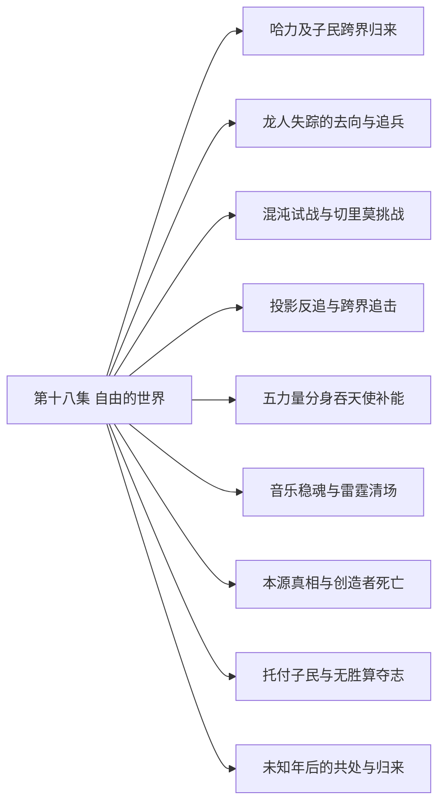

# 第十八集 自由的世界 · 剧情结构

[剧情目录](README.md) · [本集九维报告](../../vol18.md)

## 主线树

## 本集因果、伏笔与回收关系

| 起点 | 关系 | 终点 | 研究说明 |
|---|---|---|---|
| [哈力及子民跨界归来](vol-18.md) | 铺垫 | [投影反追与跨界追击](vol-18.md) | 哈力实际回归并建立信任，为关键时刻挡击和共同跨界提供条件。 |
| [龙人失踪的去向与追兵](vol-18.md) | 因果 | [混沌试战与切里莫挑战](vol-18.md) | 龙人追兵抵达，提供黑龙实验对象并显出深渊战争方向。 |
| [混沌试战与切里莫挑战](vol-18.md) | 铺垫 | [投影反追与跨界追击](vol-18.md) | 切里莫投影暴露可反追路径，黑龙在继续试验新力时抓住它。 |
| [投影反追与跨界追击](vol-18.md) | 因果 | [五力量分身吞天使补能](vol-18.md) | 沿坐标跨界追击遭到切里莫部署的天使拦截，黑龙以吞噬应战。 |
| [五力量分身吞天使补能](vol-18.md) | 铺垫 | [本源真相与创造者死亡](vol-18.md) | 天使能量被消化后黑龙更轻易跨越多层位面，抵达最终来源。 |
| [音乐稳魂与雷霆清场](vol-18.md) | 揭示 | [本源真相与创造者死亡](vol-18.md) | 雷霆造成的大量死亡与巨球增幅并置，验证黑龙关于收集生命能量的判断。 |
| [本源真相与创造者死亡](vol-18.md) | 因果 | [托付子民与无胜算夺志](vol-18.md) | 切里莫残意提供本源危机和唯一替代方法，使黑龙改变战斗目标。 |
| [托付子民与无胜算夺志](vol-18.md) | 回收 | [未知年后的共处与归来](vol-18.md) | 自由存在与同伴生存愿望，在多年后的共处生活和主体归来中获得结果见证，过程未描写。 |
| [哈力及子民跨界归来](vol-18.md) | 呼应 | [未知年后的共处与归来](vol-18.md) | 开篇对共存的愿望与末尾多族市场呼应；不把早期未完成划地计划硬认成后记唯一成因。 |

跨集联系见[全部语义关系](relations.md)与[跨集剧情线](README.md)。

## 事件、人物与认知依据

### 哈力及子民跨界归来

判断类型：原文事实

黑龙、哈力、尼女协作导引，哈力与大批子民进入物质位面；互开灵魂确立信任，双方拟演退兵以换西北至死亡沙漠领地。没有把物理大陆整体迁来。

人物：[黑龙](../cards/chr-9f2e5fcbba87455eb37e35869ea8854d.md)、[哈力维亚](../cards/chr-8aa753f481f04f0181e7bee412fb68f8.md)、[迦莲娜（尼鲁达分裂灵格）](../cards/chr-57d5ea137fa1427d885b62bd8378143c.md)、[斯文哥尔](../cards/chr-24438669720a4bb8a0a27cbd25eadb33.md)

- 黑龙：知道；哈力与己互开灵魂并实际回归。

- 斯文哥尔：未知；不知道黑龙正有共存愿望，其呼喊也未被黑龙听见。

| 章节 | 行号 | 判断类型 |
|---|---|---|
| ch-0195 第一章 导引回归 | 23122–23138 | 原文事实 |
| ch-0196 第二章 骸骨君王 | 23183–23261 | 原文事实 |

### 龙人失踪的去向与追兵

判断类型：原文事实

帝勒说明族群因生计迁深渊、遭统一军队侵略后不足两千返回，自己与龙皇被追兵逼至黑龙处。深渊大巫身份此时主要由尼女判断。

人物：[斯图帝勒](../cards/chr-5aeff1d849534cdf80251105e5c44e7a.md)、[泰特尼斯](../cards/chr-4355fd0bfe034913a4c320006ef7678b.md)、[黑龙](../cards/chr-9f2e5fcbba87455eb37e35869ea8854d.md)、[哈力维亚](../cards/chr-8aa753f481f04f0181e7bee412fb68f8.md)、[迦莲娜（尼鲁达分裂灵格）](../cards/chr-57d5ea137fa1427d885b62bd8378143c.md)

- 斯图帝勒：知道；已知深渊大部归大巫，自己的族群惨失后回归。

- 黑龙：怀疑；大巫是切里莫另一个经营方向。

| 章节 | 行号 | 判断类型 |
|---|---|---|
| ch-0196 第二章 骸骨君王 | 23290–23321 | 原文事实 |
| ch-0197 第三章 深渊魔物 | 23325–23374 | 原文事实 |

### 混沌试战与切里莫挑战

判断类型：原文事实

哈力杀魔眼，黑龙试验冲击转化、受死亡之指毁躯后学会回击并修复；余三魔物受烙活下。切里莫投影现身，随后开启深渊门，哈力军团接战。

人物：[黑龙](../cards/chr-9f2e5fcbba87455eb37e35869ea8854d.md)、[哈力维亚](../cards/chr-8aa753f481f04f0181e7bee412fb68f8.md)、[切里莫·亚力莫菲](../cards/chr-6e4a70b72af34722b670d0c84b4f9bb9.md)

- 黑龙：知道；自己能在未被一次彻底毁灭时修复，并学习反向能量。

- 哈力维亚：未知；切里莫让魔物送死的最终目的仍不明。

| 章节 | 行号 | 判断类型 |
|---|---|---|
| ch-0197 第三章 深渊魔物 | 23385–23432 | 原文事实 |
| ch-0197 第三章 深渊魔物 | 23450–23517 | 原文事实 |
| ch-0198 第四章 平衡之神 | 23537–23619 | 原文事实 |

### 投影反追与跨界追击

判断类型：原文事实

黑龙操死象时感知提升，冻结投影碎片取得坐标，却被远袭重创，哈力挡击后黑龙撕裂位面；尼女加入追击。

人物：[黑龙](../cards/chr-9f2e5fcbba87455eb37e35869ea8854d.md)、[哈力维亚](../cards/chr-8aa753f481f04f0181e7bee412fb68f8.md)、[迦莲娜（尼鲁达分裂灵格）](../cards/chr-57d5ea137fa1427d885b62bd8378143c.md)、[切里莫·亚力莫菲](../cards/chr-6e4a70b72af34722b670d0c84b4f9bb9.md)、[施乃图](../cards/chr-50d264a7448a42fba3ea4329fa2d84dd.md)

- 黑龙：知道；投影能够沿能量路径反追，且远端力量足以威胁自己。

| 章节 | 行号 | 判断类型 |
|---|---|---|
| ch-0198 第四章 平衡之神 | 23680–23748 | 原文事实 |
| ch-0199 第五章 虚无世界 | 23755–23788 | 原文事实 |

### 五力量分身吞天使补能

判断类型：原文事实

三人遭无自我光影天使拦截，黑龙放出五受控力量体吞噬，全部回收后消化，气息大增；尼女辨黑晶即混沌之灵实体，并回想教皇送枪布局。

人物：[黑龙](../cards/chr-9f2e5fcbba87455eb37e35869ea8854d.md)、[哈力维亚](../cards/chr-8aa753f481f04f0181e7bee412fb68f8.md)、[迦莲娜（尼鲁达分裂灵格）](../cards/chr-57d5ea137fa1427d885b62bd8378143c.md)、[教皇](../cards/chr-fa5f928c72f34e6292fef0b12b0579e9.md)

- 迦莲娜（尼鲁达分裂灵格）：知道；黑龙体内黑晶与帝国圣物同类，其吞噬潜能远超旧君王。

- 读者：知道；教皇借雷奥送枪有意设置机缘。

| 章节 | 行号 | 判断类型 |
|---|---|---|
| ch-0199 第五章 虚无世界 | 23795–23813 | 原文事实 |
| ch-0199 第五章 虚无世界 | 23828–23873 | 原文事实 |
| ch-0200 第六章 五个分身 | 23874–23904 | 原文事实 |
| ch-0201 第七章 音乐魔法 | 24158–24172 | 原文事实 |

### 音乐稳魂与雷霆清场

判断类型：原文事实

切里莫投影送雾掩护三领主，施乃图与先知合守。乐团先死六人，罗得安魂曲稳住军队并助杀魔眼；受保护蓄势后雷霆杀近十五万魔物，门仍输兵。

人物：[施乃图](../cards/chr-50d264a7448a42fba3ea4329fa2d84dd.md)、[米勒达布隆迪](../cards/chr-4aafb8822bf64bb099f0e9abe3ae67c9.md)、[斯科特](../cards/chr-60677b93fd18486dbb9f18d6de5f823f.md)、[阿古力特](../cards/chr-37825d4ef6be40189c50d630eb315f4c.md)、[黑大](../cards/chr-632a4344b53f478a93f4d308f3890b92.md)、[黑二](../cards/chr-24b9d252fb624865a46d717832261c68.md)、[罗得宾士](../cards/chr-0d52140c20bf4dc5be05fbdc80d9ace1.md)、[斯文哥尔](../cards/chr-24438669720a4bb8a0a27cbd25eadb33.md)

- 施乃图：知道；音乐有稳魂效果并能调动庞大元素，值得防护但仍需援军后备。

- 罗得宾士：未知；不知道自己的杀伤将为本源增加能量。

| 章节 | 行号 | 判断类型 |
|---|---|---|
| ch-0200 第六章 五个分身 | 23974–24029 | 原文事实 |
| ch-0200 第六章 五个分身 | 24049–24093 | 原文事实 |
| ch-0201 第七章 音乐魔法 | 24111–24157 | 原文事实 |
| ch-0202 第八章 起始之夜 | 24295–24304 | 原文事实 |

### 本源真相与创造者死亡

判断类型：原文事实

三人抵巨球，切里莫以起源说辞拖延。黑龙看破收集生命能量，光球随地面屠杀增强互证；切里莫借力时被本源吞噬，残意无本源并把构想和危机传黑龙。

人物：[黑龙](../cards/chr-9f2e5fcbba87455eb37e35869ea8854d.md)、[哈力维亚](../cards/chr-8aa753f481f04f0181e7bee412fb68f8.md)、[迦莲娜（尼鲁达分裂灵格）](../cards/chr-57d5ea137fa1427d885b62bd8378143c.md)、[切里莫·亚力莫菲](../cards/chr-6e4a70b72af34722b670d0c84b4f9bb9.md)、[本源（切里莫创造）](../cards/chr-19d3695eaf984c488f39846f58c2894d.md)

- 黑龙：知道；切里莫供养新本源求超规则，却被它作为最后能量补充吞掉。

- 读者：未知；切里莫所述旧生命本源觉醒后的完整起源历史没有讲完。

| 章节 | 行号 | 判断类型 |
|---|---|---|
| ch-0201 第七章 音乐魔法 | 24189–24218 | 原文事实 |
| ch-0202 第八章 起始之夜 | 24239–24334 | 原文事实 |

### 托付子民与无胜算夺志

判断类型：原文事实

本源吞噬虚无，黑龙要求哈力、尼女回去减少所有种族死亡，将君王烙印交哈力，接受公正神格，以混沌之灵化银团投本源争取代意志。

人物：[黑龙](../cards/chr-9f2e5fcbba87455eb37e35869ea8854d.md)、[哈力维亚](../cards/chr-8aa753f481f04f0181e7bee412fb68f8.md)、[迦莲娜（尼鲁达分裂灵格）](../cards/chr-57d5ea137fa1427d885b62bd8378143c.md)、[本源（切里莫创造）](../cards/chr-19d3695eaf984c488f39846f58c2894d.md)

- 黑龙：知道；遗留信息给出意志替代方法，但自己没有胜算。

- 哈力维亚：知道；黑龙选择源于自由存在与具体同伴生存，并托付子民烙印。

| 章节 | 行号 | 判断类型 |
|---|---|---|
| ch-0202 第八章 起始之夜 | 24335–24369 | 原文事实 |

### 未知年后的共处与归来

判断类型：原文事实

后记黑龙意识醒来，看见飞艇、巨龙运输、深渊出入门、多族市场与蓝晶售冰。菲力普、罗得、斯文、娜娜仍在；哈力号角迎回，黑龙重现原形。

人物：[黑龙](../cards/chr-9f2e5fcbba87455eb37e35869ea8854d.md)、[哈力维亚](../cards/chr-8aa753f481f04f0181e7bee412fb68f8.md)、[菲力普](../cards/chr-f5b27f27591c4a9f9b29844c3ab97ee0.md)、[罗得宾士](../cards/chr-0d52140c20bf4dc5be05fbdc80d9ace1.md)、[斯文哥尔](../cards/chr-24438669720a4bb8a0a27cbd25eadb33.md)、[娜娜](../cards/chr-1d629a39da3e41149707e5f9f636defd.md)

- 读者：知道；黑龙存活并重现形体，画面中多族共同生活、数位旧友明确活着。

- 读者：未知；意志争夺、停战与治理经过、准确间隔及未露面人物终局。

| 章节 | 行号 | 判断类型 |
|---|---|---|
| ch-0202 第八章 起始之夜 | 24373–24397 | 原文事实 |

## 本集当时的剧情线判断

这是分集历史判断，后续回收结果以跨集终点页为准。

### 第18集 · 帝国来源、黑晶与回归

当时状态：部分回收

旧帝国及黑晶的来源与放逐后果怎样得到说明？

哈力与子民回归、黑晶作为混沌之灵实体、残印被抹及新本源制造获得新证；旧本源觉醒至爆炸的完整原因未说完，不能全线resolved。

[查看全书终点判断](threads/book-2c92e5ad3024.md)

### 第18集 · 龙人迁徙与族群存续

当时状态：部分回收

失踪龙人去了哪里，能否获得自由家园？

失踪去向明确：因贫荒迁深渊、战后不足两千返物质位面。去向窄问题已回收，家园、各具名族人及龙皇关系终局未逐项交代。

[查看全书终点判断](threads/book-7ba6c4bc6db7.md)

### 第18集 · 自由存在与同伴关系

当时状态：已回收

黑龙如何在成为顶层存在后保住自己想要的自由与关系？

终卷明确自由动机没有改变，托付与冒险出自此；后记主体归来、部分旧友生存与共处世界给出主题结果。此resolved仅针对核心价值选择及归来，不代表所有同伴命运已查清。

[查看全书终点判断](threads/book-37dd82abc178.md)

### 第18集 · 光明制度与神祇主体

当时状态：部分回收

信徒力量的分配与神祇代理权最终如何重组？

教皇送枪意图、虚设至高称号和新本源挪用该名得到解释；尼女赠公正格、宣布黑龙唯一神是明确行为。具体教会制度执行与教皇个人结局未写。

[查看全书终点判断](threads/book-02ba45413b1e.md)

### 第18集 · 尼鲁达双灵格与神格

当时状态：部分回收

两独立灵格怎样面对共同历史与本源危机？

继续分别追踪女灵格与教皇；女灵格赠格削翼离去，教皇寿命后果无后记见证。未发生二灵格合并，原迦莲娜人格恢复亦未说明。

[查看全书终点判断](threads/book-442e53d9c11d.md)

### 第18集 · 切罗曼尔遗产的自主使用

当时状态：部分回收

黑龙如何把继承的知识转为自己的行动，帝国使命是否获得全部实现？

反向力、时间干扰、位面追踪等知识被实际使用，最终选择仍以黑龙自己的自由及同伴为核心。哈力子民回归不是重建所有旧帝国制度的证明。

[查看全书终点判断](threads/book-f6314cbd93ce.md)

### 第18集 · 深渊入侵与跨族共处

当时状态：部分回收

如何阻止无尽深渊入侵并结束死亡循环？

军队抵抗与乐章获得局部成果，黑龙要求停止跨族伤亡；后记深渊门成为往来通道、多族共处。停战、统一深渊势力解散及具体军队结局过程缺失，不能当全部军事问题已讲完。

[查看全书终点判断](threads/book-2e1eb7a1d515.md)

### 第18集 · 独立本源与超脱规则

当时状态：部分回收

制造者如何失去本源控制，黑龙能否阻止其吞噬世界？

切里莫被吞及其构想明确；黑龙投入夺志后多年醒返与世界存续明确。具体胜利过程、本源原意识和黑龙最终权限不明，因此保留partial而非把后记推成机制全解。

[查看全书终点判断](threads/book-3ec69c740e20.md)

### 第18集 · 音乐魔法与弱者专长

当时状态：已回收

罗得与普通乐师的体系能否在顶层战争中产生真实作用？

安魂曲护军与万世雷霆杀伤均有实证，弱者专长获得明确窄回收；后记继续音乐生活。亡妻及招魂另属roder-song-and-wife，未由本线程解决。

[查看全书终点判断](threads/book-0338447aee32.md)

### 第18集 · 子民意识与生存

当时状态：部分回收

黑龙子民的意识与存续是否获得完整交代？

黑大黑二参战及骑兵损失明确，君王烙印托付保护深约子民；后记蓝晶骨劳动未逐名。原黑三至黑十觉醒、每个子民最终契约和存亡均未全交代。

[查看全书终点判断](threads/book-c55cdb2efcb4.md)

### 第18集 · 娜娜传承与被保护的生活

当时状态：部分回收

娜娜能否从被争夺的传承者成为自由生活的主体？

黑龙明确希望娜娜活下去；后记娜娜成长、自然传承青春与认出哥哥得到验证。并未新增正式成神、完整身世与克丽丝终局说明。

[查看全书终点判断](threads/book-cb9c67d1cdae.md)
