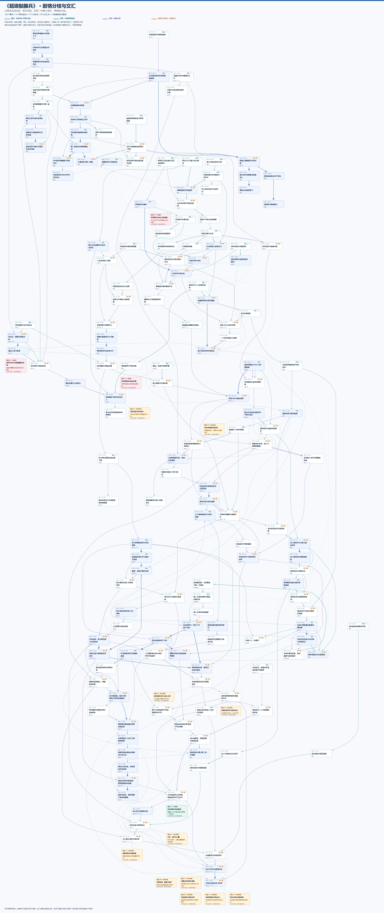
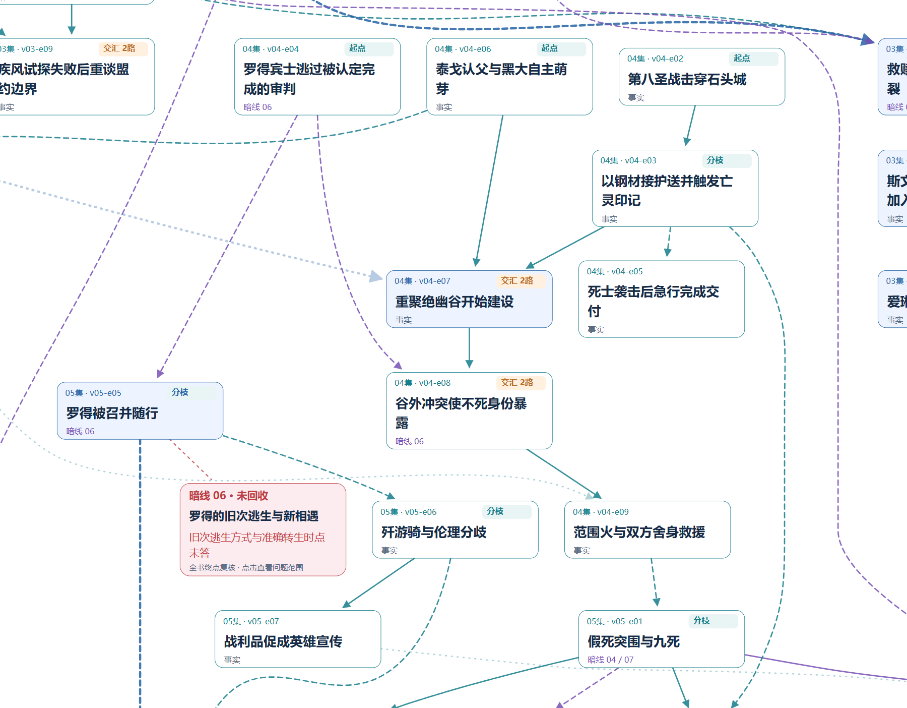

# 全书剧情树：分枝与交汇

[返回图片目录](images.md) · [全部事件与证据](README.md)

**从主线出发，支线可另起，在共享事件处汇合，再向后分枝。** 包含全书163个事件、265条已有关系、15条暗线终点复核；不再按集数排列成链式目录。

[完整PNG图片](whole-book/tree.png) · [SVG无损放大](whole-book/tree.svg) · [离线缩放页面](whole-book/index.html)

预览用于看形态；文字请打开原图放大。下载 `whole-book/index.html` 后用浏览器打开，可拖动、缩放、搜索，聚焦主线、任一支线、交汇点或未回收问题，点击事件和连线查看摘要与证据。页面自带所有内容，不需要网络；GitHub不运行仓库中的HTML。

- **蓝色**突出“自由存在与同伴关系”核心主线；青色为其他剧情关系；紫色为暗线关系。核心主线与暗线重合时优先蓝色，事件内保留暗线编号。
- **同一事件只画一次**。多条推进关系接入同一事件框，才标为交汇；线条交叉不表示剧情相交。全图有15个图内起点、71个分枝点、70个交汇点。
- **实线**为因果，虚线为铺垫、揭示、转折或回收，细点线为主题呼应。265条关系均保留原方向和判断性质；点击连线可看类型。呼应与两条后置解释不强制决定向下层级。
- **集数只作位置提示**，不是父子层级。同一高度不表示同一天；回叙仍注明。图内起点不等于故事世界中绝对没有前因。
- **暗线状态贴在对应枝端**：1条已回收、11条部分回收、3条未回收。连接状态框的细虚线是注记；状态统一取第18集复核，不能将回收范围扩大到全部人物去向。

原有49张分图继续保留供逐集、逐线查阅。源研究JSON、个人笔记和版本历史没有因这次布局改变。

重建：`rebuild_whole_book.py --prepare` → `layout_whole_book.cjs` → `rebuild_whole_book.py` → `render_whole_book.cjs`。布局使用 [Viz.js / Graphviz](https://viz-js.com/api/)，需要 `@viz-js/viz`（本次3.31.0）、Python/Pillow、中文字体和Node.js/Playwright。`VIZ_MODULE`可指定本地模块路径。布局输入、坐标与源图哈希见[清单](whole-book/manifest.json)。
