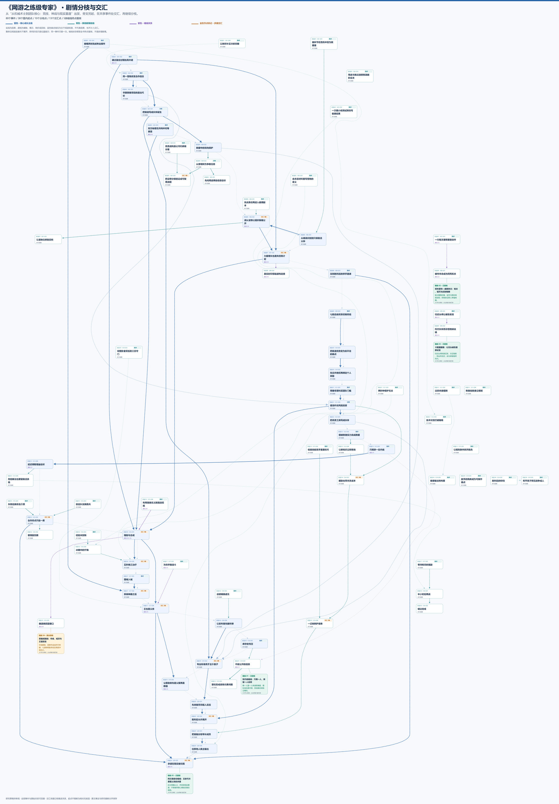
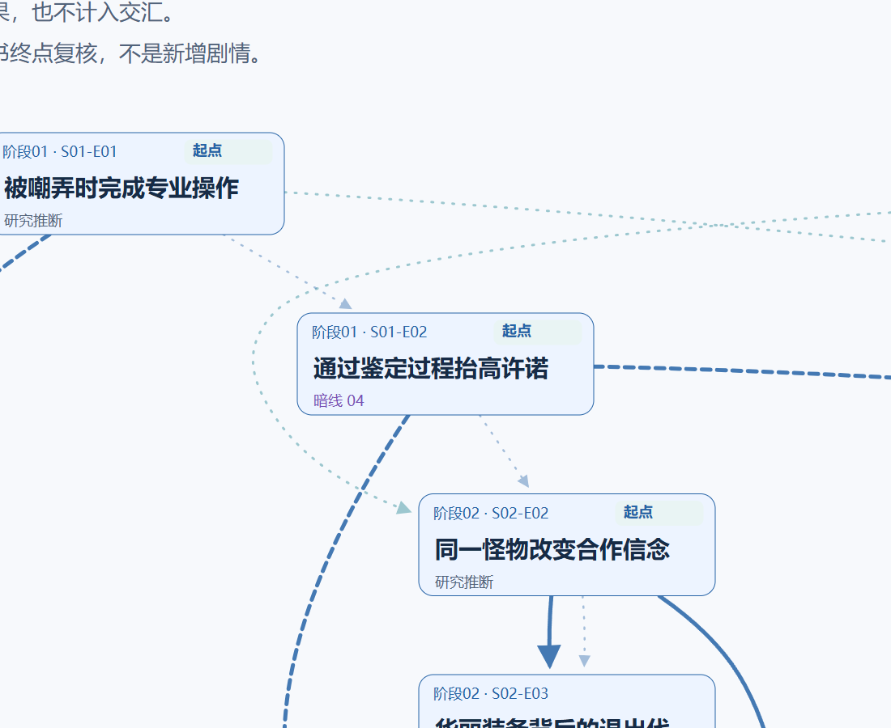
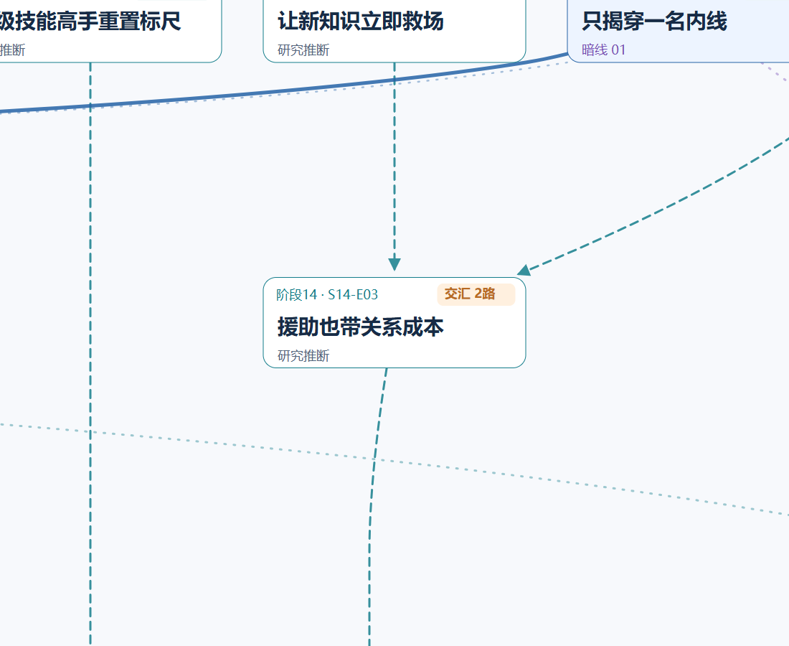
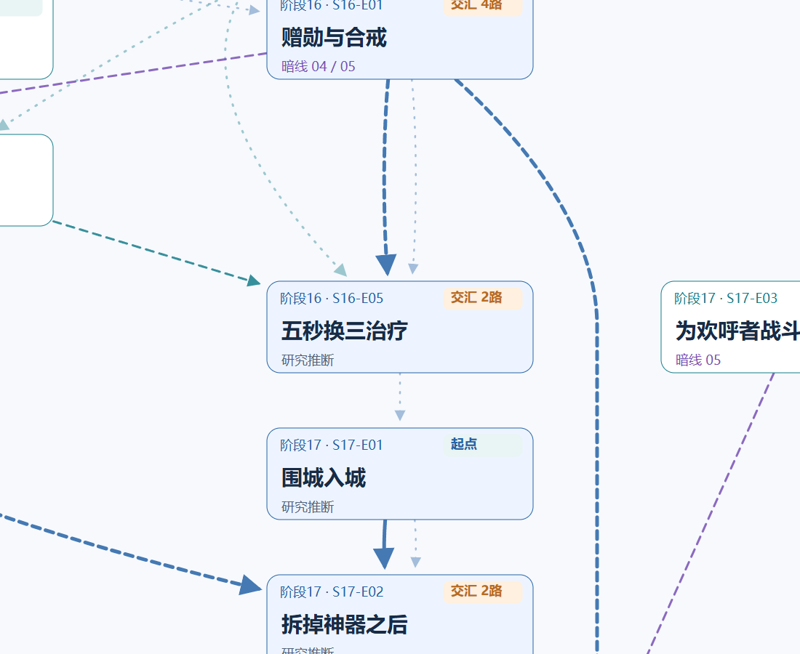
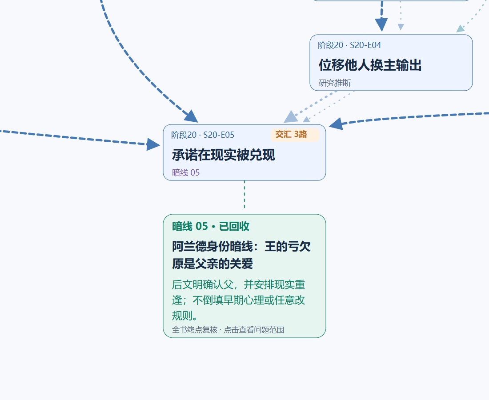

# 《网游之练级专家》全书剧情树与地图

[打开可缩放地图](map/index.html) · [打开树状图与事件证据](whole-book/index.html) · [完整PNG](whole-book/tree.png) · [矢量SVG](whole-book/tree.svg)

沿用《超级骷髅兵》的树状分枝与整图缩放形式：蓝色为核心主线，青色为旁枝，紫色为暗线，金色标记共享事件的交汇。同一事件只画一次；阶段只用于定位，不作为剧情父节点。

保留全书精选的80个场景；58条推进语义关系与34条主干阅读衔接分开。实线为因果，虚线为铺垫、揭示、转折或回收；蓝色细点线仅表示阅读顺序，不计入分枝或交汇。

全图有10个分枝点、13个交汇点、5条暗线终态注记。点击事件、连线或剧情线可查看研究判断与章节行号；终局没有交代的结果仍标为未明。

地图可离线拖动、滚轮或双指缩放、小地图跳转、研究阶段定位、记住位置、下载PNG/SVG。浏览器直接打开HTML；GitHub网页展示下方图片与索引。

| 开篇分枝 | 共享交汇 |
|---|---|
|  |  |
| 中后段转折 | 终局边界 |
|  |  |

以上局部均截自同一张全图，不重新排版。完整逐章覆盖见[章节笔记](../chapter-notes.md)，结局边界见[终局核对](../ending-audit.md)。

展示拓扑是可审阅的研究解释：[人工核对配置](curated-topology.json)、[派生拓扑](topology.json)、[原研究图](graph.json)、[布局与身份清单](whole-book/manifest.json)。原来源图与卡片不因版式改变。
