# 《网游之练级专家》全书场景、伏笔与阶段结构

实线表示结构归属，虚线表示跨节点关系；依据类型详见节点数据。

```mermaid
flowchart TD
  n0["《网游之练级专家》全书研究"]
  n1["职业困境、复合能力与第一次可信合作"]
  n0 --> n1
  n2["被嘲弄时完成专业操作"]
  n1 --> n2
  n3["通过鉴定过程抬高许诺"]
  n1 --> n3
  n4["弱环节在危机中变为救援者"]
  n1 --> n4
  n5["以地形补足冷却空窗"]
  n1 --> n5
  n6["血色任务的许诺与团队效率改写独行观念"]
  n0 --> n6
  n7["残血与施法速度制造越阶反杀"]
  n6 --> n7
  n8["同一怪物改变合作信念"]
  n6 --> n8
  n9["华丽装备背后的退出代价"]
  n6 --> n9
  n10["石像鬼兑现、秘密交换与双队伍博弈"]
  n0 --> n10
  n11["把制造写成伙伴诞生"]
  n10 --> n11
  n12["双方秘密在共鸣中对等暴露"]
  n10 --> n12
  n13["一次细小侦测试探改写偷袭结果"]
  n10 --> n13
  n14["战斗回报、盟友信用与下水道风险升级"]
  n0 --> n14
  n15["昂贵战利品让守约具有分量"]
  n14 --> n15
  n16["救援中的双向保护"]
  n14 --> n16
  n17["从旁观转为争取任务"]
  n14 --> n17
  n18["把风险转为情报、续航兑现与个人探险"]
  n0 --> n18
  n19["先问用途再给信息定价"]
  n18 --> n19
  n20["把设想分级验证成可复用流程"]
  n18 --> n20
  n21["击杀后材料重写怪物的意义"]
  n18 --> n21
  n22["雇佣大团、组织裂缝与恶魔诅咒启动"]
  n0 --> n22
  n23["先谈责任再进入雇佣副本"]
  n22 --> n23
  n24["从错误识别到只保复活火种"]
  n22 --> n24
  n25["误认宝物让组织裂缝公开"]
  n22 --> n25
  n26["诅咒真相、惨胜之后的队伍重建与亡灵爱情"]
  n0 --> n26
  n27["力量增长也是失控倒计时"]
  n26 --> n27
  n28["让渡地位修复旧伤"]
  n26 --> n28
  n29["一行铭文重释重复动作"]
  n26 --> n29
  n30["中型团队成形、悲剧收束与转职竞争"]
  n0 --> n30
  n31["被夺本命成为同死机关"]
  n30 --> n31
  n32["真实封印撑起虚构追查"]
  n30 --> n32
  n33["压倒胜利后的停手邀请"]
  n30 --> n33
  n34["转职完成、申冤取证与团队擂台试探"]
  n0 --> n34
  n35["归还头颅让被告发言"]
  n34 --> n35
  n36["托付伙伴而非怪物掉坐骑"]
  n34 --> n36
  n37["七胜后由双系控制终结"]
  n34 --> n37
  n38["擂台兑现、组织训练与父子复仇任务"]
  n0 --> n38
  n39["把极速优势变为刹不住的弱点"]
  n38 --> n39
  n40["先交共有权再绑定个人奖励"]
  n38 --> n40
  n41["完整卧室背后的三日守门"]
  n38 --> n41
  n42["后勤突破、首战成名与自主性危机"]
  n0 --> n42
  n43["用奢侈原料买团队门槛"]
  n42 --> n43
  n44["法系肉身阻骑"]
  n42 --> n44
  n45["两秒钟保护无炎"]
  n42 --> n45
  n46["败者给胜者立规矩"]
  n42 --> n46
  n47["借龙吟谈风险投资"]
  n42 --> n47
  n48["守城兑现、工程遗产与反围杀"]
  n0 --> n48
  n49["把昂贵工具写成伙伴"]
  n48 --> n49
  n50["借被救者实力完成救援"]
  n48 --> n50
  n51["技术识货打破赌局"]
  n48 --> n51
  n52["让新知识立即救场"]
  n48 --> n52
  n53["强援、技能观重塑与临时战力窗口"]
  n0 --> n53
  n54["让规则条件拆开胜负"]
  n53 --> n54
  n55["低级技能高手重置标尺"]
  n53 --> n55
  n56["只揭穿一名内线"]
  n53 --> n56
  n57["延迟领取增益设伏"]
  n53 --> n57
  n58["危险解法也要留复活余地"]
  n53 --> n58
  n59["战争的个人代价、千人围杀与信仰入口"]
  n0 --> n59
  n60["敌手的残疾成为可操作弱点"]
  n59 --> n60
  n61["胜利后的铃铛"]
  n59 --> n61
  n62["援助也带关系成本"]
  n59 --> n62
  n63["被废输出转肉盾"]
  n59 --> n63
  n64["和平孩子照见战争成人"]
  n59 --> n64
  n65["双人考验、唯一神位与神器政争"]
  n0 --> n65
  n66["失败后换攻击介质"]
  n65 --> n66
  n67["合作终点只给一席"]
  n65 --> n67
  n68["放走队友换救兵"]
  n65 --> n68
  n69["利用强者名义脱强迫招揽"]
  n65 --> n69
  n70["神戒兑现、罪民救赎与跨阵营强团战"]
  n0 --> n70
  n71["赠勋与合戒"]
  n70 --> n71
  n72["替情敌挡狼"]
  n70 --> n72
  n73["经验未到账"]
  n70 --> n73
  n74["冰雕中的忏悔"]
  n70 --> n74
  n75["五秒换三治疗"]
  n70 --> n75
  n76["泰坦成长、父子揭谜与圣光城转局"]
  n0 --> n76
  n77["围城入城"]
  n76 --> n77
  n78["拆掉神器之后"]
  n76 --> n78
  n79["为欢呼者战斗"]
  n76 --> n79
  n80["王也是父亲"]
  n76 --> n80
  n81["等待耗尽的强敌"]
  n76 --> n81
  n82["后勤兑现、机械城谈判与组织势力扩张"]
  n0 --> n82
  n83["半小时后再战"]
  n82 --> n83
  n84["错法变戒"]
  n82 --> n84
  n85["迫使镜像虚无"]
  n82 --> n85
  n86["让发布者先撤炸弹"]
  n82 --> n86
  n87["库存变号召"]
  n82 --> n87
  n88["墓穴反间、神器成长与竞技前夜"]
  n0 --> n88
  n89["不能公开的信息"]
  n88 --> n89
  n90["雷柱变成战场元素问题"]
  n88 --> n90
  n91["一记地刺护读条"]
  n88 --> n91
  n92["专业标准高于主仆面子"]
  n88 --> n92
  n93["撤退换回蓝窗口"]
  n88 --> n93
  n94["公爵勋章先是父爱再是数值"]
  n88 --> n94
  n95["竞技兑现、众神引导与现实重逢"]
  n0 --> n95
  n96["先准备而非超人反应"]
  n95 --> n96
  n97["胜利后允许离开"]
  n95 --> n97
  n98["把首脑分给专长成员"]
  n95 --> n98
  n99["位移他人换主输出"]
  n95 --> n99
  n100["承诺在现实被兑现"]
  n95 --> n100
  n1 -. "紫光处铁戒是什么？" .-> n3
  n2 -. "泰坦之心完整属性是什么？" .-> n78
  n1 -. "驱逐术士的历史是否另有原因？" .-> n80
  n3 -. "局部萧寒是否另一人物？" .-> n100
  n6 -. "老术士为何以项链雇萧翎？" .-> n71
  n6 -. "三系是否意味着所有技能无限学习？" .-> n9
  n1 -. "为何其他机械术士都有一阶小鬼？" .-> n10
  n10 -. "天狂为何兼有不同牧师能力？" .-> n12
  n14 -. "五腐尸为何感觉不同？" .-> n16
  n17 -. "能否直接多金属分部制作？" .-> n92
  n18 -. "提莫斯是否地方史中的镇长之子？" .-> n30
  n22 -. "诅咒石、戒指和雕像怎样共同触发？" .-> n71
  n25 -. "希莱尔戒指是神器吗？" .-> n88
  n23 -. "诅咒之石是什么？" .-> n26
  n27 -. "戒指新增细圆图有何效用？" .-> n71
  n31 -. "提莫斯为何持阿卡德项链？" .-> n30
  n30 -. "选择s任务是否能迅速安全回团？" .-> n40
  n30 -. "花舞如何准确寻找周围玩家？" .-> n34
  n32 -. "月亮晶石有何用途？" .-> n82
  n34 -. "谁在伪造及莫亚历史？" .-> n36
  n11 -. "拆旧傀儡是否必然毁宝石意识？" .-> n92
  n41 -. "霍尔为何有恶魔气？" .-> n43
  n38 -. "夜落是否已宗师并能量产高级回魔？" .-> n88
  n38 -. "龙之焰客卿是否保证不会遭狂龙打压？" .-> n97
  n43 -. "谜题为何指向远古之树" .-> n82
  n42 -. "C任务难度错误是否阴谋" .-> n49
  n47 -. "一月内能否冲击狂龙并履约" .-> n97
  n42 -. "本书萧御是否就是《贼胆》主角" .-> n99
  n49 -. "谁是内线" .-> n70
  n49 -. "救援前两戒、称第三、结算为何四戒" .-> n84
  n49 -. "无岚无羽为何追无炎" .-> n100
  n53 -. "天狂能否得将军套" .-> n94
  n53 -. "两戒为何共鸣" .-> n71
  n53 -. "20天大宗师和泰坦材料能否兑现" .-> n78
  n59 -. "萨鲁是否英雄任务" .-> n67
  n64 -. "圣光城是否会陷落" .-> n95
  n57 -. "天骑为何背叛" .-> n65
  n69 -. "王为何见萧翎震动" .-> n100
  n71 -. "王为何亏欠萧翎？" .-> n100
  n71 -. "魔神戒吸经验比例？" .-> n88
  n71 -. "阿兰德是否萧翎父？" .-> n80
  n83 -. "最后药戒如何取得？" .-> n84
  n82 -. "伊特斯安全送离誓言可信吗？" .-> n86
  n82 -. "王室墓穴七还是九？" .-> n87
  n88 -. "伊森得被谁制造成泥人傀儡？" .-> n95
  n88 -. "主角二转是否完成？" .-> n99
  n88 -. "狂龙是否参加单人竞技？" .-> n95
  n88 -. "航船靠岸后游戏及伙伴关系如何？" .-> n99
  n88 -. "水晶图与血羽心何时兑现？" .-> n92
  n95 -. "第三方是谁？" .-> n99
  n98 -. "众神是否永久牺牲？" .-> n99
  n99 -. "四女能否现实相聚？" .-> n100
  n99 -. "火舞是否成为主角第五恋人？" .-> n100
  n88 -. "靠岸后游戏持续运营吗？" .-> n100
  n8 -. "控制接力改变独行判断，加入队伍后获得可负债购买的制作材料" .-> n11
  n11 -. "绑定并觉醒的机械伙伴在断翼前托住坠落主人，初建关系获得行动回报" .-> n16
  n17 -. "营地救援得到生命分流等技能，早先续航构想才有条件接受实测" .-> n20
  n24 -. "保住复活火种使全团复起，战后取得的诅咒石触发魔化与夺宝误认" .-> n25
  n25 -. "抢宝背叛使牧琳赔偿解团，可信核心转入新团后重新安排主副盾关系" .-> n28
  n35 -. "归还头颅恢复卡莫里的证言能力，神誓和共同惩凶最终导向坐骑托付" .-> n36
  n39 -. "击败最后狮鹫骑士实际赢得魔力源泉，奖励随后先经共有权协商再绑定" .-> n40
  n56 -. "只逐出一人并保留另一内线传假情报，月龙偷袭被导入临时光环窗口" .-> n57
  n71 -. "四附件合魔神戒获得的大禁言，在跨阵营战中换来斩杀三治疗的窗口" .-> n75
  n77 -. "穿过围城封锁到达工程师工会，才能使用已备材料与场地制作泰坦" .-> n78
  n81 -. "能源机械战后凑齐月光宝石、制成起搏器，森林龙失利后由复活工具保住再战" .-> n83
  n16 -. "旧伙伴曾自主救主；制作水晶体时继续保留同一灵魂和亲昵习惯" .-> n92
```

## 剧情线

- 紫光处铁戒是什么？：hidden / resolved
- 泰坦之心完整属性是什么？：hidden / resolved
- 驱逐术士的历史是否另有原因？：hidden / partial
- 局部萧寒是否另一人物？：hidden / partial
- 无战士的四人队如何群刷？：hidden / resolved
- 老术士为何以项链雇萧翎？：hidden / partial
- 三系是否意味着所有技能无限学习？：hidden / resolved
- 为何其他机械术士都有一阶小鬼？：hidden / resolved
- 天狂为何兼有不同牧师能力？：hidden / resolved
- 洛克希德法杖限制何在？：hidden / resolved
- 罗格之眼有什么作用？：hidden / resolved
- 五腐尸为何感觉不同？：hidden / resolved
- 罗格眼侦察时何物在注视？：hidden / unknown
- 能否直接多金属分部制作？：hidden / resolved
- 一级灵魂碎片有何用？：hidden / unknown
- 提莫斯是否地方史中的镇长之子？：hidden / partial
- 三分身中哪个是真身？：hidden / resolved
- 诅咒石、戒指和雕像怎样共同触发？：hidden / partial
- 希莱尔戒指是神器吗？：hidden / resolved
- 诅咒之石是什么？：hidden / resolved
- 塔布雷特为什么忍痛看阳光？：hidden / resolved
- 戒指新增细圆图有何效用？：hidden / partial
- 提莫斯为何持阿卡德项链？：hidden / resolved
- 选择s任务是否能迅速安全回团？：hidden / resolved
- 花舞如何准确寻找周围玩家？：hidden / unknown
- 月亮晶石有何用途？：hidden / unknown
- 谁在伪造及莫亚历史？：hidden / resolved
- 拆旧傀儡是否必然毁宝石意识？：hidden / partial
- 花舞赠材为何如此主动？：hidden / resolved
- 古堡卧室为何独无火烧？：hidden / resolved
- 霍尔为何有恶魔气？：hidden / partial
- 夜落是否已宗师并能量产高级回魔？：hidden / resolved
- 龙之焰客卿是否保证不会遭狂龙打压？：hidden / resolved
- 谜题为何指向远古之树：hidden / resolved
- C任务难度错误是否阴谋：hidden / resolved
- 一月内能否冲击狂龙并履约：hidden / partial
- 本书萧御是否就是《贼胆》主角：hidden / unknown
- 石像鬼能否从骨龙逃回：hidden / resolved
- 谁是内线：hidden / resolved
- 救援前两戒、称第三、结算为何四戒：hidden / partial
- 无岚无羽为何追无炎：hidden / resolved
- 天狂能否得将军套：hidden / resolved
- 两戒为何共鸣：hidden / resolved
- 20天大宗师和泰坦材料能否兑现：hidden / resolved
- 铃铛为何关联萨尔玛：hidden / resolved
- 先到百骑来自哪里：hidden / resolved
- 萨鲁是否英雄任务：hidden / resolved
- 圣光城是否会陷落：hidden / resolved
- 日志为何只写一名英雄：hidden / resolved
- 天骑为何背叛：hidden / resolved
- 卡尔洛斯为何成仆有无战力：hidden / resolved
- 王为何见萧翎震动：hidden / resolved
- 王为何亏欠萧翎？：hidden / resolved
- 大宗师要求是否完成？：hidden / resolved
- 魔神戒吸经验比例？：hidden / unknown
- 虚荣戒净化后为何仍古怪？：hidden / unknown
- 阿兰德是否萧翎父？：hidden / resolved
- 王如何救下被攻破的圣光城？：hidden / resolved
- 爱丽丝是否已死？：hidden / unknown
- 黑伍德断后是否战死？：hidden / unknown
- 最后药戒如何取得？：hidden / resolved
- 伊特斯安全送离誓言可信吗？：hidden / resolved
- 王室墓穴七还是九？：hidden / unknown
- 奥丁城13盗贼围攻结果？：hidden / unknown
- 伊森得被谁制造成泥人傀儡？：hidden / partial
- 主角二转是否完成？：hidden / resolved
- 父亲间接封爵是否符合主脑公平规则？：hidden / unknown
- 狂龙是否参加单人竞技？：hidden / unknown
- 航船靠岸后游戏及伙伴关系如何？：hidden / partial
- 水晶图与血羽心何时兑现？：hidden / resolved
- 第三方是谁？：hidden / resolved
- 众神是否永久牺牲？：hidden / resolved
- 四女能否现实相聚？：hidden / resolved
- 萧翎萧御末次PK谁赢？：hidden / unknown
- 火舞是否成为主角第五恋人？：hidden / resolved
- 靠岸后游戏持续运营吗？：hidden / unknown
- 追回等级与实现实力第一〔阶段追踪〕：main / unknown
- 制作双技能机械石像鬼〔阶段追踪〕：main / unknown
- 猎杀者的再战意向〔阶段追踪〕：subplot / unknown
- 浴血小队初次合作〔阶段追踪〕：subplot / resolved
- 血色修道院清剿〔阶段追踪〕：main / unknown
- 自由固定团的建立〔阶段追踪〕：subplot / unknown
- 永动机续航构想〔阶段追踪〕：main / resolved
- 机械石像鬼宝石材料〔阶段追踪〕：main / unknown
- 机械石像鬼制造与成长〔阶段追踪〕：main / unknown
- 林菲两万金债务〔阶段追踪〕：subplot / unknown
- 矿洞地图争夺〔阶段追踪〕：main / unknown
- 罗格之眼获取与侦察〔阶段追踪〕：subplot / resolved
- 恶魔瞳视〔阶段追踪〕：main / resolved
- 夜落隐藏任务与幽暗之花〔阶段追踪〕：main / unknown
- 断翼修复与多金属设想〔阶段追踪〕：subplot / unknown
- 盗神宝箱取物逃离〔阶段追踪〕：subplot / unknown
- 雇佣队清三仆从〔阶段追踪〕：subplot / unknown
- 恶魔诅咒完成〔阶段追踪〕：main / resolved
- 牧风小派系叛逃〔阶段追踪〕：subplot / unknown
- 无炎的团队选择〔阶段追踪〕：subplot / unknown
- 奥斯林兰清剿与项链奖励〔阶段追踪〕：main / unknown
- 塔布雷特净化与爱情遗物〔阶段追踪〕：subplot / resolved
- 朋友团队合流〔阶段追踪〕：main / unknown
- 奥斯林兰与提莫斯旧事〔阶段追踪〕：main / resolved
- 阿卡德五件套〔阶段追踪〕：subplot / unknown
- 迷幻转职〔阶段追踪〕：main / unknown
- 卡莫里昭雪〔阶段追踪〕：subplot / resolved
- 霍尔卡德复仇协助〔阶段追踪〕：subplot / resolved
- 竞技证明第一〔阶段追踪〕：main / resolved
- 花舞承诺梦幻金属〔阶段追踪〕：subplot / resolved
- 埃拉西亚北部前线〔阶段追踪〕：main / unknown
- 霍尔背信审判〔阶段追踪〕：subplot / unknown
- 石像鬼高阶宝石升级〔阶段追踪〕：main / unknown
- 守住迪菲利亚〔阶段追踪〕：main / resolved
- 狂龙压制与团队自主〔阶段追踪〕：main / unknown
- 跨阵营萧御关系〔阶段追踪〕：subplot / unknown
- 萧翎的感情关系〔阶段追踪〕：subplot / unknown
- 药王五戒〔阶段追踪〕：subplot / unknown
- 泰坦与二十天工程目标〔阶段追踪〕：main / unknown
- 三机师关系〔阶段追踪〕：subplot / unknown
- 花舞挖角〔阶段追踪〕：subplot / unknown
- 天狂荣耀套装〔阶段追踪〕：subplot / unknown
- 菲南泽思战争〔阶段追踪〕：main / unknown
- 斯蒂兰斯铃铛〔阶段追踪〕：subplot / resolved
- 公会全面战争〔阶段追踪〕：main / unknown
- 术之掌控者传承〔阶段追踪〕：main / resolved
- 紫焰感情〔阶段追踪〕：subplot / unknown
- 泰坦工程〔阶段追踪〕：subplot / unknown
- 狂龙竞争〔阶段追踪〕：main / unknown
- 泰坦工程〔阶段追踪〕：subplot / resolved
- 黑伍德断后〔阶段追踪〕：subplot / unknown
- 圣光城危机〔阶段追踪〕：main / resolved
- 第三方毁灭势力〔阶段追踪〕：main / unknown
- 地精起搏器〔阶段追踪〕：subplot / unknown
- 药王五戒〔阶段追踪〕：subplot / resolved
- 地精宝藏〔阶段追踪〕：subplot / resolved
- 水晶石像鬼改造〔阶段追踪〕：subplot / unknown
- 王室任务与狂龙墓穴竞争〔阶段追踪〕：subplot / resolved
- 四女关系〔阶段追踪〕：subplot / unknown
- 水晶石像鬼工程〔阶段追踪〕：subplot / resolved
- 60级恶魔变身〔阶段追踪〕：subplot / resolved
- 魔神戒升级〔阶段追踪〕：main / unknown
- 父亲王阿兰德〔阶段追踪〕：main / unknown
- 光暗双子星与沃顿〔阶段追踪〕：main / resolved
- 四女关系〔阶段追踪〕：subplot / unknown
- 狂龙圣殿竞争〔阶段追踪〕：main / resolved
- 虚拟航船到新星〔阶段追踪〕：main / resolved
- 四女现实重逢〔阶段追踪〕：subplot / resolved
- 60二转〔阶段追踪〕：subplot / resolved
- 旧NPC爱情〔阶段追踪〕：subplot / resolved
- 萧翎萧御末次PK〔阶段追踪〕：subplot / unknown
