# 《贼胆》全书场景、伏笔与阶段结构

实线表示结构归属，虚线表示跨节点关系；依据类型详见节点数据。

```mermaid
flowchart TD
  n0["《贼胆》全书研究"]
  n1["研究分段一：现实匮乏与基础技能的实验式建立"]
  n0 --> n1
  n2["玩笑赠盔掩住贫困忧伤"]
  n1 --> n2
  n3["失败复盘到数值验证"]
  n1 --> n3
  n4["升级被费用截住"]
  n1 --> n4
  n5["冷却空档逼出新控制"]
  n1 --> n5
  n6["危险行为转成宝箱解法"]
  n1 --> n6
  n7["研究分段二：委托考验、合作承认与夜战突破"]
  n0 --> n7
  n8["共享感知弱化的十五秒窗口"]
  n7 --> n8
  n9["承认边界后有限合作"]
  n7 --> n9
  n10["结算把掉落转成人情"]
  n7 --> n10
  n11["强隐被破后打破百分百上限"]
  n7 --> n11
  n12["研究分段三：战场收益、种族认同与首单雇佣潜入"]
  n0 --> n12
  n13["相同诱饵下的耐性差"]
  n12 --> n13
  n14["个人失亲让世界史具象"]
  n12 --> n14
  n15["主角技术与雇主经验互补"]
  n12 --> n15
  n16["安全死角里遇日常行动"]
  n12 --> n16
  n17["多时间窗叠加开箱"]
  n12 --> n17
  n18["研究分段四：首笔变现、对手教学与现实自尊危机"]
  n0 --> n18
  n19["敌手招数成为即时教材"]
  n18 --> n19
  n20["银行确认把胜利落到生活"]
  n18 --> n20
  n21["为妹妹接受让自尊疼痛的帮助"]
  n18 --> n21
  n22["强控对手让高伤失效"]
  n18 --> n22
  n23["洗碗时谈致命旧伤"]
  n18 --> n23
  n24["研究分段五：技能取舍、蜘蛛局与封闭地图变奏"]
  n0 --> n24
  n25["猎利者被怪物诱弱围猎"]
  n24 --> n25
  n26["高完成度不再绝对最优"]
  n24 --> n26
  n27["临时组织身份漏洞"]
  n24 --> n27
  n28["逃亡奖励带入局部新系统"]
  n24 --> n28
  n29["研究分段六：副本兑现、信息宝藏与基础技高手"]
  n0 --> n29
  n30["输首轮而用预备资源再战"]
  n29 --> n30
  n31["同一掉落在更大市场兑现"]
  n29 --> n31
  n32["停止还手瓦解规则投机"]
  n29 --> n32
  n33["假动作反制精算防线"]
  n29 --> n33
  n34["研究分段七：战场获利到诅咒任务的伦理悬念"]
  n0 --> n34
  n35["强道具既是奖励也是入场解法"]
  n34 --> n35
  n36["孤儿与童灵的信念争论"]
  n34 --> n36
  n37["被低估的安抚改变技能时间"]
  n34 --> n37
  n38["研究分段八：古德悲剧回收与朋友意识萌生"]
  n0 --> n38
  n39["差一秒逃生的首次死"]
  n38 --> n39
  n40["兄弟不能代做的选择"]
  n38 --> n40
  n41["昔日善意打开最终门槛"]
  n38 --> n41
  n42["看到相守后主动出手"]
  n38 --> n42
  n43["研究分段九：矿洞双线悲剧与恋情映照"]
  n0 --> n43
  n44["任务告白引出真心追问"]
  n43 --> n44
  n45["六头领宝箱后的平分"]
  n43 --> n45
  n46["水潭从逃生地到杀敌工具"]
  n43 --> n46
  n47["受害恋人自述被另一证词改写"]
  n43 --> n47
  n48["研究分段十：雪兰草误杀与竞技收入跃迁"]
  n0 --> n48
  n49["把一秒技能留到唯一机会"]
  n48 --> n49
  n50["打赢却掐死支线"]
  n48 --> n50
  n51["妩媚伪装逼出新连贯"]
  n48 --> n51
  n52["压尽技能后以保留追击杀小刀"]
  n48 --> n52
  n53["研究分段十一：新目标、联盟合作与遗失城引导"]
  n0 --> n53
  n54["630万解除生计又难以搬家"]
  n53 --> n54
  n55["强NPC险死迫主角做辅助"]
  n53 --> n55
  n56["专才买家把不用之物变大价值"]
  n53 --> n56
  n57["外援把经验变可检验理论"]
  n53 --> n57
  n58["研究分段十二：遗失城终局与资源网络显形（前半分工终点）"]
  n0 --> n58
  n59["不先攻资格只用一次"]
  n58 --> n59
  n60["培养盟友兼压制不可靠盟友"]
  n58 --> n60
  n61["同一诱惑区分占有与守护"]
  n58 --> n61
  n62["零血仍活要求专用终结"]
  n58 --> n62
  n63["迪雅保卫战：临时团队、对手示范与阵营伦理"]
  n0 --> n63
  n64["救宿命与两种冷淡"]
  n63 --> n64
  n65["保留逃脱底牌的当敌回血"]
  n63 --> n65
  n66["敌方兄弟不逃仍被击杀"]
  n63 --> n66
  n67["攻塔结算、组织投资与新技能接续"]
  n0 --> n67
  n68["集体战利品转成单人演示"]
  n67 --> n68
  n69["对手取消必赢赌局"]
  n67 --> n69
  n70["旧护腿属性激活龙翔体系"]
  n67 --> n70
  n71["刺杀的二次解法与富裕后的现实选择"]
  n0 --> n71
  n72["敌方营地陷阱变成困熊工具"]
  n71 --> n72
  n73["大胜仍有2%任务损失"]
  n71 --> n73
  n74["送豆浆与拒绝旧情"]
  n71 --> n74
  n75["黑赛资源博弈、团队成长与蜗牛的隐藏进度"]
  n0 --> n75
  n76["双图腾误判后的低资源取胜"]
  n75 --> n76
  n77["团队连控胜利后回城遇袭"]
  n75 --> n77
  n78["看似无功的进攻完成全员标记"]
  n75 --> n78
  n79["蜗牛战回收、分配谈判与国战边缘竞争"]
  n0 --> n79
  n80["改变标记位置反制依赖"]
  n79 --> n80
  n81["战后分配由石剪布替代决斗"]
  n79 --> n81
  n82["击杀合作结束即转战利品竞争"]
  n79 --> n82
  n83["凤凰回报、旁观高手与卫风授艺"]
  n0 --> n83
  n84["以本人死亡换援助成功"]
  n83 --> n84
  n85["转嫁危险后被义气改变行动"]
  n83 --> n85
  n86["让熟悉旧风格的人验证改变"]
  n83 --> n86
  n87["骨龙夺宝、公会托底与云义平局"]
  n0 --> n87
  n88["抢装成功由集体救尸托底"]
  n87 --> n88
  n89["旧对手也在成长并拒绝主角碾压"]
  n87 --> n89
  n90["专业分工、灵魂宝箱与旧身份线索重连"]
  n0 --> n90
  n91["主坦克的强项与弱项当场分离"]
  n90 --> n91
  n92["把开锁和取宝拆成两次兑现"]
  n90 --> n92
  n93["用对手更重视的目标固定其位置"]
  n90 --> n93
  n94["捕宠养成、黑赛双胜与后裔任务"]
  n0 --> n94
  n95["捕获不是杀死"]
  n94 --> n95
  n96["用分散而非火力拖狂暴"]
  n94 --> n96
  n97["召唤物替主角填能量"]
  n94 --> n97
  n98["两个人创造升级生产线"]
  n94 --> n98
  n99["同样的忠诚要求换主体"]
  n94 --> n99
  n100["血族复仇、转职奖励与国家任务联动"]
  n0 --> n100
  n101["套装改变主从束缚"]
  n100 --> n101
  n102["无效排陷后的冒险"]
  n100 --> n102
  n103["成本与组织放大刷点"]
  n100 --> n103
  n104["让守卫自行离开安全位"]
  n100 --> n104
  n105["逃生物改变为进攻工具"]
  n100 --> n105
  n106["一次没能团灭的救援"]
  n100 --> n106
  n107["反伤迫使输出转为仇恨"]
  n100 --> n107
  n108["地下城经济、隐藏反击与空间神器抉择"]
  n0 --> n108
  n109["三段尖刺的治疗时机"]
  n108 --> n109
  n110["优势计划被暗会校正"]
  n108 --> n110
  n111["半血超阶仍不能轻视"]
  n108 --> n111
  n112["废物材料换稀有货币"]
  n108 --> n112
  n113["装进口袋仍留下追踪"]
  n108 --> n113
  n114["同一句伟大法师的意义转向"]
  n108 --> n114
  n115["守护者落幕、现实承诺与国战任务转接"]
  n0 --> n115
  n116["终极牺牲重新解释卑微求生"]
  n115 --> n116
  n117["最后一点卡住后换心理节律"]
  n115 --> n117
  n118["阶层压力里问当事人意愿"]
  n115 --> n118
  n119["牵核心与可替代指挥的组织差"]
  n115 --> n119
  n120["让敌自己走进不可见位置"]
  n115 --> n120
  n121["对称刺杀收束与最高竞技前夜"]
  n0 --> n121
  n122["自爆开窗后由队友完成神级击杀"]
  n121 --> n122
  n123["退出竞价后仍有实际补偿"]
  n121 --> n123
  n124["失败敌人的影子成为决战预习"]
  n121 --> n124
  n125["停手切磋保留胜负条件"]
  n121 --> n125
  n126["不败神话落幕、异星探索与全服竞技门槛"]
  n0 --> n126
  n127["败前以生命换掉助力"]
  n126 --> n127
  n128["不是逃生而是选择可复活的死处"]
  n126 --> n128
  n129["最差属性保存最重关系"]
  n126 --> n129
  n130["保留一线复活希望拖住全团"]
  n126 --> n130
  n131["配合边界、旧爱取舍与竞技循环赛展开"]
  n0 --> n131
  n132["给巨大战绩标出条件再试极限"]
  n131 --> n132
  n133["控制者与输出者共享窗口"]
  n131 --> n133
  n134["曾被嫌的能力改作新的赠礼"]
  n131 --> n134
  n135["华丽终招晚到一拍"]
  n131 --> n135
  n136["双冠成神、两线神战与赴新星终局"]
  n0 --> n136
  n137["先逼出逃命资源再用空场惩罚"]
  n136 --> n137
  n138["打不完的血先切断蓝"]
  n136 --> n138
  n139["两个战场共同打开脆弱窗口"]
  n136 --> n139
  n140["胜者也得接住败者最后一击"]
  n136 --> n140
  n1 -. "头盔资金门槛如何跨越？" .-> n38
  n4 -. "奥德第二环真实内容是什么？" .-> n41
  n1 -. "文本异名萧翎是否有身份依据？" .-> n125
  n11 -. "技能100%是否上限？" .-> n48
  n7 -. "哈蒙斯送信是否完成？" .-> n14
  n12 -. "狗头营首单能否安全交付？" .-> n18
  n12 -. "刺刀的实力比较是否能验证？" .-> n127
  n12 -. "赵岚馨是否低级休闲玩家、需要主角带练？" .-> n43
  n1 -. "心脏刀伤真实缘由是什么？" .-> n134
  n24 -. "埃莫与另一枚戒指是什么？" .-> n108
  n24 -. "一万元头盔资金能否筹够？" .-> n38
  n29 -. "梦魇是否通关？" .-> n116
  n29 -. "赵对移新星恋人现是什么关系？" .-> n100
  n38 -. "逃脱匕首是否已卖，后续为何仍用？" .-> n52
  n47 -. "十天雪兰草是否及时交回？" .-> n48
  n51 -. "能否赢熊态书生？" .-> n54
  n57 -. "黑市龙蝇老头身份？" .-> n55
  n53 -. "纳德人何以成半亡灵？" .-> n58
  n53 -. "遗失城能否通关及助力何去？" .-> n60
  n63 -. "三小时击杀赌约如何结算？" .-> n69
  n63 -. "刺血猎杀第一环是否完成？" .-> n125
  n74 -. "燕琳求复合是否被接受？" .-> n134
  n69 -. "糖果和萧御是否以PK分装备？" .-> n137
  n75 -. "萨满战胜负与收益是否兑现？" .-> n76
  n75 -. "尖牙项链已封幽灵比蒙？" .-> n94
  n75 -. "蜗牛如何看见七人的隐形？" .-> n80
  n77 -. "蜗牛的再战最终如何？" .-> n81
  n79 -. "萧御是否成功保护凤凰且战胜天龙狂龙？" .-> n84
  n83 -. "卫风受教后是否成为永久队友？" .-> n86
  n84 -. "凤凰涅槃到底三次还是五次？" .-> n87
  n87 -. "夺宝成功是否意味着萧御自己逃出生天？" .-> n88
  n86 -. "闲置隐月之钥有没有实际用途？" .-> n93
  n90 -. "笔记是否已确认开篇亡灵就是巫妖王？" .-> n115
  n96 -. "幽灵比蒙是否捕获？" .-> n94
  n94 -. "赵岚馨是否明确答应做女友？" .-> n134
  n94 -. "赵父会阻碍恋情吗？" .-> n118
  n99 -. "后裔是否能摆脱列昂控制？" .-> n100
  n94 -. "黑龙驹是否已进阶？" .-> n100
  n100 -. "萧赵是否确定恋爱与发生现实性关系？" .-> n134
  n103 -. "风野优势是否等于魔域已灭？" .-> n126
  n103 -. "同名萧翎是否已经确认亲属？" .-> n140
  n107 -. "普拉迪洛克与格里奥能否救出？" .-> n116
  n112 -. "乌服诺斯与侍者任务是否已开启？" .-> n136
  n114 -. "索德燃命与巨人断后结局？" .-> n116
  n114 -. "空间转换能否解封？" .-> n136
  n116 -. "奥特兰信件藏夹层吗？" .-> n115
  n119 -. "杀狂龙等于索菲亚已攻陷？" .-> n126
  n123 -. "神言副手杖是否已给赵？" .-> n126
  n122 -. "涅槃复活剩几次？" .-> n128
  n121 -. "刺杀成功是否意味着攻城战争已全部完成？" .-> n126
  n128 -. "沃克的神秘身份/引路作用？" .-> n136
  n122 -. "凤凰最后一次复活最终是否消耗？" .-> n140
  n131 -. "全部装备归零退游赌约会执行吗？" .-> n137
  n2 -. "妹妹给出试用入口，首笔银行到账验证转业可行" .-> n20
  n3 -. "战技熟练超前却无钱升级，练习进度制造费用债" .-> n4
  n4 -. "赊账附加奥德委托，后续第二环把债权导师变待救者" .-> n35
  n14 -. "早期送信奖励逃脱匕，首黑赛快换匕躲舍命连击" .-> n52
  n26 -. "旁观刺刀短幅战法的学习，在小刀战被对方认出风格" .-> n52
  n36 -. "无明确收益的友情，使真正核心主动允许朋友刺水晶" .-> n41
  n44 -. "以任务掩饰的爱慕，后来成为拒绝燕琳复合时明确的感情方向" .-> n74
  n52 -. "首胜开启高额黑赛收入，连胜到账后解除生计并重定第一人目标" .-> n54
  n54 -. "财富扩展选择范围，后续自主留下并能回报旧日恩人" .-> n74
  n45 -. "承认治疗贡献平分头骨，与后期不把队友退让当免费占有相呼应" .-> n123
  n78 -. "蜗牛隐蔽标记计划完成后，标记的位置被反向操纵成估位陷阱" .-> n80
  n92 -. "宝箱已开却不能拿宝，反而使斯卡必须不断返防并被定点轰杀" .-> n93
  n84 -. "援凤换来的有限涅槃，被领队用于自爆开窗、由队友接力完成神级击杀" .-> n122
  n64 -. "起初要求队友救援责任，最终以自己付复活、糖果接指挥和小鬼终结共同兑现" .-> n122
  n37 -. "童灵友情链的安抚与招魂，加上后获魂珠和公会控血，真正捕获幽灵比蒙；情感赠物进入长期养成链。" .-> n95
  n124 -. "第十环月白的影子职业让主角明确预习刺刀；正式赛仍须辨认影子战神130%及其控制、血量条件，不把两职业视为同物。" .-> n127
  n47 -. "矿洞爱情悲剧所获首赠饰物，后来因赵一直珍戴而在被围掉落时推动追还；属性旧了，记忆仍能造成行动。" .-> n129
  n125 -. "先前约定停手且双方藏主力，最终两萧再邀无保留友战、白昼比试，实际分出萧御胜后仍共饮；两次结果分别保留。" .-> n140
  n114 -. "返救与索德燃命使空间转换交到主角，后解封充当光暗两门钥匙，才让单人隐秘任务与万人神战汇合。设传点不补成实际往返动作。" .-> n139
  n97 -. "早期阳炎以技能数量压制却受法力上限反制，末段执金无限治疗又以切蓝池破局；两次呼应资源轴转换，非声称文本明写回忆前战。" .-> n138
```

## 剧情线

- 头盔资金门槛如何跨越？：hidden / resolved
- 连击点数用途是什么？：hidden / resolved
- 奥德第二环真实内容是什么？：hidden / partial
- 文本异名萧翎是否有身份依据？：hidden / resolved
- 瞬回配方说明为何称回魔而用途称回血？：hidden / unknown
- 蛇信草委托能否完成及奖励是什么？：hidden / resolved
- 技能100%是否上限？：hidden / resolved
- 幽灵BOSS坐标是否出售？：hidden / unknown
- 同一秒杀白狼伤害是385还是325？：hidden / unknown
- 哈蒙斯送信是否完成？：hidden / resolved
- 巫师休整大军预告何事？：hidden / unknown
- 狗头营首单能否安全交付？：hidden / resolved
- 刺刀的实力比较是否能验证？：hidden / resolved
- 赵岚馨是否低级休闲玩家、需要主角带练？：hidden / resolved
- 心脏刀伤真实缘由是什么？：hidden / partial
- 精灵贼为何带未学蝎草配方？：hidden / unknown
- 刺刀短幅战技为何仍有杀伤？：hidden / partial
- 埃莫与另一枚戒指是什么？：hidden / partial
- 灵纹符是否每蝠掉落？：hidden / resolved
- 一万元头盔资金能否筹够？：hidden / resolved
- 梦魇是否通关？：hidden / partial
- 赵对移新星恋人现是什么关系？：hidden / resolved
- 孩子说的两叔是否奥德兄弟？：hidden / resolved
- 童灵旁黑幽灵是什么关系？：hidden / unknown
- 沃卡德是否成功复生？：hidden / unknown
- 逃脱匕首是否已卖，后续为何仍用？：hidden / resolved
- 小黑龙驹是否死去黑龙驹之子或重生？：hidden / unknown
- 迪娜为何阻止召子爵？：hidden / resolved
- 罪恶值有什么后果？：hidden / unknown
- 十天雪兰草是否及时交回？：hidden / resolved
- 能否赢熊态书生？：hidden / resolved
- 黑市龙蝇老头身份？：hidden / resolved
- 纳德人何以成半亡灵？：hidden / resolved
- 哈尔为何受罚及会否倒戈？：hidden / resolved
- 遗失城能否通关及助力何去？：hidden / resolved
- 箭塔萧御是否战胜蜗牛？：hidden / resolved
- 三小时击杀赌约如何结算？：hidden / resolved
- 刺血猎杀第一环是否完成？：hidden / resolved
- 驯兽师演示输出能否代表全部正常PK？：hidden / resolved
- 战争结束前能否复活？：hidden / unknown
- 杀思科是否等于第二环完成？：hidden / resolved
- 燕琳求复合是否被接受？：hidden / resolved
- 返乡兰博基尼是否为萧御购置？：hidden / resolved
- 糖果和萧御是否以PK分装备？：hidden / resolved
- 萨满战胜负与收益是否兑现？：hidden / resolved
- 尖牙项链已封幽灵比蒙？：hidden / resolved
- 两波击杀统计是否一致？：hidden / unknown
- 蜗牛如何看见七人的隐形？：hidden / resolved
- 蜗牛的再战最终如何？：hidden / resolved
- 千夫长晋升是否重复叙述？：hidden / unknown
- 蜗牛低血是否明确由扣血加速装造成？：hidden / unknown
- 萧御是否成功保护凤凰且战胜天龙狂龙？：hidden / resolved
- 卫风受教后是否成为永久队友？：hidden / resolved
- 断右臂卡尔为何又右手持刀？：hidden / unknown
- 凤凰涅槃到底三次还是五次？：hidden / unknown
- 302从未被玩家杀的说法是否与凤凰段冲突？：hidden / unknown
- 夺宝成功是否意味着萧御自己逃出生天？：hidden / resolved
- 升级后的萧御是否击败云义？：hidden / resolved
- 闲置隐月之钥有没有实际用途？：hidden / resolved
- 守箱牵制是否零伤亡？：hidden / resolved
- 安抚心灵是否已证实提高偷窃率？：hidden / unknown
- 笔记是否已确认开篇亡灵就是巫妖王？：hidden / resolved
- 幽灵比蒙是否捕获？：hidden / resolved
- 赵岚馨是否明确答应做女友？：hidden / resolved
- 赵父会阻碍恋情吗？：hidden / resolved
- 后裔是否能摆脱列昂控制？：hidden / resolved
- 黑龙驹是否已进阶？：hidden / resolved
- 专注是否提升药剂成功率？：hidden / partial
- 霍尔斯是否实际被杀，列昂是否获救？：hidden / resolved
- 噬魂戒是否完全解封？：hidden / partial
- 萧赵是否确定恋爱与发生现实性关系？：hidden / partial
- A箱能否安全结算转职？：hidden / resolved
- 风野优势是否等于魔域已灭？：hidden / resolved
- 同名萧翎是否已经确认亲属？：hidden / unknown
- 圣言匕污染是否清洗？：hidden / resolved
- 恶魔角是否实际开启旧梦魇门？：hidden / resolved
- 普拉迪洛克与格里奥能否救出？：hidden / resolved
- 第七/第八/第三任务称法如何统一？：hidden / unknown
- 暗影克制后控制技能为何又击晕？：hidden / unknown
- 乌服诺斯与侍者任务是否已开启？：hidden / resolved
- 索德燃命与巨人断后结局？：hidden / resolved
- 空间转换能否解封？：hidden / resolved
- 格里奥与索德为何同图异名？：hidden / unknown
- 一千万特萨甲交易两向完成吗？：hidden / partial
- 永恒血瓶晶石价格为何摇摆？：hidden / unknown
- 索德与普拉迪洛克会活吗？：hidden / resolved
- 53熟练差距能突破大宗师吗？：hidden / resolved
- 赵父是否本人长期阻恋？：hidden / resolved
- 新星婚姻已完成还是承诺？：hidden / partial
- 影砂组织背景与遭遇结果？：hidden / partial
- 奥特兰信件藏夹层吗？：hidden / resolved
- 杀狂龙等于索菲亚已攻陷？：hidden / unknown
- 普通刺客如何能杀下位神？：hidden / resolved
- 安府战斗时是谁窥视？：hidden / partial
- 神言副手杖是否已给赵？：hidden / resolved
- 涅槃复活剩几次？：hidden / partial
- 刺杀成功是否意味着攻城战争已全部完成？：hidden / resolved
- 神言副手杖已交赵了吗？：hidden / resolved
- 沃克的神秘身份/引路作用？：hidden / resolved
- 凤凰最后一次复活最终是否消耗？：hidden / unknown
- 417已公爵为何428才晋？：hidden / unknown
- 糖糖称决赛会遇的哥哥是谁？：hidden / resolved
- 飞刀来源与刀伤起因已经解释吗？：hidden / partial
- 燕琳重会是否与萧复合？：hidden / resolved
- 一挑50能代表竞技打任何强敌吗？：hidden / resolved
- 全部装备归零退游赌约会执行吗？：hidden / resolved
- 禁药与神圣血瓶道具使用如何相容？：hidden / unknown
- 沃克问号级侍者真身份？：hidden / resolved
- 光暗门为何只先开光之门？：hidden / resolved
- 旧方盒确定是本命骷髅并被毁了吗？：hidden / partial
- 玩家成神与永久主神力量兑现？：hidden / resolved
- 最高末战是否平手？：hidden / resolved
- 15/16岁心口刀伤起因结局揭了吗？：hidden / unknown
- 三人是否已经抵达新星且正式婚姻？：hidden / partial
- 合法谋生与头盔费用〔阶段追踪〕：main / unknown
- 奥德诅咒与兄弟〔阶段追踪〕：main / resolved
- 赵岚馨恋情〔阶段追踪〕：main / unknown
- 集火人情〔阶段追踪〕：subplot / unknown
- 哈蒙斯送信及亡灵军〔阶段追踪〕：subplot / unknown
- 首单人民币变现〔阶段追踪〕：main / resolved
- 风行寻盗贼〔阶段追踪〕：subplot / unknown
- 买自己房子〔阶段追踪〕：main / unknown
- 十天雪兰草任务〔阶段追踪〕：subplot / unknown
- 梦魇洞窟〔阶段追踪〕：subplot / unknown
- 长空围猎〔阶段追踪〕：subplot / resolved
- 圣言匕污染恢复〔阶段追踪〕：subplot / unknown
- 沃卡德复生可能〔阶段追踪〕：subplot / unknown
- 独行者寻找朋友〔阶段追踪〕：subplot / unknown
- 矿洞僵尸与三人爱恨〔阶段追踪〕：main / resolved
- 十日雪兰草〔阶段追踪〕：subplot / resolved
- 猴子职业玩家可能〔阶段追踪〕：subplot / unknown
- 沃思复活赛娜〔阶段追踪〕：subplot / unknown
- 黑赛通往刺刀〔阶段追踪〕：main / unknown
- 遗失之城与纳德人〔阶段追踪〕：main / resolved
- 深白周内交五背包〔阶段追踪〕：subplot / unknown
- 机械人偶再启〔阶段追踪〕：subplot / unknown
- 尖牙链配深邃宝石招魂〔阶段追踪〕：subplot / unknown
- 圣痕换裂爆护肩〔阶段追踪〕：subplot / unknown
- 国家十环任务〔阶段追踪〕：main / unknown
- 糖果竞赛与公平约战〔阶段追踪〕：subplot / unknown
- 旧情与现实阶层距离〔阶段追踪〕：subplot / resolved
- 从寄居到选择归属〔阶段追踪〕：subplot / unknown
- 巫术萨满黑赛〔阶段追踪〕：subplot / resolved
- 捕捉幽灵比蒙〔阶段追踪〕：main / unknown
- 保护火凤涅槃〔阶段追踪〕：subplot / resolved
- 卫风独行能否出头〔阶段追踪〕：subplot / unknown
- 骨龙争夺和公会战〔阶段追踪〕：main / resolved
- 萧御与云义的战术检验〔阶段追踪〕：subplot / resolved
- 晚间猎人黑赛〔阶段追踪〕：subplot / unknown
- 尖牙招魂与比蒙〔阶段追踪〕：subplot / resolved
- 极效腐蚀供货〔阶段追踪〕：subplot / resolved
- 列昂纳多自由任务〔阶段追踪〕：main / unknown
- 黑龙驹进阶〔阶段追踪〕：subplot / unknown
- 血族复仇〔阶段追踪〕：subplot / resolved
- 萧赵恋爱〔阶段追踪〕：subplot / unknown
- 盗贼转职〔阶段追踪〕：main / resolved
- 风野魔域冲突〔阶段追踪〕：subplot / unknown
- 十环国家任务〔阶段追踪〕：main / unknown
- 圣言净化〔阶段追踪〕：subplot / resolved
- 梦魇洞窟〔阶段追踪〕：subplot / unknown
- 巨人解救与主人〔阶段追踪〕：subplot / unknown
- 特萨铠甲交易〔阶段追踪〕：subplot / unknown
- 索德巨人守护〔阶段追踪〕：subplot / resolved
- 大宗师与野性药〔阶段追踪〕：subplot / resolved
- 刺刀公开决战〔阶段追踪〕：main / unknown
- 父亲试探与认可〔阶段追踪〕：subplot / resolved
- 迁移与结婚承诺〔阶段追踪〕：main / unknown
- 索菲亚攻城〔阶段追踪〕：subplot / unknown
- 奥特兰笔记国任〔阶段追踪〕：main / resolved
- 两探索任务〔阶段追踪〕：main / resolved
- 十连环刺杀任务〔阶段追踪〕：main / resolved
- 乌服诺斯探索〔阶段追踪〕：main / unknown
- 刺刀最高黑赛〔阶段追踪〕：main / resolved
- 赴新星与赵恋情〔阶段追踪〕：subplot / unknown
- 全服竞技全项目终果〔阶段追踪〕：main / resolved
- 首赠链与赵被围〔阶段追踪〕：subplot / resolved
- 魔域收编〔阶段追踪〕：subplot / resolved
- 旧爱重会与爱情之心〔阶段追踪〕：subplot / resolved
- 苍冥退游赌约〔阶段追踪〕：subplot / resolved
- 小雨洛城追求者〔阶段追踪〕：subplot / unknown
- 恩泽斯期盼及神战〔阶段追踪〕：main / resolved
- 两萧巅峰末战〔阶段追踪〕：subplot / resolved
- 赴新星现实生活〔阶段追踪〕：main / unknown
