# 《纵横天下》全书重点线索探索图

实线表示结构归属，虚线表示跨节点关系；依据类型详见节点数据。

```mermaid
flowchart TD
  n0["全书剧情：跨卷关系与分卷证据"]
  n1["卷1末｜卷土重来：生计、升级与结盟"]
  n0 --> n1
  n2["困境与陌生来客"]
  n1 --> n2
  n3["帮助变为新任务"]
  n1 --> n3
  n4["补叙失业缺钱，头盔购买受阻"]
  n2 --> n4
  n5["发现误绑定后仍赠出头盔"]
  n3 --> n5
  n6["加入雪月，接到首夜任务"]
  n3 --> n6
  n7["资源和职业路线"]
  n1 --> n7
  n8["身份、互助与洞穴任务"]
  n1 --> n8
  n9["赠予、现实收入与继续追赶"]
  n1 --> n9
  n10["黄金弓定职业，交易铠甲"]
  n7 --> n10
  n11["协助紫韵儿完成豪猪击杀"]
  n8 --> n11
  n12["保护牧师击退傲世"]
  n8 --> n12
  n13["公司会议与权力差异"]
  n8 --> n13
  n14["凌月身份揭晓并获赤焰海"]
  n8 --> n14
  n15["前次保护获明确回报"]
  n8 --> n15
  n16["击杀得物，死亡导致任务失败"]
  n8 --> n16
  n17["赠流光剑，凌雪成为输出主力"]
  n9 --> n17
  n18["追星弓降低使用门槛"]
  n9 --> n18
  n19["卷2末｜卷二 · 龙吟天下（正文50—100章）"]
  n0 --> n19
  n20["58—71：资源战争、旧名与团队协作"]
  n19 --> n20
  n21["72—85：古刹推进与现实资金门槛"]
  n19 --> n21
  n22["86—100：职业机会、交付危机与重练"]
  n19 --> n22
  n23["剑火投入救援"]
  n20 --> n23
  n24["现实提款受阻"]
  n21 --> n24
  n25["旧弓售出与再次实兑"]
  n21 --> n25
  n26["稻花香控制能力出现"]
  n22 --> n26
  n27["送戒哭拒、醉因未揭"]
  n22 --> n27
  n28["入住、收戒与启动任务"]
  n22 --> n28
  n29["死亡归零后收到转职成功提示"]
  n22 --> n29
  n30["旧弓回流、带练回9级"]
  n22 --> n30
  n31["卷3末｜卷三 雪月天下"]
  n0 --> n31
  n32["重练与转职资格"]
  n31 --> n32
  n33["现实共同体与首会"]
  n31 --> n33
  n34["冠军转产业自主"]
  n31 --> n34
  n35["两次战争与止损反伏"]
  n31 --> n35
  n36["首转竞赛和卷末威慑"]
  n31 --> n36
  n37["重练装备门槛"]
  n32 --> n37
  n38["秦韵脱离暴力关系入驻"]
  n33 --> n38
  n39["稻花香暗送建帮令"]
  n33 --> n39
  n40["拒凌天赌约并清退王"]
  n34 --> n40
  n41["寒冰王失败与秦韵单杀"]
  n35 --> n41
  n42["拒名分的吻与永陪"]
  n36 --> n42
  n43["卷4末｜卷四：守护、领地与强者成本"]
  n0 --> n43
  n44["幻灵与离队"]
  n43 --> n44
  n45["首领地与香救援"]
  n43 --> n45
  n46["魂殇古秦与归家"]
  n43 --> n46
  n47["竞技冠军与关系公开"]
  n43 --> n47
  n48["秋风复仇与魔泉封印"]
  n43 --> n48
  n49["海底之城与跨时承诺"]
  n43 --> n49
  n50["补偿、初雪与150"]
  n43 --> n50
  n51["幻灵救援胜而补损"]
  n44 --> n51
  n52["首领地最后持令"]
  n45 --> n52
  n53["上海救香与护理"]
  n45 --> n53
  n54["魂殇临终复明"]
  n46 --> n54
  n55["校园公开男友"]
  n47 --> n55
  n56["魔泉误以失去灵儿"]
  n48 --> n56
  n57["盲亡灵最后铸甲"]
  n49 --> n57
  n58["给枪与亲带补守护"]
  n50 --> n58
  n59["卷5末｜卷五 魂归战袍"]
  n0 --> n59
  n60["守城后：荣誉、遗物与家庭"]
  n59 --> n60
  n61["跨会冲突与七门地狱"]
  n59 --> n61
  n62["离别、转职与异族代价"]
  n59 --> n62
  n63["血色攻城：从优势到极限"]
  n59 --> n63
  n64["亲缘反转与新行程"]
  n59 --> n64
  n65["暖月光的承诺"]
  n60 --> n65
  n66["米拉的婚纱与披风"]
  n60 --> n66
  n67["冰兰主动给血"]
  n61 --> n67
  n68["回城穿套再追踪归队"]
  n62 --> n68
  n69["还装备与拒绝最强邀约"]
  n63 --> n69
  n70["援军倒计时反成姐妹救援"]
  n64 --> n70
  n71["卷6末｜卷六 月神殿祭｜合作全文研究阶段树"]
  n0 --> n71
  n72["阿瓦隆：方法、舍弃与结算"]
  n71 --> n72
  n73["归家、雪灾与天空副本"]
  n71 --> n73
  n74["月神崛起与审判神殿"]
  n71 --> n74
  n75["龙墓与王都守战"]
  n71 --> n75
  n76["曙光国战：围城、设施与王权"]
  n71 --> n76
  n77["埋骨、魔方与复仇领战"]
  n71 --> n77
  n78["救宠争执与成功后的永久损失"]
  n72 --> n78
  n79["复归同意发生在醒后"]
  n73 --> n79
  n80["接被舍同伴转现实险境"]
  n73 --> n80
  n81["导师陪打也仍有立场距离"]
  n74 --> n81
  n82["NPC战时全灭与战后75%恢复"]
  n75 --> n82
  n83["拒辱离主与斩旧同僚"]
  n76 --> n83
  n84["手抖拒公爵后真实国战结算"]
  n76 --> n84
  n85["拒强招到保旧会的分盟方案"]
  n77 --> n85
  n86["狙援救书仍救不回核心队"]
  n77 --> n86
  n87["随风偿恩与反夺月神领地"]
  n77 --> n87
  n88["卷7末｜卷七 圣域年代"]
  n0 --> n88
  n89["败城、归零与协作重练"]
  n88 --> n89
  n90["归零后的弓靴与留怪"]
  n89 --> n90
  n91["拆盟、现实自主与城毁重建"]
  n88 --> n91
  n92["剑火出离与组织重建"]
  n91 --> n92
  n93["诸神之怒：守不住再建设"]
  n91 --> n93
  n94["再取白云与军团生产"]
  n88 --> n94
  n95["银曜与毁灭剑的军团生产"]
  n94 --> n95
  n96["冰兰的旧师之谜：死亡判断与缺尸疑点并存"]
  n88 --> n96
  n97["暗黑镜囚与灵儿第三封"]
  n94 --> n97
  n98["秦韵返回、日更据点和安定—烈虎"]
  n88 --> n98
  n99["秦韵的拒返、退租与归队"]
  n98 --> n99
  n100["遗迹财富、现实断裂与新合作"]
  n88 --> n100
  n101["七人沧龙：团灭后追踪回场"]
  n100 --> n101
  n102["共同防御、梦境与蛮荒夺权"]
  n88 --> n102
  n103["达尔胜利同时全灭与失城"]
  n102 --> n103
  n104["关系知情差、逃亡和新门槛"]
  n88 --> n104
  n105["同学会身份与自主拒赌"]
  n104 --> n105
  n106["卷8末｜卷八至全书终点：力量、代价与离散"]
  n0 --> n106
  n107["副本、天域与联盟"]
  n106 --> n107
  n108["国战、失亲与职业"]
  n106 --> n108
  n109["装备退阶与导师救援"]
  n106 --> n109
  n110["世界赛与回报"]
  n106 --> n110
  n111["私战、主线惨败与兽魂"]
  n106 --> n111
  n112["安妮净化与终战准备"]
  n106 --> n112
  n113["圣者、冰川及余生"]
  n106 --> n113
  n114["荀方旧号删除与新号再起"]
  n107 --> n114
  n115["凌天临终与全员迁上海"]
  n108 --> n115
  n116["秦韵的夜间留伴条件"]
  n108 --> n116
  n117["杀血吼后明宇偷袭"]
  n109 --> n117
  n118["活祭救冰兰与共同跪歉"]
  n109 --> n118
  n119["凌月五分钟耗胜天域"]
  n110 --> n119
  n120["四天域和银曜的27万人次战"]
  n111 --> n120
  n121["猎捕安妮与一成希望"]
  n111 --> n121
  n122["洗碗与杭州签约回家"]
  n111 --> n122
  n123["净化安妮及女王拒让"]
  n112 --> n123
  n124["林香拒家族祭祖"]
  n112 --> n124
  n125["入口打开、剑毁与生命冰封"]
  n113 --> n125
  n126["半年后的冰川、茶厅与机场"]
  n113 --> n126
  n12 -. "龙魂明确称先前护紫韵儿是回援缘由" .-> n15
  n5 -. "书生明确以头盔之情解释赠流光剑" .-> n17
  n16 -. "曾计划留卖的流光剑转为赠予和战力" .-> n17
  n27 -. "物品最终交付，但拒绝原因未完整回收" .-> n28
  n26 -. "封印能力从Boss控制转为阻断交付" .-> n29
  n29 -. "损失之后用保留职业、技能与关系重建" .-> n30
  n25 -. "已卖旧弓由凌雪交还成为重启资源，购回金额出自其自述" .-> n30
  n27 -. "清账式赠物遭遇拒绝分清的回赠" .-> n30
  n38 -. "被接纳的牧师反成幕后救援者" .-> n41
  n51 -. "灵儿的获取通向封印成长与陪伴承诺" .-> n56
  n54 -. "两种跨时爱情与误认/欺骗，结局不同" .-> n57
  n66 -. "披风贯穿战争，胜利仍有不可逆死亡；不是同一任务直接因果" .-> n70
  n67 -. "解封套装达到门槛，成为后续护送抗击打条件" .-> n68
  n79 -. "重聚后仍需把不弃承诺落实到未归同伴" .-> n80
  n83 -. "离主不消红收留旧恩，后不还手偿恩引内部质疑" .-> n87
  n85 -. "被护者以侦位狙援回报，书生获救仍队败" .-> n86
  n86 -. "伏击致命损失转夺领报复；魔方打断地阵有具体战术作用" .-> n87
  n92 -. "空房删友不是永久消失，控诉与退租/返程/入会逐次修复" .-> n99
  n115 -. "生活重整与关系协商的并置；不宣失亲直接导致秦韵留伴" .-> n116
  n115 -. "主与冰茶进入技术部，后来实际出差签万达合同" .-> n122
  n117 -. "明宇碎冰兰神格使寻巫和活祭成为必要" .-> n118
  n121 -. "安妮运回龙域后雷鸣净化，私报概率到实际结果" .-> n123
  n122 -. "冰茶曾说婚后离，后来离开行动确实发生并经营后重逢；结尾婚条件未触发，不算条件承诺兑现" .-> n126
  n125 -. "工作室解散/主接龙域，半年后个人去向和重逢落实，冰兰未确醒" .-> n126
  n124 -. "香拒祭祖留蓝星，末仍与主雪工作和聚会" .-> n126
  n5 -. "援助再次发生，关系没有靠一次还礼结束" .-> n30
  n18 -. "追星弓成为主武器，旧黄金弓后来出售" .-> n25
  n17 -. "赠剑时的暗金玩笑，在送戒时被重新提起" .-> n27
  n30 -. "带练和旧资源支撑下一卷的重练，但须再过等级门槛" .-> n37
  n39 -. "敌方控制者早有暗助，后来获得脱离控制的生活位置" .-> n53
  n42 -. "曾拒绝女友名分，后来由本人公开称男友" .-> n55
  n57 -. "林克的死亡留下未完成的牵挂，后续任务继续落实照料" .-> n65
  n56 -. "第一封解除后的陪伴，推进到第二封与新的归零代价" .-> n78
  n54 -. "魂殇化剑成为可召战力，后来这份战力永久失去" .-> n78
  n69 -. "先拒雪月、后正式加入；不同选择来自不同处境" .-> n83
  n84 -. "国战奖励给未来入圣资格，达到条件后仍需归零重练" .-> n90
  n78 -. "第二封后的未完成身份链，在暗黑镜中推进到最后封" .-> n97
  n95 -. "银曜的集中生产，使后期军团部署有资源基础" .-> n120
  n105 -. "现实追求和财富施压未获回应，竞争继续转到游戏与资本" .-> n114
  n51 -. "受导师救援的学徒，后来承担救回导师的代价" .-> n118
  n125 -. "冰封与职责转移，延续为每月探望和龙域账单" .-> n126
  n57 -. "被当作已死的旧女王，后来以霜之剑刃和菲雅姐姐的身份出现" .-> n70
  n96 -. "失踪旧师现身，先前的死亡判断被后证更新" .-> n117
```

## 剧情线

- 从谋生到组织与龙域责任：main / partial
- 凌雪：援助、拒绝与公开选择：subplot / partial
- 灵儿：从被救伙伴到主动保护者：subplot / resolved
- 冰兰：救援者、被救者与职责继承：subplot / partial
- 组织归属：招募、拒绝、离开与补偿：subplot / partial
- 安妮身份：旧女王、敌军领袖与保护妹妹的行动：hidden / resolved
- 明宇身份：传承死亡判断、缺尸疑点与现身：hidden / resolved
