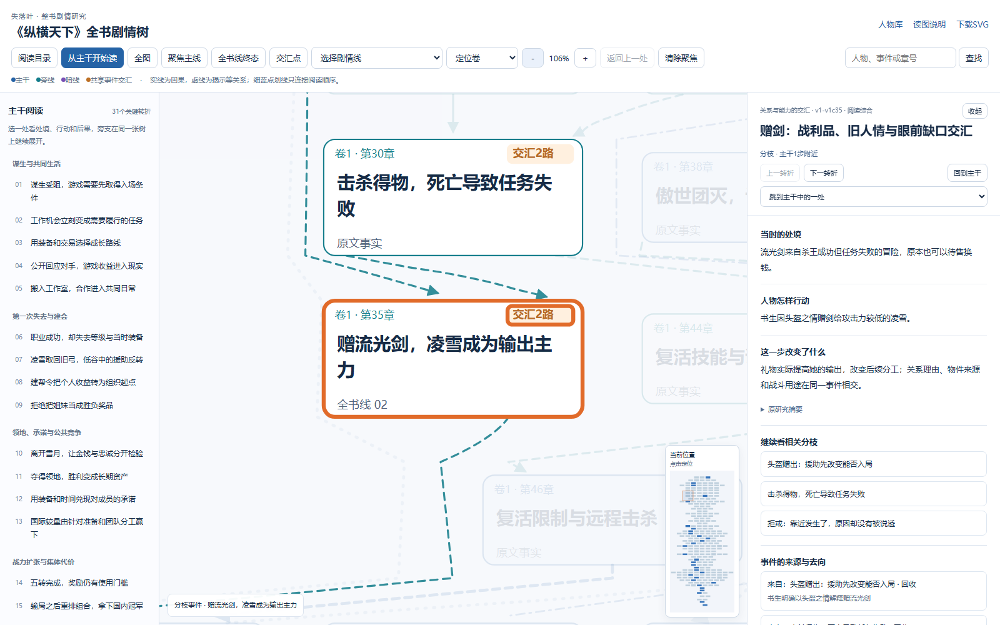
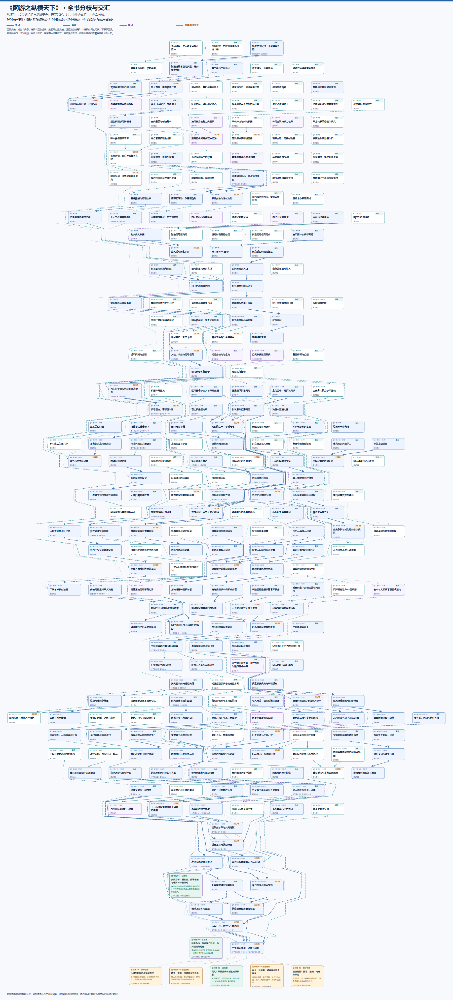
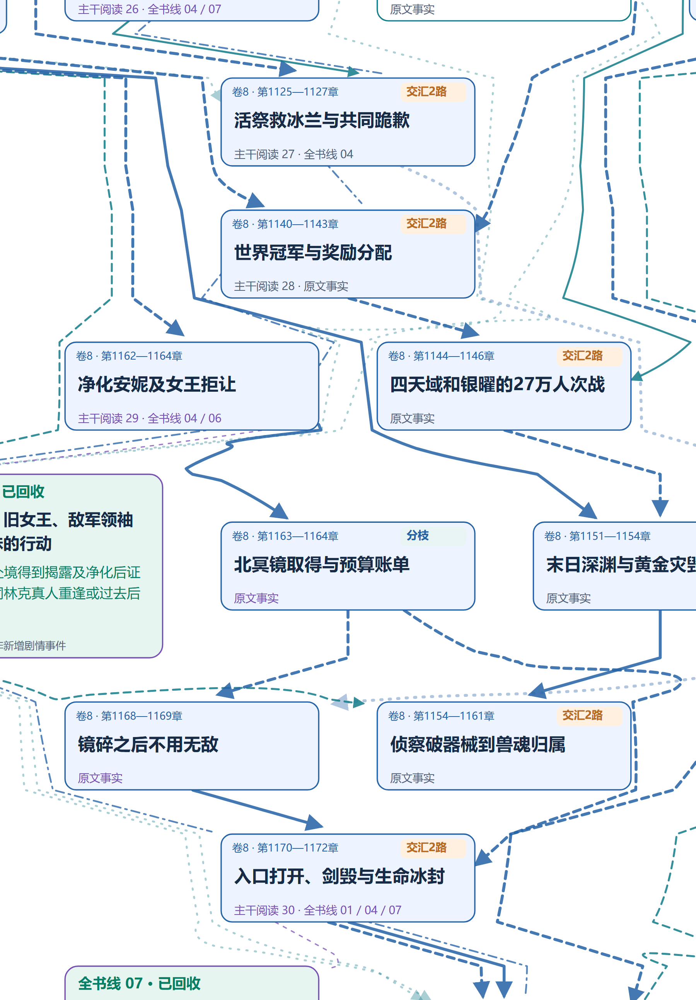

# 《纵横天下》全书分枝与交汇

## 本次阅读优化

默认从主干逐步阅读；左侧31个转折按阶段组织，右侧为51个关键事件提供处境、行动与后果说明。20个重要分枝与主干共用原事件，不另造事件或因果。原图卡片直接显示原章号，详情保留内部ID与全文行号。

支持上一／下一转折、7条全书线阅读、目录跟随当前位置、按人物／事件／章号检索结果、返回上一处、分枝回到原主干节点、刷新恢复事件及剧情线、事件深链接、小地图点击定位与手机目录自动收起。首次打开开始第1步，之后优先恢复阅读位置；外部事件链接优先定位。

[](index.html#v1-v1c35)

完整树图继续保留全部260个事件。51处是本轮深化的叙事说明，其余209处沿用已有摘要与证据，不宣称同等重写。

**260个事件／场景只画一次，全部227条原关系接入同一张大图。** 旁支可以另起，在同一事件框处交汇，再向后分枝。卷号只用于定位，不作为父子目录。

[离线地图](index.html) · [完整PNG](tree.png) · [SVG无损放大](tree.svg) · [终局交汇局部](tree-junction-preview.png) · [开篇局部](tree-opening-preview.png)

[](tree.png)

预览用于看形态；读文字请打开PNG原图或离线地图放大。离线HTML内嵌同一SVG、全部原事件摘要、原关系说明与章节／行号证据，不连接网络。可拖动、滚轮缩放、搜索、聚焦主线／某一线程／交汇点／某一卷，点击事件和连线查看证据及相邻事件。

- 蓝色为主线，青色为旁线，紫色为暗线。主线和暗线重合时优先蓝色，事件框仍保存线程编号。
- 因果为实线；铺垫、揭示、转折、回收为虚线；主题呼应为细点线。所有方向和判断性质保持原图，呼应不计入交汇。
- 细蓝点划线是31个关键转折之间的30条**主干阅读衔接**，没有箭头，点击会显示“不表示因果”。它只在展示层贯通阅读路径，不并入227条语义边，不计入起点、分枝或交汇；也没有把全部260个事件串成链。
- 金色标签表示不同事件的推进关系接入同一事件框。线条交叉不表示剧情相交；同一对事件的多条语义边不重复计路数。
- 7条全书线终态贴在枝端：3条已回收、4条部分回收。安妮、明宇身份两条暗线均已回收。卷末记录仍可查阅，但其早期`unknown`不会替代全书终态。
- 原图语义关系有110个图内起点、27个分枝点、40个交汇点。未存前因的事件保留独立起点；没有为了连成一棵树而伪造因果或跨卷推进。阅读衔接独立标注，严格语义版本另存[SVG](semantic-only-tree.svg)和[清单](semantic-only-manifest.json)备查。
- 移除的70个图面分组节点为1个story、8个volume、61个arc；其身份清单保存在manifest，正式源图没有修改。260个事件含75个event、185个scene，均保留原ID与证据。



实际图像尺寸5371×11834。采用《超级骷髅兵》已有的Graphviz／Viz.js布局、Python中文卡片、Playwright浏览器渲染与内嵌离线阅读器流程。稀疏分枝原始布局横向空白较多，因此在Graphviz坐标后作逐层单调连续横向压缩：卡片宽度、节点次序和拓扑路径保持，层间连续插值，未改剧情数据。原坐标、变换参数与源哈希均保留以便复核。

本机重建（无需联网或安装软件）：

```text
writing-vault\library\reports\zongheng-tianxia\atlas\tree\rebuild.cmd
```

重建依次执行`rebuild.py --prepare` → `layout.cjs` → `rebuild.py` → `render.cjs` → `verify.py`。批处理使用本机已存在的Codex Node／Python依赖与Playwright Chromium 1228；换机可调整`TREE_DEPS`、`VIZ_MODULE`和`PLOT_BROWSER_EXE`。

证据：[源与布局清单](manifest.json) · [结构完整性](integrity-check.json) · [浏览器验收](browser-check.json) · [图面检查](layout-check.json)。浏览器检查涵盖文字溢出、节点遮挡、连线穿卡、事件／关系唯一性、搜索、点击证据、邻居跳转、身份终态、SVG下载、缩放拖动以及外部请求。

人物互链可使用`index.html#事件ID`；阅读器会定位同一事件。已接入145条事件到人物档案链接。可继续向本目录的`character-links.json`提供`{事件ID: [{"name": "人物名", "href": "相对档案路径"}]}`后重建，事件面板会显示档案链接。源图人物身份仍由正式主档维护。

本次地图属于阅读副本，文学解释仍待用户审阅；它纳入2026-10-30 Git同步批次，远端核验见根目录同步回执。

本版模板由viewer.html、viewer.css、viewer.js组成，重建时全部内嵌到index.html；reading-guide.json是根据既有研究整理的阅读注解，保留原事件证据，不修改正式源图。原文与原证据索引不变。

[本轮阅读与来源检查](reading-check.json)记录叙事范围、浏览器交互及保护边界。
