# 斩龙卷一｜成长、组织与不完全胜利

实线表示结构归属，虚线表示跨节点关系；依据类型详见节点数据。

```mermaid
flowchart TD
  n0["卷一 从零开始｜个人与组织的不同结算"]
  n1["起步：能力与规则重新磨合"]
  n0 --> n1
  n2["失居之后接下暗护"]
  n1 --> n2
  n3["熊王掉剑不等立刻拿稳"]
  n1 --> n3
  n4["救弱者倾向被假救援利用"]
  n1 --> n4
  n5["药剂任务中借敌耗王的尾杀"]
  n1 --> n5
  n6["跨雪送信与两个身份世界接通"]
  n1 --> n6
  n7["转剑士的失去与保留"]
  n1 --> n7
  n8["一骑当千从失败到可破解"]
  n1 --> n8
  n9["剑锋寒两战与十二张图"]
  n1 --> n9
  n10["合同、首令与旧友重召"]
  n0 --> n10
  n11["长风合同与天策违约"]
  n10 --> n11
  n12["尸魁首令的两死与夺回"]
  n10 --> n12
  n13["旧友重召与经验归属带练"]
  n10 --> n13
  n14["4V13与半血剑锋寒退让"]
  n10 --> n14
  n15["公主坟推王与窄口迂回"]
  n10 --> n15
  n16["五人、后勤与现实权力"]
  n0 --> n16
  n17["天一楼烙印与事后歉意"]
  n16 --> n17
  n18["先做任务再让录像说服奶妈"]
  n16 --> n18
  n19["洛克斯偷技与最后封印"]
  n16 --> n19
  n20["有限指环转成带学服务"]
  n16 --> n20
  n21["招工告示到第五实体成员"]
  n16 --> n21
  n22["拙操作者承担外部认知"]
  n16 --> n22
  n23["雪追救援与匕首变攀具"]
  n16 --> n23
  n24["重宣誓后斩人形黑兽"]
  n16 --> n24
  n25["荒陵十人合作与古魂复生"]
  n0 --> n25
  n26["劫牢、竹筏与巨钥兑现"]
  n25 --> n26
  n27["百炼止痛、维修与最终出墓"]
  n25 --> n27
  n28["穹熊五击的错位救援与打断"]
  n25 --> n28
  n29["团灭后的复活链与失败卡位"]
  n25 --> n29
  n30["拿头之后才是复生守城"]
  n25 --> n30
  n31["线下拳胜与对手体面"]
  n25 --> n31
  n32["组织失败、重建与有限和解"]
  n0 --> n32
  n33["灵火兽先兑现53紫胸"]
  n32 --> n33
  n34["树王两线战以重损换局部胜"]
  n32 --> n34
  n35["转职机会按旧技成本取舍"]
  n32 --> n35
  n36["个人MVP与忠烈被解散"]
  n32 --> n36
  n37["保忠烈营的邀请与交易后劫令"]
  n32 --> n37
  n38["注册、容量与轮班运营"]
  n32 --> n38
  n39["击杀千阳再压队内报复纳她"]
  n32 --> n39
  n40["解除守尸而不交朋友"]
  n32 --> n40
  n41["背碑99.9%之后的真实破壳"]
  n32 --> n41
  n42["小会从广告形象到系统盟"]
  n32 --> n42
  n43["龙庙传承与资源矿战"]
  n0 --> n43
  n44["独杀地龙试炼与逐师"]
  n43 --> n44
  n45["九人配比与悬空入口"]
  n43 --> n45
  n46["水雷不同技能要分别试"]
  n43 --> n46
  n47["火峰无法断时改保施救者"]
  n43 --> n47
  n48["寒岩八死独存与机关虎"]
  n43 --> n48
  n49["神虎已孵与五卷受限"]
  n43 --> n49
  n50["汪的公私形象与主隐瞒"]
  n43 --> n50
  n51["28精英围主：26死与脱身"]
  n43 --> n51
  n52["醒魂100%仍只是秦王半成品"]
  n43 --> n52
  n53["五会矿战：伏援成功与未结终局"]
  n43 --> n53
  n7 -. "任务与新技能提供五动作正式组合的条件，不是现实招式直接自带系统连招。" .-> n8
  n9 -. "主从剑锋寒拆一骑学来的后翻，在142被王偷招时用于解自己末两击。" .-> n19
  n11 -. "无品阶优先原录像135使囡修正对主的误判。" .-> n18
  n12 -. "首令/3000G助忠烈成立，使后来以真实行会发布公主坟并邀主。" .-> n15
  n15 -. "主128收还佣4万、130其中3万运营，使重召不止一次买盔。" .-> n13
  n18 -. "新增稳定奶补齐笔记最高5共享，五人实际执行S。" .-> n19
  n19 -. "任务五枚洛戒与可带人条款是收费服务的实际通行工具。" .-> n20
  n20 -. "带学收益后讨论工作室基本生活与招工，不把钱自动变已签合同。" .-> n21
  n21 -. "面试战术判断在测CD/报岗中实际贡献，拙操仍留。" .-> n22
  n22 -. "151收七虫卵原食材、154烤时意外孵幻蝶交抹绑定。" .-> n23
  n26 -. "造钥/入墓后才能发现被困百炼，进入条件不等预知其在内。" .-> n27
  n27 -. "被救者提供多次实际修装，十人长副本可续；不称其直接杀终王。" .-> n29
  n23 -. "154抹得幻蝶，166该宠缠绕实际断穹熊后续击。" .-> n28
  n29 -. "终王死/177取头只是新阶段，带至龙城才能完成身魂复生。" .-> n30
  n30 -. "冉闵实留城，209卡尔报其斩矮人将；该战为转述，不抹流霜受伤。" .-> n44
  n33 -. "一抹先获紫胸/求荐，197已成忠烈核心表追随，后来随营入斩龙。" .-> n37
  n34 -. "李牧因协作将实得转职证明交主，189抹完成任务消耗。" .-> n35
  n35 -. "已转幻影骑士和实学技，让九人配置有双T/分身接怪。" .-> n45
  n36 -. "忠烈被系统解散迫使旧核心寻找新承载，198给保营自治方案。" .-> n37
  n36 -. "失败MVP书197实学草丛，199用来伏交易后沐天取令。" .-> n37
  n37 -. "饭局两营/加盟口约在200令币系统成立后才分岗位接人。" .-> n38
  n38 -. "真实行会两营与管理给纳入旧敌提供权限，需主处理成员报复。" .-> n39
  n39 -. "多轮守尸形成对方求停压力；不是千阳一入队自动和平。" .-> n40
  n40 -. "243刘/小猪实止部下攻击，允许主采青木，验证有限止战。" .-> n52
  n44 -. "逐师后接受龙墓试炼，新任务和九人出发依该资格。" .-> n45
  n44 -. "流霜许活出收徒在221中途三转已先兑现，234SSS结不同层。" .-> n49
  n47 -. "两场均把控制全MISS后的施救/承伤边界写清，寒岩仍升级到另八死。" .-> n48
  n41 -. "207七星可破建筑，230按云辰天权玉衡星位实际碎两柱放机关虎。" .-> n48
  n48 -. "机关虎被吞后蛋出现并绑定孵化；具体血认主转蛋是与子解释非系统因果全证。" .-> n49
  n49 -. "新神虎实际练级后以踏火/吼/嗜血协同主反猎，仍被剑浮生杀。" .-> n51
  n49 -. "233五卷消耗符、241缺符，242兵解低银得15，另开收购循环。" .-> n52
  n52 -. "醒魂半品还需高工艺/麒麟铁，南宫采矿升级被赤金封锁，推动五会矿争。" .-> n53
  n42 -. "209系统盟后247血色实际到矿援战。" .-> n53
```

## 剧情线

- 规则学习与职业/技能成长：main / partial
- 斩龙从重召到正式行会：main / partial
- 天策违约与囡信念更新：subplot / resolved
- 暗护、亲近与自主权：main / partial
- 理论强与动作弱的培养线：subplot / partial
- 运营资金、分账与供给：subplot / partial
- 百炼受救与反哺维修：subplot / resolved
- 冉闵魂救与有条件留守：subplot / partial
- 卡尔失子、流霜与换师：hidden / partial
- 忠烈组织败与核心再承载：subplot / resolved
- 练级地、有限停战与矿权：main / open
- 血契背碑到建筑破坏实用：subplot / resolved
- 云辰、机关虎与受限传承：subplot / partial
- 黑兽、血联与改造体线：hidden / open
- 汪公私形象与林信息差：hidden / partial
- 不转会也可合作的外部关系：subplot / partial
