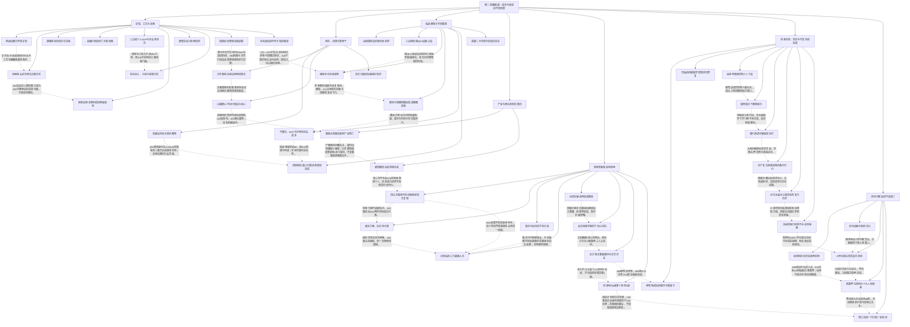

# 斩龙卷二 英雄崛起｜强者的成本与守诺

实线表示结构归属，虚线表示跨节点关系；依据类型详见节点数据。

## 剧情线

- 矿权公开与重铸回收：subplot / resolved
- 秦王、双持与技能成长：main / partial
- 商铺、薪制与分账：subplot / partial
- 秦蒙与血镰调查：hidden / partial
- 护卫、关系与现实力量：main / partial
- 告丧、照护与王将告白：subplot / partial
- 两城战的分项胜果：main / resolved
- 龙城援兵、父子与重建：subplot / partial
- 四公子荒冢与物品分配：subplot / resolved
- 驻地十符、外敌与失败代价：main / resolved
- 双女迁会、神隐与近卫：subplot / resolved
- 骨干降级、套装和授权：subplot / partial
- 剑圣活捕与真实历史：main / resolved
- 池阳旧案、官方史与父遗念：hidden / partial
- 不杀诺、人界正道与24h追杀：main / open
