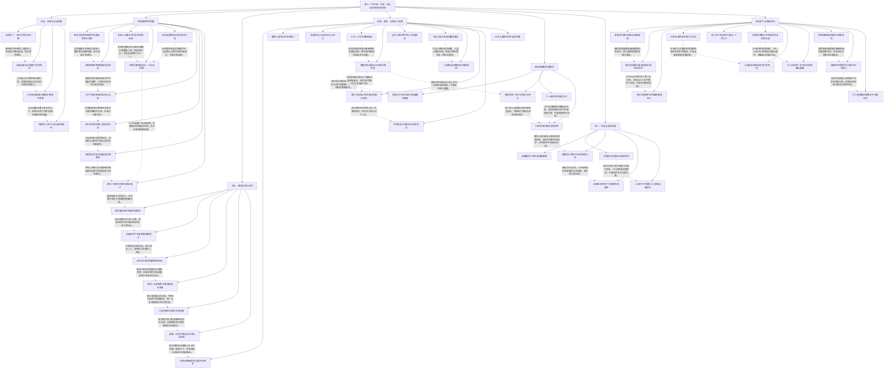

# 斩龙卷三 一代宗师｜守诺、失去与有限成长

实线表示结构归属，虚线表示跨节点关系；依据类型详见节点数据。

## 剧情线

- 守池与自治安置：main / resolved
- 双池政军与领地成长：subplot / partial
- 寻绝望与持有权：main / resolved
- 护城者夺权与异魔归附：main / partial
- 寒荒败与记忆不全的复生：main / partial
- 复活流霜隐藏SSS：main / resolved
- 自利盟友与多笔欠款：subplot / partial
- 自由、朋友与龙骑未来：subplot / partial
- 截脉学习的限定兑现：main / partial
- 九层副本与斧交付：subplot / resolved
- 画魅擂台与保密：subplot / resolved
- 英雄翼国区与全球资格：main / partial
- 恋人、亲妹与不同关系的自主：subplot / partial
- 血镰、殖装与不足的证据：hidden / partial
- 实习和信号权限调查：main / open
- 贪狼游猎与反围剿：subplot / partial
- 矿、弓、套装与骑兵：subplot / partial
- 罗恒任务与父被隐瞒的真相：hidden / partial
- 联盟指挥与内部强权冲突：subplot / partial
- 狮盾与镇岳的独立归属链：main / resolved
- 卷末鹿鸣新图：main / open
