# 斩龙卷四｜权力、供给与有限保护

实线表示结构归属，虚线表示跨节点关系；依据类型详见节点数据。

```mermaid
flowchart TD
  n0["卷四 逐鹿天下｜权力、供给与选择性保护"]
  n1["鹿鸣奖与御林重建"]
  n0 --> n1
  n2["鹿鸣洞：分配、真死与控制链"]
  n1 --> n2
  n3["交鹿角到确认御林任命"]
  n1 --> n3
  n4["释放囚女并逐罗特"]
  n1 --> n4
  n5["选军官与安置部族"]
  n1 --> n5
  n6["御林首次北援：胜后哀归"]
  n1 --> n6
  n7["拒双膝与新部归属磨合"]
  n1 --> n7
  n8["雪夜留宿与一统目标"]
  n1 --> n8
  n9["武神河：情报失算到援军回收"]
  n1 --> n9
  n10["不归海：多方救援与君王死亡"]
  n0 --> n10
  n11["射友箭雨中的火斧救援"]
  n10 --> n11
  n12["巨弩、鱼嘴与唐麟之死"]
  n10 --> n12
  n13["塞林围杀：封海、轮救与归宝落空"]
  n10 --> n13
  n14["断河火攻到五龙锚控毁血囊"]
  n10 --> n14
  n15["保旧营名才完成残军并入"]
  n10 --> n15
  n16["六转费用与替代技能"]
  n10 --> n16
  n17["水盗、失信与北征审判"]
  n0 --> n17
  n18["无名死者与活兰馨要分人"]
  n17 --> n18
  n19["绿城设伏与81船收获"]
  n17 --> n19
  n20["缴械不杀的政治破产"]
  n17 --> n20
  n21["尸桥与友炮：御林保存的另一面"]
  n17 --> n21
  n22["绝望毁灭与盖文收益落空"]
  n17 --> n22
  n23["西亡、战地元戎与罗林终死"]
  n17 --> n23
  n24["护审与拒拆四将的奖赏选择"]
  n17 --> n24
  n25["火晶迁部与神烈换骑"]
  n17 --> n25
  n26["血案、恢复与暗月联盟"]
  n0 --> n26
  n27["蓝水血案：公共风险与私人救援"]
  n26 --> n27
  n28["出院、祭墓与分期回归"]
  n26 --> n28
  n29["暗月保护诺失败到交凶迁族"]
  n26 --> n29
  n30["师归、巨款与拒新聘"]
  n26 --> n30
  n31["国战：双城得失与王权更迭"]
  n0 --> n31
  n32["火神堡失守与骑队毁炮"]
  n31 --> n32
  n33["追饵失误与弩车渡河救援"]
  n31 --> n33
  n34["从烧大仓到护粮回收"]
  n31 --> n34
  n35["双城占领仍失徐与佩"]
  n31 --> n35
  n36["圣天玦号令神殿与临海委托"]
  n31 --> n36
  n37["凡书追击、救父与君主自返被劫"]
  n31 --> n37
  n38["欧恩禁飞、自由断后与领地军救场"]
  n31 --> n38
  n39["抹茶夺龙城与工具化责任分层"]
  n31 --> n39
  n40["镇国刀救官到拥浅林为帝"]
  n31 --> n40
  n41["重建、北域与新矿未结"]
  n0 --> n41
  n42["凡书重建、采矿与铸币"]
  n41 --> n42
  n43["为阿雷复杀千冢与旭日承接"]
  n41 --> n43
  n44["地狱火量产和俄冰灵交易"]
  n41 --> n44
  n45["北域陆防：成长、伤兵与舍救"]
  n41 --> n45
  n46["首次全海指挥：换炮与损舰"]
  n41 --> n46
  n47["弃炮撤令、罗特死亡与问责"]
  n41 --> n47
  n48["火沟迟滞与罗鼎神体破口"]
  n41 --> n48
  n49["两把蝴蝶与国器升阶材料链"]
  n41 --> n49
  n50["现实新掩护与未归薛柔"]
  n41 --> n50
  n51["借援也救不了英雄冢主盟"]
  n41 --> n51
  n52["副职竞速：到十级仍缺最高酒"]
  n41 --> n52
  n53["新矿三方战：刺杀魔山失败"]
  n41 --> n53
  n2 -. "实际持角交王且确认任命，任务物成为权力入口。" .-> n3
  n3 -. "统领权和令允许开牢/处置下属，不等已免贵族法。" .-> n4
  n4 -. "逐旧人和失兵后，实际选军官/安置人口补结构。" .-> n5
  n5 -. "新蛮盾/骑弓训练提供首次北援兵种，真战检验并付伤亡。" .-> n6
  n6 -. "军功王赏后引只忠洛克条件，主拒绝。" .-> n7
  n2 -. "十二套777全实战/紫链781限复，旧掉落真实用而非名称复现。" .-> n9
  n2 -. "761英雄盔实戴，778/781免晕在敌控中实际验证；不是持有即全程无伤。" .-> n9
  n11 -. "大战伤亡和战绩推动并军决定，808准809保名实际归编。" .-> n15
  n12 -. "前三波耗军/夜叉浪改变可用武器，最终王用军耗塞提供围杀条件。" .-> n13
  n14 -. "凯尔经验达到150，另付费/仪式810才正式六转，不把击杀等晋阶。" .-> n16
  n16 -. "翼实登盗船/越营压制，用于新任务但没救下无名少女。" .-> n18
  n18 -. "呈物证/免责后受新剿虬龙任务，推动找补给港。" .-> n19
  n19 -. "缴械诺与俘上交触发君权否决，结果不是保命成功。" .-> n20
  n19 -. "820赏炮821尚未到，823实际射用且五炮热限。" .-> n21
  n22 -. "绝望熔毁削罗武器，仍须千龙战/多方合攻，833才尾杀。" .-> n23
  n23 -. "西死回棺引欧归责斩令，徐证/多盟力量使候审无罪。" .-> n24
  n24 -. "获十万招募/火晶用权才有新迁地，给米除兽促招。" .-> n25
  n27 -. "主自修醒阳炎并游戏得神技能；死亡/错过赛事并未消。" .-> n28
  n20 -. "两次保护诺都先失败，暗月另有交凶与资源执行，不能当降俘复活。" .-> n29
  n32 -. "南征复火神堡/深入平原后才有追饵断河，区分首次失堡与复堡。" .-> n33
  n34 -. "火象粮仓真毁/己粮运到使围饿和出口伏击可持续。" .-> n35
  n34 -. "己夺天水不等控制全部地形，敌另以洪水/石林反截。" .-> n35
  n35 -. "佩临终玉895神殿认作圣天玦并实效主。" .-> n36
  n36 -. "899真受无攻镇国刀，917架秦颈救官是政治物再用。" .-> n40
  n37 -. "帝自返被劫/降书拒后产生重要任务护送，禁飞迫陆水脱。" .-> n38
  n38 -. "池军2000限先救帝，城失后916该限解除但军仍听主，城军拆开。" .-> n39
  n39 -. "池军失城无住食会锐减，需要另获凡书城址与生产。" .-> n42
  n38 -. "欧已真亡/未封武王，宗室继承议事才有浅林拥立。" .-> n40
  n40 -. "新帝真准文书/工矿，构成重建前提而非主私自占。" .-> n42
  n43 -. "千冢成员转旭日后11000冰灵晶交易与十万换骑，报复未灭敌组织。" .-> n44
  n44 -. "地狱火骑枪936近全实换参与更高阶陆防，仍奶缺真崩。" .-> n45
  n45 -. "已挡陆波后御林/炎/蛟转海迎舰，需新换炮和船令。" .-> n46
  n46 -. "海胜未全安全，后借炮阵却遭武信撤，资源优势有协作条件。" .-> n47
  n47 -. "炮阵损后改沟火延迟登陆，为北袭主力造时间窗。" .-> n48
  n48 -. "罗鼎颈神晶已实取957用于游戏龙池升五星，非现实剑同物。" .-> n49
  n39 -. "主960正式请沈一周找薛柔，是寻人行动启动而非已找回。" .-> n50
  n44 -. "为组织取矿的需求与965危险矿民未改善同处，非新矿一战已解决劳动处境。" .-> n53
  n49 -. "五星高攻仍被无敌/盾击/多奶挡，末刺魔失败反证单装包胜。" .-> n53
  n52 -. "酿酒到10却缺果、三路有战果却刺杀失败，两场均把资格/局部收益与终目标分开。" .-> n53
```

## 剧情线

- 御林制度与实数增长：main / partial
- 护弱与选择性牺牲：main / partial
- 鹿角任务与战利品实用：subplot / resolved
- 不归海两君与军队代价：main / resolved
- 兰馨营救与越案：subplot / resolved
- 水盗歼灭与降俘诺失败：subplot / resolved
- 北征、罗林/盖文死亡与审判：main / resolved
- 互爱、独立军政与亲密边界：main / partial
- 雷亡与东城月恢复：main / partial
- 暗月从劫掠到独立营联盟：subplot / partial
- 第一国战的城权分层：main / partial
- 薛柔身份、龙城损失与寻找：hidden / open
- 私军权限与凡书重建：subplot / partial
- 王权更迭与洛家疑云：hidden / partial
- 骑装量产与新矿：subplot / partial
- 北域之怒陆海与罗鼎结算：main / resolved
- 现实与游戏两把蝴蝶：subplot / partial
- 殖装/裴案与PaPa掩护：hidden / open
- 主父母与旧师归来：hidden / partial
- 群体竞赛与副职门槛：subplot / partial
