# 斩龙卷五｜军权、资源与龙域的代价

实线表示结构归属，虚线表示跨节点关系；依据类型详见节点数据。

```mermaid
flowchart TD
  n0["卷五｜军权与龙域的获得及代价"]
  n1["军权与北迁代价"]
  n0 --> n1
  n2["矿区利益未随战功归御林"]
  n1 --> n2
  n3["北迁炮杀与流霜救军"]
  n1 --> n3
  n4["救龙硎不抹周海死"]
  n1 --> n4
  n5["熔神马由破坏炮场中发现并绝版"]
  n1 --> n5
  n6["逼洛洵自刎与王仍活"]
  n1 --> n6
  n7["竞技、会猎与大执戈"]
  n0 --> n7
  n8["镜像竞技保主八强止"]
  n7 --> n8
  n9["共工百团的插秒与分装"]
  n7 --> n9
  n10["七转御天的条件与副作用"]
  n7 --> n10
  n11["三百死囚替七千后的边兵账"]
  n7 --> n11
  n12["临海夺城与诱徐的双线"]
  n7 --> n12
  n13["会猎夜袭到御天破湖"]
  n7 --> n13
  n14["王者会猎系统胜与两国器去向"]
  n7 --> n14
  n15["正式大执戈与退一米挑战"]
  n7 --> n15
  n16["皇城胜负不归参与最高光者"]
  n7 --> n16
  n17["放刘骏的威慑回收"]
  n7 --> n17
  n18["二国战的多城与不同结算"]
  n0 --> n18
  n19["凡书长守的累积破损"]
  n18 --> n19
  n20["血渊借兰的危险交易"]
  n18 --> n20
  n21["取望月却只解一部分凡书围"]
  n18 --> n21
  n22["女神泪解奴又强迁"]
  n18 --> n22
  n23["月灵定居与菲奥娜臣属协议"]
  n18 --> n23
  n24["残局反杀仍要盟友死次"]
  n18 --> n24
  n25["怨拒援到末刻保天翎"]
  n18 --> n25
  n26["薛柔回归的多道门"]
  n18 --> n26
  n27["二国战系统恢复分项"]
  n18 --> n27
  n28["现实创业、调查与修行"]
  n0 --> n28
  n29["武汉A袭主与两个C活擒"]
  n28 --> n29
  n30["婉约从工商手续到首单签收"]
  n28 --> n30
  n31["公开假搜与壁虎基因的证明范围"]
  n28 --> n31
  n32["宴后花坊五A与活口"]
  n28 --> n32
  n33["三天阳炎训练有温度与覆盖验收"]
  n28 --> n33
  n34["救兰与交易后的责任"]
  n0 --> n34
  n35["五人救兰的分工与真路"]
  n34 --> n35
  n36["百酒与百万金的王戒升级"]
  n34 --> n36
  n37["旧技随装备复制失效"]
  n34 --> n37
  n38["百团层级与雷丁实死"]
  n0 --> n38
  n39["百人征召不是全明星都自愿来"]
  n38 --> n39
  n40["尸王四命与层间奖励节奏"]
  n38 --> n40
  n41["阿蜜隐身被小舞短窗口破解"]
  n38 --> n41
  n42["雷丁前没有霸王重生"]
  n38 --> n42
  n43["三魂外交与重铸"]
  n0 --> n43
  n44["三魂与精晶的分段取材"]
  n43 --> n44
  n45["九霄剥魂破不侵口约"]
  n43 --> n45
  n46["新军备与沧复仇八波"]
  n0 --> n46
  n47["神威试炮到运弹限制"]
  n46 --> n47
  n48["守海岸至三军先撤"]
  n46 --> n48
  n49["首次霸王重生逼枫失无敌后反杀"]
  n46 --> n49
  n50["空船识隐与天眼树油灯"]
  n46 --> n50
  n51["灵花零攻击面板与连锁自爆"]
  n46 --> n51
  n52["诸神分散混战迫重炮转目标"]
  n46 --> n52
  n53["沧复仇正式胜与一只包订单"]
  n46 --> n53
  n54["龙神之女、列岛与野域"]
  n0 --> n54
  n55["龙心奖励救活子舒女"]
  n54 --> n55
  n56["未复神智时成血契"]
  n54 --> n56
  n57["血契后成年试飞才可召骑"]
  n54 --> n57
  n58["泽渊通商诱惑与附庸代价"]
  n54 --> n58
  n59["王准远征与港外火炮"]
  n54 --> n59
  n60["弃谷翻山与金鳞分权治理"]
  n54 --> n60
  n61["抢蛋升级为迁族重建龙域"]
  n54 --> n61
  n62["安娜拒降死/银戈补刀死"]
  n54 --> n62
  n63["千万元叫价之前未落槌"]
  n54 --> n63
  n3 -. "北迁炮杀使军政冲突激化，主回师逼洛洵自刎。" .-> n6
  n4 -. "同一龙城导师的高强救援与后授御天并置付力和成长，不宣救龙硎直接触发七转。" .-> n10
  n9 -. "共工结算等级成长提供七转门槛，实际仍需申请交费。" .-> n10
  n10 -. "小物练习后的御天用于湖战水龙，并有六十分钟禁技弱化。" .-> n13
  n6 -. "回军阶段的杀囚令到1022获司徒未执行/主改替死方案，后果不是命令即完成。" .-> n11
  n12 -. "云榛夺城及败局接到生擒，放归刘为新一轮临海战略。" .-> n17
  n13 -. "夜舰与湖战属于同一会猎竞争，系统最终主MVP但全服印胜分属。" .-> n14
  n14 -. "艾尔莎1039交东，1060先实冰；二战后续协作不把冰归主。" .-> n25
  n15 -. "正式大执戈权限在1169请求远征/王准/调船与调统领中具体使用。" .-> n59
  n19 -. "凡书炮围与补给断后主改向兰求外力，原战术未全解。" .-> n20
  n20 -. "龛取魂交易换先锋/巨鲧，直接攻取望月而有屠民越界。" .-> n21
  n21 -. "新城需人口/林建议奴场，主借魔转攻女神泪并强迁。" .-> n22
  n21 -. "望月被取后提供月灵新家，菲奥娜主动来/主给女王与称臣条件。" .-> n23
  n21 -. "取望月仅迫英法退，主仍返凡书联友抗美俄残局。" .-> n24
  n24 -. "凡书美俄退后主转赴天翎，经历先拒与改令援宫。" .-> n25
  n25 -. "末宫守住与各战场终局接系统中国胜，恢复分别发。" .-> n27
  n26 -. "正式跨服归会/现实返后薛领八千高损守城，重新承担核心职责。" .-> n52
  n27 -. "镇岳交挽与后霸王复制/旧膝代送并置不同物链，不宣同一装备。" .-> n37
  n20 -. "主借兰军/交龛后的个人关系延伸到救她，救醒/效霜并不抹旧屠杀。" .-> n35
  n36 -. "五星王戒的王域在沧战前排与炮外防守多次实用；冷却口径另保。" .-> n52
  n39 -. "百人配额队成立后进入同一任务首层，材料/职业分工实生效。" .-> n40
  n40 -. "首层清并开后层，第三隐身难点要求与第一层不同的识隐协作。" .-> n41
  n41 -. "同一百团继续清四五层到雷丁，前掉装/神技在后战使用。" .-> n42
  n42 -. "杀雷得铠复制才有重生，1151首次选择原地掉级复后杀枫。" .-> n49
  n42 -. "六件套开启/进一步进化需求引出余三魂与精晶材料任务。" .-> n44
  n45 -. "弗雷活剥第三魂补齐材料，1138重铸成，之后新死不能回填当场。" .-> n44
  n44 -. "精晶交换建立持续送弹/御林炮上龙城，纯晶用于新十神威。" .-> n47
  n30 -. "布斯特订单验收时保镖红鳞事件引会议、假搜与样本取得。" .-> n31
  n31 -. "公司线索与宴后伏击并置风险升级；汪指使尚未供证，不把嫌疑当已证因果。" .-> n32
  n32 -. "主受多A伤暴露防守短板，林成送北辰观补心眼与全甲。" .-> n33
  n47 -. "十神威随军轰海/对空实用，冷却/散敌使它不能保全防线。" .-> n48
  n48 -. "NPC炮先撤至城，玩家第六波识隐后也撤望月接入当地显形体系。" .-> n50
  n50 -. "皎月显形解法对下一波灵伞护灵花/自爆破墙无效，必须另测另解。" .-> n51
  n51 -. "外墙炸毁迫内墙近身，神骨/印度双线使炮另向墙外密兵。" .-> n52
  n52 -. "三小时神骨/攻城被挡，清眸退，系统确认活动成功。" .-> n53
  n53 -. "MVP龙心之耀的唤龙用途在子舒莓蛋上实成，不只是个人坐骑媒介。" .-> n55
  n55 -. "莓复生后母/霜催长至咬主，霜乘其神智未复促血契。" .-> n56
  n56 -. "血契后仍待成年，系统叫第一次试飞完成才开第二空间。" .-> n57
  n58 -. "泽渊不给无条件贸易，霜请主征岛/主请王准并实际出舰。" .-> n59
  n59 -. "远炮扫港/龙骑登陆后测图绕谷，炮破金鳞与设官供粮。" .-> n60
  n60 -. "征岛SSS交后主求更多龙骑、霜定功勋条件并组织大队赴野域。" .-> n61
  n57 -. "莓已融合骑宠，野域实护母攻安娜，性能与母女动机都回用。" .-> n62
  n61 -. "活捕/灭域目标遭银戈安娜反击，双王死和忠诚清零促群龙转属。" .-> n62
  n62 -. "银戈掉星辰戒/龙牙，林实装后戒为避偏送而上拍竞价。" .-> n63
```

## 剧情线

- 御林北迁与军权制度化：main / partial
- 杀囚令与替死方案的责任：subplot / partial
- ALLSTAR名次与公开收益：subplot / resolved
- 会猎与升级物链：main / resolved
- 二国战的阵营/城权/损失：main / resolved
- 望月治理与强迁/臣属：subplot / partial
- 借兰交易/救活/效霜：main / partial
- 薛柔分步回归与立足地：main / partial
- 现实创业、礼物与未结拍卖：subplot / partial
- 殖装技术与汪嫌疑证链：hidden / open
- 护卫、亲密与继续执警：main / partial
- 霸王复制与全五星/首次重生：main / resolved
- 百团层级与雷丁首：subplot / resolved
- 沧复仇八波与三城存续：main / resolved
- 现实阳炎中阶完善：subplot / resolved
- 复生、血契与可骑解锁：main / resolved
- 东方列岛征服与后续供给：main / partial
- 灭野域/重建/子舒龙神：main / partial
- 君王重排与七曜新同盟：hidden / open
