# 《斩龙》卷六阶段图：统一、交班与生还

实线表示结构归属，虚线表示跨节点关系；依据类型详见节点数据。

```mermaid
flowchart TD
  n0["卷六：统一、退隐与生还"]
  n1["龙谷与圣箱"]
  n0 --> n1
  n2["异魔侵攻与龙域军损"]
  n0 --> n2
  n3["朝堂结算"]
  n0 --> n3
  n4["碎寂神界与条件力量"]
  n0 --> n4
  n5["七星墓与国器"]
  n0 --> n5
  n6["第三国战统一七主"]
  n0 --> n6
  n7["现实取证、订婚与军务"]
  n0 --> n7
  n8["救佩、交职与北境均衡"]
  n0 --> n8
  n9["义盟民心与主动追击"]
  n0 --> n9
  n10["鬼城惨败与保军撤回"]
  n0 --> n10
  n11["交班与有限重生"]
  n0 --> n11
  n12["把龙骑扩张变成生态工程"]
  n1 --> n12
  n13["圣灵箱七小时的协防与失而复得"]
  n1 --> n13
  n14["门没有开，仍借龙越城"]
  n2 --> n14
  n15["拒绝佩体招降与霸王任务接口"]
  n2 --> n15
  n16["百里长风以禁法换斯特拉重伤"]
  n2 --> n16
  n17["刀锋山地雷与冻域的分账损失"]
  n2 --> n17
  n18["熟人炼魂影与真问剑并存"]
  n2 --> n18
  n19["胜利后的冻军追责没有消失"]
  n3 --> n19
  n20["鹿奴向导把新地图转成陷阱"]
  n4 --> n20
  n21["碎格换入口与尚未回赠的承诺"]
  n4 --> n21
  n22["救伊薇但暂阻她复仇"]
  n4 --> n22
  n23["因救父暂留俘虏，再杀取格"]
  n4 --> n23
  n24["从擂台夺军到把兵权交皇子"]
  n4 --> n24
  n25["阻止炼错格，交换成首位中神"]
  n4 --> n25
  n26["云浅第一次把主真正打回凡界"]
  n4 --> n26
  n27["霸王改动的延期与落地属性"]
  n4 --> n27
  n28["救兰蔻成功但祖父死"]
  n4 --> n28
  n29["双丹保级与近两小时杀云浅"]
  n4 --> n29
  n30["沈冰取证到手后遭遥爆"]
  n7 --> n30
  n31["私袭别墅留下新证而非永远无证"]
  n7 --> n31
  n32["五人入七星墓与空棺"]
  n5 --> n32
  n33["材料实交到国器实成"]
  n5 --> n33
  n34["投资2500万到营业执照后证"]
  n7 --> n34
  n35["龙绝失脚再由传送反夺高地"]
  n6 --> n35
  n36["九黎被偷传夺城后再收"]
  n6 --> n36
  n37["杀飞龙使团与委托九霄"]
  n6 --> n37
  n38["不杀佩体的捕获代价"]
  n6 --> n38
  n39["杀沧肉体没有杀尽神魂"]
  n6 --> n39
  n40["突破寒刃关仍须回防安排"]
  n6 --> n40
  n41["铁颅空袭破后系统占领"]
  n6 --> n41
  n42["粮刃、信物与君位合成联盟"]
  n6 --> n42
  n43["夏叶的油木把冰墙转成弱点"]
  n6 --> n43
  n44["林协调有限传送回援与离线战果"]
  n6 --> n44
  n45["同意订婚与东城的伴娘选择"]
  n7 --> n45
  n46["驱西瓦娜后原佩醒来"]
  n8 --> n46
  n47["记忆技术提案到家属签字"]
  n7 --> n47
  n48["真假订婚两层到汪逐层突破"]
  n7 --> n48
  n49["断蝴蝶实体剑杀汪并核己损"]
  n7 --> n49
  n50["少将仪式与新的未执行任务"]
  n7 --> n50
  n51["系统王爵与正式军职交接分步"]
  n8 --> n51
  n52["清君侧杀高而不杀帝"]
  n8 --> n52
  n53["盟友主动求友伤炮战消百万空骑"]
  n8 --> n53
  n54["留希活与限裂缝七日的私议"]
  n8 --> n54
  n55["两剑梦毁后回到钓鱼日常"]
  n7 --> n55
  n56["王府民心界面与不能挥刀的敌人"]
  n9 --> n56
  n57["花枪提出不正义之战的质疑"]
  n9 --> n57
  n58["杀平民后追卷轴进封闭位面"]
  n9 --> n58
  n59["鬼城探空与神侯活擒仍不能解禁"]
  n10 --> n59
  n60["楚江头与巨人的新战斗尺度"]
  n10 --> n60
  n61["问剑锋拒退，主冒敌伏救回残军"]
  n10 --> n61
  n62["拒割七国条件后杀孔房使团"]
  n10 --> n62
  n63["瞄眼与集炮也只能延迟墙破"]
  n10 --> n63
  n64["祝抢粮被伏与主拒救的抉择"]
  n10 --> n64
  n65["开门让孙方霖三千求生后被屠"]
  n10 --> n65
  n66["识雨防潮仍失城，改用两路救军"]
  n10 --> n66
  n67["不足18万军返与未死的战皇"]
  n10 --> n67
  n68["盟主交林与西南任务前告别"]
  n11 --> n68
  n69["白墨颜实际醒来与雷尚未出场"]
  n11 --> n69
  n12 -. "军生态与龙骑基础，非直接导致国战胜" .-> n44
  n15 -. "先见借体威胁，后选择保体" .-> n38
  n38 -. "不杀体使驱邪救原魂可行" .-> n46
  n16 -. "斯受伤后仍需伏击/流尾" .-> n17
  n17 -. "真军损带回朝堂追责" .-> n19
  n18 -. "熟面与意志不等，后仍需分体魂" .-> n39
  n20 -. "碎格成为换入口资源" .-> n21
  n22 -. "救女行动转救父/神尊路径" .-> n23
  n24 -. "雷火格通过停炼换授东" .-> n25
  n25 -. "东参与地境续战并代寄圣冰" .-> n26
  n26 -. "败退/格损与规则改动促新备战" .-> n27
  n27 -. "七日窗口内二访实成上位" .-> n29
  n28 -. "二访天境同时留救人后果" .-> n29
  n32 -. "实拾玉玺作为消耗材料" .-> n33
  n30 -. "证毁与殉职促私袭/再获新证" .-> n31
  n31 -. "汪活逃/复仇成为诱敌风险" .-> n48
  n48 -. "隔离预案被逐层突破后近战击杀" .-> n49
  n49 -. "区域组织近肃后守护转军授职" .-> n50
  n30 -. "真实丧失使数据方案具有情感动机" .-> n47
  n47 -. "授权后白墨颜实醒，雷保持计划" .-> n69
  n34 -. "现实生活规划与任务交班并行" .-> n68
  n35 -. "主力胶着期间敌另路偷传，不归唯一直接因" .-> n36
  n36 -. "1320已收九黎后七主整体最终成" .-> n44
  n37 -. "既得宫法联系使四十万远传可用" .-> n44
  n39 -. "流返后可主持驱邪，不意味沧魂当场灭" .-> n46
  n40 -. "过关使主力炮可抵铁" .-> n41
  n41 -. "旧供给政权毁使部落需新供方" .-> n42
  n42 -. "三百万援与君诺不能独破冰炮" .-> n43
  n43 -. "泽取后有主力返天翎" .-> n44
  n44 -. "兑现七主承诺后家庭议订婚" .-> n45
  n45 -. "拟订婚在真宾前宣告，随即切诱敌" .-> n48
  n51 -. "卸职不等免军政猜忌" .-> n52
  n46 -. "救回原魂后仍与其军源诉求分歧" .-> n54
  n53 -. "敌军消耗后才有压境议价位置" .-> n54
  n54 -. "神兵消息进入主观恐惧梦，不实际毁剑" .-> n55
  n56 -. "民心危机/领头被擒促帝发平乱令" .-> n57
  n57 -. "弱者誓言在真杀平民与冒追中受验" .-> n58
  n58 -. "金卷诱入封幕后需占据点" .-> n59
  n59 -. "探空城未排除外域巨人" .-> n60
  n60 -. "抛石破墙压力促两会野战测试" .-> n61
  n61 -. "救回残军又减兵，继续围城损耗" .-> n63
  n62 -. "杀使破谈后新攻十万" .-> n63
  n63 -. "人伤和断粮迫取谷粮" .-> n64
  n64 -. "缺粮仍未解且援粮被伏，哗变另起" .-> n65
  n64 -. "拒援保余军但粮未解，需要短时外援" .-> n66
  n66 -. "玩家诱敌/燕撤军/方流开幕实回" .-> n67
  n67 -. "惨败仍有继续军务，主转交盟主" .-> n68
  n50 -. "授职后的南京出发准备实际发生，未任务结" .-> n68
  n45 -. "正式未婚夫妻送别，非婚礼回收" .-> n68
```

## 剧情线

- 第三战七主统一：main / resolved
- 龙城守成与不可互抵军损：main / resolved
- 上位飞升：main / resolved
- 兰蔻获救的代价：subplot / partial
- 回赠长老格：subplot / open
- 玉玺回报与空棺：hidden / partial
- 沈取证与汪追捕：main / resolved
- 李林订婚：subplot / resolved
- 东城月关系与同住条件：subplot / partial
- 雷沈记忆复现：hidden / partial
- 兹爵创业：subplot / partial
- 空军授衔/KILLS：subplot / partial
- 佩原魂与控制者：hidden / resolved
- 沧体毁与魂结局渠道：hidden / resolved
- 退职与王权猜忌：main / partial
- 北境限军均衡：main / partial
- 琴歌天域兵：hidden / open
- 蚩尤联盟君位/供给：subplot / partial
- 义盟与弱者誓冲突：main / partial
- 鬼城救残军：main / resolved
- 傲天下一版：main / open
- 祝海后勤与死亡：subplot / resolved
- 鬼城史与神侯终态：hidden / unknown
