# 网游之纵横天下｜卷一第1—49章连续阅读图

实线表示结构归属，虚线表示跨节点关系；依据类型详见节点数据。

```mermaid
flowchart TD
  n0["卷土重来：生计、升级与结盟"]
  n1["困境与陌生来客"]
  n0 --> n1
  n2["帮助变为新任务"]
  n0 --> n2
  n3["先见结果：主人被来客锁在房外"]
  n1 --> n3
  n4["倒叙解释：为脱离地痞而带她上楼"]
  n1 --> n4
  n5["补叙失业缺钱，头盔购买受阻"]
  n1 --> n5
  n6["试戴提前拿到的头盔，意外锁定身份"]
  n1 --> n6
  n7["来客主动分粥，缓和关系"]
  n2 --> n7
  n8["发现误绑定后仍赠出头盔"]
  n2 --> n8
  n9["留下钱与工作地址"]
  n2 --> n9
  n10["加入雪月，接到首夜任务"]
  n2 --> n10
  n11["开服抢入获经验，开始练级"]
  n2 --> n11
  n12["资源和职业路线"]
  n0 --> n12
  n13["身份、互助与洞穴任务"]
  n0 --> n13
  n14["赠予、现实收入与继续追赶"]
  n0 --> n14
  n15["任务得剑，收益换药"]
  n12 --> n15
  n16["越级打蝙蝠并遭变异怪"]
  n12 --> n16
  n17["弱点险胜，售旧装备再投入"]
  n12 --> n17
  n18["诱灰名反击，推进哨岗任务"]
  n12 --> n18
  n19["组织争夺首领"]
  n12 --> n19
  n20["补刀首领，结识剑火核心"]
  n12 --> n20
  n21["黄金弓定职业，交易铠甲"]
  n12 --> n21
  n22["就职与旧任务奖励兑现"]
  n12 --> n22
  n23["组合技能杀高防蜥蜴"]
  n12 --> n23
  n24["总监被揭为双胞胎姐姐"]
  n13 --> n24
  n25["探索剑狼弱点并接首领任务"]
  n13 --> n25
  n26["侍卫占位阻狼王"]
  n13 --> n26
  n27["赤炎套装与新技能书"]
  n13 --> n27
  n28["协助紫韵儿完成豪猪击杀"]
  n13 --> n28
  n29["保护牧师击退傲世"]
  n13 --> n29
  n30["公司会议与权力差异"]
  n13 --> n30
  n31["清风揽月的能力先展示"]
  n13 --> n31
  n32["凌月身份揭晓并获赤焰海"]
  n13 --> n32
  n33["双方共享装备进入洞穴"]
  n13 --> n33
  n34["赤焰海解除三层群袭"]
  n13 --> n34
  n35["战魂冲突与剑火救援"]
  n13 --> n35
  n36["前次保护获明确回报"]
  n13 --> n36
  n37["消亡套装按职业分配"]
  n13 --> n37
  n38["残血首领召唤千军"]
  n13 --> n38
  n39["击杀得物，死亡导致任务失败"]
  n13 --> n39
  n40["现实交租，再探新地图"]
  n14 --> n40
  n41["救陌生队换地图入口"]
  n14 --> n41
  n42["重遇凌雪并约30级惊喜"]
  n14 --> n42
  n43["共同练级到30级"]
  n14 --> n43
  n44["赠流光剑，凌雪成为输出主力"]
  n14 --> n44
  n45["傲世围攻，决定引怪反制"]
  n14 --> n45
  n46["群箭断回城，怪群闭合"]
  n14 --> n46
  n47["傲世团灭，记录与掉落"]
  n14 --> n47
  n48["录像回应宣战，现金预付法杖"]
  n14 --> n48
  n49["职场威胁与法杖交付"]
  n14 --> n49
  n50["群技训练和套装变现"]
  n14 --> n50
  n51["四人互补与信息隐瞒"]
  n14 --> n51
  n52["高防迫使主攻与抗怪换位"]
  n14 --> n52
  n53["复活技能与诅咒成为保障"]
  n14 --> n53
  n54["孤独被同伴回应，黄金首领出现"]
  n14 --> n54
  n55["复活限制与远程击杀"]
  n14 --> n55
  n56["追星弓降低使用门槛"]
  n14 --> n56
  n57["库存卖不动，改墓园群刷"]
  n14 --> n57
  n58["守墓两环完成，第三环开放"]
  n14 --> n58
  n4 -. "后叙原因解释开篇结果" .-> n3
  n5 -. "缺头盔与房外等待催生试用" .-> n6
  n3 -. "制造麻烦的来客转为主动照顾" .-> n7
  n6 -. "绑定冲突通过明确赠与收束" .-> n8
  n7 -. "具体照顾延伸为经济与求职帮助" .-> n9
  n9 -. "地址指引兑现为工作室入口" .-> n10
  n8 -. "设备使游戏目标具备条件" .-> n11
  n10 -. "谋生目标附加首夜指标" .-> n11
  n6 -. "特殊头盔与组织关系提供身份线索" .-> n10
  n15 -. "任务资金与装备支撑越级和后续再投资" .-> n17
  n17 -. "铁剑交易提供再识别与交易关系" .-> n20
  n21 -. "必中弓与破甲技能在高防怪实测" .-> n23
  n26 -. "狼王击杀与交任务产出新资源" .-> n27
  n27 -. "赤焰海由库存转赠法师" .-> n32
  n32 -. "群法在三层解围" .-> n34
  n29 -. "龙魂明确称先前护紫韵儿是回援缘由" .-> n36
  n35 -. "救援后形成互补六人队" .-> n36
  n38 -. "召唤千军引发死亡；击杀不保证任务完成" .-> n39
  n37 -. "已有消亡套装成为让鬼炙撤离的明确理由" .-> n39
  n10 -. "工作室入口后揭总监为电话中的姐姐" .-> n24
  n31 -. "视频中的清风揽月被确认为凌月" .-> n32
  n8 -. "书生明确以头盔之情解释赠流光剑" .-> n44
  n39 -. "曾计划留卖的流光剑转为赠予和战力" .-> n44
  n39 -. "新得千刃箭首次使用于打断群体回城" .-> n46
  n47 -. "提前录制战斗成为回应公开指控的证据" .-> n48
  n47 -. "法杖掉落经现实付款和游戏交付成交" .-> n49
  n48 -. "实际收入与主角不再完全受工作要挟并置" .-> n49
  n49 -. "邀牧师使四人队组建并发挥治疗作用" .-> n51
  n53 -. "复活预言先获得再实战生效且遇限制" .-> n55
  n55 -. "45级新弓经鉴定揭示降10级特技" .-> n56
  n56 -. "火力跃升与失去必中后的担忧同时保留" .-> n58
  n57 -. "收集肋骨任务完成，继续两环但第三未完" .-> n58
```

## 剧情线

- 从现实窘境进入职业游戏：main / partial
- 由误会到相互帮助：subplot / partial
- 凌雪身份与提前拿到头盔的原因：hidden / partial
- 剑火互助与分配：subplot / partial
- 幽冥洞穴任务：subplot / resolved
- 幽魂古刹探索：subplot / partial
- 傲世冲突与论坛声誉：subplot / open
- 王俊杰威胁与姐妹信息差：hidden / open
- 全力量弓箭路线：main / partial
- 守墓人的连续委托：subplot / partial
