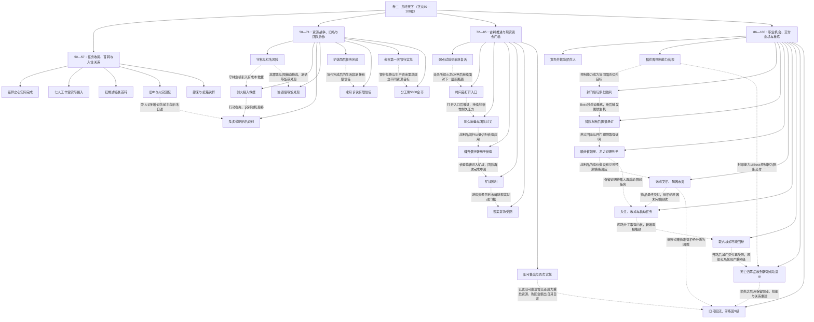

# 《网游之纵横天下》卷二50—100章阶段结构与线索图（草稿）

实线表示结构归属，虚线表示跨节点关系；依据类型详见节点数据。

## 剧情线

- 旧高手身份分层揭示：hidden / partial
- 资源自主和组织形成：main / partial
- 承诺、护送与有限信任：subplot / partial
- 古刹升级与多重代价：main / resolved
- 赠物与关系解释权：subplot / partial
- 转职、归零与重练：main / partial
- 稻花香的作用与未知动机：hidden / unknown
