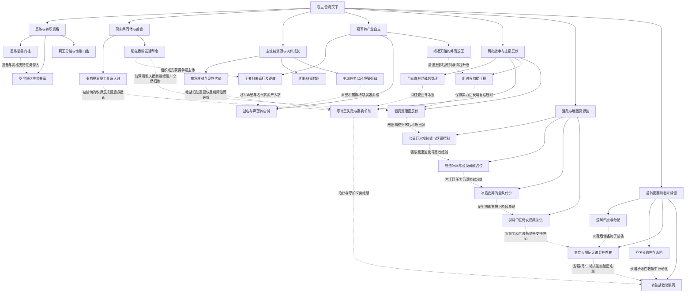

# 《网游之纵横天下》卷三：重练至双二转的资源与关系链（待审阅）

实线表示结构归属，虚线表示跨节点关系；依据类型详见节点数据。

## 剧情线

- 重练—首会—首转：main / partial
- 雪月与傲血战争：main / open
- 姐妹自主与父王安排：subplot / partial
- 凌雪与书的亲密承诺：subplot / partial
- 秦韵归属与自我价值：subplot / open
- 稻花香的约束与秘密：hidden / open
- 五年前姐姐与创伤：hidden / partial
- 幻灵珠用途：hidden / unknown
- 罗宁琳达团圆：subplot / resolved
- 血色誓言任务：subplot / resolved
- 羽月废墟任务：subplot / resolved
- 逆风平原任务：subplot / resolved
