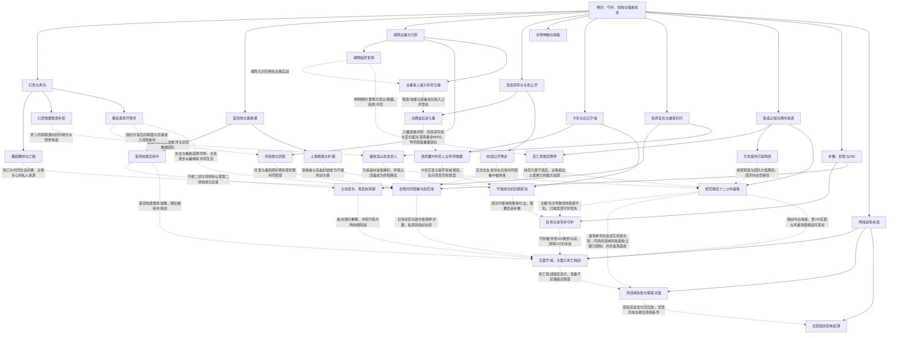

# 卷四乱世称雄：因果树与未结线索（待审阅）

实线表示结构归属，虚线表示跨节点关系；依据类型详见节点数据。

## 剧情线

- 雪月领地与两线战争：main / partial
- 亚特兰蒂斯主任务：main / resolved
- 雪月韵与主角关系：subplot / partial
- 灵儿母印与身世：hidden / partial
- 不弃同伴的补偿：subplot / partial
- 跨时恋人遗愿：subplot / partial
- 新力量与限制：main / partial
