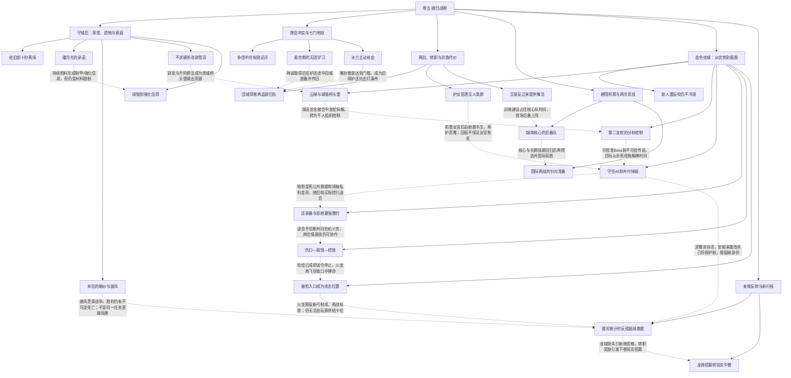

# 卷五 魂归战袍｜阶段树、因果边与认知差（待审阅）

实线表示结构归属，虚线表示跨节点关系；依据类型详见节点数据。

## 剧情线

- 力量、组织与任务回报链：main / partial
- 艾兰的月光与生活：subplot / resolved
- 米拉的等待与遗物：subplot / resolved
- 冰茶雷霆转职：subplot / resolved
- 竞技败局与国际再战：subplot / resolved
- 血色战役：main / resolved
- 安妮的人类与黑暗身份：hidden / partial
- 姐妹、父亲与秦韵的关系边界：subplot / open
- 暗影独立与魂归内裂：subplot / partial
- 龙骑新人招募与杭州面谈：subplot / open
- 龙域受袭与导师亲近：hidden / partial
- 冰茶的家庭与赠靴对象：hidden / open
