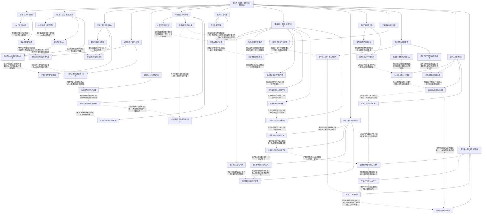

# 卷六 月神殿祭｜阶段、因果与认知差（待审阅草稿）

实线表示结构归属，虚线表示跨节点关系；依据类型详见节点数据。

## 剧情线

- 五转、套装与下一境界：main / partial
- 阿瓦隆任务与被舍代价：main / resolved
- 团聚与撤销分居：subplot / resolved
- 天空初通与协作训练：subplot / resolved
- 将陵与终生一次七塔：subplot / resolved
- 中国区冠军：subplot / resolved
- 月神、沈与旧魂借势：hidden / partial
- 审判神殿与天铸追索：subplot / resolved
- 王都高级掠夺防守：main / resolved
- 随风的归属与旧恩：subplot / partial
- 曙光攻城与正式归属：main / resolved
- 魔方招募与旧会延续：subplot / partial
- 埋骨五人绑定与装备链：subplot / partial
- 雪域三碎、先知复仇与月六转：subplot / resolved
- 安定落脚与势力暂稳：subplot / resolved
- 国际WSL冠军：main / resolved
- 许冰身份、病情与手术结果：hidden / partial
- 多向亲密与未统一承诺：subplot / open
- 清风破口与反击：main / open
