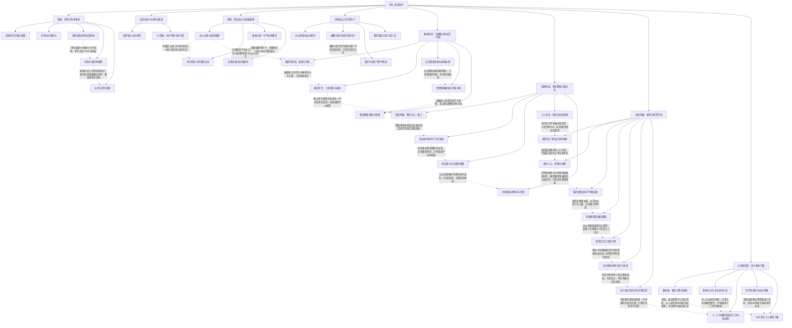

# 卷七 圣域年代：门槛、组织与知识边界

实线表示结构归属，虚线表示跨节点关系；依据类型详见节点数据。

## 剧情线

- 玩家圣域与装备使用门槛：main / partial
- 雪月重建、军团生产与治理：main / partial
- 大陆国战及边疆互守：main / open
- 秦韵出走及回归：subplot / resolved
- 多方关系与知情不对称：subplot / open
- 灵儿封印和神格复苏：subplot / partial
- 红绫受害、案情来源与重建：subplot / partial
- 奥丹恨意及保护对象转变：subplot / resolved
- 旧属暗谈与两巢归蛋：hidden / resolved
- 天钥实际归属：main / resolved
- 送花转复仇通缉：subplot / resolved
- S6首通与新强化材料：main / open
