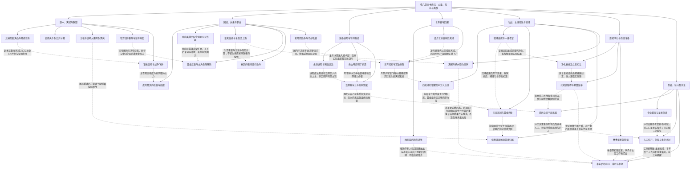

# 卷八：天域、代价、冰川与全书终点（待审阅）

实线表示结构归属，虚线表示跨节点关系；依据类型详见节点数据。

## 剧情线

- 天域成长至天地灵恸：main / resolved
- 安妮救援与自主归队：main / resolved
- 冰兰相救与传承：subplot / partial
- 第二季世界赛：main / resolved
- 国战和联盟竞争：main / partial
- 荀方私人/组织报复：subplot / resolved
- 共同生活与分离再聚：subplot / partial
- 新旧公会世代：subplot / partial
- 月哀与圣者秘密：hidden / partial
- 灵儿母史的末卷状态：hidden / unknown
