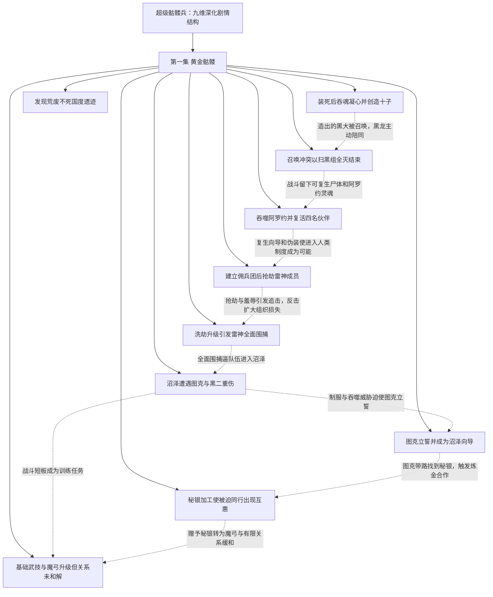

# 超级骷髅兵 · 九维深化第1—1集

实线表示结构归属，虚线表示跨节点关系；依据类型详见节点数据。

## 剧情线

- 第1集 · 自由存续与交流需求：main / partial
- 第1集 · 救赎之魂：subplot / open
- 第1集 · 十子意识与黑龙起源：hidden / open
- 第1集 · 雷神报复与信誉危机：subplot / open
- 第1集 · 沉沦国度与转生祭坛：hidden / open
