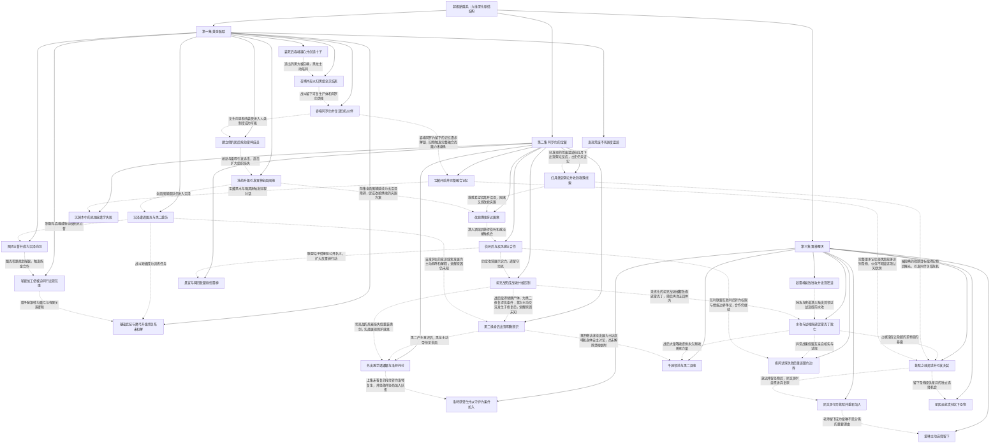

# 超级骷髅兵 · 九维深化第1—3集

实线表示结构归属，虚线表示跨节点关系；依据类型详见节点数据。

## 剧情线

- 第1集 · 自由存续与交流需求：main / partial
- 第1集 · 救赎之魂：subplot / open
- 第1集 · 十子意识与黑龙起源：hidden / open
- 第1集 · 雷神报复与信誉危机：subplot / open
- 第1集 · 沉沦国度与转生祭坛：hidden / open
- 第2集 · 自由、控制与同伴关系：main / partial
- 第2集 · 十子意识与进化条件：hidden / partial
- 第2集 · 救赎之魂：subplot / open
- 第2集 · 红月与沉沦国度：hidden / open
- 第2集 · 雷神冲突的组织化：subplot / partial
- 第2集 · 坦克战魂残留：hidden / open
- 第2集 · 克丽丝身份与邀学动机：hidden / open
- 第2集 · 娜娜暗黑气息与托付：subplot / open
- 第3集 · 救赎之魂的希望与实效：main / partial
- 第3集 · 灵魂依附与自愿同伴：main / open
- 第3集 · 雷神败亡后的利益与部族余波：main / partial
- 第3集 · 隐蔽不死领地：subplot / open
- 第3集 · 坦克战魂的压制与利用：hidden / open
- 跨集 · 灵魂依附与自愿同伴：main / open
- 跨集 · 救赎之魂的希望与实效：main / partial
- 跨集 · 十子意识与进化条件：hidden / partial
- 跨集 · 雷神败亡后的利益与部族余波：main / partial
- 跨集 · 红月与沉沦国度：hidden / open
- 跨集 · 坦克战魂的压制与利用：hidden / open
- 跨集 · 娜娜暗黑气息与托付：subplot / open
- 跨集 · 记忆、知识与力量：hidden / partial
