# 超级骷髅兵 · 九维深化第1—6集

实线表示结构归属，虚线表示跨节点关系；依据类型详见节点数据。

```mermaid
flowchart TD
  n0["超级骷髅兵：九维深化剧情结构"]
  n1["第一集 黄金骷髅"]
  n0 --> n1
  n2["装死后吞魂凝心并创造十子"]
  n1 --> n2
  n3["召唤冲突以扫黑组全灭结束"]
  n1 --> n3
  n4["吞噬阿罗约并复活四名伙伴"]
  n1 --> n4
  n5["建立佣兵团后抢劫雷神成员"]
  n1 --> n5
  n6["洗劫升级引发雷神全面围捕"]
  n1 --> n6
  n7["沼泽遭遇图克与黑二重伤"]
  n1 --> n7
  n8["图克立誓并成为沼泽向导"]
  n1 --> n8
  n9["秘银加工使被迫同行出现互惠"]
  n1 --> n9
  n10["发现荒废不死国度遗迹"]
  n1 --> n10
  n11["基础武技与魔弓升级但关系未和解"]
  n1 --> n11
  n12["第二集 阿罗约的宝藏"]
  n0 --> n12
  n13["红月激活祭坛并收到救赎线索"]
  n12 --> n13
  n14["改貌携魂穿过围堵"]
  n12 --> n14
  n15["侦听后与疾风建立合作"]
  n12 --> n15
  n16["坦克战死成战魂并被压制"]
  n12 --> n16
  n17["黑二换身后出现明确意识"]
  n12 --> n17
  n18["宝藏开启并完整融合记忆"]
  n12 --> n18
  n19["悬赏与两团联盟削弱雷神"]
  n12 --> n19
  n20["沉渊木中的克丽丝邀学失败"]
  n12 --> n20
  n21["外出教学遇娜娜与洛特托付"]
  n12 --> n21
  n22["第三集 雷神覆灭"]
  n0 --> n22
  n23["洛特获转生并以守护为条件加入"]
  n22 --> n23
  n24["趁雷神衰败独攻并发现密道"]
  n22 --> n24
  n25["水攻与战魂拖延促雷克丁败亡"]
  n22 --> n25
  n26["救赎之魂揭谎并引发决裂"]
  n22 --> n26
  n27["斯文哥尔弃救赎并重新加入"]
  n22 --> n27
  n28["千魂领地与黑二反哺"]
  n22 --> n28
  n29["爱琳主动选择留下"]
  n22 --> n29
  n30["星因亲族责任饮下圣物"]
  n22 --> n30
  n31["疾风试探失败后重谈盟约边界"]
  n22 --> n31
  n32["第四集 亡灵印记"]
  n0 --> n32
  n33["娜娜死讯与灵魂安抚"]
  n32 --> n33
  n34["第八圣战击穿石头城"]
  n32 --> n34
  n35["以钢材接护送并触发亡灵印记"]
  n32 --> n35
  n36["罗得宾士逃过被认定完成的审判"]
  n32 --> n36
  n37["死士袭击后急行完成交付"]
  n32 --> n37
  n38["泰戈认父与黑大自主萌芽"]
  n32 --> n38
  n39["重聚绝幽谷开始建设"]
  n32 --> n39
  n40["谷外冲突使不死身份暴露"]
  n32 --> n40
  n41["范围火与双方舍身救援"]
  n32 --> n41
  n42["第五集 生命禁区"]
  n0 --> n42
  n43["假死突围与九死"]
  n42 --> n43
  n44["伤后恢复与战魂内患"]
  n42 --> n44
  n45["星获救与救赎释义"]
  n42 --> n45
  n46["天使借体降临"]
  n42 --> n46
  n47["决定穿越三禁地求力"]
  n42 --> n47
  n48["罗得被召并随行"]
  n42 --> n48
  n49["歼游骑与伦理分歧"]
  n42 --> n49
  n50["战利品促成英雄宣传"]
  n42 --> n50
  n51["沙暴中悼亡进化"]
  n42 --> n51
  n52["第六集 悼亡之主"]
  n0 --> n52
  n53["黑大完全觉醒并决定转生泰戈"]
  n52 --> n53
  n54["身份情报引发机构应对"]
  n52 --> n54
  n55["森林安魂与沟通误伤"]
  n52 --> n55
  n56["借肉迟疑与克丽丝教学曝光"]
  n52 --> n56
  n57["天使战中灵魂武装觉醒"]
  n52 --> n57
  n58["斯科特封印天使并确认印记"]
  n52 --> n58
  n59["亡灵史诗与音乐会"]
  n52 --> n59
  n60["十孩完成战斗武装"]
  n52 --> n60
  n61["原萝茜补魂苏醒却失忆"]
  n52 --> n61
  n2 -. "造出的黑大被召唤，黑龙主动陪同" .-> n3
  n3 -. "战斗留下可复生尸体和阿罗约灵魂" .-> n4
  n4 -. "复生向导和伪装使进入人类制度成为可能" .-> n5
  n5 -. "抢劫与羞辱引发追击，反击扩大组织损失" .-> n6
  n6 -. "全面围捕逼队伍进入沼泽" .-> n7
  n7 -. "制服与吞噬威胁迫使图克立誓" .-> n8
  n8 -. "图克带路找到秘银，触发炼金合作" .-> n9
  n7 -. "战斗短板成为训练任务" .-> n11
  n9 -. "赠予秘银转为魔弓与有限关系缓和" .-> n11
  n13 -. "救赎希望促离开沼泽，围堵又促改貌突围" .-> n14
  n14 -. "潜入酒馆后获得侦听和政治接触机会" .-> n15
  n15 -. "约定攻营展示实力，遇留守坦克" .-> n16
  n16 -. "战后取得替换尸体，为黑二修复提供条件；首次主动交流发生于修复后，觉醒原因未知" .-> n17
  n15 -. "联盟给予情报和公开名义，扩大反雷神行动" .-> n19
  n18 -. "宝藏黑木与强灵魂触发远程对话" .-> n20
  n17 -. "黑二产生意识后，黑龙主动带他见世面" .-> n21
  n16 -. "坦克战的兵器损失促重装换剑，实战展现保护效果" .-> n21
  n24 -. "独攻与密道潜入触发首领近战及提前水攻" .-> n25
  n25 -. "占据宝库让隐藏的圣物目的暴露" .-> n26
  n26 -. "放过并留圣物后，斯文哥尔自愿舍弃复原" .-> n27
  n25 -. "战后大量吸魂提供永久赐魂所需力量" .-> n28
  n27 -. "老师留下成为爱琳不愿分离的重要理由" .-> n29
  n26 -. "留下圣物提供星月的独立选择机会" .-> n30
  n25 -. "异常战果促盟友亲自核实与试探" .-> n31
  n34 -. "战时缺钢及征调使实物酬劳促成雇佣" .-> n35
  n35 -. "接受护送使队伍承接雇主所面临的袭击风险" .-> n37
  n35 -. "钢材报酬与分队准备供给谷地建设" .-> n39
  n38 -. "带走泰戈使其加入谷地生活与劳动" .-> n39
  n36 -. "前场展示的圣焰祷言能力为主角遭遇其战法提供准备" .-> n40
  n39 -. "追踪娜娜的位置使审判小队与据点护卫相遇" .-> n40
  n40 -. "身份曝光促灭口火攻，交战重伤触发双重救援" .-> n41
  n33 -. "以额头和灵魂接触救助他人，末场由安抚转为危险反噬" .-> n41
  n43 -. "身份暴露使无限躲藏和寻求力量成为明确选择压力。" .-> n47
  n43 -. "死亡萝茜与借体天使形成后续身份问题，暂不等同原人格复生。" .-> n46
  n48 -. "罗得随行提供战斗支援，也带来吸魂伦理质询。" .-> n49
  n49 -. "战利品作为可见证据经城守转为宣传战绩。" .-> n50
  n49 -. "吸取新鲜灵魂为再次到达瓶颈提供积累，风暴中发生突破。" .-> n51
  n47 -. "北行决定带队进入沙漠，并触及未知骨骸历史。" .-> n51
  n43 -. "救援和神圣攻击造成透支与黑七的持久削弱，并暂时压制体内战魂。" .-> n44
  n53 -. "独立意识使黑大黑二自主塑造武装，而八个无意识孩子仍需代操。" .-> n60
  n55 -. "沟通误伤引战，冲火毁去外皮，随后需要活性肉引重建。" .-> n56
  n55 -. "首次安魂的有效性促成斯科特邀请罗得举办正式音乐会。" .-> n59
  n57 -. "焚身本体威胁到亡者国度，亡灵及时干预并封印。" .-> n58
  n57 -. "战中灌甲经验成为后续受指导练习的起点。" .-> n60
  n58 -. "天使被封印使残灵能够重聚，才有补魂苏醒条件。" .-> n61
  n59 -. "灵与魂的区分解释残灵补魂方案及其不等于完整记忆。" .-> n61
  n56 -. "对娜娜的迟疑与对复活敌人的灭魂冲动相照，标出关爱的对象边界。" .-> n61
  n7 -. "自发护主的意识线索发展为主动称呼和解释；觉醒原因仍未知" .-> n17
  n10 -. "已发现的荒废遗迹在红月下出现祭坛反应，古史仍未证实" .-> n13
  n6 -. "前集全面围捕延续为出沼泽障碍，促成改貌携魂的突围方案" .-> n14
  n4 -. "吞噬阿罗约留下的记忆逐步解锁，旧物触发完整融合而魔力未继承" .-> n18
  n21 -. "上集未答复的托付转为洛特复生，并经条件协商加入队伍" .-> n23
  n16 -. "未炼化的坦克战魂被释放拖延雷克丁，随后再次压回体内" .-> n25
  n13 -. "被隐瞒的救赎目标取得实物后曝光，引发同伴关系危机" .-> n26
  n18 -. "完整继承记忆使黑龙能够识别圣物，伙伴不知道这项认知优势" .-> n26
  n17 -. "意识确认继续发展为主动反哺和身体自主讨论，尚未解除灵魂依附" .-> n28
  n15 -. "互利联盟在胜利后转为权限与情报边界争论，合作仍继续" .-> n31
  n23 -. "对娜娜的守护从维持照料者生命延伸到理解失亲痛苦" .-> n33
  n28 -. "朗克岭沉睡领地与绝幽谷生活据点分别体现安全归属需求；两处不可合并为同一基地" .-> n39
  n30 -. "圣焰后果回收为星获救与盒文释义：救赎是净化，并非恢复生前身份" .-> n45
  n41 -. "上集救援与战局在本集突围中续接，黑七存活而黑龙随后因透支昏迷" .-> n43
  n35 -. "印记的北方召归声从未明信息发展为寻求力量的旅行方向" .-> n47
  n36 -. "此前独立出现且逃过审判的音乐家经异常琴召唤进入主角队伍，逃脱原理仍不能据此推定" .-> n48
  n38 -. "对泰戈的特殊反应发展为黑大主动开口和控制断开；骨架原主仍未确认" .-> n53
  n46 -. "借体降临的强敌被群体控制后封印本源；封印不等于杀灭" .-> n58
  n46 -. "降临者采用萝茜名字的疑问回收为天使与原残灵分离；原萝茜补魂醒来仍失忆" .-> n61
  n47 -. "北行寻找印记源头后，斯科特确认自己散播印记；龙墓假设未成立" .-> n58
  n51 -. "沙下骨骸得到斯科特的远古战争解释，史诗有起始边界；战因胜负仍未明" .-> n59
  n48 -. "音乐家随队后的安魂琴歌产生战力之外的集体价值；亡妻现状未因此解决" .-> n59
  n43 -. "幸存者带回的不死身份情报引起疾风、同盟及教会不同应对" .-> n54
  n25 -. "再压回体内的战魂仍未炼化，神圣伤只造成共同压制而非根除" .-> n44
```

## 剧情线

- 第1集 · 自由存续与交流需求：main / partial
- 第1集 · 救赎之魂：subplot / open
- 第1集 · 十子意识与黑龙起源：hidden / open
- 第1集 · 雷神报复与信誉危机：subplot / open
- 第1集 · 沉沦国度与转生祭坛：hidden / open
- 第2集 · 自由、控制与同伴关系：main / partial
- 第2集 · 十子意识与进化条件：hidden / partial
- 第2集 · 救赎之魂：subplot / open
- 第2集 · 红月与沉沦国度：hidden / open
- 第2集 · 雷神冲突的组织化：subplot / partial
- 第2集 · 坦克战魂残留：hidden / open
- 第2集 · 克丽丝身份与邀学动机：hidden / open
- 第2集 · 娜娜暗黑气息与托付：subplot / open
- 第3集 · 救赎之魂的希望与实效：main / partial
- 第3集 · 灵魂依附与自愿同伴：main / open
- 第3集 · 雷神败亡后的利益与部族余波：main / partial
- 第3集 · 隐蔽不死领地：subplot / open
- 第3集 · 坦克战魂的压制与利用：hidden / open
- 第4集 · 娜娜的身世、失亲与追捕：main / open
- 第4集 · 亡灵印记的真正用途：hidden / open
- 第4集 · 黑大的意识与骨架来源：subplot / partial
- 第4集 · 绝幽谷的建设与庇护：main / partial
- 第4集 · 海图护送背后的政治风险：subplot / partial
- 第4集 · 音乐家的身世与逃脱：hidden / open
- 第4集 · 岗撒罗斯的守护心愿：subplot / resolved
- 第4集 · 黑七与黑龙的圣焰危机：main / open
- 第5集 · 救赎之魂的真实作用：subplot / resolved
- 第5集 · 孩子的独立意识：subplot / partial
- 第5集 · 自由与同伴边界：main / partial
- 第5集 · 萝茜与降临天使：hidden / open
- 第5集 · 红月落处的呼唤：main / open
- 第5集 · 罗得的招魂与亡妻：subplot / open
- 第5集 · 吸魂与公共英雄形象：subplot / open
- 第5集 · 沙漠骨骸与悼亡级力量：hidden / open
- 第5集 · 坦克战魂内患：hidden / open
- 第6集 · 孩子的独立意识：subplot / partial
- 第6集 · 自由与同伴边界：main / partial
- 第6集 · 克丽丝的身份与教学：hidden / partial
- 第6集 · 娜娜的保护与主动性：subplot / partial
- 第6集 · 萝茜与降临天使：hidden / partial
- 第6集 · 红月落处的呼唤：main / resolved
- 第6集 · 沙漠历史与悼亡力量：hidden / partial
- 第6集 · 吸魂与异族伦理：subplot / open
- 第6集 · 神之骑士追索：subplot / open
- 第6集 · 罗得的音乐与未明往事：subplot / partial
- 跨集 · 自由与同伴边界：main / partial
- 跨集 · 救赎之魂的真实作用：subplot / resolved
- 跨集 · 孩子的独立意识：subplot / partial
- 跨集 · 雷神败亡后的利益与部族余波：main / partial
- 跨集 · 红月与沉沦国度：hidden / open
- 跨集 · 坦克战魂内患：hidden / open
- 跨集 · 克丽丝的身份与教学：hidden / partial
- 跨集 · 娜娜的保护与主动性：subplot / partial
- 跨集 · 红月落处的呼唤：main / resolved
- 跨集 · 音乐家的身世与逃脱：hidden / open
- 跨集 · 黑七与黑龙的圣焰危机：main / open
- 跨集 · 萝茜与降临天使：hidden / partial
- 跨集 · 罗得的音乐与未明往事：subplot / partial
- 跨集 · 吸魂与异族伦理：subplot / open
- 跨集 · 沙漠历史与悼亡力量：hidden / partial
- 跨集 · 神之骑士追索：subplot / open
- 跨集 · 记忆、知识与力量：hidden / partial
