# 超级骷髅兵 · 九维深化第1—11集

实线表示结构归属，虚线表示跨节点关系；依据类型详见节点数据。

```mermaid
flowchart TD
  n0["超级骷髅兵：九维深化剧情结构"]
  n1["第一集 黄金骷髅"]
  n0 --> n1
  n2["装死后吞魂凝心并创造十子"]
  n1 --> n2
  n3["召唤冲突以扫黑组全灭结束"]
  n1 --> n3
  n4["吞噬阿罗约并复活四名伙伴"]
  n1 --> n4
  n5["建立佣兵团后抢劫雷神成员"]
  n1 --> n5
  n6["洗劫升级引发雷神全面围捕"]
  n1 --> n6
  n7["沼泽遭遇图克与黑二重伤"]
  n1 --> n7
  n8["图克立誓并成为沼泽向导"]
  n1 --> n8
  n9["秘银加工使被迫同行出现互惠"]
  n1 --> n9
  n10["发现荒废不死国度遗迹"]
  n1 --> n10
  n11["基础武技与魔弓升级但关系未和解"]
  n1 --> n11
  n12["第二集 阿罗约的宝藏"]
  n0 --> n12
  n13["红月激活祭坛并收到救赎线索"]
  n12 --> n13
  n14["改貌携魂穿过围堵"]
  n12 --> n14
  n15["侦听后与疾风建立合作"]
  n12 --> n15
  n16["坦克战死成战魂并被压制"]
  n12 --> n16
  n17["黑二换身后出现明确意识"]
  n12 --> n17
  n18["宝藏开启并完整融合记忆"]
  n12 --> n18
  n19["悬赏与两团联盟削弱雷神"]
  n12 --> n19
  n20["沉渊木中的克丽丝邀学失败"]
  n12 --> n20
  n21["外出教学遇娜娜与洛特托付"]
  n12 --> n21
  n22["第三集 雷神覆灭"]
  n0 --> n22
  n23["洛特获转生并以守护为条件加入"]
  n22 --> n23
  n24["趁雷神衰败独攻并发现密道"]
  n22 --> n24
  n25["水攻与战魂拖延促雷克丁败亡"]
  n22 --> n25
  n26["救赎之魂揭谎并引发决裂"]
  n22 --> n26
  n27["斯文哥尔弃救赎并重新加入"]
  n22 --> n27
  n28["千魂领地与黑二反哺"]
  n22 --> n28
  n29["爱琳主动选择留下"]
  n22 --> n29
  n30["星因亲族责任饮下圣物"]
  n22 --> n30
  n31["疾风试探失败后重谈盟约边界"]
  n22 --> n31
  n32["第四集 亡灵印记"]
  n0 --> n32
  n33["娜娜死讯与灵魂安抚"]
  n32 --> n33
  n34["第八圣战击穿石头城"]
  n32 --> n34
  n35["以钢材接护送并触发亡灵印记"]
  n32 --> n35
  n36["罗得宾士逃过被认定完成的审判"]
  n32 --> n36
  n37["死士袭击后急行完成交付"]
  n32 --> n37
  n38["泰戈认父与黑大自主萌芽"]
  n32 --> n38
  n39["重聚绝幽谷开始建设"]
  n32 --> n39
  n40["谷外冲突使不死身份暴露"]
  n32 --> n40
  n41["范围火与双方舍身救援"]
  n32 --> n41
  n42["第五集 生命禁区"]
  n0 --> n42
  n43["假死突围与九死"]
  n42 --> n43
  n44["伤后恢复与战魂内患"]
  n42 --> n44
  n45["星获救与救赎释义"]
  n42 --> n45
  n46["天使借体降临"]
  n42 --> n46
  n47["决定穿越三禁地求力"]
  n42 --> n47
  n48["罗得被召并随行"]
  n42 --> n48
  n49["歼游骑与伦理分歧"]
  n42 --> n49
  n50["战利品促成英雄宣传"]
  n42 --> n50
  n51["沙暴中悼亡进化"]
  n42 --> n51
  n52["第六集 悼亡之主"]
  n0 --> n52
  n53["黑大完全觉醒并决定转生泰戈"]
  n52 --> n53
  n54["身份情报引发机构应对"]
  n52 --> n54
  n55["森林安魂与沟通误伤"]
  n52 --> n55
  n56["借肉迟疑与克丽丝教学曝光"]
  n52 --> n56
  n57["天使战中灵魂武装觉醒"]
  n52 --> n57
  n58["斯科特封印天使并确认印记"]
  n52 --> n58
  n59["亡灵史诗与音乐会"]
  n52 --> n59
  n60["十孩完成战斗武装"]
  n52 --> n60
  n61["原萝茜补魂苏醒却失忆"]
  n52 --> n61
  n62["第七集 信仰元力"]
  n0 --> n62
  n63["魔法斧与人工金属化成形"]
  n62 --> n63
  n64["龙墓取骨转为损失撤退"]
  n62 --> n64
  n65["娜娜关心打断萝茜旧杀意"]
  n62 --> n65
  n66["先知交易被拒"]
  n62 --> n66
  n67["隐史与元力知识传授"]
  n62 --> n67
  n68["一个月后掌握元力联系"]
  n62 --> n68
  n69["重订同伴边界并获效忠"]
  n62 --> n69
  n70["同盟沦陷改变出口控制"]
  n62 --> n70
  n71["返程与天使骑士战前相遇"]
  n62 --> n71
  n72["第八集 暗之神骑"]
  n0 --> n72
  n73["圣骑溃败与保密灭口"]
  n72 --> n73
  n74["雷奥失械败退与火马被俘"]
  n72 --> n74
  n75["黑四受创引出追击失守"]
  n72 --> n75
  n76["河岸救援与多兵种反击"]
  n72 --> n76
  n77["旧记忆、隐瞒与氓族求助"]
  n72 --> n77
  n78["追兵撤离与蚕食内幕"]
  n72 --> n78
  n79["强迫入沼与收魂"]
  n72 --> n79
  n80["萝茜通过娜娜见克丽丝"]
  n72 --> n80
  n81["祭坛修复与首批启动"]
  n72 --> n81
  n82["第九集 皇者驾临"]
  n0 --> n82
  n83["图克承继与大批转生"]
  n82 --> n83
  n84["钢材瓶颈与交易突破"]
  n82 --> n84
  n85["先知提高筹码重开龙岛协议"]
  n82 --> n85
  n86["领地组织与跨代知识进入"]
  n82 --> n86
  n87["救镇、收魂与英雄传播"]
  n82 --> n87
  n88["敌方部署与未明态度"]
  n82 --> n88
  n89["皇者驾临练习与六千赋魂耗竭"]
  n82 --> n89
  n90["同伴守谷与醒后围歼"]
  n82 --> n90
  n91["坦克脱困与身体权限控制"]
  n82 --> n91
  n92["第十集 噬魂的秘密"]
  n0 --> n92
  n93["泰戈变化得到观察和有限解释"]
  n92 --> n93
  n94["隘口伏击造成坐骑灭失与再次透支"]
  n92 --> n94
  n95["领地恢复与皇者技能教学"]
  n92 --> n95
  n96["雷奥刺杀失败、死亡与噬魂制傀儡"]
  n92 --> n96
  n97["森林矮人冲突与被阻的追索"]
  n92 --> n97
  n98["强制夺船与两月航海"]
  n92 --> n98
  n99["海战伤亡与体内脱困"]
  n92 --> n99
  n100["克丽丝解释观察联系与神身份"]
  n92 --> n100
  n101["分身降临破外封，洞内仍有魂封"]
  n92 --> n101
  n102["第十一集 不死海怪"]
  n0 --> n102
  n103["海皇身份确认与合力解封"]
  n102 --> n103
  n104["夺舍危机引发群体反击与真武装"]
  n102 --> n104
  n105["吞神分流与信任破裂"]
  n102 --> n105
  n106["女神转求娜娜与海蛇转生"]
  n102 --> n106
  n107["菲力普以猎狗比喻动摇下属"]
  n102 --> n107
  n108["龙岛育幼实况与银丝毁躯"]
  n102 --> n108
  n109["龙人被动员与主角方战法修正"]
  n102 --> n109
  n110["龙人被利用与地面消耗战"]
  n102 --> n110
  n111["投枪伤龙与祈祷白光"]
  n102 --> n111
  n2 -. "造出的黑大被召唤，黑龙主动陪同" .-> n3
  n3 -. "战斗留下可复生尸体和阿罗约灵魂" .-> n4
  n4 -. "复生向导和伪装使进入人类制度成为可能" .-> n5
  n5 -. "抢劫与羞辱引发追击，反击扩大组织损失" .-> n6
  n6 -. "全面围捕逼队伍进入沼泽" .-> n7
  n7 -. "制服与吞噬威胁迫使图克立誓" .-> n8
  n8 -. "图克带路找到秘银，触发炼金合作" .-> n9
  n7 -. "战斗短板成为训练任务" .-> n11
  n9 -. "赠予秘银转为魔弓与有限关系缓和" .-> n11
  n13 -. "救赎希望促离开沼泽，围堵又促改貌突围" .-> n14
  n14 -. "潜入酒馆后获得侦听和政治接触机会" .-> n15
  n15 -. "约定攻营展示实力，遇留守坦克" .-> n16
  n16 -. "战后取得替换尸体，为黑二修复提供条件；首次主动交流发生于修复后，觉醒原因未知" .-> n17
  n15 -. "联盟给予情报和公开名义，扩大反雷神行动" .-> n19
  n18 -. "宝藏黑木与强灵魂触发远程对话" .-> n20
  n17 -. "黑二产生意识后，黑龙主动带他见世面" .-> n21
  n16 -. "坦克战的兵器损失促重装换剑，实战展现保护效果" .-> n21
  n24 -. "独攻与密道潜入触发首领近战及提前水攻" .-> n25
  n25 -. "占据宝库让隐藏的圣物目的暴露" .-> n26
  n26 -. "放过并留圣物后，斯文哥尔自愿舍弃复原" .-> n27
  n25 -. "战后大量吸魂提供永久赐魂所需力量" .-> n28
  n27 -. "老师留下成为爱琳不愿分离的重要理由" .-> n29
  n26 -. "留下圣物提供星月的独立选择机会" .-> n30
  n25 -. "异常战果促盟友亲自核实与试探" .-> n31
  n34 -. "战时缺钢及征调使实物酬劳促成雇佣" .-> n35
  n35 -. "接受护送使队伍承接雇主所面临的袭击风险" .-> n37
  n35 -. "钢材报酬与分队准备供给谷地建设" .-> n39
  n38 -. "带走泰戈使其加入谷地生活与劳动" .-> n39
  n36 -. "前场展示的圣焰祷言能力为主角遭遇其战法提供准备" .-> n40
  n39 -. "追踪娜娜的位置使审判小队与据点护卫相遇" .-> n40
  n40 -. "身份曝光促灭口火攻，交战重伤触发双重救援" .-> n41
  n33 -. "以额头和灵魂接触救助他人，末场由安抚转为危险反噬" .-> n41
  n43 -. "身份暴露使无限躲藏和寻求力量成为明确选择压力。" .-> n47
  n43 -. "死亡萝茜与借体天使形成后续身份问题，暂不等同原人格复生。" .-> n46
  n48 -. "罗得随行提供战斗支援，也带来吸魂伦理质询。" .-> n49
  n49 -. "战利品作为可见证据经城守转为宣传战绩。" .-> n50
  n49 -. "吸取新鲜灵魂为再次到达瓶颈提供积累，风暴中发生突破。" .-> n51
  n47 -. "北行决定带队进入沙漠，并触及未知骨骸历史。" .-> n51
  n43 -. "救援和神圣攻击造成透支与黑七的持久削弱，并暂时压制体内战魂。" .-> n44
  n53 -. "独立意识使黑大黑二自主塑造武装，而八个无意识孩子仍需代操。" .-> n60
  n55 -. "沟通误伤引战，冲火毁去外皮，随后需要活性肉引重建。" .-> n56
  n55 -. "首次安魂的有效性促成斯科特邀请罗得举办正式音乐会。" .-> n59
  n57 -. "焚身本体威胁到亡者国度，亡灵及时干预并封印。" .-> n58
  n57 -. "战中灌甲经验成为后续受指导练习的起点。" .-> n60
  n58 -. "天使被封印使残灵能够重聚，才有补魂苏醒条件。" .-> n61
  n59 -. "灵与魂的区分解释残灵补魂方案及其不等于完整记忆。" .-> n61
  n56 -. "对娜娜的迟疑与对复活敌人的灭魂冲动相照，标出关爱的对象边界。" .-> n61
  n63 -. "制造出的三十具金属骷髅进入龙墓实战，强度与关节弱点同时接受检验。" .-> n64
  n64 -. "亲历墓地实力与同伴损失，使黑龙拒绝更高风险的取石方案。" .-> n66
  n66 -. "斯科特追问并认可风险判断后，才交出天使和隐瞒的历史；考察关联由效忠说明补证。" .-> n67
  n67 -. "封存天使意念提供运用方法，黑龙经过一个月消化取得元力感知。" .-> n68
  n68 -. "成长与扩军计划加深斯文恐惧，持续劝阻引发关系摊牌。" .-> n69
  n64 -. "不让孩子挑战过强力量的决策成为斯科特判断君王资格的依据。" .-> n69
  n70 -. "出口被控制和雷奥持续定位让安德鲁绕行到返程方向完成拦截。" .-> n71
  n73 -. "雷奥出手保密并迎战，黑龙据其身体与兵器特点展开下一层对决。" .-> n74
  n74 -. "火马仍被扣留且早说明有机会就逃，雷奥返回突袭后出现实际脱困窗口。" .-> n75
  n75 -. "雷奥与火马重组尾随，观察新增援力后转向总部，当前追击中止。" .-> n78
  n76 -. "战后服饰与羊皮书识别，把获救者接回阿罗约的族源和祭坛历史。" .-> n77
  n76 -. "黑龙察觉菲力普未尽全力，后场的四翼与蚕食说明提供读者层解释。" .-> n78
  n77 -. "族长提出收魂返坛方案并获黑龙接受，后以武力推动生命形式转换。" .-> n79
  n79 -. "灵魂被收集并送到祭坛，缺失逆转知识与设施损坏迫使等待族长苏醒后修复启动。" .-> n81
  n77 -. "族长保存的逆转记录与亡灵传承知识组合，才有修复和重新运行的可能。" .-> n81
  n83 -. "大批转生和先人记忆为领地建设提供人口与知识。" .-> n86
  n84 -. "首批钢材使骷髅强化可以启动，而建设与制造争用劳力。" .-> n86
  n87 -. "e05中沿途消灭小队这一部分促成e06中菲力普派队调查；不表示后段英雄传播造成前段敌方部署。" .-> n88
  n89 -. "主角耗竭未下令使队伍无法撤离，同伴守谷遭循痕搜查。" .-> n90
  n88 -. "e06中菲力普派出调查的小队成为谷地对手；不把该聚合事件中的其他敌方行动视为此次围谷原因。" .-> n90
  n89 -. "耗竭先抽空战魂，后补魂时双方恢复差使其脱困。" .-> n91
  n89 -. "控尸时细分动作的经验用于检验战魂躯体控制。" .-> n91
  n94 -. "连续透支与伏击损失促成反思、恢复和教学。" .-> n95
  n95 -. "雷奥在领地观察后暴露于魅，借被俘进入近身范围。" .-> n96
  n96 -. "取得噬魂的实力与亲和使黑龙决意启程，并在森林战中实际运用。" .-> n97
  n96 -. "首次制雷奥形傀儡的能力在十五矮人灵魂上再次验证。" .-> n97
  n98 -. "船只与未知航线把不会游泳的主角置于海洋威胁中。" .-> n99
  n99 -. "巨兽带黑龙到海谷，双峰视野使克丽丝识出封印并主动呼唤。" .-> n100
  n100 -. "解释后合作使黑龙召来萝茜，分身得以降临并拆外封。" .-> n101
  n94 -. "末尾舍弃复活巨兽回应此前不能再耗尽力量的教训。" .-> n101
  n103 -. "解救者转为夺舍目标" .-> n104
  n104 -. "本源近身逼出吞噬与容量危机" .-> n105
  n105 -. "拒绝再援使克丽丝转求娜娜" .-> n106
  n105 -. "新增力量支持昂贵的海蛇转生" .-> n106
  n106 -. "海蛇使龙皇重估追击代价" .-> n108
  n108 -. "空骑损失与飞行威胁推动战术补强" .-> n109
  n109 -. "动员与越崖被导向预定消耗战" .-> n110
  n109 -. "黑大投枪示范由黑龙实战伤龙兑现" .-> n111
  n110 -. "增援改变战局促龙皇介入，损失促帝勒祈祷" .-> n111
  n7 -. "自发护主的意识线索发展为主动称呼和解释；觉醒原因仍未知" .-> n17
  n10 -. "已发现的荒废遗迹在红月下出现祭坛反应，古史仍未证实" .-> n13
  n6 -. "前集全面围捕延续为出沼泽障碍，促成改貌携魂的突围方案" .-> n14
  n4 -. "吞噬阿罗约留下的记忆逐步解锁，旧物触发完整融合而魔力未继承" .-> n18
  n21 -. "上集未答复的托付转为洛特复生，并经条件协商加入队伍" .-> n23
  n16 -. "未炼化的坦克战魂被释放拖延雷克丁，随后再次压回体内" .-> n25
  n13 -. "被隐瞒的救赎目标取得实物后曝光，引发同伴关系危机" .-> n26
  n18 -. "完整继承记忆使黑龙能够识别圣物，伙伴不知道这项认知优势" .-> n26
  n17 -. "意识确认继续发展为主动反哺和身体自主讨论，尚未解除灵魂依附" .-> n28
  n15 -. "互利联盟在胜利后转为权限与情报边界争论，合作仍继续" .-> n31
  n23 -. "对娜娜的守护从维持照料者生命延伸到理解失亲痛苦" .-> n33
  n28 -. "朗克岭沉睡领地与绝幽谷生活据点分别体现安全归属需求；两处不可合并为同一基地" .-> n39
  n30 -. "圣焰后果回收为星获救与盒文释义：救赎是净化，并非恢复生前身份" .-> n45
  n41 -. "上集救援与战局在本集突围中续接，黑七存活而黑龙随后因透支昏迷" .-> n43
  n35 -. "印记的北方召归声从未明信息发展为寻求力量的旅行方向" .-> n47
  n36 -. "此前独立出现且逃过审判的音乐家经异常琴召唤进入主角队伍，逃脱原理仍不能据此推定" .-> n48
  n38 -. "对泰戈的特殊反应发展为黑大主动开口和控制断开；骨架原主仍未确认" .-> n53
  n46 -. "借体降临的强敌被群体控制后封印本源；封印不等于杀灭" .-> n58
  n46 -. "降临者采用萝茜名字的疑问回收为天使与原残灵分离；原萝茜补魂醒来仍失忆" .-> n61
  n47 -. "北行寻找印记源头后，斯科特确认自己散播印记；龙墓假设未成立" .-> n58
  n51 -. "沙下骨骸得到斯科特的远古战争解释，史诗有起始边界；战因胜负仍未明" .-> n59
  n48 -. "音乐家随队后的安魂琴歌产生战力之外的集体价值；亡妻现状未因此解决" .-> n59
  n43 -. "幸存者带回的不死身份情报引起疾风、同盟及教会不同应对" .-> n54
  n25 -. "再压回体内的战魂仍未炼化，神圣伤只造成共同压制而非根除" .-> n44
  n58 -. "封存天使后来成为元力知识来源；其遭吸收与原萝茜失忆后的经历分别记录" .-> n67
  n61 -. "补魂失忆后仍有姓名触发的敌意，娜娜的关心使本次杀意退去；未证明完整恢复记忆" .-> n65
  n59 -. "斯科特承认先前隐瞒并补充古帝国史，已知历史的来源边界进一步收紧" .-> n67
  n54 -. "出岛的暗之神骑提供持续方位，追索在同盟败亡后转为出口拦截" .-> n70
  n47 -. "北行求力遇到曾预告的龙墓危险；损失使风险判断改变，但不重开已解决的印记源头疑问" .-> n64
  n60 -. "已掌握的灵魂运用与武装支撑正面应战信心，战果留待下一集；不归因为本集金属化实验" .-> n71
  n56 -. "对具体伙伴的关爱边界发展为明确的自由存在宣言；两次选择都未解除灵魂支配关系" .-> n69
  n71 -. "上集盾墙冲撞前的悬停在本集战斗中兑现；雷奥救主教并灭口使胜负之外再生身份问题" .-> n73
  n60 -. "此前制作后尚待实测的战装在圣力攻击中得到验证；能量仍消耗，不扩展为所有单位均免疫" .-> n73
  n65 -. "与娜娜建立的新关系进一步成为接触克丽丝的渠道，旧人格和记忆仍未恢复" .-> n80
  n4 -. "早期吞噬阿罗约留下的记忆在氓族相遇时产生亲近与识别，也让被隐瞒的旧杀戮进入联盟关系" .-> n77
  n13 -. "曾观察到活性的古祭坛回到主线，经修复后首批限载启动；本集结尾还不能确认全族转生成功" .-> n81
  n8 -. "早期提供沼泽与祭坛信息的图克，面对新启动景象显出熟悉感；守护使命的来源仍未揭" .-> n81
  n69 -. "自由存在的宣言与强迫族群接受死亡/运魂安排形成价值冲突；这是主题对照，不声称宣言导致屠杀" .-> n79
  n81 -. "祭坛启动后的声音与图克守护来源得到解释，混合灵魂的分批转生完成；知识继承不等于力量或原人格直接替换" .-> n83
  n66 -. "先知披露本名、分身和先前隐瞒，并提高筹码使拒绝转为有条件承诺；尚未实际取回安息石" .-> n85
  n44 -. "先前不能炼化的战魂再次脱困后出现身体权限控制，独立战意仍反抗；内患只获有限进展" .-> n91
  n80 -. "接触克丽丝后产生保护黑龙的新使命，萝茜行动履行使命但不认旧友；不据使命本身确认克丽丝神性" .-> n90
  n63 -. "人工金属化进入扩张阶段后受钢材供给与单人产能限制，促成城中采购和贸易谈判" .-> n84
  n50 -. "两次私人取利与公共救援结果重叠，见证和组织传播分别塑造英雄形象；不是同一宣传活动" .-> n87
  n78 -. "撤回总部的雷奥获得噬魂，先前离开的追兵转成新武器威胁；本集尚未交锋" .-> n88
  n53 -. "转生后的泰戈继续经历沉睡与苏醒，身体变化有表现，修魂解释来自斯科特而具体能力仍待检验" .-> n86
  n86 -. "苏醒时发现的泰戈变化由刀火测试与问答进一步确认，特殊变异原因仍是研究者解释" .-> n93
  n89 -. "黑龙通过实践掌握的意控能力进一步进入教学，黑大和黑二参与练习，不扩为十孩全会" .-> n95
  n88 -. "雷奥所持噬魂因同源亲和未能伤害黑龙灵魂，刺杀反转为雷奥死亡及同形傀儡生成，教皇动机仍未明" .-> n96
  n85 -. "暂不定时的龙岛承诺进入夺船启航阶段，旅程两月仅至中继岛，不等于取得安息石" .-> n98
  n90 -. "萝茜的新使命后来显出观察黑龙视野的联系用途，角色与读者获知的时点分别保留" .-> n100
  n20 -. "早期女神自称在私人视角和菲力普独立识认下获得更强证据；不据神性推定全部历史自述真实" .-> n101
  n91 -. "取得身体指令权限的战魂在伏击战中被调用，仍会受克制和自行脱离，不能视作意志已驯服" .-> n94
  n79 -. "两次以转生和魂约组织行动均包含强迫，后来获得人力不抹去当时的拒绝权缺失" .-> n98
  n101 -. "外封破除后继续解除内部封印，海皇此时才真正获释" .-> n103
  n100 -. "观察与教学的深层目的由独处叙述解释为求自身脱困；黑龙并不因此获得读者全部知识" .-> n105
  n90 -. "先借萝茜保护并接近黑龙，黑龙拒援后转向娜娜求助；新请求尚未等于脱困成功" .-> n106
  n95 -. "教学与个体意识发展进入实战，黑大自主提出投枪，不代表其余八孩觉醒" .-> n109
  n96 -. "已有神器和实体附能并非真正纯魂武装，海皇危机中十孩供力促成黑龙凝兵" .-> n104
  n98 -. "中继岛之后终于登龙岛，现场政治和守卫改变取石行动，尚未取得安息石" .-> n108
  n99 -. "海兽被杀后其躯体进一步被转生为远征资源，转生耗半魂而非无成本扩军" .-> n106
  n78 -. "菲力普独处展露的工具恐惧在对克罗斯的猎犬解释中进一步公开，听者动摇不等于已投效" .-> n107
```

## 剧情线

- 第1集 · 自由存续与交流需求：main / partial
- 第1集 · 救赎之魂：subplot / open
- 第1集 · 十子意识与黑龙起源：hidden / open
- 第1集 · 雷神报复与信誉危机：subplot / open
- 第1集 · 沉沦国度与转生祭坛：hidden / open
- 第2集 · 自由、控制与同伴关系：main / partial
- 第2集 · 十子意识与进化条件：hidden / partial
- 第2集 · 救赎之魂：subplot / open
- 第2集 · 红月与沉沦国度：hidden / open
- 第2集 · 雷神冲突的组织化：subplot / partial
- 第2集 · 坦克战魂残留：hidden / open
- 第2集 · 克丽丝身份与邀学动机：hidden / open
- 第2集 · 娜娜暗黑气息与托付：subplot / open
- 第3集 · 救赎之魂的希望与实效：main / partial
- 第3集 · 灵魂依附与自愿同伴：main / open
- 第3集 · 雷神败亡后的利益与部族余波：main / partial
- 第3集 · 隐蔽不死领地：subplot / open
- 第3集 · 坦克战魂的压制与利用：hidden / open
- 第4集 · 娜娜的身世、失亲与追捕：main / open
- 第4集 · 亡灵印记的真正用途：hidden / open
- 第4集 · 黑大的意识与骨架来源：subplot / partial
- 第4集 · 绝幽谷的建设与庇护：main / partial
- 第4集 · 海图护送背后的政治风险：subplot / partial
- 第4集 · 音乐家的身世与逃脱：hidden / open
- 第4集 · 岗撒罗斯的守护心愿：subplot / resolved
- 第4集 · 黑七与黑龙的圣焰危机：main / open
- 第5集 · 救赎之魂的真实作用：subplot / resolved
- 第5集 · 孩子的独立意识：subplot / partial
- 第5集 · 自由与同伴边界：main / partial
- 第5集 · 萝茜与降临天使：hidden / open
- 第5集 · 红月落处的呼唤：main / open
- 第5集 · 罗得的招魂与亡妻：subplot / open
- 第5集 · 吸魂与公共英雄形象：subplot / open
- 第5集 · 沙漠骨骸与悼亡级力量：hidden / open
- 第5集 · 坦克战魂内患：hidden / open
- 第6集 · 孩子的独立意识：subplot / partial
- 第6集 · 自由与同伴边界：main / partial
- 第6集 · 克丽丝的身份与教学：hidden / partial
- 第6集 · 娜娜的保护与主动性：subplot / partial
- 第6集 · 萝茜与降临天使：hidden / partial
- 第6集 · 红月落处的呼唤：main / resolved
- 第6集 · 沙漠历史与悼亡力量：hidden / partial
- 第6集 · 吸魂与异族伦理：subplot / open
- 第6集 · 神之骑士追索：subplot / open
- 第6集 · 罗得的音乐与未明往事：subplot / partial
- 第7集 · 求力远征与龙墓：main / partial
- 第7集 · 龙魂誓约与先知：hidden / open
- 第7集 · 自由存在与同伴自主：main / partial
- 第7集 · 萝茜残存身份与天使分离：subplot / partial
- 第7集 · 不死帝国失踪与君王力量：hidden / partial
- 第7集 · 暗之神骑的身份与追踪：hidden / open
- 第7集 · 同盟战局与神明力量：subplot / partial
- 第8集 · 死亡骑士的教会身份：hidden / partial
- 第8集 · 自由目标与支配手段：main / open
- 第8集 · 阿罗约记忆与被隐藏的旧杀戮：hidden / open
- 第8集 · 祭坛逆转与氓族存续：main / partial
- 第8集 · 教会工具与蚕食计划：hidden / open
- 第8集 · 萝茜的新力量与自我重建：subplot / partial
- 第8集 · 图克与祭坛来历：hidden / open
- 第9集 · 沼泽古国与转生遗产：hidden / partial
- 第9集 · 图克诞生、守护与祭坛声音来源：subplot / resolved
- 第9集 · 自主、服从与共同存在：main / partial
- 第9集 · 孩子意识与皇者能力：main / partial
- 第9集 · 龙魂誓约与先知交易：hidden / partial
- 第9集 · 坦克战魂的控制边界：hidden / partial
- 第9集 · 萝茜失忆与新使命：subplot / partial
- 第9集 · 克丽丝身份与代理行动：hidden / partial
- 第9集 · 雷奥追踪与君王兵器：hidden / open
- 第9集 · 占领与英雄声望：subplot / partial
- 第9集 · 领地生产与文明建设：main / partial
- 第9集 · 老罗格凝魂与临终祈愿：hidden / open
- 第9集 · 泰戈苏醒与灵魂修复：subplot / partial
- 第10集 · 泰戈变异与认知成长：subplot / partial
- 第10集 · 皇者能力教学与孩子自主：main / partial
- 第10集 · 雷奥追杀与教皇安排：hidden / partial
- 第10集 · 噬魂权限与死息傀儡：hidden / partial
- 第10集 · 龙墓解封与龙岛远征：main / partial
- 第10集 · 森林巨树与矮人信仰：hidden / open
- 第10集 · 自主与强迫合作：main / partial
- 第10集 · 冥月女神身份与行动：hidden / partial
- 第10集 · 萝茜承载与自我状态：subplot / partial
- 第10集 · 海皇与双层封印：hidden / open
- 第10集 · 战争掩护与神权网络：subplot / open
- 第11集 · 海皇解封与夺躯危机：subplot / resolved
- 第11集 · 克丽丝身份与脱困动机：hidden / partial
- 第11集 · 自由与保护关系的边界：main / partial
- 第11集 · 孩子意识、武装与独立战法：subplot / partial
- 第11集 · 龙墓约定与龙岛安息石：main / partial
- 第11集 · 龙族繁衍、龙人庇护与禁锢：subplot / open
- 第11集 · 教会猎犬价值与天使自主：hidden / partial
- 第11集 · 古帝国遗迹与悼亡成长：hidden / partial
- 跨集 · 自由与保护关系的边界：main / partial
- 跨集 · 救赎之魂的真实作用：subplot / resolved
- 跨集 · 孩子意识、武装与独立战法：subplot / partial
- 跨集 · 雷神败亡后的利益与部族余波：main / partial
- 跨集 · 沼泽古国与转生遗产：hidden / partial
- 跨集 · 坦克战魂的控制边界：hidden / partial
- 跨集 · 克丽丝身份与脱困动机：hidden / partial
- 跨集 · 娜娜的保护、身世与主动性：subplot / partial
- 跨集 · 亡灵印记的发出者与目的地：main / resolved
- 跨集 · 罗得的旧次逃生与新相遇：hidden / partial
- 跨集 · 黑七圣焰救援的生死结局：subplot / resolved
- 跨集 · 萝茜承载与自我状态：subplot / partial
- 跨集 · 罗得的音乐与未明往事：subplot / partial
- 跨集 · 吸魂与异族伦理：subplot / open
- 跨集 · 古帝国遗迹与悼亡成长：hidden / partial
- 跨集 · 雷奥追杀与教皇安排：hidden / partial
- 跨集 · 龙墓约定与龙岛安息石：main / partial
- 跨集 · 龙魂誓约与先知交易：hidden / partial
- 跨集 · 战争掩护与神权网络：subplot / open
- 跨集 · 阿罗约记忆与被隐藏的旧杀戮：hidden / open
- 跨集 · 氓族与骑士灵魂转生后的存续：main / partial
- 跨集 · 教会猎犬价值与天使自主：hidden / partial
- 跨集 · 图克诞生、守护与祭坛声音来源：subplot / resolved
- 跨集 · 领地生产与文明建设：main / partial
- 跨集 · 泰戈变异与认知成长：subplot / partial
- 跨集 · 噬魂权限与死息傀儡：hidden / partial
- 跨集 · 海皇解封与夺躯危机：subplot / resolved
- 跨集 · 记忆、知识与力量：hidden / partial
