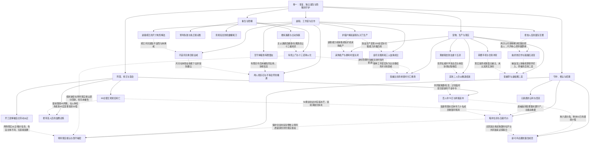

# 卷一：收入、共同体与未相认的守护（待审阅）

实线表示结构归属，虚线表示跨节点关系；依据类型详见节点数据。

## 剧情线

- 从删号到新职业恢复：main / partial
- 独立收入与血佣组织：main / partial
- 陆尘存活与古剑相认：hidden / partial
- 林逸欣的盟友与情感：subplot / partial
- 心然成为银月牧师的约定：hidden / open
- 善夜灵与血舞资格：subplot / partial
- 首英雄令与雪银杉：main / resolved
- 独霸/狂龙敌对升级：main / partial
- 李乐的现实与游戏纠葛：subplot / partial
- 第四成员共享的深红Boss战：subplot / open
