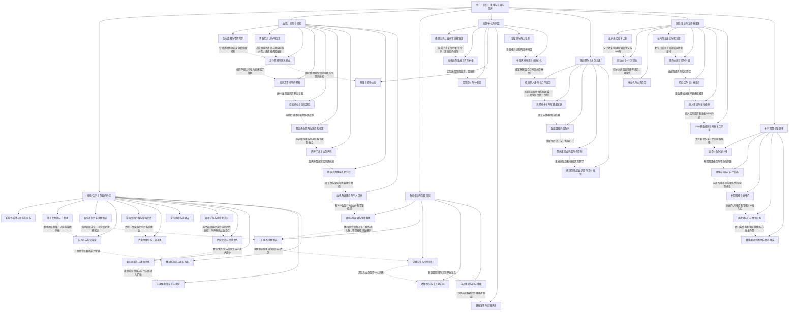

# 卷二：回归、重组与有限的保护（待审阅）

实线表示结构归属，虚线表示跨节点关系；依据类型详见节点数据。

## 剧情线

- 陆何相认：hidden / resolved
- LC与匿名供血：hidden / partial
- 心然约定与真实身份：hidden / partial
- 血佣自治与古剑回归：main / partial
- 谁与争锋夺冠：main / resolved
- 雪莲与雪薇毒伤：subplot / resolved
- 林独立目标与陆关系：subplot / partial
- 父卡与亲情：subplot / partial
- 陈生纠缠与北妊娠误认：subplot / partial
- 恶魔灵堂神威令：subplot / resolved
- 林十金佣与百药预订：subplot / open
- 锁魔塔神念/镇魔剑：main / open
- 古剑与花间/狂龙/灭神/烛龙：main / partial
