# 无双卷三：群雄、治理和未结双线战

实线表示结构归属，虚线表示跨节点关系；依据类型详见节点数据。

```mermaid
flowchart TD
  n0["卷三 群雄并起"]
  n1["兄妹、疗伤与紫罗兰复国"]
  n0 --> n1
  n2["锁魔塔：替伤与交剑的分阶段成功"]
  n1 --> n2
  n3["拍卖结账与霜云共同体"]
  n1 --> n3
  n4["卡丁短暂认女与真失去"]
  n1 --> n4
  n5["道格斯失败与寒冰琼花交付"]
  n1 --> n5
  n6["紫罗兰复国与镇魔封门"]
  n1 --> n6
  n7["村民救援与不能全救"]
  n1 --> n7
  n8["现实冲突、职业成长与谁主沉浮"]
  n0 --> n8
  n9["纸醉金迷冲突与李承风入盟"]
  n8 --> n9
  n10["紫域王长耗与等级门槛"]
  n8 --> n10
  n11["冰魄盾图与铁匠资格"]
  n8 --> n11
  n12["谁主沉浮：险过烛与决赛让步"]
  n8 --> n12
  n13["领地、生产与寒刃战争"]
  n0 --> n13
  n14["首领地：夺令被偷、盟友对战与守成"]
  n13 --> n14
  n15["暗月建设与骑兵产能"]
  n13 --> n15
  n16["蒂雅试炼、毒龙与疗伤"]
  n13 --> n16
  n17["叛王联盟与十分钟毁桥危机"]
  n13 --> n17
  n18["寒刃十波：成功守城但王活逃"]
  n13 --> n18
  n19["首五转真正交付与技能限制"]
  n13 --> n19
  n20["生活、第二城与职业化"]
  n0 --> n20
  n21["回乡探亲与生活资产交换"]
  n20 --> n21
  n22["第二城换锋与雪银实际得城"]
  n20 --> n22
  n23["从竞技榜到赞助合同"]
  n20 --> n23
  n24["地下黑赛：赢赛和现实报复"]
  n20 --> n24
  n25["九龙争夺与工具回收"]
  n0 --> n25
  n26["木龙入口：盲区与旁观获利"]
  n25 --> n26
  n27["黄金与冰龙：双坦/辅助与尾刀分离"]
  n25 --> n27
  n28["隐藏地龙：拆洞追逐与让尾成长"]
  n25 --> n28
  n29["九层天王：殿后惨败与限时反击"]
  n25 --> n29
  n30["俱乐部、事业独立与回家"]
  n0 --> n30
  n31["1:4真败与李承风KOF一穿五"]
  n30 --> n31
  n32["GGS决裂到雨立方筹建"]
  n30 --> n32
  n33["猎神者与青虎：传承/军团同地图"]
  n30 --> n33
  n34["暴雨车祸：带你回家的实际成本"]
  n30 --> n34
  n35["招募、组织信用与承诺战争"]
  n0 --> n35
  n36["分身救吕与旧物赠谋士"]
  n35 --> n36
  n37["自家清场与小蛮有条件入盟"]
  n35 --> n37
  n38["第三城赌约与暗月双线"]
  n35 --> n38
  n39["青石谷：时间换空间与未结王牌"]
  n35 --> n39
  n2 -. "先前实际交付的镇魔剑在紫罗兰封门复国阶段使用；不是王剑化尘后获得另一武器。" .-> n6
  n4 -. "心然反噬/替伤产生疗药需求，花需实际交付才治疗，而非击杀道格斯即愈。" .-> n5
  n5 -. "心然疗伤后在复国战实际回归主伤，陆只是最后补击。" .-> n6
  n10 -. "105实穿偷天、群技与四转在竞技中使用，仍2:1险胜烛/1:2真败雪银。" .-> n12
  n11 -. "制作与实穿先增强何前排条件，领地厅内实战仍有多角色死亡与换锋。" .-> n14
  n14 -. "系统古剑占城并授陆管理之后才有建设、传送广告和分红生产。" .-> n15
  n16 -. "试炼得破魔/烈刃后真实用于舞神/寒刃战争，破魔面对大招等级差会失效或只削一半。" .-> n18
  n17 -. "叛王保杖导致桥夜灵入、求卡援，十波守城继而发生。" .-> n18
  n18 -. "寒刃战争提供向导师交付的任务恢复条件；501真实交付才五转白金，502另付学费学技，不以战后相邻顺序直接立因果。" .-> n19
  n15 -. "领地分兵/火马重练与名将编组用于第二领地，古剑主攻后换盟友雪银取得产权。" .-> n22
  n23 -. "华硕先商谈再签约开业，公开品牌义务/嘉宾身份带来两俱乐部友谊赛压力。" .-> n31
  n24 -. "地下匿名红毛550才揭百战者/战天第一分盟，现实报复通过同一人接入九龙的敌会冲突。" .-> n29
  n27 -. "金王赤岩甲已穿，血煞与旧神怒在九层反击真正联动；仍由慕/吻/洛接救收尾。" .-> n29
  n27 -. "乱月四骨镰现场简易穿、碎石首学后在隐洞内清路，获得让尾新名将。" .-> n28
  n29 -. "九龙先险胜并不消除操作差/赛制不利，线下1:4真败后队友KOF另胜；仅作两种团队评估比较。" .-> n31
  n23 -. "合同提供持续收入预期，何决裂GGS后现金紧，实际支持仍是陆售装与两笔1000万转款；不是年薪已全付。" .-> n32
  n32 -. "两女为筹公司分赴沪杭，慕已签先发协议返程遇事故，取包与救人同属真实后果。" .-> n34
  n33 -. "灵烹8的力量药实际制/分许杜，降低五转力量门槛；谷战壁垒锋线显示组织产能，不声称每位五转都由该药促成。" .-> n39
  n33 -. "从青虎捕获100/400到3097真成，外线机动追杀并切骑神，谷军为其争回城时间。" .-> n39
  n29 -. "九龙灼热扇与血颅紫龙书先存后实际交吕，603才报已学，未成为名将。" .-> n36
  n36 -. "为吕收第八/允自治后，零度用古剑名清场伤人，招小蛮须承担该组织信用债。" .-> n37
  n31 -. "WSL制1:4赌的第三城不争在598明确仍有效，外围截杀为角色规避方案，非赌已撤。" .-> n38
  n38 -. "暗月诸侯令迫分兵：鬼青虎继续西外截，陆七千青石谷挡援、杜薛护传送；需撑时而非独歼30万。" .-> n39
  n28 -. "让尾得掠夺，末606乱月以高爆率击杀拾斧刺客，追回斗卓越无敌仍包中，未复活斗。" .-> n39
```

## 剧情线

- 职业/种族/装备与技能门槛：main / partial
- 心然兄妹、封印与记忆：subplot / partial
- 紫罗兰复国阶段：main / resolved
- 首领地归属与经营：main / resolved
- 寒刃入侵与五转任务：main / resolved
- 共同生活、多方亲密与边界：subplot / open
- 第二城联盟分配：main / resolved
- 九龙九鳞交付与奖励：main / resolved
- 地下红毛身份：hidden / resolved
- 赞助与公开切磋：subplot / partial
- 雨立方筹建与家：subplot / partial
- 猎神者救治与灵烹：subplot / resolved
- 吕布衣、小蛮与第八治理：subplot / open
- 第三城/暗月掠夺双线：main / open
