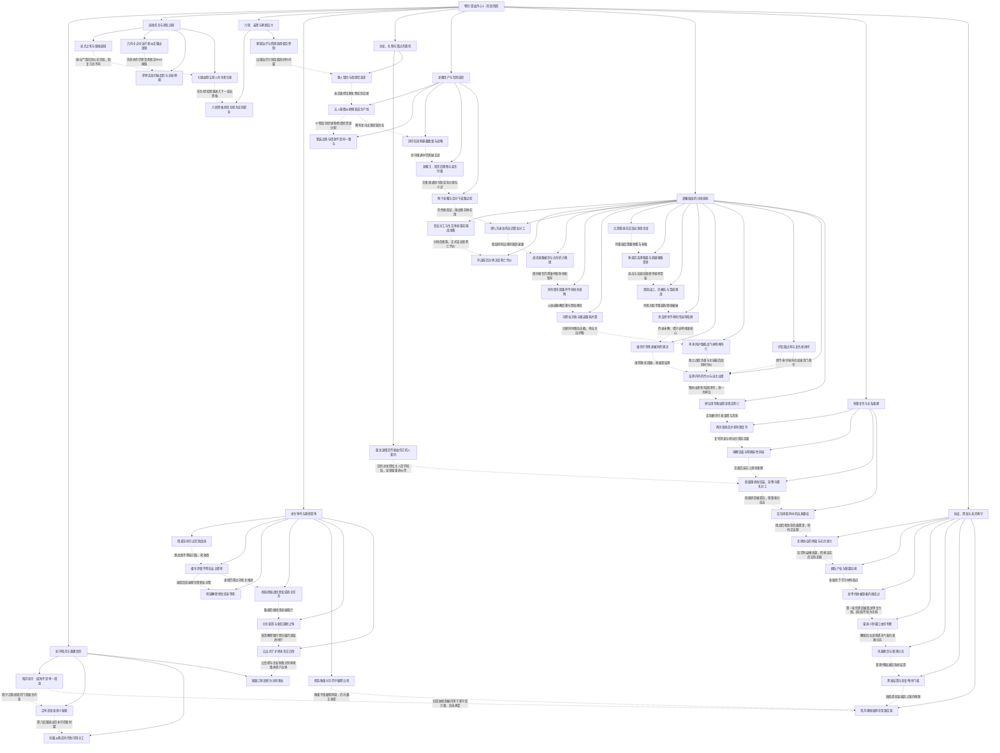

# 《天下无双》卷四｜守城、生产、失能与重建

实线表示结构归属，虚线表示跨节点关系；依据类型详见节点数据。

## 剧情线

- 暗月领地守护与升级：main / partial
- 布衣转属与自主归属：subplot / resolved
- 新刺盟能力与失败：subplot / partial
- 蒙川罗兰德复生任务：subplot / resolved
- 达达忠魂与幻影狼：subplot / partial
- 六转与装备资格：subplot / partial
- 白帝最终永生归属：main / resolved
- 鬼神预言与明镜：subplot / partial
- 克里斯从敌龙到逸宠：subplot / partial
- 母亲治疗与出国离别：subplot / partial
- 陆何逸亲密边界：subplot / open
- 龙曜生产分配与实战：main / resolved
- 借款与个人承诺未兑：hidden / open
- 晨曦国战保城：main / resolved
- 粮道与护粮战区：subplot / partial
- 复仇者挟持与烛知情度：hidden / partial
- 维多次脱险后的实杀：subplot / resolved
- 李的护粮牺牲与神将：subplot / resolved
- 神泣一次性与有限恢复：main / partial
- 北境协议与永爱诱局：hidden / partial
- 黑海拦截与毁港：main / resolved
- 霸王再攻与雪银召骑：main / open
