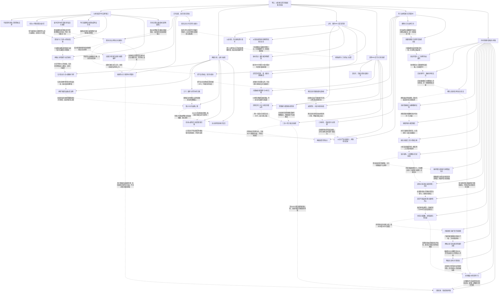

# 卷五：资源、伙伴、牺牲与胜战失籍（待审阅）

实线表示结构归属，虚线表示跨节点关系；依据类型详见节点数据。

## 剧情线

- 九魄已集与魂盒释放未示：main / partial
- 法师缺口与连昕回归：main / resolved
- 白马弑君与毁约：subplot / resolved
- 取首主线与云续命：main / resolved
- 苏仇与母灵救赎：subplot / resolved
- 国内/国际两冠与王城：main / resolved
- 千法借约改千骑交易：subplot / partial
- 何林双亲密与尚未协商的关系：subplot / open
- 父辈与现实陪伴：subplot / partial
- 幼神龙的成长时延：subplot / partial
- 浮冰灾难至紫葡萄国战正式胜：main / resolved
- 红枫对地形的部署与最终谷亡：hidden / resolved
- 归零代价与不负的承诺：hidden / partial
- 宴会官员到正式剥籍：hidden / open
