# 《天下无双》卷六｜放逐、互惠、反攻与未完救援

实线表示结构归属，虚线表示跨节点关系；依据类型详见节点数据。

```mermaid
flowchart TD
  n0["卷六·英雄王座｜阶段快照"]
  n1["逐籍后的生存与营地"]
  n0 --> n1
  n2["互助组织与有条件盟友"]
  n0 --> n2
  n3["雇援霜风与回撤"]
  n0 --> n3
  n4["副本、马铁与保护伞"]
  n0 --> n4
  n5["多城败战与王权撤离"]
  n0 --> n5
  n6["现实回归与联防重建"]
  n0 --> n6
  n7["一次遗迹机会与天河"]
  n0 --> n7
  n8["多国反攻与分化城池"]
  n0 --> n8
  n9["寻剑远征与借体骗局"]
  n0 --> n9
  n10["龙窟竞争与未完互救"]
  n0 --> n10
  n11["徽记和好友被删除"]
  n1 --> n11
  n12["返生不能覆盖生死谷"]
  n1 --> n12
  n13["救出莫娜并建立营地支点"]
  n1 --> n13
  n14["十小时不能飞也不能下线"]
  n1 --> n14
  n15["赌战后保留自治的合军"]
  n2 --> n15
  n16["以草液火攻换突围"]
  n2 --> n16
  n17["敌手真正相救的转折"]
  n2 --> n17
  n18["证明给吻痕而非陆自用"]
  n2 --> n18
  n19["嗜血日常自治与战略协同"]
  n2 --> n19
  n20["坡地冲击也要付大代价"]
  n3 --> n20
  n21["逸提浅水、战痕实测"]
  n3 --> n21
  n22["千弓实死换二十分钟"]
  n3 --> n22
  n23["两万龙曜救人与假退解释"]
  n3 --> n23
  n24["三门副本以灭队修正循环"]
  n4 --> n24
  n25["废铁通过莫娜复成图谱"]
  n4 --> n25
  n26["战斗转向矿区和运仓"]
  n4 --> n26
  n27["飞炎争夺失利与保护伞整编"]
  n4 --> n27
  n28["野营亲密仍有明确拒绝"]
  n4 --> n28
  n29["入口精防仍被击穿"]
  n5 --> n29
  n30["袋阵不是一人独赢"]
  n5 --> n30
  n31["七小时毁器械换灭神存活"]
  n5 --> n31
  n32["受伤五龙中先救蒂雅"]
  n5 --> n32
  n33["琥珀色眼眸当面露交易"]
  n5 --> n33
  n34["撤铠送王权，自己留地面"]
  n5 --> n34
  n35["外援救回人但未立刻取城"]
  n5 --> n35
  n36["现实抓捕与游戏排名各有回执"]
  n5 --> n36
  n37["归来后兑现北冥的宝马"]
  n6 --> n37
  n38["苏菲识破激将后才谈重建"]
  n6 --> n38
  n39["被丢的S卷让乱月首天河"]
  n7 --> n39
  n40["国服限用迫使SS交换"]
  n7 --> n40
  n41["偶撞河图再实叠地图"]
  n7 --> n41
  n42["死门柱有效但仍死三十余次"]
  n7 --> n42
  n43["解阵后的第二种存续"]
  n7 --> n43
  n44["被迫学卷穿无敌救队"]
  n7 --> n44
  n45["青茶式爱由当事人说出代价"]
  n7 --> n45
  n46["多国分工与现役薪资制度"]
  n7 --> n46
  n47["从破锋到取杖正式归城"]
  n8 --> n47
  n48["从强攻废城改围点打援"]
  n8 --> n48
  n49["一万六的滋扰为何要撤"]
  n8 --> n49
  n50["先耗十五次再堵谷双飞"]
  n8 --> n50
  n51["不自己占日落而演交泪"]
  n8 --> n51
  n52["国家胜奖与北冥神器分账"]
  n8 --> n52
  n53["胜偷袭者却把船劈碎"]
  n9 --> n53
  n54["林分三坦后仍需死后调整"]
  n9 --> n54
  n55["在战利堆下看见活亡灵"]
  n9 --> n55
  n56["变异镇山击穿新套路"]
  n9 --> n56
  n57["钱与单控都不够的问路"]
  n9 --> n57
  n58["老师不谅与恋人自刎"]
  n9 --> n58
  n59["让全装和十万换第三魂"]
  n9 --> n59
  n60["系统SS完成之后委托人背约"]
  n9 --> n60
  n61["卡兰识明宇，陆林从等尾改救人"]
  n9 --> n61
  n62["先断续命条件再断持剑手"]
  n9 --> n62
  n63["任务结后剑又被夺"]
  n9 --> n63
  n64["高防新盾仍被刀魔逼出控制链"]
  n10 --> n64
  n65["残血明宇不能绕过坐骑龙"]
  n10 --> n65
  n66["歌者先死改变队伍结构"]
  n10 --> n66
  n67["弃仇公战与神器抢夺"]
  n10 --> n67
  n68["菲盖的被害者叙事先获得信任"]
  n10 --> n68
  n69["低血的龙不是菲盖真身"]
  n10 --> n69
  n70["被吞的竞争者活出后才真死"]
  n10 --> n70
  n71["救援者断腿后仍提供解法"]
  n10 --> n71
  n11 -. "逐籍后的异地求生在禁返地图承压" .-> n12
  n13 -. "救回的专业者识图复工" .-> n25
  n14 -. "持奖后的战力参与后续战，非直接造成胜城" .-> n27
  n15 -. "伙伴关系落实为稀缺证明转赠" .-> n18
  n16 -. "战局压力推进到同服排挤后的局部转向" .-> n17
  n17 -. "相救后才有独立领地雇援合作" .-> n20
  n18 -. "盟友能力成长在更大协作框架中使用" .-> n19
  n20 -. "阶段胜仍面临过水/留守成本" .-> n21
  n22 -. "以死亡买窗口至何援来" .-> n23
  n23 -. "旧共同体未因徽记丢失停止互助" .-> n11
  n24 -. "任务交付后新制造机会展开" .-> n25
  n25 -. "新军备材料需求使矿和运仓成争点" .-> n26
  n19 -. "早期协作后来形成保护伞实编组" .-> n27
  n28 -. "现实短休被远端败战消息打断" .-> n29
  n29 -. "正面失利迫总体林线布袋" .-> n30
  n30 -. "防线战后仍需毁器械保援会" .-> n31
  n32 -. "先保五龙生命后与卡琳同运出" .-> n34
  n33 -. "清内裂不消外围危局" .-> n34
  n34 -. "单人残守未死，俄援止围" .-> n35
  n35 -. "复籍与现实调查后续各走程序" .-> n36
  n36 -. "返苏后承诺宝马实交" .-> n37
  n34 -. "保出君主后在天岭谈联防重建" .-> n38
  n38 -. "天空/神隐恢复提供反攻背景，不独因" .-> n47
  n39 -. "放弃S后继续寻适配高技" .-> n40
  n41 -. "求解封需实际取内丹而入圣兽战" .-> n42
  n42 -. "内丹实解阵，灵尽带来新选择" .-> n43
  n43 -. "新武器救援与已得卷被迫实学" .-> n44
  n44 -. "游戏传出与留饭照料转入关系诉求" .-> n45
  n40 -. "实交换支持谁赴联席磋商" .-> n46
  n46 -. "多国分工为反攻牵制，不独定胜" .-> n47
  n47 -. "天风已得主力转热沙并改守城目标" .-> n48
  n48 -. "下一千万援来，林提提前扰军" .-> n49
  n49 -. "回主林持续多轮耗军，英援后到" .-> n50
  n50 -. "日落主力已大损制造突袭窗口" .-> n51
  n51 -. "城局分化后72h系统结国家战" .-> n52
  n52 -. "神器易招抢夺，旅途有人实劫" .-> n53
  n54 -. "loot下锁链引出守护者" .-> n55
  n55 -. "被释放者回战辨明宇仍需被救" .-> n61
  n56 -. "新甲后强攻弱怪不等抓得极速拾荒者" .-> n57
  n57 -. "带路抵剑山接三魂条件" .-> n58
  n58 -. "第三魂目标已被战天先打促谈交易" .-> n59
  n59 -. "三魂齐实际交后系统结但委托人背约" .-> n60
  n60 -. "异常借体在卡兰与明宇互认中解释" .-> n61
  n61 -. "救人后联军/心然到，转取剑窗口" .-> n62
  n62 -. "断手拿任务物后实际交付得奖" .-> n63
  n57 -. "旧问路者再次成夺剑者" .-> n63
  n63 -. "任务已结后自主进24h禁返龙窟" .-> n64
  n64 -. "分层探索相遇残明宇坐骑，非先知必达" .-> n65
  n65 -. "输出暴露位置和烈焰团灭引出血盟袭杀" .-> n66
  n66 -. "七变六后与其他会在第五层争目标" .-> n67
  n67 -. "吞掉的竞争者后来活出腹再真死" .-> n70
  n68 -. "菲盖变真斯特，旧囚龙被认妻" .-> n69
  n68 -. "玩家斩锁为其自由活动/夺晶提供条件" .-> n69
  n69 -. "大屠后余人合作仍败，妻由陆终杀" .-> n70
  n70 -. "陆反复返生残守，心然实来救又受伤" .-> n71
  n43 -. "救援成功与身体恢复/存续方式再分离" .-> n71
```

## 剧情线

- 放逐、替代组织与复籍：main / resolved
- 莫娜营地与马铁供应：subplot / resolved
- 保护伞的自治与义援：main / partial
- 行云雇援与霜风终占：subplot / open
- 血佣假退的知识差：hidden / resolved
- S3成长与赌款：subplot / partial
- 保天空王权而非当场保城可用：main / resolved
- 唐龙现实司法进度：hidden / partial
- 陆何逸北慕的关系边界：subplot / open
- 账号一次遗迹与古技取得：main / resolved
- 玄女融剑未来醒否：hidden / open
- 谁的交换与未来守城诺：subplot / partial
- 天风热沙反攻与日落分化：main / resolved
- 现役工资新制与首款：subplot / partial
- 玄冥赠北、爆落与返还：subplot / resolved
- SSS寻斩龙剑：main / resolved
- 验收后斩龙剑再失：hidden / open
- 三魂验收与救赎背约：hidden / resolved
- 100骑射训练承诺：subplot / open
- 明宇借林浅体与续命米：hidden / partial
- 卡兰守护与回魂恢复：subplot / partial
- 血盟幕后雇主：hidden / open
- 长生刀得主与爆落风险：subplot / resolved
- 菲盖真身与妻龙误认：hidden / resolved
- 龙心SS与真斯特战：main / open
- 心然互救和断腿伤情：main / open
