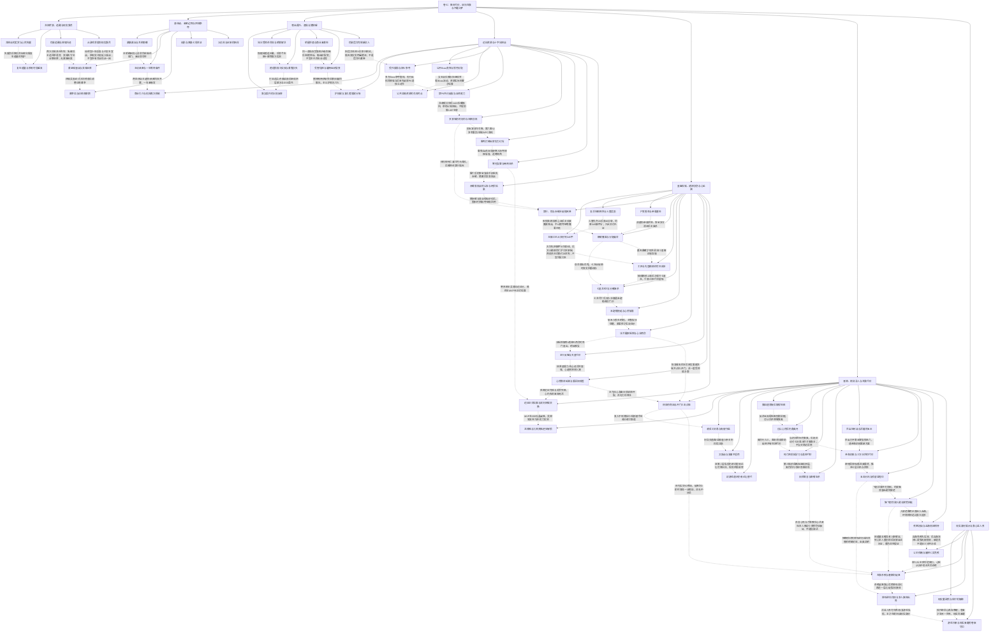

# 卷七：照护、远征代价与双向救返（待审阅）

实线表示结构归属，虚线表示跨节点关系；依据类型详见节点数据。

## 剧情线

- 龙神余波与照护恢复：main / partial
- 周龙鞭追回与信任交易：subplot / resolved
- 月光救援与听风追责分账：subplot / partial
- 现实身体谜、何林亲密及一年条件：hidden / open
- 四城正式归属/退款与训练成长：main / resolved
- 救女SSS与委托目的反转：subplot / resolved
- 婉指控、猪转盟及复仇进行：main / partial
- 混乱远征正式完成与多方死伤：main / resolved
- 军需、鳞甲/火套、奖励与未交物：subplot / partial
- 冰兰短控、灭圣与龙域重建：hidden / partial
- 修罗神格/九转逐步可行动：main / resolved
- 奥丹从误认获救到互救伙伴：subplot / partial
- 心然坠渊寻人至游戏实救返：main / resolved
- 神石轻踏与返程接应：hidden / resolved
- 现实董欣然的身份与尚未醒来：hidden / open
- 林纳力量/断臂/追击后仍活：main / open
