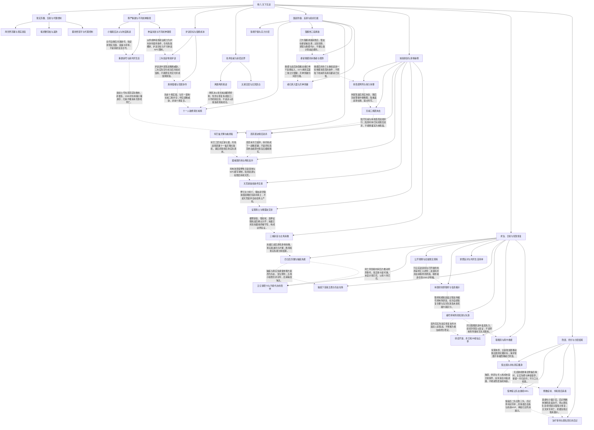

# 无双卷八：制度、国战与求治的分层收束

实线表示结构归属，虚线表示跨节点关系；依据类型详见节点数据。

## 剧情线

- 心然现实苏醒与代理控制：main / partial
- 噬灵鞭竞拍与返款：subplot / resolved
- 小猪尊严与另号重建：subplot / partial
- 神级资格、职业与操作边界：subplot / partial
- 护送与分基地毁炮：main / resolved
- 公共权威与盲战控制：subplot / partial
- 国战指挥、诱敌与不可兼救：main / partial
- 真假徽记与自主入盟：subplot / partial
- 征服、废弃、城权与盟友利益：main / resolved
- 财产、孝养与组织资源：subplot / partial
- 抗原研究、照护与知情权：main / partial
- WEL参与权、借装与冠军杯：subplot / partial
- 多方亲密与结尾辨识边界：subplot / partial
