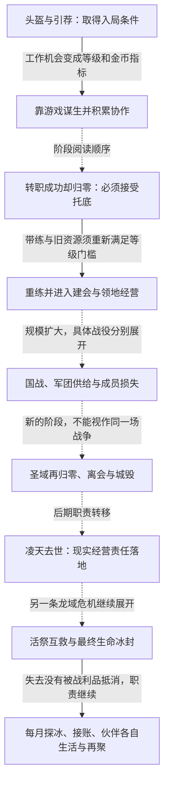
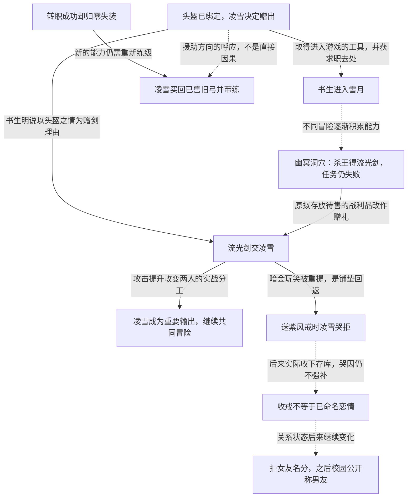
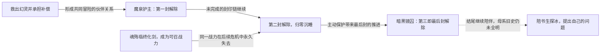
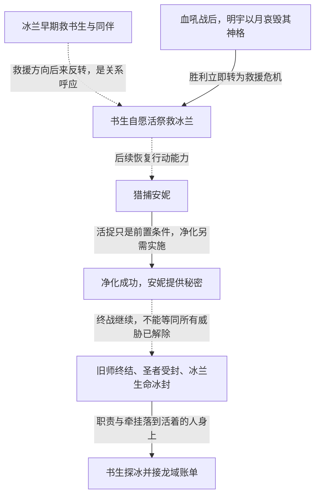
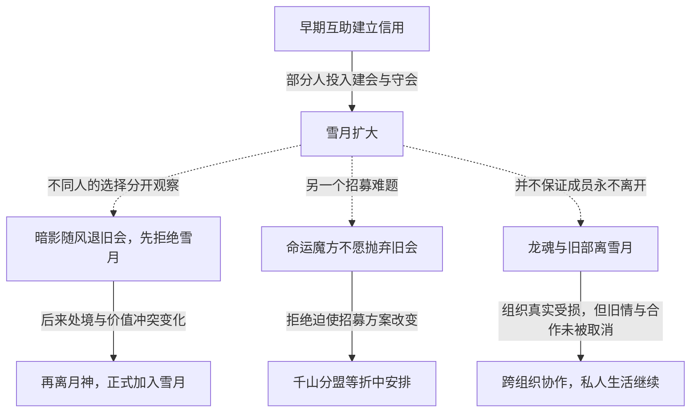
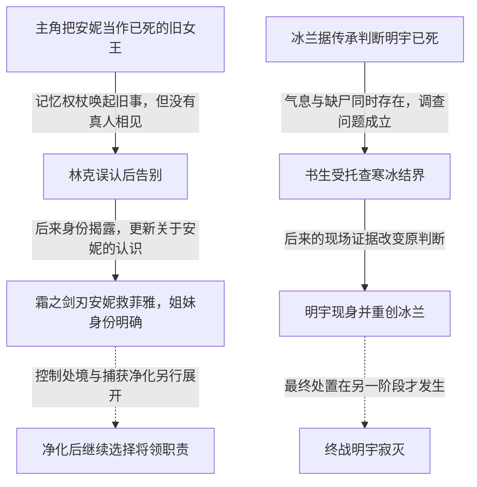

# 《纵横天下》剧情地图

[内容入口](README.md) · [人物库](characters.md) · [创作研究](craft.md) · [离线探索图](map/index.html)

从下表选线，再沿事件展开。实线旁说明实际承接的条件，呼应线说明两件事怎样彼此重释；两个事件先后出现，不因此自动构成因果。全文序号和原章号均在事件依据中保留。

| 全书线 | 审阅时要追问的问题 | 展开 |
|---|---|---|
| 谋生→组织→责任 | 新的力量使谁受益，又让谁承担维护和损失？ | [主干](#main) |
| 凌雪的关系选择 | 赠物、接受帮助与命名关系，怎样各自改变两人？ | [关系分枝](#snow) |
| 灵儿的封印与保护 | 伙伴何时从被救者转成主动保护者，每一步损失了什么？ | [成长分枝](#linger) |
| 冰兰与龙域 | 强导师何时也需被救，终战之后留下什么责任？ | [师生与暗线](#mentor) |
| 组织归属 | 为什么有人拒招、离会或回归，个人选择如何改变组织？ | [群像分枝](#organization) |
| 安妮与明宇的身份暗线 | 旧记忆、人物判死与现场后证，在哪一步改变读者所知？ | [信息揭露](#hidden-identities) |

需要在小图里探索时，可分别打开：[谋生与责任](lines/editorial-livelihood-duty/index.html)、[凌雪关系线](lines/editorial-snow-agency/index.html)、[灵儿封印线](lines/editorial-linger-seals/index.html)、[冰兰师生线](lines/editorial-mentor-duty/index.html)、[组织归属线](lines/editorial-organization-choice/index.html)。

## 主干：力量改变行动余地，也增加要照料的人

虚线负责阶段定位，不声称相邻两段必为直接因果。真正承接的物品、承诺和信息，在下方各线的实线中细看。

本书几次重大回报同时留下损失：幽冥洞穴杀王拿到掉落，却任务失败；龙语者转职成功，却归零失装；终战达成系统目标，却未使冰兰恢复日常生活。地图因此分别保留“得到什么”和“没有恢复什么”，不能只沿奖励向上画。

对应人物：[书生](characters/character-arc-01.md)、[凌月](characters/character-arc-03.md)、[冰兰](characters/character-arc-07.md)。

## 关系分枝：凌雪与书生的援助为什么没有结清

这条线的交汇处是**流光剑赠出**：战利品线提供物件，早期援助提供赠予理由，凌雪当时攻低的战斗处境提供用途。三者共同改变后续行动，不能只记成“男主送了贵礼，感情升温”。另一处是**归零后的带练**：职业成功没有取消现实损失，凌雪的行动使关系再次从还债转向持续合作。

需要特别分开的两个物件：归零时丢失的是追星弓；凌雪买回的是此前已经出售的黄金王者旧弓。第100章当下还没到旧弓的佩戴门槛，带练先用其他办法。三万元是凌雪的自述，弓的实际交付则是场景可见的行动。

人物选择与写法详见[凌雪档案](characters/character-arc-02.md)。关键节点：[赠剑](#event-v1-v1c35)、[拒戒](#event-v2-refuse)、[归零](#event-v2-zero)、[旧弓回流](#event-v2-return)、[拒名分](#event-v3-v03-promise)、[校园确认](#event-v4-v04-campus)。

## 成长分枝：灵儿能保护别人，仍会付出阶段代价

这里有一次必须看清的交汇：同一场任务既推进灵儿，也永久失去魂殇。不能只从灵儿的成长角度给它标“升级成功”，更不能把别人的永久损失当成可随下次奖励抵销的成本。

需要分开的信息：三次封印与玩家圣域不是一个系统；后来的苏醒确认不另造第四封；封印链闭合不等于所有身世秘密均已解释。

关键节点：[幻灵救援](#event-v4-v04-dragonbone)、[第一封](#event-v4-v04-spring)、[第二封与魂殇失去](#event-v6-v06-scene-linger-cost)、[最后封](#event-v7-v07-aryan)。

## 师生与暗线：冰兰的强大为什么不能解决全部失去

这条线可以同时从人物与信息两面展开：学徒取得能力，后来能为导师承担代价；失踪旧师的判断、现身和最终处置，则逐步更新人物所知。某角色早期认为其必死，不等于正文已经展示过一次死亡再复活。

安妮在这条线上也有自己的选择：血色战役先救妹妹，后来被捕、获净化，再拒绝让出的王位。她不是只为导师线提供一个任务目标。详见[安妮](characters/character-arc-08.md)、[冰兰](characters/character-arc-07.md)。

关键节点：[血吼与偷袭](#event-v8-v08-bloodroar)、[活祭](#event-v8-v08-sacrifice)、[活捉](#event-v8-v08-capture)、[净化](#event-v8-v08-cleanse)、[终战](#event-v8-v08-endbattle)、[半年后](#event-v8-v08-after)。

## 群像分枝：一个人的拒绝，可以改变组织结构

三个人不能压成“最终都为主角所用”：随风的两次选择来自不同处境；魔方的拒绝促成组织方案变化；龙魂的离开使主角利益受损而关系仍须继续处理。这些分枝用于检查配角是不是拥有能改变主线的决定权。

人物档案：[暗影随风](characters/character-arc-16.md)、[命运魔方](characters/character-arc-44.md)、[龙魂](characters/character-arc-41.md)。

## 跨线而不合并的私人损失

林克的战甲、艾兰的暖月光、米拉的披风与林丘后来的战死，都让任务结算之后仍有人的生活继续。它们可以在创作研究中互相比较，但不能仅因都涉及亡者就画成同一条因果线。尤其林克和林丘是不同的人，愿望中的重逢、实际会面与死亡也各有终点。

[林克档案](characters/character-arc-20.md) · [林丘档案](characters/character-arc-21.md) · [从具体交汇研究写法](craft.md)

## 信息揭露：人物当时的理解，不能被结尾覆盖

安妮线的关键并不只是“原来她是姐姐”：先前玩家和林克掌握的材料不同，林克握着的是记忆权杖；后来的身份揭露也不能使那场告别变成真人团聚。明宇线则把冰兰基于传承的死亡判断、她感觉到的气息、现场缺少两具尸体分别给出。线索互有张力，不能随手补成“已经死过，又复活了”。

这两条线的读法是先问**谁在什么时点知道哪一部分**，再看新证据更新了哪项认识。身份答案已有后证，不等于所有旧史和机制都已被完整解释。

[安妮身份小图](lines/editorial-hidden-annie/index.html) · [明宇身份小图](lines/editorial-hidden-mentor/index.html) · [冰兰档案](characters/character-arc-07.md) · [安妮档案](characters/character-arc-08.md)

关键节点：[林克误认](#event-v4-v04-linkforge)、[安妮现身](#event-v5-v05-scene-annie-reversal)、[明宇缺尸之谜](#event-editorial-mentor-missing)、[明宇偷袭](#event-v8-v08-bloodroar)。

## 事件、人物与章节依据

下面的同一事件供地图和人物档案共同引用。展开依据时再查看原章与行号，不用在每段人物分析中重复机器标识。

<!-- event-register:start -->

### 补叙失业缺钱，头盔购买受阻

失业与缺钱使购买头盔、支付房租都成为问题。后续的帮助改变现实行动条件，不只是制造一次偶遇。

章节依据

| 章节 | 全文行号 |
|---|---|
| 卷一 卷土重来 第2章 来龙去脉（ch-0003） | 69—89 |

### 发现误绑定后仍赠出头盔

凌雪发现头盔已经绑定书生后，决定赠出；随后留下1000元与蓝星求职去处。早期援助同时提供游戏工具与工作入口。

人物：[凌雪](characters/character-arc-02.md)

跨卷或后续联系：

- **呼应**：[旧弓回流、带练回9级](#event-v2-return)。援助再次发生，关系没有靠一次还礼结束。最初头盔让书生入局；归零后凌雪再把已售旧弓送回。两次援助是人物关系的呼应，不能把头盔赠予直接说成后来买弓的充分原因。

章节依据

| 章节 | 全文行号 |
|---|---|
| 卷一 卷土重来 第4章 住宿费（ch-0005） | 193—200 |

### 加入雪月，接到首夜任务

冰茶接纳凌雪引荐的书生，说明职业工作室的安排，并传达首夜10级和2金币的指标。机会随即变成需要履行的任务。

人物：[许冰／冰茶](characters/character-arc-05.md)

章节依据

| 章节 | 全文行号 |
|---|---|
| 卷一 卷土重来 第5章 进入游戏（ch-0006） | 235—259 |

### 黄金弓定职业，交易铠甲

弓鉴定白银必中，铠甲换破甲箭和金币，暂拒加盟。

章节依据

| 章节 | 全文行号 |
|---|---|
| 卷一 卷土重来 第12章 黄金王者弓（ch-0013） | 824—889 |

### 协助紫韵儿完成豪猪击杀

双人拉扯杀首领，书生只取金币留装备给她。

人物：[秦韵](characters/character-arc-04.md)

章节依据

| 章节 | 全文行号 |
|---|---|
| 卷一 卷土重来 第19章 豪猪首领（ch-0020） | 1380—1459 |

### 保护牧师击退傲世

诱敌灰名，先清法师保护紫韵儿。

人物：[秦韵](characters/character-arc-04.md)

章节依据

| 章节 | 全文行号 |
|---|---|
| 卷一 卷土重来 第20章 初次扬威（ch-0021） | 1465—1521 |

### 公司会议与权力差异

王俊杰提出资源集中，凌月另召工作室谈话。

人物：[凌月](characters/character-arc-03.md)

章节依据

| 章节 | 全文行号 |
|---|---|
| 卷一 卷土重来 第21章 人中龙凤（ch-0022） | 1556—1583 |

### 凌月身份揭晓并获赤焰海

明确凌月是清风揽月，书生给金币和技能书。

人物：[凌月](characters/character-arc-03.md)

章节依据

| 章节 | 全文行号 |
|---|---|
| 卷一 卷土重来 第23章 鬼王坡（ch-0024） | 1649—1693 |

### 前次保护获明确回报

龙魂说明援助缘由，六人补齐角色清三层。

人物：[秦韵](characters/character-arc-04.md) · [龙魂](characters/character-arc-41.md)

章节依据

| 章节 | 全文行号 |
|---|---|
| 卷一 卷土重来 第27章 炮灰先上（ch-0028） | 1964—1999 |

### 击杀得物，死亡导致任务失败

保鬼炙离开，书生最后击杀取物后死；获千刃箭与流光剑。

章节依据

| 章节 | 全文行号 |
|---|---|
| 卷一 卷土重来 第30章 流光剑（ch-0031） | 2144—2229 |

### 赠流光剑，凌雪成为输出主力

书生说明偿头盔之情并赠剑，效率显著变化。

人物：[凌雪](characters/character-arc-02.md)

跨卷或后续联系：

- **铺垫**：[送戒哭拒、醉因未揭](#event-v2-refuse)。赠剑时的暗金玩笑，在送戒时被重新提起。第35章的暧昧话语在第95章由书生主动重提，凌雪却哭拒。物品品阶达标没有自动兑现关系；哭因仍未获得完整单一解释。

章节依据

| 章节 | 全文行号 |
|---|---|
| 卷一 卷土重来 第35章 流光剑逞威（ch-0036） | 2510—2569 |

### 追星弓降低使用门槛

300金鉴定，降级特技使36级可以使用45级弓。

跨卷或后续联系：

- **因果**：[旧弓售出与再次实兑](#event-v2-sold)。追星弓成为主武器，旧黄金弓后来出售。新武器改变旧物的实用地位；旧弓被卖出后，才可能在归零时由凌雪买回。追星弓与黄金王者弓始终是两件物品。

章节依据

| 章节 | 全文行号 |
|---|---|
| 卷一 卷土重来 第47章 追星之弓（ch-0048） | 3355—3427 |

### 剑火投入救援

大批援助解除本次包围并提出加盟。

人物：[龙魂](characters/character-arc-41.md)

章节依据

| 章节 | 全文行号 |
|---|---|
| 卷二 龙吟天下 第60章 剑火雪月（ch-0061） | 4197—4258 |

### 现实提款受阻

50万未取得，公开斥责后私下支持并转自立。

人物：[凌月](characters/character-arc-03.md)

章节依据

| 章节 | 全文行号 |
|---|---|
| 卷二 龙吟天下 第82章 初次交锋（ch-0083） | 5480—5517 |
| 卷二 龙吟天下 第83章 暮光城风云（ch-0084） | 5518—5544 |

### 旧弓售出与再次实兑

旧弓卖2800金，另兑4000金17000元。

跨卷或后续联系：

- **因果**：[追星弓降低使用门槛](#event-v1-v1c47)。追星弓成为主武器，旧黄金弓后来出售。新武器改变旧物的实用地位；旧弓被卖出后，才可能在归零时由凌雪买回。追星弓与黄金王者弓始终是两件物品。

章节依据

| 章节 | 全文行号 |
|---|---|
| 卷二 龙吟天下 第84章 杀熊（ch-0085） | 5567—5591 |

### 稻花香控制能力出现

同场协助傲世，封Boss30秒；动机未知。

人物：[林香／稻花香](characters/character-arc-06.md)

章节依据

| 章节 | 全文行号 |
|---|---|
| 卷二 龙吟天下 第90章 捷足先得（ch-0091） | 5922—5938 |

### 送戒哭拒、醉因未揭

主角预期被打破；凌月提示他不了解凌雪。

人物：[凌雪](characters/character-arc-02.md)

跨卷或后续联系：

- **铺垫**：[赠流光剑，凌雪成为输出主力](#event-v1-v1c35)。赠剑时的暗金玩笑，在送戒时被重新提起。第35章的暧昧话语在第95章由书生主动重提，凌雪却哭拒。物品品阶达标没有自动兑现关系；哭因仍未获得完整单一解释。

章节依据

| 章节 | 全文行号 |
|---|---|
| 卷二 龙吟天下 第95章 凌雪之伤（ch-0096） | 6264—6271 |

### 入住、收戒与启动任务

凌雪实际搬入，实际收戒存库；两路分工转职任务。

人物：[凌雪](characters/character-arc-02.md)

章节依据

| 章节 | 全文行号 |
|---|---|
| 卷二 龙吟天下 第97章 邪恶地龙（ch-0098） | 6346—6353 |
| 卷二 龙吟天下 第97章 邪恶地龙（ch-0098） | 6378—6394 |

### 死亡归零后收到转职成功提示

首次死亡由复活预言无损复活；夺回证明启动融合，遭封印后第二次死亡降至0并遗失当时装备，随后系统才提示转职成功、死亡无经验。职业与损失分别结算。

人物：[丁舒升／轻狂书生](characters/character-arc-01.md) · [林香／稻花香](characters/character-arc-06.md)

章节依据

| 章节 | 全文行号 |
|---|---|
| 卷二 龙吟天下 第99章 从头再来（ch-0100） | 6493—6566 |

### 旧弓回流、带练回9级

同伴知道转职已成功；凌雪实际交还旧弓，自述花3万元买回；重练升10后死回9。

人物：[丁舒升／轻狂书生](characters/character-arc-01.md) · [凌雪](characters/character-arc-02.md)

跨卷或后续联系：

- **呼应**：[发现误绑定后仍赠出头盔](#event-v1-gift)。援助再次发生，关系没有靠一次还礼结束。最初头盔让书生入局；归零后凌雪再把已售旧弓送回。两次援助是人物关系的呼应，不能把头盔赠予直接说成后来买弓的充分原因。
- **因果**：[重练装备门槛](#event-v3-v03-rebuild)。带练和旧资源支撑下一卷的重练，但须再过等级门槛。卷二末实际回到9级；卷三继续升15用旧弓、交任务至22。不能把转职成功或仓库有高装写成战力已经完全恢复。

章节依据

| 章节 | 全文行号 |
|---|---|
| 卷二 龙吟天下 第100章 藏剑十年（ch-0101） | 6596—6608 |
| 卷二 龙吟天下 第100章 藏剑十年（ch-0101） | 6634—6697 |

### 重练装备门槛

先升15才换弓，再交任务升22；阈值逐步开启原资源

跨卷或后续联系：

- **因果**：[旧弓回流、带练回9级](#event-v2-return)。带练和旧资源支撑下一卷的重练，但须再过等级门槛。卷二末实际回到9级；卷三继续升15用旧弓、交任务至22。不能把转职成功或仓库有高装写成战力已经完全恢复。

章节依据

| 章节 | 全文行号 |
|---|---|
| 卷三 雪月天下 第101章 嗜血枪（ch-0102） | 6701—6835 |
| 卷三 雪月天下 第102章 冰风刺（ch-0103） | 6836—6983 |
| 卷三 雪月天下 第103章 星辰之目（ch-0104） | 6984—7092 |

### 秦韵脱离暴力关系入驻

书公开护人、邀工作室；秦加入八人并交代婚姻自述

人物：[秦韵](characters/character-arc-04.md)

章节依据

| 章节 | 全文行号 |
|---|---|
| 卷三 雪月天下 第127章 烈焰龙腾（ch-0128） | 9804—9944 |
| 卷三 雪月天下 第128章 紫韵儿DD秦韵！（ch-0129） | 9945—10070 |
| 卷三 雪月天下 第129章 秦韵入驻（ch-0130） | 10071—10179 |

### 稻花香暗送建帮令

香让令书建后让月会长；全服首会维护、书向工作室说来源

人物：[凌月](characters/character-arc-03.md) · [林香／稻花香](characters/character-arc-06.md) · [龙魂](characters/character-arc-41.md)

跨卷或后续联系：

- **揭示**：[上海救香与护理](#event-v4-v04-rescuexiang)。敌方控制者早有暗助，后来获得脱离控制的生活位置。稻花香先暗送建帮令，现实救援后进入共同生活；这使敌方标签不足以解释其行动。建会受益与后来的救援不能简化成购买忠诚。

章节依据

| 章节 | 全文行号 |
|---|---|
| 卷三 雪月天下 第132章 战争践踏（ch-0133） | 10379—10484 |
| 卷三 雪月天下 第133章 天火之盾（ch-0134） | 10485—10640 |
| 卷三 雪月天下 第134章 建帮令（ch-0135） | 10641—10742 |
| 卷三 雪月天下 第135章 天火战靴（ch-0136） | 10743—10833 |

### 拒凌天赌约并清退王

书拒把姐妹当奖，月决断踢王部；姐妹信任增但父未解除安排

人物：[凌月](characters/character-arc-03.md)

章节依据

| 章节 | 全文行号 |
|---|---|
| 卷三 雪月天下 第186章 花开花落，云卷云舒（ch-0187） | 16010—16102 |
| 卷三 雪月天下 第187章 年少轻狂（ch-0188） | 16103—16210 |
| 卷三 雪月天下 第188章 白云城外血染天（ch-0189） | 16211—16289 |

### 寒冰王失败与秦韵单杀

书雪强试失败，秦留安全走道12小时磨；两坦真掉级、秦取地剑

人物：[秦韵](characters/character-arc-04.md)

章节依据

| 章节 | 全文行号 |
|---|---|
| 卷三 雪月天下 第191章 霜甲之盾（ch-0192） | 16470—16600 |
| 卷三 雪月天下 第192章 水晶螃蟹（ch-0193） | 16601—16679 |
| 卷三 雪月天下 第193章 飓风石巨人（ch-0194） | 16680—16788 |
| 卷三 雪月天下 第194章 名动天下（ch-0195） | 16789—16885 |
| 卷三 雪月天下 第195章 寒冰之王（ch-0196） | 16886—16998 |
| 卷三 雪月天下 第196章 秦韵的执着（ch-0197） | 16999—17120 |
| 卷三 雪月天下 第197章 夏天不是大美女（ch-0198） | 17121—17214 |

### 拒名分的吻与永陪

雪要不伤己与长伴，拒女友却吻脸；冰茶目击，书答带80探校

人物：[凌雪](characters/character-arc-02.md)

跨卷或后续联系：

- **回收**：[校园公开男友](#event-v4-v04-campus)。曾拒绝女友名分，后来由本人公开称男友。第238原索引的亲近和拒名分，与校园的公开确认分属不同阶段。后者更新关系状态，却不能倒推此前已经双方确认。

章节依据

| 章节 | 全文行号 |
|---|---|
| 卷三 雪月天下 第237章 甜蜜诺言（ch-0238） | 21114—21212 |

### 幻灵救援胜而补损

求援冰兰并由玩家打一击获取任务；主补死者百万；主线完成仍掉级、导师负伤。阶段变化：灵儿入队与补偿责任同时形成

人物：[冰兰](characters/character-arc-07.md)

跨卷或后续联系：

- **呼应**：[活祭救冰兰与共同跪歉](#event-v8-v08-sacrifice)。受导师救援的学徒，后来承担救回导师的代价。早期主角求冰兰救援并补偿同伴，后期自愿活祭救她。角色位置互换是人物关系的跨卷呼应；不把两次危机写成同一个任务。

章节依据

| 章节 | 全文行号 |
|---|---|
| 卷四 乱世称雄 第255章 冰霜之翼·龙骨（ch-0256） | 22868—22976 |
| 卷四 乱世称雄 第256章 幻灵少女（ch-0257） | 22977—23097 |

### 首领地最后持令

与孤坟立约、守末、集援、正式持领主令；领地终于建成并需建设。阶段变化：从战斗奖励变长期组织资产

人物：[丁舒升／轻狂书生](characters/character-arc-01.md)

章节依据

| 章节 | 全文行号 |
|---|---|
| 卷四 乱世称雄 第270章 突出重围（ch-0271） | 24385—24490 |
| 卷四 乱世称雄 第276章 乱世争雄（ch-0277） | 24938—25041 |
| 卷四 乱世称雄 第277章 最后的抵抗（ch-0278） | 25042—25171 |
| 卷四 乱世称雄 第278章 战后宁静（ch-0279） | 25172—25276 |

### 上海救香与护理

伪快递入内救人、毁录像、送医付20万安置；身体与噩梦未立即治愈。阶段变化：从敌方工具转受照护同伴

人物：[林香／稻花香](characters/character-arc-06.md)

跨卷或后续联系：

- **揭示**：[稻花香暗送建帮令](#event-v3-v03-token)。敌方控制者早有暗助，后来获得脱离控制的生活位置。稻花香先暗送建帮令，现实救援后进入共同生活；这使敌方标签不足以解释其行动。建会受益与后来的救援不能简化成购买忠诚。

章节依据

| 章节 | 全文行号 |
|---|---|
| 卷四 乱世称雄 第284章 血洒长空（ch-0285） | 25773—25903 |
| 卷四 乱世称雄 第285章 含苞花香（ch-0286） | 25904—26005 |
| 卷四 乱世称雄 第286章 青蟒沼泽（ch-0287） | 26006—26093 |
| 卷四 乱世称雄 第289章 青龙飞升（ch-0290） | 26266—26385 |

### 魂殇临终复明

临终见雪莉魂影、请求复仇并化剑；旧敌转可召伙伴。阶段变化：仇杀重解释并留下武器承诺

跨卷或后续联系：

- **回收**：[救宠争执与成功后的永久损失](#event-v6-v06-scene-linger-cost)。魂殇化剑成为可召战力，后来这份战力永久失去。卷四的遗愿和化剑使魂殇继续参与战斗；卷六系统永久删除烈魂召唤。任务完成不撤销这个个体的失去。

章节依据

| 章节 | 全文行号 |
|---|---|
| 卷四 乱世称雄 第290章 挑斩（ch-0291） | 26386—26504 |
| 卷四 乱世称雄 第291章 浮冰塔（ch-0292） | 26505—26597 |
| 卷四 乱世称雄 第293章 剑荡四方（ch-0294） | 26693—26775 |

### 校园公开男友

雪公开称男友并吻；主回击后仍主动动手；恋爱身份公开，冲突可能延后。阶段变化：恋人关系从暗示变实际称谓

人物：[凌雪](characters/character-arc-02.md)

跨卷或后续联系：

- **回收**：[拒名分的吻与永陪](#event-v3-v03-promise)。曾拒绝女友名分，后来由本人公开称男友。第238原索引的亲近和拒名分，与校园的公开确认分属不同阶段。后者更新关系状态，却不能倒推此前已经双方确认。

章节依据

| 章节 | 全文行号 |
|---|---|
| 卷四 乱世称雄 第339章 悍马男（ch-0340） | 32042—32149 |

### 魔泉误以失去灵儿

灵儿护主入泉、醒后解一封，母印消；实力改变、其余封印未解。阶段变化：宠物陪伴承诺与身世后续并存

跨卷或后续联系：

- **回收**：[救宠争执与成功后的永久损失](#event-v6-v06-scene-linger-cost)。第一封解除后的陪伴，推进到第二封与新的归零代价。魔泉救援后的第一封，与后来的第二封是同一封印链的不同阶段；每次解封伴随实际行动和代价，不是普通玩家圣域飞升。

章节依据

| 章节 | 全文行号 |
|---|---|
| 卷四 乱世称雄 第384章 梦魇兽（ch-0385） | 37582—37686 |
| 卷四 乱世称雄 第385章 梦魇兽皇（ch-0386） | 37687—37828 |
| 卷四 乱世称雄 第386章 幻灵剑（ch-0387） | 37829—37981 |
| 卷四 乱世称雄 第387章 幻灵套装（ch-0388） | 37982—38098 |

### 盲亡灵最后铸甲

林克仍锻白金，抱记忆权杖误认恋人后告别；女武神战甲完成，魂散，众人无喜。阶段变化：任务转月光少女未完成

人物：[林克](characters/character-arc-20.md)

跨卷或后续联系：

- **因果**：[暖月光的承诺](#event-v5-v05-scene-moon-bottle)。林克的死亡留下未完成的牵挂，后续任务继续落实照料。最后铸甲没有把亡者的全部愿望一并完成；暖月光之瓶、迁居照料继续承接遗留关系。林克本人没有因此与安妮真人重逢。
- **揭示**：[援军倒计时反成姐妹救援](#event-v5-v05-scene-annie-reversal)。被当作已死的旧女王，后来以霜之剑刃和菲雅姐姐的身份出现。林克握住记忆权杖误认安妮归来；后来的战场身份揭露更新了主角对于安妮命运的认识，却不会使此前的误认变成真人重逢。

章节依据

| 章节 | 全文行号 |
|---|---|
| 卷四 乱世称雄 第399章 女武神的战甲（ch-0400） | 39430—39563 |
| 卷四 乱世称雄 第400章 坚持的承诺（ch-0401） | 39564—39690 |

### 给枪与亲带补守护

盟主承疏忽后赋未来骑将任务，实给枪钱装并带练；守护100可骑，120主骑仍约定；寻梦态度转近。阶段变化：组织承诺以稀缺资源和时间兑现

人物：[丁舒升／轻狂书生](characters/character-arc-01.md)

章节依据

| 章节 | 全文行号 |
|---|---|
| 卷四 乱世称雄 第409章 烈魂剑（ch-0410） | 40851—40997 |
| 卷四 乱世称雄 第410章 盟主的身子带练的命（ch-0411） | 40998—41107 |
| 卷四 乱世称雄 第411章 轻抚菊花（ch-0412） | 41108—41226 |
| 卷四 乱世称雄 第419章 准备战斗！（ch-0420） | 42058—42165 |

### 暖月光的承诺

告真相，承诺成败都回来，用月草与旧友附魔替代；制成百年光暖瓶，结算后仍迁居照料

人物：[林克](characters/character-arc-20.md)

跨卷或后续联系：

- **因果**：[盲亡灵最后铸甲](#event-v4-v04-linkforge)。林克的死亡留下未完成的牵挂，后续任务继续落实照料。最后铸甲没有把亡者的全部愿望一并完成；暖月光之瓶、迁居照料继续承接遗留关系。林克本人没有因此与安妮真人重逢。

章节依据

| 章节 | 全文行号 |
|---|---|
| 卷五 魂归战袍 第426章 少女艾兰（ch-0427） | 42804—42918 |
| 卷五 魂归战袍 第427章 绿色项链（ch-0428） | 42919—43033 |
| 卷五 魂归战袍 第428章 菲雅（ch-0429） | 43034—43159 |

### 米拉的婚纱与披风

陪同回乡，危急出剑后听临终表达；米拉死，婚纱/披风成为遗物，林丘继续抗亡灵

人物：[林丘](characters/character-arc-21.md)

章节依据

| 章节 | 全文行号 |
|---|---|
| 卷五 魂归战袍 第431章 剑光掠影（ch-0432） | 43395—43526 |
| 卷五 魂归战袍 第432章 追踪项链（ch-0433） | 43527—43653 |
| 卷五 魂归战袍 第433章 幸福与拥抱（ch-0434） | 43654—43766 |
| 卷五 魂归战袍 第516章 叛变龙骑士（ch-0517） | 53696—53791 |

### 冰兰主动给血

主角说明求助，冰兰主动划腕于剑；完成血条件，圣疗互助，传承套可用门槛仍165

人物：[冰兰](characters/character-arc-07.md)

章节依据

| 章节 | 全文行号 |
|---|---|
| 卷五 魂归战袍 第453章 死亡试炼（ch-0454） | 46351—46480 |
| 卷五 魂归战袍 第454章 雷霆试炼（ch-0455） | 46481—46631 |
| 卷五 魂归战袍 第455章 冰兰之血（ch-0456） | 46632—46747 |
| 卷五 魂归战袍 第456章 爱死你了（ch-0457） | 46748—46882 |

### 回城穿套再追踪归队

冰茶不杀防红名，书生回城换套用追踪回来担杀；护冰茶成功，后正式转雷霆剑士

人物：[许冰／冰茶](characters/character-arc-05.md)

章节依据

| 章节 | 全文行号 |
|---|---|
| 卷五 魂归战袍 第432章 追踪项链（ch-0433） | 43527—43653 |
| 卷五 魂归战袍 第459章 虎魄（ch-0460） | 47122—47259 |
| 卷五 魂归战袍 第460章 寒风之战（ch-0461） | 47260—47388 |
| 卷五 魂归战袍 第461章 杀出重围（ch-0462） | 47389—47505 |
| 卷五 魂归战袍 第462章 决裂战魂（ch-0463） | 47506—47622 |
| 卷五 魂归战袍 第463章 雷霆斩（ch-0464） | 47623—47742 |

### 还装备与拒绝最强邀约

当众还整套退会，拒雪月后选低约束天骄；天骄得将，附不对雪月PK；魂归失情意技协同

人物：[暗影随风](characters/character-arc-16.md)

跨卷或后续联系：

- **揭示**：[拒辱离主与斩旧同僚](#event-v6-v06-scene-suifeng-exit)。先拒雪月、后正式加入；不同选择来自不同处境。卷五退魂归后选择低约束天骄，卷六不接受旧阵营的行为而离开月神再入雪月。不能把后来的加盟改写成第一次招募就成功。

章节依据

| 章节 | 全文行号 |
|---|---|
| 卷五 魂归战袍 第521章 人心难测（ch-0522） | 54263—54361 |
| 卷五 魂归战袍 第522章 小肚鸡肠（ch-0523） | 54362—54470 |

### 援军倒计时反成姐妹救援

安妮先核实部队尽没，卡伦杀菲雅时将其斩首；血色胜、姐姐身份揭开，但女官死和姐姐堕落不解

人物：[安妮](characters/character-arc-08.md)

跨卷或后续联系：

- **揭示**：[盲亡灵最后铸甲](#event-v4-v04-linkforge)。被当作已死的旧女王，后来以霜之剑刃和菲雅姐姐的身份出现。林克握住记忆权杖误认安妮归来；后来的战场身份揭露更新了主角对于安妮命运的认识，却不会使此前的误认变成真人重逢。

章节依据

| 章节 | 全文行号 |
|---|---|
| 卷五 魂归战袍 第521章 人心难测（ch-0522） | 54263—54361 |
| 卷五 魂归战袍 第527章 绝尘一剑（ch-0528） | 54975—55113 |
| 卷五 魂归战袍 第528章 转职龙骑士（ch-0529） | 55114—55242 |
| 卷五 魂归战袍 第529章 神龙祝福（ch-0530） | 55243—55367 |

### 救宠争执与成功后的永久损失

冰强拦，灵儿解二封反击，书死回城而冰末杀；任务完成可领，魂殇永久毁、灵儿0沉睡

跨卷或后续联系：

- **回收**：[魔泉误以失去灵儿](#event-v4-v04-spring)。第一封解除后的陪伴，推进到第二封与新的归零代价。魔泉救援后的第一封，与后来的第二封是同一封印链的不同阶段；每次解封伴随实际行动和代价，不是普通玩家圣域飞升。
- **回收**：[魂殇临终复明](#event-v4-v04-soul)。魂殇化剑成为可召战力，后来这份战力永久失去。卷四的遗愿和化剑使魂殇继续参与战斗；卷六系统永久删除烈魂召唤。任务完成不撤销这个个体的失去。
- **回收**：[暗黑镜囚与灵儿第三封](#event-v7-v07-aryan)。第二封后的未完成身份链，在暗黑镜中推进到最后封。灵儿在救援中主动保护，第三即最后封解除；醒来后的再确认不是第四封。封印解除不等于母系旧史全部解释。

章节依据

| 章节 | 全文行号 |
|---|---|
| 卷六 月神殿祭 第558章 求生之路（ch-0559） | 58675—58785 |
| 卷六 月神殿祭 第559章 冰茶的无情（ch-0560） | 58786—58918 |
| 卷六 月神殿祭 第560章 谁的枪？（ch-0561） | 58919—59069 |
| 卷六 月神殿祭 第561章 滴血认亲（ch-0562） | 59070—59186 |
| 卷六 月神殿祭 第565章 幻神剑（ch-0566） | 59593—59714 |

### 复归同意发生在醒后

实际醉带旧房；醒后她明确答应取行李，后实带物归；现实重新同住，早先灌酒无事前同意未被洗掉

人物：[秦韵](characters/character-arc-04.md)

章节依据

| 章节 | 全文行号 |
|---|---|
| 卷六 月神殿祭 第564章 开什么玩笑（ch-0565） | 59451—59592 |
| 卷六 月神殿祭 第565章 幻神剑（ch-0566） | 59593—59714 |
| 卷六 月神殿祭 第566章 单刷（ch-0567） | 59715—59827 |
| 卷六 月神殿祭 第567章 一直睡（ch-0568） | 59828—59974 |

### 接被舍同伴转现实险境

雪推书出窗，自留亲友牵挂；警方救她，夏因访亲安全；书骨折脱臼禁游戏，凌天确认未弃雪撤分居

章节依据

| 章节 | 全文行号 |
|---|---|
| 卷六 月神殿祭 第557章 精灵王的愤怒（ch-0558） | 58557—58674 |
| 卷六 月神殿祭 第567章 一直睡（ch-0568） | 59828—59974 |
| 卷六 月神殿祭 第568章 我们还能相爱吗？（ch-0569） | 59975—60154 |
| 卷六 月神殿祭 第569章 转瞬红颜（ch-0570） | 60155—60284 |
| 卷六 月神殿祭 第570章 沉鱼落雁（ch-0571） | 60285—60387 |

### 导师陪打也仍有立场距离

冰兰已清惩戒后陪战压残，书实际收尾；书217到220、天铸盔与国器等实得

人物：[冰兰](characters/character-arc-07.md)

章节依据

| 章节 | 全文行号 |
|---|---|
| 卷六 月神殿祭 第649章 砸场子（ch-0650） | 70001—70178 |
| 卷六 月神殿祭 第650章 天铸战盔（ch-0651） | 70179—70333 |
| 卷六 月神殿祭 第651章 混沌破天刃（ch-0652） | 70334—70489 |
| 卷六 月神殿祭 第652章 审判之剑（ch-0653） | 70490—70622 |

### NPC战时全灭与战后75%恢复

枪塔/悲拆敌炮，七召羽五波；书危时末救、夏物免火攻；NPC战时全灭，菲军/艾丽自主来援、羽最终杀；战后系统恢复75%物资军力，书估十多万可复七八万

章节依据

| 章节 | 全文行号 |
|---|---|
| 卷六 月神殿祭 第657章 高级掠夺令（ch-0658） | 71155—71282 |
| 卷六 月神殿祭 第658章 虎狼之师（ch-0659） | 71283—71417 |
| 卷六 月神殿祭 第659章 对峙（ch-0660） | 71418—71547 |
| 卷六 月神殿祭 第660章 日落镰刀（ch-0661） | 71548—71669 |
| 卷六 月神殿祭 第661章 刺客突袭（ch-0662） | 71670—71786 |
| 卷六 月神殿祭 第662章 引火自焚（ch-0663） | 71787—71901 |
| 卷六 月神殿祭 第663章 堕落魔（ch-0664） | 71902—72014 |
| 卷六 月神殿祭 第664章 幽冥士（ch-0665） | 72015—72142 |
| 卷六 月神殿祭 第665章 日落镰刀·羽月（ch-0666） | 72143—72276 |
| 卷六 月神殿祭 第666章 落日（ch-0667） | 72277—72424 |
| 卷六 月神殿祭 第667章 禁制空间（ch-0668） | 72425—72553 |
| 卷六 月神殿祭 第668章 月陨（ch-0669） | 72554—72702 |

### 拒辱离主与斩旧同僚

实际退月入雪；书拒投名杀血玩笑，随风仍亲斩剑飞扬决裂；雪获将，但随风旧恩未即时清

人物：[暗影随风](characters/character-arc-16.md)

跨卷或后续联系：

- **揭示**：[还装备与拒绝最强邀约](#event-v5-v05-scene-suifeng-exit)。先拒雪月、后正式加入；不同选择来自不同处境。卷五退魂归后选择低约束天骄，卷六不接受旧阵营的行为而离开月神再入雪月。不能把后来的加盟改写成第一次招募就成功。

章节依据

| 章节 | 全文行号 |
|---|---|
| 卷六 月神殿祭 第670章 经久动力（ch-0671） | 72850—73006 |
| 卷六 月神殿祭 第671章 子午谷（ch-0672） | 73007—73133 |
| 卷六 月神殿祭 第714章 你懂的（ch-0717） | 78716—78796 |

### 手抖拒公爵后真实国战结算

实际手抖点拒；菲已杀王赦官，后任茉莉；国战胜已结，书获到255时无条件入圣资格但此时未255，不能把拒绝美化为早定原则

跨卷或后续联系：

- **铺垫**：[归零后的弓靴与留怪](#event-v7-v07-relevel)。国战奖励给未来入圣资格，达到条件后仍需归零重练。获得资格、实际进入圣域和恢复战力是三件事；卷六当时未到255，卷七归零和友队供装展示兑现成本。

章节依据

| 章节 | 全文行号 |
|---|---|
| 卷六 月神殿祭 第693章 册立新君（ch-0696） | 75870—76000 |
| 卷六 月神殿祭 第694章 干锅三叶虫（ch-0697） | 76001—76109 |

### 拒强招到保旧会的分盟方案

雪公开结盟护，书先邀被拒后尊重；坟提千山折中；成立千山，追月500万后真交，旧会保留

人物：[命运魔方](characters/character-arc-44.md)

章节依据

| 章节 | 全文行号 |
|---|---|
| 卷六 月神殿祭 第703章 命运魔方（ch-0706） | 77262—77393 |
| 卷六 月神殿祭 第706章 抢手的神弓（ch-0709） | 77717—77866 |
| 卷六 月神殿祭 第708章 地瓜摊（ch-0711） | 78020—78146 |
| 卷六 月神殿祭 第709章 姐姐帮你打坏人（ch-0712） | 78147—78262 |
| 卷六 月神殿祭 第713章 千山雪（ch-0716） | 78620—78715 |
| 卷六 月神殿祭 第732章 山人妙计（ch-0735） | 80593—80661 |

### 狙援救书仍救不回核心队

魔方回援侦位与书狙杀，书回头时雪等已全死；书反杀王仍再死；复仇领地计划形成

人物：[命运魔方](characters/character-arc-44.md)

章节依据

| 章节 | 全文行号 |
|---|---|
| 卷六 月神殿祭 第710章 路遇截杀（ch-0713） | 78263—78378 |
| 卷六 月神殿祭 第711章 不想回头（ch-0714） | 78379—78522 |
| 卷六 月神殿祭 第712章 丛林对狙（ch-0715） | 78523—78619 |
| 卷六 月神殿祭 第713章 千山雪（ch-0716） | 78620—78715 |

### 随风偿恩与反夺月神领地

魔方80码打断地阵、枪兵海、绝尘破双门；书任随风死；天下暂夺后秦晨报守成，随风付级，月质疑书解释

人物：[暗影随风](characters/character-arc-16.md) · [命运魔方](characters/character-arc-44.md)

章节依据

| 章节 | 全文行号 |
|---|---|
| 卷六 月神殿祭 第713章 千山雪（ch-0716） | 78620—78715 |
| 卷六 月神殿祭 第714章 你懂的（ch-0717） | 78716—78796 |
| 卷六 月神殿祭 第715章 暴风箭（ch-0718） | 78797—78897 |
| 卷六 月神殿祭 第716章 幽谷之魂（ch-0719） | 78898—79019 |

### 归零后的弓靴与留怪

败城中先得圣域体验再归零，接受同伴资源才恢复战力。

跨卷或后续联系：

- **铺垫**：[手抖拒公爵后真实国战结算](#event-v6-v06-scene-refuse-duke)。国战奖励给未来入圣资格，达到条件后仍需归零重练。获得资格、实际进入圣域和恢复战力是三件事；卷六当时未到255，卷七归零和友队供装展示兑现成本。

章节依据

| 章节 | 全文行号 |
|---|---|
| 卷七 圣域年代 第775章 变身吧，书生！（ch-0778） | 85891—86043 |
| 卷七 圣域年代 第776章 我们的爱（ch-0779） | 86044—86214 |
| 卷七 圣域年代 第778章 野熊之锋利长剑（ch-0781） | 86355—86498 |
| 卷七 圣域年代 第782章 晨露战靴（ch-0785） | 86873—87013 |
| 卷七 圣域年代 第783章 已募集（ch-0786） | 87014—87172 |
| 卷七 圣域年代 第784章 龙气回旋（ch-0787） | 87173—87321 |

### 剑火出离与组织重建

旧恩召回旧部，书当面允离却付大组织损失。

人物：[丁舒升／轻狂书生](characters/character-arc-01.md) · [龙魂](characters/character-arc-41.md)

章节依据

| 章节 | 全文行号 |
|---|---|
| 卷七 圣域年代 第862章 雪月解体（ch-0866） | 96911—97031 |
| 卷七 圣域年代 第863章 聚散（ch-0867） | 97032—97160 |
| 卷七 圣域年代 第864章 分离（ch-0868） | 97161—97265 |

### 诸神之怒：守不住再建设

多波互保和临机引怪仍城毁，雨露新村随后实际建。

章节依据

| 章节 | 全文行号 |
|---|---|
| 卷七 圣域年代 第868章 诸神之怒（ch-0872） | 97653—97762 |
| 卷七 圣域年代 第869章 新的时代（ch-0873） | 97763—97869 |
| 卷七 圣域年代 第870章 寒鸦射手（ch-0874） | 97870—97967 |
| 卷七 圣域年代 第871章 混乱之治（ch-0875） | 97968—98073 |
| 卷七 圣域年代 第872章 又是一个小村庄（ch-0876） | 98074—98188 |
| 卷七 圣域年代 第873章 人马湖（ch-0877） | 98189—98298 |

### 银曜与毁灭剑的军团生产

私人坐骑发现扩成集中装备军团。

跨卷或后续联系：

- **因果**：[四天域和银曜的27万人次战](#event-v8-v08-durability)。银曜的集中生产，使后期军团部署有资源基础。坐骑与毁灭剑从个体收获变成组织生产；后续银曜军投入、神油续航等共同维持战场行动，不能只归功于四位天域者。

章节依据

| 章节 | 全文行号 |
|---|---|
| 卷七 圣域年代 第900章 银曜战马（ch-0904） | 101180—101302 |
| 卷七 圣域年代 第901章 毁灭之刃（ch-0905） | 101303—101385 |
| 卷七 圣域年代 第902章 毁灭珠（ch-0906） | 101386—101492 |
| 卷七 圣域年代 第903章 幸福的刷珠之旅（ch-0907） | 101493—101595 |
| 卷七 圣域年代 第904章 完克韩信（ch-0908） | 101596—101684 |
| 卷七 圣域年代 第905章 极品万岁！（ch-0909） | 101685—101782 |
| 卷七 圣域年代 第911章 血与荣耀（ch-0915） | 102290—102394 |
| 卷七 圣域年代 第988章 人为财死（ch-0996） | 110075—110154 |
| 卷七 圣域年代 第1021章 天钥城（ch-1029） | 113465—113557 |

### 冰兰的旧师之谜：死亡判断与缺尸疑点并存

冰兰依据传承判断明宇已死，却仍感觉其气息；当年的六具尸骸不包含明宇与亚兰。她请书生查寒冰结界，判断、希望与可见证据不能合成一个已经证实的死亡事实。

跨卷或后续联系：

- **揭示**：[杀血吼后明宇偷袭](#event-v8-v08-bloodroar)。失踪旧师现身，先前的死亡判断被后证更新。缺尸与气息形成调查疑点，后来明宇现身并以月哀重创冰兰；不能在两端之间补造一次没有被展示的先死亡后复活过程。

章节依据

| 章节 | 全文行号 |
|---|---|
| 卷七 圣域年代 第911章 血与荣耀（ch-0915） | 102358—102370 |

### 暗黑镜囚与灵儿第三封

救援团也被囚，灵儿主动选择保护触发新阶段。

跨卷或后续联系：

- **回收**：[救宠争执与成功后的永久损失](#event-v6-v06-scene-linger-cost)。第二封后的未完成身份链，在暗黑镜中推进到最后封。灵儿在救援中主动保护，第三即最后封解除；醒来后的再确认不是第四封。封印解除不等于母系旧史全部解释。

章节依据

| 章节 | 全文行号 |
|---|---|
| 卷七 圣域年代 第911章 血与荣耀（ch-0915） | 102290—102394 |
| 卷七 圣域年代 第912章 燃烧的盾牌（ch-0916） | 102395—102495 |
| 卷七 圣域年代 第915章 祭奠死灵（ch-0919） | 102676—102755 |
| 卷七 圣域年代 第916章 暗黑龙骑（ch-0920） | 102756—102857 |
| 卷七 圣域年代 第917章 暗黑魔镜（ch-0921） | 102858—102994 |
| 卷七 圣域年代 第918章 第三封印（ch-0922） | 102995—103101 |
| 卷七 圣域年代 第919章 永恒披风（ch-0923） | 103102—103248 |
| 卷七 圣域年代 第920章 凝月之眸（ch-0924） | 103249—103369 |

### 秦韵的拒返、退租与归队

一次找到不够，承认情感损害后才分步回到南京和雪月。

人物：[秦韵](characters/character-arc-04.md)

章节依据

| 章节 | 全文行号 |
|---|---|
| 卷七 圣域年代 第914章 再遇秦韵（ch-0918） | 102590—102675 |
| 卷七 圣域年代 第928章 等待（ch-0932） | 104012—104108 |
| 卷七 圣域年代 第929章 谁能抵挡？（ch-0933） | 104109—104209 |
| 卷七 圣域年代 第930章 妻妾成群（ch-0934） | 104210—104352 |
| 卷七 圣域年代 第931章 人生得意须尽欢（ch-0935） | 104353—104464 |
| 卷七 圣域年代 第932章 让她安全（ch-0936） | 104465—104590 |
| 卷七 圣域年代 第933章 卓越＋7不是梦（ch-0937） | 104591—104707 |

### 七人沧龙：团灭后追踪回场

双牧和宠高血仍团灭，香独留制造有限二次窗口。

人物：[林香／稻花香](characters/character-arc-06.md)

章节依据

| 章节 | 全文行号 |
|---|---|
| 卷七 圣域年代 第976章 沧龙长老（ch-0984） | 108630—108745 |
| 卷七 圣域年代 第977章 食人花（ch-0985） | 108746—108867 |
| 卷七 圣域年代 第978章 恶龙巢穴（ch-0986） | 108868—108975 |
| 卷七 圣域年代 第979章 石鸦法杖（ch-0987） | 108976—109100 |
| 卷七 圣域年代 第980章 蜴人战将（ch-0988） | 109101—109227 |
| 卷七 圣域年代 第981章 淬火指环（ch-0989） | 109228—109367 |
| 卷七 圣域年代 第982章 堕落的霸王龙（ch-0990） | 109368—109496 |
| 卷七 圣域年代 第983章 王者降临（ch-0991） | 109497—109618 |
| 卷七 圣域年代 第984章 绝世小母龙（ch-0992） | 109619—109768 |
| 卷七 圣域年代 第985章 光辉圣甲（ch-0993） | 109769—109879 |

### 达尔胜利同时全灭与失城

集体攻城付重大损失，终王战需NPC主战与玩家控、林丘真死。

人物：[林丘](characters/character-arc-21.md)

章节依据

| 章节 | 全文行号 |
|---|---|
| 卷七 圣域年代 第1022章 养由基转世（ch-1030） | 113558—113646 |
| 卷七 圣域年代 第1023章 远方的增援（ch-1031） | 113647—113739 |
| 卷七 圣域年代 第1024章 天钥风云（ch-1032） | 113740—113829 |
| 卷七 圣域年代 第1025章 强力的冰霜战歌（ch-1033） | 113830—113916 |
| 卷七 圣域年代 第1026章 残忍之战（ch-1034） | 113917—114020 |
| 卷七 圣域年代 第1027章 两败俱伤（ch-1035） | 114021—114131 |
| 卷七 圣域年代 第1028章 太古神器（ch-1036） | 114132—114221 |

### 同学会身份与自主拒赌

现实情敌先财富施压，雪明确拒绝而转游戏挑战。

人物：[凌雪](characters/character-arc-02.md)

跨卷或后续联系：

- **因果**：[荀方旧号删除与新号再起](#event-v8-v08-delete)。现实追求和财富施压未获回应，竞争继续转到游戏与资本。凌雪已经自主拒绝，后续删旧号仍未消除荀方目标，新号再起。删号是局部结果，不是这个人现实死亡或永久退出。

章节依据

| 章节 | 全文行号 |
|---|---|
| 卷七 圣域年代 第1049章 荀方（ch-1057） | 115989—116079 |
| 卷七 圣域年代 第1050章 菊花开（ch-1058） | 116080—116173 |
| 卷七 圣域年代 第1051章 心灵感应（ch-1059） | 116174—116258 |

### 荀方旧号删除与新号再起

主授权杀、孤施压实际删旧号；旧百计删除却后建千计。局部惩罚未消目标

跨卷或后续联系：

- **因果**：[同学会身份与自主拒赌](#event-v7-v07-xun)。现实追求和财富施压未获回应，竞争继续转到游戏与资本。凌雪已经自主拒绝，后续删旧号仍未消除荀方目标，新号再起。删号是局部结果，不是这个人现实死亡或永久退出。

章节依据

| 章节 | 全文行号 |
|---|---|
| 卷八 纵横天下 第1071章 神算百计（ch-1079） | 117870—117966 |
| 卷八 纵横天下 第1072章 百合盛开（ch-1080） | 117967—118049 |
| 卷八 纵横天下 第1104章 神算千计（ch-1112） | 120509—120597 |

### 凌天临终与全员迁上海

交持股/职位、主称爸，全员搬；真实死与职业责任落地。姐妹掌蓝星、主技术职

人物：[凌雪](characters/character-arc-02.md) · [凌月](characters/character-arc-03.md)

章节依据

| 章节 | 全文行号 |
|---|---|
| 卷八 纵横天下 第1099章 凌天之死（ch-1107） | 120095—120169 |
| 卷八 纵横天下 第1100章 亲人（ch-1108） | 120170—120259 |
| 卷八 纵横天下 第1101章 天翻地覆（ch-1109） | 120260—120345 |

### 秦韵的夜间留伴条件

韵愿留但腻会离、主说不舍；吻后各回房/此夜未新性。既往性关系由回忆明确

人物：[秦韵](characters/character-arc-04.md)

章节依据

| 章节 | 全文行号 |
|---|---|
| 卷八 纵横天下 第1111章 柔情（ch-1119） | 121138—121239 |

### 杀血吼后明宇偷袭

冰杀众圣后受伤、主队合杀；血吼死/月拾证，冰被月哀碎神格。胜利即时转救援

人物：[冰兰](characters/character-arc-07.md)

跨卷或后续联系：

- **揭示**：[冰兰的旧师之谜：死亡判断与缺尸疑点并存](#event-editorial-mentor-missing)。失踪旧师现身，先前的死亡判断被后证更新。缺尸与气息形成调查疑点，后来明宇现身并以月哀重创冰兰；不能在两端之间补造一次没有被展示的先死亡后复活过程。

章节依据

| 章节 | 全文行号 |
|---|---|
| 卷八 纵横天下 第1121章 圣火龙（ch-1129） | 122149—122229 |
| 卷八 纵横天下 第1122章 血吼（ch-1130） | 122230—122303 |
| 卷八 纵横天下 第1123章 妄自称神（ch-1131） | 122304—122388 |
| 卷八 纵横天下 第1124章 冰兰陨落（ch-1132） | 122389—122501 |

### 活祭救冰兰与共同跪歉

主自愿降级、冰醒后共同歉；冰实际醒、主面板250/永恒六太古。命与装备收益并非同一目标

人物：[丁舒升／轻狂书生](characters/character-arc-01.md) · [冰兰](characters/character-arc-07.md)

跨卷或后续联系：

- **呼应**：[幻灵救援胜而补损](#event-v4-v04-dragonbone)。受导师救援的学徒，后来承担救回导师的代价。早期主角求冰兰救援并补偿同伴，后期自愿活祭救她。角色位置互换是人物关系的跨卷呼应；不把两次危机写成同一个任务。

章节依据

| 章节 | 全文行号 |
|---|---|
| 卷八 纵横天下 第1125章 大巫师（ch-1133） | 122502—122588 |
| 卷八 纵横天下 第1126章 活祭（ch-1134） | 122589—122666 |
| 卷八 纵横天下 第1127章 包养（ch-1135） | 122667—122778 |

### 凌月五分钟耗胜天域

77%冰减速风筝拒冲；综合资源67对54判胜、次同路。圣域技巧有条件胜天域

人物：[凌月](characters/character-arc-03.md)

章节依据

| 章节 | 全文行号 |
|---|---|
| 卷八 纵横天下 第1135章 消耗战（ch-1143） | 123388—123474 |
| 卷八 纵横天下 第1136章 反超（ch-1144） | 123475—123574 |

### 四天域和银曜的27万人次战

箭阵、飞回血、四神油续、十万银曜后截；27万全歼战报/己<5000。敌城仍未占

跨卷或后续联系：

- **因果**：[银曜与毁灭剑的军团生产](#event-v7-v07-industry)。银曜的集中生产，使后期军团部署有资源基础。坐骑与毁灭剑从个体收获变成组织生产；后续银曜军投入、神油续航等共同维持战场行动，不能只归功于四位天域者。

章节依据

| 章节 | 全文行号 |
|---|---|
| 卷八 纵横天下 第1144章 一场误会（ch-1152） | 124204—124270 |
| 卷八 纵横天下 第1145章 无双铁骑（ch-1153） | 124271—124348 |
| 卷八 纵横天下 第1146章 结党营私（ch-1154） | 124349—124422 |

### 猎捕安妮与一成希望

控链引镇、冰诱受伤断肢圣锁；安妮活捉/克莱尔死。捕成而净化未成

人物：[安妮](characters/character-arc-08.md)

章节依据

| 章节 | 全文行号 |
|---|---|
| 卷八 纵横天下 第1147章 猎捕（ch-1155） | 124423—124512 |
| 卷八 纵横天下 第1149章 霜之剑刃（ch-1157） | 124597—124702 |
| 卷八 纵横天下 第1150章 斩杀大地骑士（ch-1158） | 124703—124787 |
| 卷八 纵横天下 第1151章 为了她（ch-1159） | 124788—124901 |

### 洗碗与杭州签约回家

共洗碗、审签3亿、许家主独房；承诺生活回收/冰明确婚后离意。暧昧推进有边界

人物：[许冰／冰茶](characters/character-arc-05.md)

章节依据

| 章节 | 全文行号 |
|---|---|
| 卷八 纵横天下 第1159章 遇人不淑（ch-1167） | 125480—125558 |
| 卷八 纵横天下 第1160章 蹭床（ch-1168） | 125559—125654 |
| 卷八 纵横天下 第1161章 龙域寒潭（ch-1169） | 125655—125746 |

### 净化安妮及女王拒让

冰雷鸣、主领域助，安妮后提供线索；净化真成、月哀弱点知、拒让王。菲雅继续统/安妮先锋

人物：[冰兰](characters/character-arc-07.md) · [安妮](characters/character-arc-08.md)

章节依据

| 章节 | 全文行号 |
|---|---|
| 卷八 纵横天下 第1162章 雷鸣（ch-1170） | 125747—125829 |
| 卷八 纵横天下 第1163章 不死弓（ch-1171） | 125830—125929 |
| 卷八 纵横天下 第1164章 北冥镜（ch-1172） | 125930—126017 |

### 林香拒家族祭祖

香自己陈述敬在心/拒攀比；林氏离，香留蓝星。受保护者发声

人物：[林香／稻花香](characters/character-arc-06.md)

章节依据

| 章节 | 全文行号 |
|---|---|
| 卷八 纵横天下 第1165章 颐指气使（ch-1173） | 126018—126100 |

### 入口打开、剑毁与生命冰封

情意轰、主北冥碎仍踢助冰杀师；冰碎心生命封；明宇魂格灭/圣者封/恶灵逃/冰封。系统成功/主接龙域和月哀无喜

人物：[冰兰](characters/character-arc-07.md)

跨卷或后续联系：

- **因果**：[半年后的冰川、茶厅与机场](#event-v8-v08-after)。冰封与职责转移，延续为每月探望和龙域账单。终战胜利后主角并未继续无限征服；探冰、接账和分散后的重聚给新生活以具体行为。接到账单不等每笔付款均已展示。

章节依据

| 章节 | 全文行号 |
|---|---|
| 卷八 纵横天下 第1170章 圣盔之殇（ch-1178） | 126445—126523 |
| 卷八 纵横天下 第1171章 修罗咒（ch-1179） | 126524—126618 |
| 卷八 纵横天下 第1172章 龙语冰川（ch-1180） | 126619—126738 |

### 半年后的冰川、茶厅与机场

主每月探冰接账、冰茶经营再逢/月韵实际归；现实重聚、世界新敌继续。个人征服退场/关系未婚定

人物：[丁舒升／轻狂书生](characters/character-arc-01.md) · [凌雪](characters/character-arc-02.md) · [凌月](characters/character-arc-03.md) · [许冰／冰茶](characters/character-arc-05.md) · [冰兰](characters/character-arc-07.md) · [安妮](characters/character-arc-08.md) · [暗影随风](characters/character-arc-16.md) · [龙魂](characters/character-arc-41.md) · [命运魔方](characters/character-arc-44.md)

跨卷或后续联系：

- **因果**：[入口打开、剑毁与生命冰封](#event-v8-v08-endbattle)。冰封与职责转移，延续为每月探望和龙域账单。终战胜利后主角并未继续无限征服；探冰、接账和分散后的重聚给新生活以具体行为。接到账单不等每笔付款均已展示。

章节依据

| 章节 | 全文行号 |
|---|---|
| 卷八 纵横天下 第1172章 龙语冰川（ch-1180） | 126619—126738 |
| 卷八 纵横天下 第1173章 淡淡甜味（大结局）（ch-1181） | 126739—126850 |

<!-- event-register:end -->
