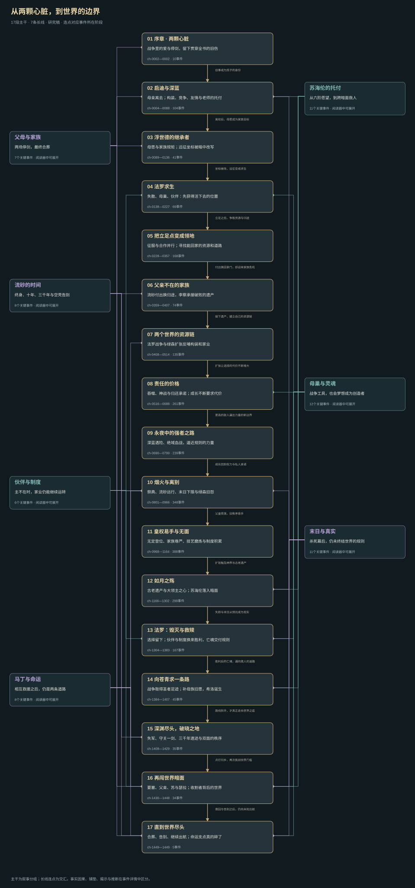

# 《罪恶之城》剧情总览研究稿

烟雨江南《罪恶之城》的叙事主干与长线交汇概览。

17段主干按叙事阶段组织，7条长线的连点来自实际事件所在阶段。总览连线表示涉及与交汇范围；事实因果、铺垫、揭示和研究推断仍需在具体事件记录中区分。

SVG可独立查看和缩放；图内分组链接供对应阅读器使用。此处仅收录总览导出稿，人物主档、逐章证据和交互阅读器未随此稿发布。

这是研究稿。图卡解释终审、真实PC及390px手机交互、浏览器下载和用户验收尚未全部完成，不能因全书已顺读而自动视为成品。

公开文件经过范围检查：不含小说正文、私人笔记、账户信息、凭证或本机路径；未改动已有书目中标记为完成的地图。
