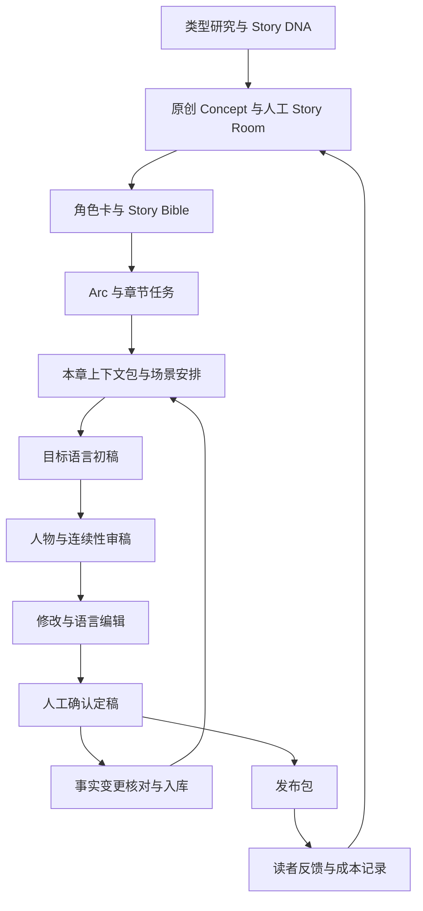

# 小说工作室本地工作架构框架 V0.1

版本：0.1

日期：2026-09-12

状态：初版设计，可用于组织试运行；尚未实现自动化，也尚未验证生产效率。

## 1. 目标与依据

本框架依据《本土小说改编 V1.0》修改版白皮书，以及随后讨论的本地工作流修订。以 Character Cards 与 Story Bible 为核心，建立从原创设计、目标语言写作、审稿定稿到反馈复盘的文件工作流。

第一阶段要证明：一部小说能够逐章产出，在更换会话后仍能恢复准确上下文，且人工编辑成本与问题来源可被记录。

白皮书中市场数据、平台合同和收入数字不作为本框架的已验证事实。实施发布前另行核查。本文只定义发布准备与反馈接口。

### 1.1 初版假设

- 小团队运行：负责人、故事编辑、目标语言母语编辑；前两项可以由同一人承担。
- 内部策划语言为中文，正文直接使用选定目标语言。
- 白皮书正文提出墨西哥优先的拉美西语路线，后续讨论转向巴西。本框架暂以巴西 `pt-BR` 为试运行假设，作品立项时必须明确；若选择墨西哥，则使用相应西语规范，不能沿用葡语规范。
- 文件保存在本地；这不表示模型离线运行。
- 首轮完成一部作品前5章，再决定扩大到多个概念或更长连载。

### 1.2 架构选择

| 方案 | 适用情况 | 取舍 |
|---|---|---|
| 本地文件工作台，初版采用 | 小团队、流程尚在调整 | 易阅读、易修改、易追溯；需要明确维护责任 |
| 文件加脚本 | 已有重复且稳定的机械操作 | 自动整理上下文、检查字段、导出稿件；需要维护脚本 |
| 数据库加工作流应用 | 多作品协作出现明确瓶颈 | 检索与统计更强，建设和维护成本更高 |

## 2. 总体架构



架构划分为五层：

| 层 | 职责 | 核心交付物 | 最终负责人 |
|---|---|---|---|
| 选题设计 | 定义读者、情绪承诺、原创冲突 | Concept、Story DNA 分析、决策记录 | 负责人 |
| 故事资产 | 约束人物、关系、世界和发展方向 | 角色卡、Bible、Arc | 故事编辑 |
| 章节生产 | 把已确定结构变成可读正文 | 章节任务、场景、初稿、审稿、定稿 | 故事编辑 |
| 状态与版本 | 维护已发生事实和版本依据 | 时间线、秘密表、关系状态、变更记录 | 故事编辑 |
| 发布与反馈 | 输出作品材料并记录实际反馈 | 发布包、反馈、生产成本、复盘 | 负责人 |

## 3. 本地目录设计

以下为目标目录设计，不表示已经创建全部文件。当前交付物是本框架文档。

```text
Novel/
  docs/
    工作架构框架-v0.1.md
  workflow/
    production-sop.md              逐章操作规程
    review-rules.md                审稿规则与严重度
    templates/                    文件模板
    prompts/                      经试运行的任务指令及版本
  library/
    story-dna.md                   类型机制与原创分析
    narrative-patterns.md          冲突、回报和人物变化经验
    localization/                 按语言区分的编辑经验
  books/
    book-001/
      project.md                  定位、语言、状态、下一步
      concept.md                  题材、读者、独特冲突
      bible.md                    故事承诺与整体约束
      characters.md               核心角色卡
      world.md                    已采用世界规则
      style.md                    叙述与目标语言规范
      decisions.md                已采用或否决的重要决策
      outline/
        arc-01.md                 当前阶段规划
        reveal-plan.md            未来揭密计划
      canon/
        timeline.md               已发生时间线
        secrets.md                实际知情状态
        relationships.md          当前关系与变化依据
        chapter-index.md          定稿索引与摘要
      chapters/
        ch001/
          brief.md                章节任务
          context.md              本次写作使用的资料与版本
          beats.md                场景安排
          draft.md                当前工作稿
          review.md               问题证据及处理结果
          final.md                人工确认定稿
          delta.md                相对上一章的事实变化
      publishing/
        pitch.md                  标题、简介、定位与样章说明
        release-log.md            发布版本与渠道记录
        feedback.md               实际反馈及来源
        production-log.md         工时、成本与返工原因
      exports/                    对外输出的版本快照
```

共用库只保存经过归纳的经验。作品事实只存在于该作品目录中，避免不同小说的人物和情节相互污染。

## 4. 核心故事资产

### 4.1 Concept

必填项：目标市场与语言、类型、目标读者、情绪承诺、核心人物冲突、故事独特之处、预期产品形态。

立项检查：能否说明人物为何必须行动，以及冲突如何持续发展。热门标签组合不能替代故事发动机。

### 4.2 Character Cards：三轮构建

1. 结构设计：身份、表层目标、深层需要、恐惧、缺陷、能力、资源、秘密、矛盾、压力反应、说话方式。
2. 关系压力测试：提出能够同时推动双方目标、又加剧关系冲突的事件，人工筛选。
3. 极端场景测试：检验人物面对羞辱、背叛、机会时是否具有可解释的一致性。

底线采用“默认不会做什么，以及突破底线所需的铺垫和代价”。人物成长必须有依据，不能将所有变化都判成漂移。

### 4.3 Story Bible

保留六项：Story Promise、Main Characters、Core Relationships、Story Engine、Transformation、Ending Direction。

Bible 定义长期约束，不复制每章细节。角色完整资料引用角色卡，实际发生事件引用 canon，减少重复维护。

### 4.4 辅助资产

| 对象 | 最小字段 | 更新时机 |
|---|---|---|
| Story DNA | 读者幻想、情绪承诺、权力关系、主冲突、回报循环、分析来源 | 选题及复盘 |
| Arc | 起始状态、目标、升级、转折、结束状态、预期范围 | 阶段设计与重大修改 |
| World Bible | 规则、适用范围、限制、首次使用依据 | 采用新规则时 |
| Timeline | 事件ID、故事时间、事件、人物、来源章节与场景 | 定稿后 |
| Secret Table | 秘密ID、真相、各方认知、获知依据、更新章节 | 定稿后 |
| Relationship State | 人物对、信任与利益状态、冲突、变化原因、来源 | 关系变化后 |

Arc 采用白皮书提出的15—25章作为规划参考，具体可调整。首轮只细化前5章，其余保持阶段级安排。

秘密认知区分“不知道、怀疑、确信、误以为”。读者也作为独立知情方；误解须写清错误信念。

## 5. 事实与计划的管理规则

### 5.1 三类信息分开

- 固定设定：人物核心、世界规则、叙述约束。
- 未来计划：Arc、未发生场景、预计揭密时间。
- 已发生事实：定稿中实际出现的事件、人物认知与关系变化。

计划揭密章节存于 outline，不能直接改写 canon 中的知情状态。

### 5.2 冲突处理

定稿正文是已发生事实的依据，摘要与表格是派生资料。两者冲突时，查定稿原文。

正文若与已批准设定冲突，必须由编辑决定修改正文或正式调整设定，并记录影响。不能以任一文件优先为由自动抹平冲突。

尚未定稿的情节不得进入正式 canon。没有查到依据时标记“未确认”，不能补写事实。

### 5.3 改稿传播

修改已定稿章节时记录旧版本、新版本、修改原因和受影响章节。重新提取 delta，修复相应 canon，并将依赖旧事实的后续章节标为“待复核”。

发布版本保留快照；本地改稿不能被视为平台版本已更新。

## 6. 逐章生产规程

| 步骤 | 输入 | 输出 | 通过条件 |
|---|---|---|---|
| 1. 人工定章 | Bible、Arc、上一章状态 | brief | 明确本章行动、变化、回报与保留信息 |
| 2. 准备上下文 | 相关角色、canon、旧章原文 | context | 来源与版本明确，重要事实有依据 |
| 3. 场景设计 | brief、context | beats | 行动与结果有因果，视角与时间合理 |
| 4. 正文写作 | 已确认场景、语言规范 | draft | 完成章节任务，新增设定另列提案 |
| 5. 故事审稿 | draft、约束与事实 | review | 人物、时间、秘密、规则问题均有证据 |
| 6. 修改及语言编辑 | 问题清单与正文 | 修订稿 | 结构问题处理，目标语言可自然阅读 |
| 7. 人工定稿 | 修订稿、已处理问题 | final | 编辑确认；语言编辑状态如实记录 |
| 8. 状态提交 | final、上一章 canon | delta 与更新后的 canon | 事实变更逐项核对并与定稿版本对应 |

章节任务至少包含：视角、目标、阻碍、行动、转折、Reader Reward、Exit Hook、允许揭露、必须保留、结束状态。

上下文包包含全书简要约束、当前 Arc、本章相关人物、最新实际状态、上一章正文与相关旧章原文。未来情节单独标注“计划”。

新一章以已完成状态提交的上一章为基础。可以提前构思场景，但不能把未确认事实作为后续正文的基础。

### 6.1 章节状态

`planned → drafted → reviewed → revised → finalized → canon-synced`

审稿失败返回 drafted/revised；修改已定稿事实后，相关章节标记 needs-recheck。作品 project 文件记录最新完成章节及下一步。

### 6.2 人工检查点

- 批准核心人物与 Bible。
- 确认重大桥段和章节场景安排。
- 确认定稿及其事实变化。
- 决定继续、重写、暂停或终止项目。

这些是编辑工作中的检查点，可以在批次评审中完成，不要求每次机械操作都重新征求许可。

## 7. AI任务模块与自动化边界

以下是逻辑模块设计，尚未创建或安装为可调用 Skill。

| 模块 | 输入与输出 | 边界 |
|---|---|---|
| CHARACTER_ARCHITECT | 人工原型 → 角色卡与压力测试 | 输出候选，不替代编辑选择 |
| STORY_BIBLE_COMPILER | 已采用决策 → Bible | 不把未采用提案写成正式设定 |
| CHAPTER_ARCHITECT | Arc、状态、章节目标 → brief 与 beats | 不越过既定揭密边界 |
| TARGET_LANGUAGE_WRITER | 场景、上下文、style → 正文 | 按作品语言运行，新增事实单列 |
| CHARACTER_GUARD | 正文、角色约束 → 问题证据 | 不直接重写人物 |
| CONTINUITY_GUARD | 正文、canon、相关旧文 → 矛盾报告 | 无依据时标记不确定 |
| STYLE_EDITOR | 已修复结构的正文、style → 语言修订 | 不擅改情节、视角或含义 |
| CANON_UPDATER | 定稿、旧状态 → delta 草案 | 确认后才写入正式状态 |

每个模块统一记录：版本、输入要求、任务、约束、输出格式、失败条件、少量正反例。首轮先用普通文件任务指令验证，再固化为 Skill。

后续可自动化的机械动作：检查必填字段、章节编号、缺失引用、版本匹配、上下文整理、字数统计、文件导出。

故事 Hook 指叙事悬念；自动化 Hook 指流程触发动作。两者在文档中分开命名。确定性检查只能发现结构或文件问题，不能证明故事质量。

## 8. 质量与返工

| 级别 | 示例 | 处理 |
|---|---|---|
| 阻断问题 | 越权知情、重大时间矛盾、缺失关键动机 | 解决后才能定稿 |
| 重要问题 | 转折缺铺垫、章节无实际回报、人物反应缺解释 | 修改或记录保留理由 |
| 表达建议 | 重复表达、对白不自然、局部节奏 | 语言编辑处理 |

审稿记录格式：问题ID、位置、问题、依据、影响、建议、处理结果。单独的模型评分不能作为放行依据。

语言编辑后重新检查含义变化。母语编辑暂未参与的章节可以作为内部定稿，但发布包必须清楚记录该状态，不能标为已通过母语审核。

每轮同时检查：本章是否给出回报，悬念是否兑现或合理延后，人物是否有具体行动，是否反复解释同一情绪。不能把增加章节数当作质量目标。

## 9. 人员与日常协作

| 角色 | 负责事项 |
|---|---|
| 负责人 / Producer | 选题、资源投入、产品形态、阶段决策与发布 |
| Story Editor | 角色、Bible、Arc、逐章生产、canon、版本一致性 |
| Native Editor | 目标语言自然度、对白、文化合理性，标注含义变动 |
| AI | 提案、初稿、检索整理、审稿辅助和变更草案 |

建议每周一次 Story Room，讨论下一阶段关键场景、权力变化、秘密揭露与已出现的问题。每次只把采用结论写入 decisions，其余保留为候选。

日常从 project 文件恢复进度：确认版本与上一章状态，执行当前步骤，结束时记录完成项、未解决问题和下一步。依赖信息必须写入文件，不能只留在聊天里。

## 10. 发布与数据反馈接口

发布包包含：目标渠道与语言、标题、简介、类型标签、角色关系、样章、计划篇幅与更新方式、编辑状态、稿件版本。

渠道研究另行记录最新来源和核查日期。框架不预设签约成功、收益分成或发布资格。

| 数据 | 记录口径 |
|---|---|
| 单章生产成本 | 实际模型费用、编辑费用及分摊方式；订阅无法精确归因时标注估算 |
| 人工编辑时间 | 分开记录故事修改与语言修改时间 |
| 返工 | 问题类别、发生环节、处理轮次 |
| 阅读反馈 | 渠道、时间范围、版本、样本量、原始反馈 |
| 留存与转化 | 仅使用可获得且口径明确的数据；缺失记为未提供，不填零 |

连载和整本书采用不同交付标准。前5章可用于样章测试，不能被当作完整长篇成品。小样本反馈形成下一轮假设，不直接宣称市场结论。

## 11. 试运行阶段与验收

### 阶段 A：建立最小资料

交付：一份 Concept、核心角色卡、精简 Bible、第一 Arc、语言规范与初始状态。

验收：核心冲突可以持续发展，目标语言明确，主要人物行为可解释。

### 阶段 B：完成第一章闭环

交付：brief、context、beats、draft、review、final、delta 与更新后的 canon。

验收：定稿与状态对应，问题处理可追溯；必要字段确实被使用。

### 阶段 C：连续完成前5章

交付：5章内部定稿、各章变更、问题与工时记录。

验收：阻断问题已解决，人物知情有依据，章节有实际变化，语言审核状态真实。

### 阶段 D：独立恢复与第6章规划

以本地文件重新构建上下文，恢复主要人物目标、秘密状态、未完成伏笔与当前时间，再规划第6章。

验收：恢复过程不依赖历史聊天补充关键事实；发现缺口时修订资料组织方式。

### 阶段 E：决定扩展

结合人工耗时、返工类型和目标读者反馈，选择继续到10—30章、重写前段或暂停。再逐步回到白皮书的多 Concept 筛选机制。

初版不设虚构效率或收益指标。首轮记录形成基线后，再设可检验的改进目标。

## 12. 下一批具体交付物

1. 作品 project、Concept、角色卡、Bible 与 Arc 模板。
2. 章节 brief、context、review、delta 模板。
3. 时间线、秘密表、关系状态模板。
4. production-sop 与 review-rules。
5. 一部实际作品的前5章试运行记录。

先用实际作品修订模板，再将稳定步骤封装为 Skill 或脚本。扩大自动化的依据是重复操作与已验证规则，而不是预先假定全流程可以自治。

## 13. 依据与修订说明

来源：[西语网文出海架构](chatgpt-conversation://6a9f96a9-cc24-83e9-8dfb-5badf8d37fe6) 中修改后的《本土小说改编 V1.0》，重点采用第二至第四部分，并保留第五、第六部分的商业反馈接口。

相对原白皮书的本地工作流修订：

- 自动更新状态改为“定稿提取、依据核对、确认提交”。
- 未来揭密计划与实际知情状态分开保存。
- 角色底线允许有铺垫、付代价的转变。
- 增加关系状态、来源版本、改稿影响和会话恢复要求。
- 多概念商业测试之前，先完成单作品前5章的流程验证。
- 巴西葡语与墨西哥西语按作品明确选择，避免将拉美市场等同于单一语言。
